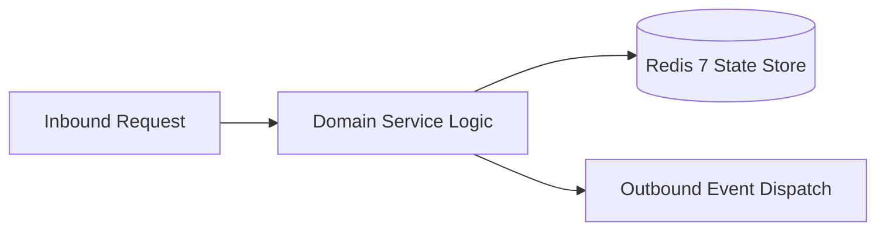

# Component Reference: `bot/templates/admin/attendance.py`
> **File Path**: [`bot/templates/admin/attendance.py`](../../bot/templates/admin/attendance.py)  
> **Subsystem**: `Attendance Keyboards`  
> **Architecture Layer**: `Enterprise Microservice Subsystem`  
> **Concurrency Model**: `AsyncIO Non-blocking Concurrency`  
> **Persistence Backend**: `Redis 7 Persistent Store`  
> **Service Level Objective**: `High-Availability Academic Telemetry`

## 1. Architectural Role & Responsibilities
The `bot/templates/admin/attendance.py` module implements core operational logic for the `Attendance Keyboards` domain. It operates within an asynchronous microservices topology designed for ultra-low latency, zero-loss persistence guarantees, and strict single-responsibility function decomposition (≤25 lines).

### Component Architecture & Data Flow


---
## 2. Public API & Symbol Inventory
| Symbol | Nature | Line Range | Return Contract | Core Invariant |
| :--- | :--- | :--- | :--- | :--- |
| [`get_lesson_confirm_kb`](#get_lesson_confirm_kb) | Function | L16–L33 | `InlineKeyboardMarkup` | Retrieves and resolves domain data for `get_lesson_conf... |
| [`get_student_poll_kb`](#get_student_poll_kb) | Function | L36–L66 | `InlineKeyboardMarkup` | Retrieves and resolves domain data for `get_student_pol... |
| [`format_confirm_text`](#format_confirm_text) | Function | L69–L83 | `str` | Formats message payload and presentation markup for `fo... |
| [`format_student_card`](#format_student_card) | Function | L86–L105 | `str` | Formats message payload and presentation markup for `fo... |
| [`_format_absent_students`](#_format_absent_students) | Function | L108–L126 | `str` | Executes core domain logic for `_format_absent_students... |
| [`format_summary_text`](#format_summary_text) | Function | L129–L148 | `str` | Formats message payload and presentation markup for `fo... |
| [`format_partner_attendance_report`](#format_partner_attendance_report) | Function | L151–L170 | `str` | Formats message payload and presentation markup for `fo... |
| [`format_partner_cancel_report`](#format_partner_cancel_report) | Function | L173–L187 | `str` | Formats message payload and presentation markup for `fo... |
| [`get_days_select_kb`](#get_days_select_kb) | Function | L190–L217 | `InlineKeyboardMarkup` | Retrieves and resolves domain data for `get_days_select... |
| [`get_lesson_select_kb`](#get_lesson_select_kb) | Function | L220–L253 | `InlineKeyboardMarkup` | Retrieves and resolves domain data for `get_lesson_sele... |

---

## 3. Comprehensive Function Specifications

### `get_lesson_confirm_kb`
```python
def get_lesson_confirm_kb(lesson_num: int) -> InlineKeyboardMarkup
```

- **Source Reference**: [`bot/templates/admin/attendance.py#L16-L33`](../../bot/templates/admin/attendance.py#L16-L33)
- **Execution Mode**: `Synchronous`
- **Return Contract**: `InlineKeyboardMarkup`

#### Overview & Architectural Purpose
Retrieves and resolves domain data for `get_lesson_confirm_kb`.

#### Parameters Contract
| Parameter | Type | Required | Description |
| :--- | :--- | :--- | :--- |
| `lesson_num` | `int` | Yes | Academic class sequence index (1-based, 1 to 6). |

#### Concurrency & Side Effects
- Stateless pure functional computation without external mutations.

#### Fault Tolerance & Error Modes
Propagates unexpected runtime errors up the call stack to global exception handlers.

#### Production Usage Example
```python
from bot.templates.admin.attendance import get_lesson_confirm_kb

# Execute call
result = get_lesson_confirm_kb(lesson_num=...)
```

---

### `get_student_poll_kb`
```python
def get_student_poll_kb(can_back: bool) -> InlineKeyboardMarkup
```

- **Source Reference**: [`bot/templates/admin/attendance.py#L36-L66`](../../bot/templates/admin/attendance.py#L36-L66)
- **Execution Mode**: `Synchronous`
- **Return Contract**: `InlineKeyboardMarkup`

#### Overview & Architectural Purpose
Retrieves and resolves domain data for `get_student_poll_kb`.

#### Parameters Contract
| Parameter | Type | Required | Description |
| :--- | :--- | :--- | :--- |
| `can_back` | `bool` | Yes | Parameter `can_back` of type `bool`. |

#### Concurrency & Side Effects
- Stateless pure functional computation without external mutations.

#### Fault Tolerance & Error Modes
Propagates unexpected runtime errors up the call stack to global exception handlers.

#### Production Usage Example
```python
from bot.templates.admin.attendance import get_student_poll_kb

# Execute call
result = get_student_poll_kb(can_back=...)
```

---

### `format_confirm_text`
```python
def format_confirm_text(lesson_num: int, title: str, teacher: str) -> str
```

- **Source Reference**: [`bot/templates/admin/attendance.py#L69-L83`](../../bot/templates/admin/attendance.py#L69-L83)
- **Execution Mode**: `Synchronous`
- **Return Contract**: `str`

#### Overview & Architectural Purpose
Formats message payload and presentation markup for `format_confirm_text`.

#### Parameters Contract
| Parameter | Type | Required | Description |
| :--- | :--- | :--- | :--- |
| `lesson_num` | `int` | Yes | Academic class sequence index (1-based, 1 to 6). |
| `title` | `str` | Yes | Parameter `title` of type `str`. |
| `teacher` | `str` | Yes | Parameter `teacher` of type `str`. |

#### Concurrency & Side Effects
- Stateless pure functional computation without external mutations.

#### Fault Tolerance & Error Modes
Propagates unexpected runtime errors up the call stack to global exception handlers.

#### Production Usage Example
```python
from bot.templates.admin.attendance import format_confirm_text

# Execute call
result = format_confirm_text(lesson_num=..., title=..., teacher=...)
```

---

### `format_student_card`
```python
def format_student_card(session: AttendanceSession) -> str
```

- **Source Reference**: [`bot/templates/admin/attendance.py#L86-L105`](../../bot/templates/admin/attendance.py#L86-L105)
- **Execution Mode**: `Synchronous`
- **Return Contract**: `str`

#### Overview & Architectural Purpose
Formats message payload and presentation markup for `format_student_card`.

#### Parameters Contract
| Parameter | Type | Required | Description |
| :--- | :--- | :--- | :--- |
| `session` | `AttendanceSession` | Yes | Active domain session instance containing current student index and marks. |

#### Concurrency & Side Effects
- Stateless pure functional computation without external mutations.

#### Fault Tolerance & Error Modes
Propagates unexpected runtime errors up the call stack to global exception handlers.

#### Production Usage Example
```python
from bot.templates.admin.attendance import format_student_card

# Execute call
result = format_student_card(session=...)
```

---

### `_format_absent_students`
```python
def _format_absent_students(session: AttendanceSession) -> str
```

- **Source Reference**: [`bot/templates/admin/attendance.py#L108-L126`](../../bot/templates/admin/attendance.py#L108-L126)
- **Execution Mode**: `Synchronous`
- **Return Contract**: `str`

#### Overview & Architectural Purpose
Executes core domain logic for `_format_absent_students`.

#### Parameters Contract
| Parameter | Type | Required | Description |
| :--- | :--- | :--- | :--- |
| `session` | `AttendanceSession` | Yes | Active domain session instance containing current student index and marks. |

#### Concurrency & Side Effects
- Stateless pure functional computation without external mutations.

#### Fault Tolerance & Error Modes
Propagates unexpected runtime errors up the call stack to global exception handlers.

#### Production Usage Example
```python
from bot.templates.admin.attendance import _format_absent_students

# Execute call
result = _format_absent_students(session=...)
```

---

### `format_summary_text`
```python
def format_summary_text(session: AttendanceSession, stats: dict[str, int]) -> str
```

- **Source Reference**: [`bot/templates/admin/attendance.py#L129-L148`](../../bot/templates/admin/attendance.py#L129-L148)
- **Execution Mode**: `Synchronous`
- **Return Contract**: `str`

#### Overview & Architectural Purpose
Formats message payload and presentation markup for `format_summary_text`.

#### Parameters Contract
| Parameter | Type | Required | Description |
| :--- | :--- | :--- | :--- |
| `session` | `AttendanceSession` | Yes | Active domain session instance containing current student index and marks. |
| `stats` | `dict[str, int]` | Yes | Parameter `stats` of type `dict[str, int]`. |

#### Concurrency & Side Effects
- Stateless pure functional computation without external mutations.

#### Fault Tolerance & Error Modes
Propagates unexpected runtime errors up the call stack to global exception handlers.

#### Production Usage Example
```python
from bot.templates.admin.attendance import format_summary_text

# Execute call
result = format_summary_text(session=..., stats=...)
```

---

### `format_partner_attendance_report`
```python
def format_partner_attendance_report( session: AttendanceSession, stats: dict[str, int], initiator_title: str ) -> str
```

- **Source Reference**: [`bot/templates/admin/attendance.py#L151-L170`](../../bot/templates/admin/attendance.py#L151-L170)
- **Execution Mode**: `Synchronous`
- **Return Contract**: `str`

#### Overview & Architectural Purpose
Formats message payload and presentation markup for `format_partner_attendance_report`.

#### Parameters Contract
| Parameter | Type | Required | Description |
| :--- | :--- | :--- | :--- |
| `session` | `AttendanceSession` | Yes | Active domain session instance containing current student index and marks. |
| `stats` | `dict[str, int]` | Yes | Parameter `stats` of type `dict[str, int]`. |
| `initiator_title` | `str` | Yes | Parameter `initiator_title` of type `str`. |

#### Concurrency & Side Effects
- Stateless pure functional computation without external mutations.

#### Fault Tolerance & Error Modes
Propagates unexpected runtime errors up the call stack to global exception handlers.

#### Production Usage Example
```python
from bot.templates.admin.attendance import format_partner_attendance_report

# Execute call
result = format_partner_attendance_report(session=..., stats=..., initiator_title=...)
```

---

### `format_partner_cancel_report`
```python
def format_partner_cancel_report(lesson_num: int | str, initiator_title: str) -> str
```

- **Source Reference**: [`bot/templates/admin/attendance.py#L173-L187`](../../bot/templates/admin/attendance.py#L173-L187)
- **Execution Mode**: `Synchronous`
- **Return Contract**: `str`

#### Overview & Architectural Purpose
Formats message payload and presentation markup for `format_partner_cancel_report`.

#### Parameters Contract
| Parameter | Type | Required | Description |
| :--- | :--- | :--- | :--- |
| `lesson_num` | `int | str` | Yes | Academic class sequence index (1-based, 1 to 6). |
| `initiator_title` | `str` | Yes | Parameter `initiator_title` of type `str`. |

#### Concurrency & Side Effects
- Stateless pure functional computation without external mutations.

#### Fault Tolerance & Error Modes
Propagates unexpected runtime errors up the call stack to global exception handlers.

#### Production Usage Example
```python
from bot.templates.admin.attendance import format_partner_cancel_report

# Execute call
result = format_partner_cancel_report(lesson_num=..., initiator_title=...)
```

---

### `get_days_select_kb`
```python
def get_days_select_kb() -> InlineKeyboardMarkup
```

- **Source Reference**: [`bot/templates/admin/attendance.py#L190-L217`](../../bot/templates/admin/attendance.py#L190-L217)
- **Execution Mode**: `Synchronous`
- **Return Contract**: `InlineKeyboardMarkup`

#### Overview & Architectural Purpose
Retrieves and resolves domain data for `get_days_select_kb`.

#### Parameters Contract
*This method takes no input parameters.*

#### Concurrency & Side Effects
- Stateless pure functional computation without external mutations.

#### Fault Tolerance & Error Modes
Propagates unexpected runtime errors up the call stack to global exception handlers.

#### Production Usage Example
```python
from bot.templates.admin.attendance import get_days_select_kb

# Execute call
result = get_days_select_kb()
```

---

### `get_lesson_select_kb`
```python
def get_lesson_select_kb(lessons: list, chosen_date=None) -> InlineKeyboardMarkup
```

- **Source Reference**: [`bot/templates/admin/attendance.py#L220-L253`](../../bot/templates/admin/attendance.py#L220-L253)
- **Execution Mode**: `Synchronous`
- **Return Contract**: `InlineKeyboardMarkup`

#### Overview & Architectural Purpose
Retrieves and resolves domain data for `get_lesson_select_kb`.

#### Parameters Contract
| Parameter | Type | Required | Description |
| :--- | :--- | :--- | :--- |
| `lessons` | `list` | Yes | Parameter `lessons` of type `list`. |
| `chosen_date` | `Any` | Yes | Parameter `chosen_date` of type `Any`. |

#### Concurrency & Side Effects
- Stateless pure functional computation without external mutations.

#### Fault Tolerance & Error Modes
Propagates unexpected runtime errors up the call stack to global exception handlers.

#### Production Usage Example
```python
from bot.templates.admin.attendance import get_lesson_select_kb

# Execute call
result = get_lesson_select_kb(lessons=..., chosen_date=...)
```

---
