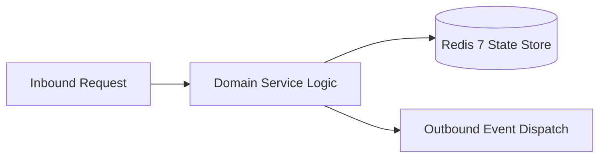

# Component Reference: `bot/templates/admin/gamification.py`
> **File Path**: [`bot/templates/admin/gamification.py`](../../bot/templates/admin/gamification.py)
> **Subsystem**: `Achievement Rules`
> **Architecture Layer**: `Enterprise Microservice Subsystem`
> **Concurrency Model**: `AsyncIO Non-blocking Concurrency`
> **Persistence Backend**: `Redis 7 Persistent Store`
> **Service Level Objective**: `High-Availability Academic Telemetry`

## 1. Architectural Role & Responsibilities
The `bot/templates/admin/gamification.py` module implements core operational logic for the `Achievement Rules` domain. It operates within an asynchronous microservices topology designed for ultra-low latency, zero-loss persistence guarantees, and strict single-responsibility function decomposition (≤25 lines).

### Component Architecture & Data Flow


---
## 2. Public API & Symbol Inventory
| Symbol | Nature | Line Range | Return Contract | Core Invariant |
| :--- | :--- | :--- | :--- | :--- |
| [`_cb`](#_cb) | Function | L60–L62 | `str` | Executes core domain logic for `_cb`. |
| [`students_ikb`](#students_ikb) | Function | L73–L86 | `InlineKeyboardMarkup` | Executes core domain logic for `students_ikb`. |
| [`student_card_text`](#student_card_text) | Function | L89–L101 | `str` | Executes core domain logic for `student_card_text`. |
| [`_bonus_row`](#_bonus_row) | Function | L104–L109 | `list[InlineKeyboardButton]` | Executes core domain logic for `_bonus_row`. |
| [`student_card_ikb`](#student_card_ikb) | Function | L112–L133 | `InlineKeyboardMarkup` | Executes core domain logic for `student_card_ikb`. |
| [`categories_ikb`](#categories_ikb) | Function | L136–L152 | `InlineKeyboardMarkup` | Executes core domain logic for `categories_ikb`. |
| [`category_achievements`](#category_achievements) | Function | L155–L159 | `list[str]` | Executes core domain logic for `category_achievements`. |
| [`category_ikb`](#category_ikb) | Function | L162–L181 | `InlineKeyboardMarkup` | Executes core domain logic for `category_ikb`. |
| [`category_text`](#category_text) | Function | L184–L189 | `str` | Executes core domain logic for `category_text`. |
| [`ask_amount_text`](#ask_amount_text) | Function | L195–L203 | `str` | Executes core domain logic for `ask_amount_text`. |
| [`ask_amount_ikb`](#ask_amount_ikb) | Function | L206–L214 | `InlineKeyboardMarkup` | Executes core domain logic for `ask_amount_ikb`. |
| [`parse_amount`](#parse_amount) | Function | L224–L239 | `tuple[bool, int] | None` | Parses and extracts structured entities from `parse_amo... |

---

## 3. Comprehensive Function Specifications

## Class Model: `GameAdminCallback`

Encapsulates domain entities and data transfer logic for `GameAdminCallback`.

## Class Model: `GameAdminState`

Encapsulates domain entities and data transfer logic for `GameAdminState`.

### `_cb`
```python
def _cb(action: str, idx: int = -1, value: str = "") -> str
```

- **Source Reference**: [`bot/templates/admin/gamification.py#L60-L62`](../../bot/templates/admin/gamification.py#L60-L62)
- **Execution Mode**: `Synchronous`
- **Return Contract**: `str`

#### Overview & Architectural Purpose
Executes core domain logic for `_cb`.

#### Parameters Contract
| Parameter | Type | Required | Description |
| :--- | :--- | :--- | :--- |
| `action` | `str` | Yes | Parameter `action` of type `str`. |
| `idx` | `int` | Yes | Parameter `idx` of type `int`. |
| `value` | `str` | Yes | Parameter `value` of type `str`. |

#### Concurrency & Side Effects
- Stateless pure functional computation without external mutations.

#### Fault Tolerance & Error Modes
Propagates unexpected runtime errors up the call stack to global exception handlers.

#### Production Usage Example
```python
from bot.templates.admin.gamification import _cb

# Execute call
result = _cb(action=..., idx=..., value=...)
```

---

### `students_ikb`
```python
def students_ikb(students: list[StudentProfile]) -> InlineKeyboardMarkup
```

- **Source Reference**: [`bot/templates/admin/gamification.py#L73-L86`](../../bot/templates/admin/gamification.py#L73-L86)
- **Execution Mode**: `Synchronous`
- **Return Contract**: `InlineKeyboardMarkup`

#### Overview & Architectural Purpose
Executes core domain logic for `students_ikb`.

#### Parameters Contract
| Parameter | Type | Required | Description |
| :--- | :--- | :--- | :--- |
| `students` | `list[StudentProfile]` | Yes | Parameter `students` of type `list[StudentProfile]`. |

#### Concurrency & Side Effects
- Stateless pure functional computation without external mutations.

#### Fault Tolerance & Error Modes
Propagates unexpected runtime errors up the call stack to global exception handlers.

#### Production Usage Example
```python
from bot.templates.admin.gamification import students_ikb

# Execute call
result = students_ikb(students=...)
```

---

### `student_card_text`
```python
def student_card_text(p: StudentProfile, xp_bonus: int, guild_bonus: int) -> str
```

- **Source Reference**: [`bot/templates/admin/gamification.py#L89-L101`](../../bot/templates/admin/gamification.py#L89-L101)
- **Execution Mode**: `Synchronous`
- **Return Contract**: `str`

#### Overview & Architectural Purpose
Executes core domain logic for `student_card_text`.

#### Parameters Contract
| Parameter | Type | Required | Description |
| :--- | :--- | :--- | :--- |
| `p` | `StudentProfile` | Yes | Parameter `p` of type `StudentProfile`. |
| `xp_bonus` | `int` | Yes | Parameter `xp_bonus` of type `int`. |
| `guild_bonus` | `int` | Yes | Parameter `guild_bonus` of type `int`. |

#### Concurrency & Side Effects
- Stateless pure functional computation without external mutations.

#### Fault Tolerance & Error Modes
Propagates unexpected runtime errors up the call stack to global exception handlers.

#### Production Usage Example
```python
from bot.templates.admin.gamification import student_card_text

# Execute call
result = student_card_text(p=..., xp_bonus=..., guild_bonus=...)
```

---

### `_bonus_row`
```python
def _bonus_row(idx: int, kind: str) -> list[InlineKeyboardButton]
```

- **Source Reference**: [`bot/templates/admin/gamification.py#L104-L109`](../../bot/templates/admin/gamification.py#L104-L109)
- **Execution Mode**: `Synchronous`
- **Return Contract**: `list[InlineKeyboardButton]`

#### Overview & Architectural Purpose
Executes core domain logic for `_bonus_row`.

#### Parameters Contract
| Parameter | Type | Required | Description |
| :--- | :--- | :--- | :--- |
| `idx` | `int` | Yes | Parameter `idx` of type `int`. |
| `kind` | `str` | Yes | Parameter `kind` of type `str`. |

#### Concurrency & Side Effects
- Stateless pure functional computation without external mutations.

#### Fault Tolerance & Error Modes
Propagates unexpected runtime errors up the call stack to global exception handlers.

#### Production Usage Example
```python
from bot.templates.admin.gamification import _bonus_row

# Execute call
result = _bonus_row(idx=..., kind=...)
```

---

### `student_card_ikb`
```python
def student_card_ikb(idx: int) -> InlineKeyboardMarkup
```

- **Source Reference**: [`bot/templates/admin/gamification.py#L112-L133`](../../bot/templates/admin/gamification.py#L112-L133)
- **Execution Mode**: `Synchronous`
- **Return Contract**: `InlineKeyboardMarkup`

#### Overview & Architectural Purpose
Executes core domain logic for `student_card_ikb`.

#### Parameters Contract
| Parameter | Type | Required | Description |
| :--- | :--- | :--- | :--- |
| `idx` | `int` | Yes | Parameter `idx` of type `int`. |

#### Concurrency & Side Effects
- Stateless pure functional computation without external mutations.

#### Fault Tolerance & Error Modes
Propagates unexpected runtime errors up the call stack to global exception handlers.

#### Production Usage Example
```python
from bot.templates.admin.gamification import student_card_ikb

# Execute call
result = student_card_ikb(idx=...)
```

---

### `categories_ikb`
```python
def categories_ikb(idx: int, unlocked: list[str]) -> InlineKeyboardMarkup
```

- **Source Reference**: [`bot/templates/admin/gamification.py#L136-L152`](../../bot/templates/admin/gamification.py#L136-L152)
- **Execution Mode**: `Synchronous`
- **Return Contract**: `InlineKeyboardMarkup`

#### Overview & Architectural Purpose
Executes core domain logic for `categories_ikb`.

#### Parameters Contract
| Parameter | Type | Required | Description |
| :--- | :--- | :--- | :--- |
| `idx` | `int` | Yes | Parameter `idx` of type `int`. |
| `unlocked` | `list[str]` | Yes | Parameter `unlocked` of type `list[str]`. |

#### Concurrency & Side Effects
- Stateless pure functional computation without external mutations.

#### Fault Tolerance & Error Modes
Propagates unexpected runtime errors up the call stack to global exception handlers.

#### Production Usage Example
```python
from bot.templates.admin.gamification import categories_ikb

# Execute call
result = categories_ikb(idx=..., unlocked=...)
```

---

### `category_achievements`
```python
def category_achievements(category: str) -> list[str]
```

- **Source Reference**: [`bot/templates/admin/gamification.py#L155-L159`](../../bot/templates/admin/gamification.py#L155-L159)
- **Execution Mode**: `Synchronous`
- **Return Contract**: `list[str]`

#### Overview & Architectural Purpose
Executes core domain logic for `category_achievements`.

#### Parameters Contract
| Parameter | Type | Required | Description |
| :--- | :--- | :--- | :--- |
| `category` | `str` | Yes | Parameter `category` of type `str`. |

#### Concurrency & Side Effects
- Stateless pure functional computation without external mutations.

#### Fault Tolerance & Error Modes
Propagates unexpected runtime errors up the call stack to global exception handlers.

#### Production Usage Example
```python
from bot.templates.admin.gamification import category_achievements

# Execute call
result = category_achievements(category=...)
```

---

### `category_ikb`
```python
def category_ikb(idx: int, category: str, unlocked: list[str]) -> InlineKeyboardMarkup
```

- **Source Reference**: [`bot/templates/admin/gamification.py#L162-L181`](../../bot/templates/admin/gamification.py#L162-L181)
- **Execution Mode**: `Synchronous`
- **Return Contract**: `InlineKeyboardMarkup`

#### Overview & Architectural Purpose
Executes core domain logic for `category_ikb`.

#### Parameters Contract
| Parameter | Type | Required | Description |
| :--- | :--- | :--- | :--- |
| `idx` | `int` | Yes | Parameter `idx` of type `int`. |
| `category` | `str` | Yes | Parameter `category` of type `str`. |
| `unlocked` | `list[str]` | Yes | Parameter `unlocked` of type `list[str]`. |

#### Concurrency & Side Effects
- Stateless pure functional computation without external mutations.

#### Fault Tolerance & Error Modes
Propagates unexpected runtime errors up the call stack to global exception handlers.

#### Production Usage Example
```python
from bot.templates.admin.gamification import category_ikb

# Execute call
result = category_ikb(idx=..., category=..., unlocked=...)
```

---

### `category_text`
```python
def category_text(p: StudentProfile, category: str) -> str
```

- **Source Reference**: [`bot/templates/admin/gamification.py#L184-L189`](../../bot/templates/admin/gamification.py#L184-L189)
- **Execution Mode**: `Synchronous`
- **Return Contract**: `str`

#### Overview & Architectural Purpose
Executes core domain logic for `category_text`.

#### Parameters Contract
| Parameter | Type | Required | Description |
| :--- | :--- | :--- | :--- |
| `p` | `StudentProfile` | Yes | Parameter `p` of type `StudentProfile`. |
| `category` | `str` | Yes | Parameter `category` of type `str`. |

#### Concurrency & Side Effects
- Stateless pure functional computation without external mutations.

#### Fault Tolerance & Error Modes
Propagates unexpected runtime errors up the call stack to global exception handlers.

#### Production Usage Example
```python
from bot.templates.admin.gamification import category_text

# Execute call
result = category_text(p=..., category=...)
```

---

### `ask_amount_text`
```python
def ask_amount_text(student: str, kind: str) -> str
```

- **Source Reference**: [`bot/templates/admin/gamification.py#L195-L203`](../../bot/templates/admin/gamification.py#L195-L203)
- **Execution Mode**: `Synchronous`
- **Return Contract**: `str`

#### Overview & Architectural Purpose
Executes core domain logic for `ask_amount_text`.

#### Parameters Contract
| Parameter | Type | Required | Description |
| :--- | :--- | :--- | :--- |
| `student` | `str` | Yes | Parameter `student` of type `str`. |
| `kind` | `str` | Yes | Parameter `kind` of type `str`. |

#### Concurrency & Side Effects
- Stateless pure functional computation without external mutations.

#### Fault Tolerance & Error Modes
Propagates unexpected runtime errors up the call stack to global exception handlers.

#### Production Usage Example
```python
from bot.templates.admin.gamification import ask_amount_text

# Execute call
result = ask_amount_text(student=..., kind=...)
```

---

### `ask_amount_ikb`
```python
def ask_amount_ikb(idx: int) -> InlineKeyboardMarkup
```

- **Source Reference**: [`bot/templates/admin/gamification.py#L206-L214`](../../bot/templates/admin/gamification.py#L206-L214)
- **Execution Mode**: `Synchronous`
- **Return Contract**: `InlineKeyboardMarkup`

#### Overview & Architectural Purpose
Executes core domain logic for `ask_amount_ikb`.

#### Parameters Contract
| Parameter | Type | Required | Description |
| :--- | :--- | :--- | :--- |
| `idx` | `int` | Yes | Parameter `idx` of type `int`. |

#### Concurrency & Side Effects
- Stateless pure functional computation without external mutations.

#### Fault Tolerance & Error Modes
Propagates unexpected runtime errors up the call stack to global exception handlers.

#### Production Usage Example
```python
from bot.templates.admin.gamification import ask_amount_ikb

# Execute call
result = ask_amount_ikb(idx=...)
```

---

### `parse_amount`
```python
def parse_amount(text: str | None) -> tuple[bool, int] | None
```

- **Source Reference**: [`bot/templates/admin/gamification.py#L224-L239`](../../bot/templates/admin/gamification.py#L224-L239)
- **Execution Mode**: `Synchronous`
- **Return Contract**: `tuple[bool, int] | None`

#### Overview & Architectural Purpose
Parses and extracts structured entities from `parse_amount`.

#### Parameters Contract
| Parameter | Type | Required | Description |
| :--- | :--- | :--- | :--- |
| `text` | `str | None` | Yes | Parameter `text` of type `str | None`. |

#### Concurrency & Side Effects
- Stateless pure functional computation without external mutations.

#### Fault Tolerance & Error Modes
Encapsulates faults within `try/except` blocks, logging errors and returning safe fallback defaults.

#### Production Usage Example
```python
from bot.templates.admin.gamification import parse_amount

# Execute call
result = parse_amount(text=...)
```

---
