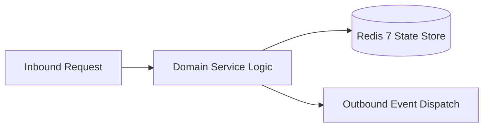

# Component Reference: `bot/templates/admin/keyboards.py`
> **File Path**: [`bot/templates/admin/keyboards.py`](../../bot/templates/admin/keyboards.py)
> **Subsystem**: `Admin Panel Keyboards`
> **Architecture Layer**: `Enterprise Microservice Subsystem`
> **Concurrency Model**: `AsyncIO Non-blocking Concurrency`
> **Persistence Backend**: `Redis 7 Persistent Store`
> **Service Level Objective**: `High-Availability Academic Telemetry`

## 1. Architectural Role & Responsibilities
The `bot/templates/admin/keyboards.py` module implements core operational logic for the `Admin Panel Keyboards` domain. It operates within an asynchronous microservices topology designed for ultra-low latency, zero-loss persistence guarantees, and strict single-responsibility function decomposition (≤25 lines).

### Component Architecture & Data Flow


---
## 2. Public API & Symbol Inventory
| Symbol | Nature | Line Range | Return Contract | Core Invariant |
| :--- | :--- | :--- | :--- | :--- |
| [`_build_topic_action_rows`](#_build_topic_action_rows) | Function | L13–L37 | `list` | Executes core domain logic for `_build_topic_action_row... |
| [`_build_action_rows`](#_build_action_rows) | Function | L40–L66 | `list` | Executes core domain logic for `_build_action_rows`. |
| [`get_admin_main_kb`](#get_admin_main_kb) | Function | L69–L79 | `InlineKeyboardMarkup` | Retrieves and resolves domain data for `get_admin_main_... |
| [`get_swagger_launch_btn`](#get_swagger_launch_btn) | Function | L82–L95 | `InlineKeyboardButton` | Retrieves and resolves domain data for `get_swagger_lau... |
| [`get_testers_management_kb`](#get_testers_management_kb) | Function | L98–L124 | `InlineKeyboardMarkup` | Retrieves and resolves domain data for `get_testers_man... |

---

## 3. Comprehensive Function Specifications

### `_build_topic_action_rows`
```python
def _build_topic_action_rows() -> list
```

- **Source Reference**: [`bot/templates/admin/keyboards.py#L13-L37`](../../bot/templates/admin/keyboards.py#L13-L37)
- **Execution Mode**: `Synchronous`
- **Return Contract**: `list`

#### Overview & Architectural Purpose
Executes core domain logic for `_build_topic_action_rows`.

#### Parameters Contract
*This method takes no input parameters.*

#### Concurrency & Side Effects
- Stateless pure functional computation without external mutations.

#### Fault Tolerance & Error Modes
Propagates unexpected runtime errors up the call stack to global exception handlers.

#### Production Usage Example
```python
from bot.templates.admin.keyboards import _build_topic_action_rows

# Execute call
result = _build_topic_action_rows()
```

---

### `_build_action_rows`
```python
def _build_action_rows() -> list
```

- **Source Reference**: [`bot/templates/admin/keyboards.py#L40-L66`](../../bot/templates/admin/keyboards.py#L40-L66)
- **Execution Mode**: `Synchronous`
- **Return Contract**: `list`

#### Overview & Architectural Purpose
Executes core domain logic for `_build_action_rows`.

#### Parameters Contract
*This method takes no input parameters.*

#### Concurrency & Side Effects
- Stateless pure functional computation without external mutations.

#### Fault Tolerance & Error Modes
Propagates unexpected runtime errors up the call stack to global exception handlers.

#### Production Usage Example
```python
from bot.templates.admin.keyboards import _build_action_rows

# Execute call
result = _build_action_rows()
```

---

### `get_admin_main_kb`
```python
def get_admin_main_kb() -> InlineKeyboardMarkup
```

- **Source Reference**: [`bot/templates/admin/keyboards.py#L69-L79`](../../bot/templates/admin/keyboards.py#L69-L79)
- **Execution Mode**: `Synchronous`
- **Return Contract**: `InlineKeyboardMarkup`

#### Overview & Architectural Purpose
Retrieves and resolves domain data for `get_admin_main_kb`.

#### Parameters Contract
*This method takes no input parameters.*

#### Concurrency & Side Effects
- Stateless pure functional computation without external mutations.

#### Fault Tolerance & Error Modes
Propagates unexpected runtime errors up the call stack to global exception handlers.

#### Production Usage Example
```python
from bot.templates.admin.keyboards import get_admin_main_kb

# Execute call
result = get_admin_main_kb()
```

---

### `get_swagger_launch_btn`
```python
def get_swagger_launch_btn() -> InlineKeyboardButton
```

- **Source Reference**: [`bot/templates/admin/keyboards.py#L82-L95`](../../bot/templates/admin/keyboards.py#L82-L95)
- **Execution Mode**: `Synchronous`
- **Return Contract**: `InlineKeyboardButton`

#### Overview & Architectural Purpose
Retrieves and resolves domain data for `get_swagger_launch_btn`.

#### Parameters Contract
*This method takes no input parameters.*

#### Concurrency & Side Effects
- Stateless pure functional computation without external mutations.

#### Fault Tolerance & Error Modes
Propagates unexpected runtime errors up the call stack to global exception handlers.

#### Production Usage Example
```python
from bot.templates.admin.keyboards import get_swagger_launch_btn

# Execute call
result = get_swagger_launch_btn()
```

---

### `get_testers_management_kb`
```python
def get_testers_management_kb(testers: list[int]) -> InlineKeyboardMarkup
```

- **Source Reference**: [`bot/templates/admin/keyboards.py#L98-L124`](../../bot/templates/admin/keyboards.py#L98-L124)
- **Execution Mode**: `Synchronous`
- **Return Contract**: `InlineKeyboardMarkup`

#### Overview & Architectural Purpose
Retrieves and resolves domain data for `get_testers_management_kb`.

#### Parameters Contract
| Parameter | Type | Required | Description |
| :--- | :--- | :--- | :--- |
| `testers` | `list[int]` | Yes | Parameter `testers` of type `list[int]`. |

#### Concurrency & Side Effects
- Stateless pure functional computation without external mutations.

#### Fault Tolerance & Error Modes
Propagates unexpected runtime errors up the call stack to global exception handlers.

#### Production Usage Example
```python
from bot.templates.admin.keyboards import get_testers_management_kb

# Execute call
result = get_testers_management_kb(testers=...)
```

---
