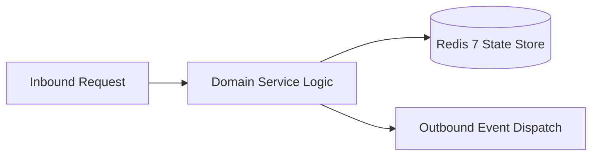

# Component Reference: `bot/templates/admin/testers.py`
> **File Path**: [`bot/templates/admin/testers.py`](../../bot/templates/admin/testers.py)
> **Subsystem**: `Tester Keyboards & States`
> **Architecture Layer**: `Enterprise Microservice Subsystem`
> **Concurrency Model**: `AsyncIO Non-blocking Concurrency`
> **Persistence Backend**: `Redis 7 Persistent Store`
> **Service Level Objective**: `High-Availability Academic Telemetry`

## 1. Architectural Role & Responsibilities
The `bot/templates/admin/testers.py` module implements core operational logic for the `Tester Keyboards & States` domain. It operates within an asynchronous microservices topology designed for ultra-low latency, zero-loss persistence guarantees, and strict single-responsibility function decomposition (≤25 lines).

### Component Architecture & Data Flow


---
## 2. Public API & Symbol Inventory
| Symbol | Nature | Line Range | Return Contract | Core Invariant |
| :--- | :--- | :--- | :--- | :--- |
| [`format_testers_text`](#format_testers_text) | Function | L20–L45 | `str` | Formats message payload and presentation markup for `fo... |
| [`get_swagger_buttons`](#get_swagger_buttons) | Function | L48–L65 | `list[InlineKeyboardButton]` | Retrieves and resolves domain data for `get_swagger_but... |
| [`get_testers_management_kb`](#get_testers_management_kb) | Function | L68–L98 | `InlineKeyboardMarkup` | Retrieves and resolves domain data for `get_testers_man... |

---

## 3. Comprehensive Function Specifications

## Class Model: `AddTesterState`

Encapsulates domain entities and data transfer logic for `AddTesterState`.

### `format_testers_text`
```python
def format_testers_text(testers: list[int], admin_key: str = "") -> str
```

- **Source Reference**: [`bot/templates/admin/testers.py#L20-L45`](../../bot/templates/admin/testers.py#L20-L45)
- **Execution Mode**: `Synchronous`
- **Return Contract**: `str`

#### Overview & Architectural Purpose
Formats message payload and presentation markup for `format_testers_text`.

#### Parameters Contract
| Parameter | Type | Required | Description |
| :--- | :--- | :--- | :--- |
| `testers` | `list[int]` | Yes | Parameter `testers` of type `list[int]`. |
| `admin_key` | `str` | Yes | Parameter `admin_key` of type `str`. |

#### Concurrency & Side Effects
- Stateless pure functional computation without external mutations.

#### Fault Tolerance & Error Modes
Propagates unexpected runtime errors up the call stack to global exception handlers.

#### Production Usage Example
```python
from bot.templates.admin.testers import format_testers_text

# Execute call
result = format_testers_text(testers=..., admin_key=...)
```

---

### `get_swagger_buttons`
```python
def get_swagger_buttons(admin_key: str = "") -> list[InlineKeyboardButton]
```

- **Source Reference**: [`bot/templates/admin/testers.py#L48-L65`](../../bot/templates/admin/testers.py#L48-L65)
- **Execution Mode**: `Synchronous`
- **Return Contract**: `list[InlineKeyboardButton]`

#### Overview & Architectural Purpose
Retrieves and resolves domain data for `get_swagger_buttons`.

#### Parameters Contract
| Parameter | Type | Required | Description |
| :--- | :--- | :--- | :--- |
| `admin_key` | `str` | Yes | Parameter `admin_key` of type `str`. |

#### Concurrency & Side Effects
- Stateless pure functional computation without external mutations.

#### Fault Tolerance & Error Modes
Propagates unexpected runtime errors up the call stack to global exception handlers.

#### Production Usage Example
```python
from bot.templates.admin.testers import get_swagger_buttons

# Execute call
result = get_swagger_buttons(admin_key=...)
```

---

### `get_testers_management_kb`
```python
def get_testers_management_kb(testers: list[int], admin_key: str = "") -> InlineKeyboardMarkup
```

- **Source Reference**: [`bot/templates/admin/testers.py#L68-L98`](../../bot/templates/admin/testers.py#L68-L98)
- **Execution Mode**: `Synchronous`
- **Return Contract**: `InlineKeyboardMarkup`

#### Overview & Architectural Purpose
Retrieves and resolves domain data for `get_testers_management_kb`.

#### Parameters Contract
| Parameter | Type | Required | Description |
| :--- | :--- | :--- | :--- |
| `testers` | `list[int]` | Yes | Parameter `testers` of type `list[int]`. |
| `admin_key` | `str` | Yes | Parameter `admin_key` of type `str`. |

#### Concurrency & Side Effects
- Stateless pure functional computation without external mutations.

#### Fault Tolerance & Error Modes
Propagates unexpected runtime errors up the call stack to global exception handlers.

#### Production Usage Example
```python
from bot.templates.admin.testers import get_testers_management_kb

# Execute call
result = get_testers_management_kb(testers=..., admin_key=...)
```

---
