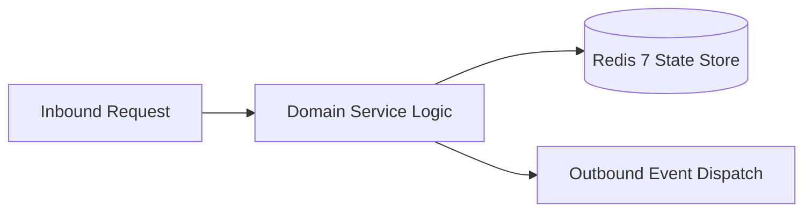

# Component Reference: `bot/templates/user/keyboards.py`
> **File Path**: [`bot/templates/user/keyboards.py`](../../bot/templates/user/keyboards.py)
> **Subsystem**: `User Inline Keyboards`
> **Architecture Layer**: `Enterprise Microservice Subsystem`
> **Concurrency Model**: `AsyncIO Non-blocking Concurrency`
> **Persistence Backend**: `Redis 7 Persistent Store`
> **Service Level Objective**: `High-Availability Academic Telemetry`

## 1. Architectural Role & Responsibilities
The `bot/templates/user/keyboards.py` module implements core operational logic for the `User Inline Keyboards` domain. It operates within an asynchronous microservices topology designed for ultra-low latency, zero-loss persistence guarantees, and strict single-responsibility function decomposition (≤25 lines).

### Component Architecture & Data Flow


---
## 2. Public API & Symbol Inventory
| Symbol | Nature | Line Range | Return Contract | Core Invariant |
| :--- | :--- | :--- | :--- | :--- |
| [`format_lesson_button_text`](#format_lesson_button_text) | Function | L14–L26 | `str` | Formats message payload and presentation markup for `fo... |
| [`chunk_link_buttons`](#chunk_link_buttons) | Function | L29–L46 | `list[list[InlineKeyboardButton]]` | Executes core domain logic for `chunk_link_buttons`. |
| [`_build_admin_nav_rows`](#_build_admin_nav_rows) | Function | L49–L68 | `list[list[InlineKeyboardButton]]` | Executes core domain logic for `_build_admin_nav_rows`. |
| [`_build_calendar_rows`](#_build_calendar_rows) | Function | L71–L90 | `list[list[InlineKeyboardButton]]` | Executes core domain logic for `_build_calendar_rows`. |
| [`_build_nav_rows`](#_build_nav_rows) | Function | L93–L106 | `list[list[InlineKeyboardButton]]` | Executes core domain logic for `_build_nav_rows`. |
| [`get_schedule_inline_kb`](#get_schedule_inline_kb) | Function | L109–L120 | `InlineKeyboardMarkup` | Retrieves and resolves domain data for `get_schedule_in... |
| [`get_tester_cabinet_kb`](#get_tester_cabinet_kb) | Function | L123–L140 | `InlineKeyboardMarkup` | Retrieves and resolves domain data for `get_tester_cabi... |
| [`get_topic_inline_kb`](#get_topic_inline_kb) | Function | L143–L158 | `InlineKeyboardMarkup | None` | Retrieves and resolves domain data for `get_topic_inlin... |
| [`get_notice_settings_kb`](#get_notice_settings_kb) | Function | L161–L178 | `InlineKeyboardMarkup` | Retrieves and resolves domain data for `get_notice_sett... |

---

## 3. Comprehensive Function Specifications

### `format_lesson_button_text`
```python
def format_lesson_button_text(lesson: Lesson) -> str
```

- **Source Reference**: [`bot/templates/user/keyboards.py#L14-L26`](../../bot/templates/user/keyboards.py#L14-L26)
- **Execution Mode**: `Synchronous`
- **Return Contract**: `str`

#### Overview & Architectural Purpose
Formats message payload and presentation markup for `format_lesson_button_text`.

#### Parameters Contract
| Parameter | Type | Required | Description |
| :--- | :--- | :--- | :--- |
| `lesson` | `Lesson` | Yes | Parameter `lesson` of type `Lesson`. |

#### Concurrency & Side Effects
- Stateless pure functional computation without external mutations.

#### Fault Tolerance & Error Modes
Propagates unexpected runtime errors up the call stack to global exception handlers.

#### Production Usage Example
```python
from bot.templates.user.keyboards import format_lesson_button_text

# Execute call
result = format_lesson_button_text(lesson=...)
```

---

### `chunk_link_buttons`
```python
def chunk_link_buttons(lessons: list[Lesson]) -> list[list[InlineKeyboardButton]]
```

- **Source Reference**: [`bot/templates/user/keyboards.py#L29-L46`](../../bot/templates/user/keyboards.py#L29-L46)
- **Execution Mode**: `Synchronous`
- **Return Contract**: `list[list[InlineKeyboardButton]]`

#### Overview & Architectural Purpose
Executes core domain logic for `chunk_link_buttons`.

#### Parameters Contract
| Parameter | Type | Required | Description |
| :--- | :--- | :--- | :--- |
| `lessons` | `list[Lesson]` | Yes | Parameter `lessons` of type `list[Lesson]`. |

#### Concurrency & Side Effects
- Stateless pure functional computation without external mutations.

#### Fault Tolerance & Error Modes
Propagates unexpected runtime errors up the call stack to global exception handlers.

#### Production Usage Example
```python
from bot.templates.user.keyboards import chunk_link_buttons

# Execute call
result = chunk_link_buttons(lessons=...)
```

---

### `_build_admin_nav_rows`
```python
def _build_admin_nav_rows(is_admin: bool, is_attendance_admin: bool) -> list[list[InlineKeyboardButton]]
```

- **Source Reference**: [`bot/templates/user/keyboards.py#L49-L68`](../../bot/templates/user/keyboards.py#L49-L68)
- **Execution Mode**: `Synchronous`
- **Return Contract**: `list[list[InlineKeyboardButton]]`

#### Overview & Architectural Purpose
Executes core domain logic for `_build_admin_nav_rows`.

#### Parameters Contract
| Parameter | Type | Required | Description |
| :--- | :--- | :--- | :--- |
| `is_admin` | `bool` | Yes | Parameter `is_admin` of type `bool`. |
| `is_attendance_admin` | `bool` | Yes | Parameter `is_attendance_admin` of type `bool`. |

#### Concurrency & Side Effects
- Stateless pure functional computation without external mutations.

#### Fault Tolerance & Error Modes
Propagates unexpected runtime errors up the call stack to global exception handlers.

#### Production Usage Example
```python
from bot.templates.user.keyboards import _build_admin_nav_rows

# Execute call
result = _build_admin_nav_rows(is_admin=..., is_attendance_admin=...)
```

---

### `_build_calendar_rows`
```python
def _build_calendar_rows(week_offset: int, is_subscribed: bool) -> list[list[InlineKeyboardButton]]
```

- **Source Reference**: [`bot/templates/user/keyboards.py#L71-L90`](../../bot/templates/user/keyboards.py#L71-L90)
- **Execution Mode**: `Synchronous`
- **Return Contract**: `list[list[InlineKeyboardButton]]`

#### Overview & Architectural Purpose
Executes core domain logic for `_build_calendar_rows`.

#### Parameters Contract
| Parameter | Type | Required | Description |
| :--- | :--- | :--- | :--- |
| `week_offset` | `int` | Yes | Parameter `week_offset` of type `int`. |
| `is_subscribed` | `bool` | Yes | Parameter `is_subscribed` of type `bool`. |

#### Concurrency & Side Effects
- Stateless pure functional computation without external mutations.

#### Fault Tolerance & Error Modes
Propagates unexpected runtime errors up the call stack to global exception handlers.

#### Production Usage Example
```python
from bot.templates.user.keyboards import _build_calendar_rows

# Execute call
result = _build_calendar_rows(week_offset=..., is_subscribed=...)
```

---

### `_build_nav_rows`
```python
def _build_nav_rows( week_offset: int, is_admin: bool = False, is_subscribed: bool = True, is_attendance_admin: bool = False, is_tester: bool = False, ) -> list[list[InlineKeyboardButton]]
```

- **Source Reference**: [`bot/templates/user/keyboards.py#L93-L106`](../../bot/templates/user/keyboards.py#L93-L106)
- **Execution Mode**: `Synchronous`
- **Return Contract**: `list[list[InlineKeyboardButton]]`

#### Overview & Architectural Purpose
Executes core domain logic for `_build_nav_rows`.

#### Parameters Contract
| Parameter | Type | Required | Description |
| :--- | :--- | :--- | :--- |
| `week_offset` | `int` | Yes | Parameter `week_offset` of type `int`. |
| `is_admin` | `bool` | Yes | Parameter `is_admin` of type `bool`. |
| `is_subscribed` | `bool` | Yes | Parameter `is_subscribed` of type `bool`. |
| `is_attendance_admin` | `bool` | Yes | Parameter `is_attendance_admin` of type `bool`. |
| `is_tester` | `bool` | Yes | Parameter `is_tester` of type `bool`. |

#### Concurrency & Side Effects
- Stateless pure functional computation without external mutations.

#### Fault Tolerance & Error Modes
Propagates unexpected runtime errors up the call stack to global exception handlers.

#### Production Usage Example
```python
from bot.templates.user.keyboards import _build_nav_rows

# Execute call
result = _build_nav_rows(week_offset=..., is_admin=..., is_subscribed=...)
```

---

### `get_schedule_inline_kb`
```python
def get_schedule_inline_kb( lessons: list[Lesson] | None = None, week_offset: int = 0, is_admin: bool = False, is_subscribed: bool = True, is_attendance_admin: bool = False, is_tester: bool = False, ) -> InlineKeyboardMarkup
```

- **Source Reference**: [`bot/templates/user/keyboards.py#L109-L120`](../../bot/templates/user/keyboards.py#L109-L120)
- **Execution Mode**: `Synchronous`
- **Return Contract**: `InlineKeyboardMarkup`

#### Overview & Architectural Purpose
Retrieves and resolves domain data for `get_schedule_inline_kb`.

#### Parameters Contract
| Parameter | Type | Required | Description |
| :--- | :--- | :--- | :--- |
| `lessons` | `list[Lesson] | None` | Yes | Parameter `lessons` of type `list[Lesson] | None`. |
| `week_offset` | `int` | Yes | Parameter `week_offset` of type `int`. |
| `is_admin` | `bool` | Yes | Parameter `is_admin` of type `bool`. |
| `is_subscribed` | `bool` | Yes | Parameter `is_subscribed` of type `bool`. |
| `is_attendance_admin` | `bool` | Yes | Parameter `is_attendance_admin` of type `bool`. |
| `is_tester` | `bool` | Yes | Parameter `is_tester` of type `bool`. |

#### Concurrency & Side Effects
- Stateless pure functional computation without external mutations.

#### Fault Tolerance & Error Modes
Propagates unexpected runtime errors up the call stack to global exception handlers.

#### Production Usage Example
```python
from bot.templates.user.keyboards import get_schedule_inline_kb

# Execute call
result = get_schedule_inline_kb(lessons=..., week_offset=..., is_admin=...)
```

---

### `get_tester_cabinet_kb`
```python
def get_tester_cabinet_kb(tester_key: str | None = None) -> InlineKeyboardMarkup
```

- **Source Reference**: [`bot/templates/user/keyboards.py#L123-L140`](../../bot/templates/user/keyboards.py#L123-L140)
- **Execution Mode**: `Synchronous`
- **Return Contract**: `InlineKeyboardMarkup`

#### Overview & Architectural Purpose
Retrieves and resolves domain data for `get_tester_cabinet_kb`.

#### Parameters Contract
| Parameter | Type | Required | Description |
| :--- | :--- | :--- | :--- |
| `tester_key` | `str | None` | Yes | Parameter `tester_key` of type `str | None`. |

#### Concurrency & Side Effects
- Stateless pure functional computation without external mutations.

#### Fault Tolerance & Error Modes
Propagates unexpected runtime errors up the call stack to global exception handlers.

#### Production Usage Example
```python
from bot.templates.user.keyboards import get_tester_cabinet_kb

# Execute call
result = get_tester_cabinet_kb(tester_key=...)
```

---

### `get_topic_inline_kb`
```python
def get_topic_inline_kb(lessons: list[Lesson] | None = None) -> InlineKeyboardMarkup | None
```

- **Source Reference**: [`bot/templates/user/keyboards.py#L143-L158`](../../bot/templates/user/keyboards.py#L143-L158)
- **Execution Mode**: `Synchronous`
- **Return Contract**: `InlineKeyboardMarkup | None`

#### Overview & Architectural Purpose
Retrieves and resolves domain data for `get_topic_inline_kb`.

#### Parameters Contract
| Parameter | Type | Required | Description |
| :--- | :--- | :--- | :--- |
| `lessons` | `list[Lesson] | None` | Yes | Parameter `lessons` of type `list[Lesson] | None`. |

#### Concurrency & Side Effects
- Stateless pure functional computation without external mutations.

#### Fault Tolerance & Error Modes
Propagates unexpected runtime errors up the call stack to global exception handlers.

#### Production Usage Example
```python
from bot.templates.user.keyboards import get_topic_inline_kb

# Execute call
result = get_topic_inline_kb(lessons=...)
```

---

### `get_notice_settings_kb`
```python
def get_notice_settings_kb(is_subscribed: bool) -> InlineKeyboardMarkup
```

- **Source Reference**: [`bot/templates/user/keyboards.py#L161-L178`](../../bot/templates/user/keyboards.py#L161-L178)
- **Execution Mode**: `Synchronous`
- **Return Contract**: `InlineKeyboardMarkup`

#### Overview & Architectural Purpose
Retrieves and resolves domain data for `get_notice_settings_kb`.

#### Parameters Contract
| Parameter | Type | Required | Description |
| :--- | :--- | :--- | :--- |
| `is_subscribed` | `bool` | Yes | Parameter `is_subscribed` of type `bool`. |

#### Concurrency & Side Effects
- Stateless pure functional computation without external mutations.

#### Fault Tolerance & Error Modes
Propagates unexpected runtime errors up the call stack to global exception handlers.

#### Production Usage Example
```python
from bot.templates.user.keyboards import get_notice_settings_kb

# Execute call
result = get_notice_settings_kb(is_subscribed=...)
```

---
