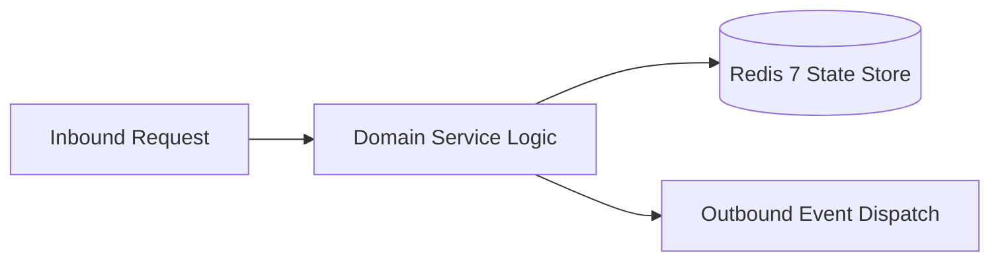

# Component Reference: `bot/templates/user/messages.py`
> **File Path**: [`bot/templates/user/messages.py`](../../bot/templates/user/messages.py)  
> **Subsystem**: `User Message Formatter`  
> **Architecture Layer**: `Enterprise Microservice Subsystem`  
> **Concurrency Model**: `AsyncIO Non-blocking Concurrency`  
> **Persistence Backend**: `Redis 7 Persistent Store`  
> **Service Level Objective**: `High-Availability Academic Telemetry`

## 1. Architectural Role & Responsibilities
The `bot/templates/user/messages.py` module implements core operational logic for the `User Message Formatter` domain. It operates within an asynchronous microservices topology designed for ultra-low latency, zero-loss persistence guarantees, and strict single-responsibility function decomposition (≤25 lines).

### Component Architecture & Data Flow


---
## 2. Public API & Symbol Inventory
| Symbol | Nature | Line Range | Return Contract | Core Invariant |
| :--- | :--- | :--- | :--- | :--- |
| [`format_lesson_card`](#format_lesson_card) | Function | L19–L43 | `str` | Formats message payload and presentation markup for `fo... |
| [`format_minutes`](#format_minutes) | Function | L47–L60 | `str` | Formats message payload and presentation markup for `fo... |
| [`_parse_time_interval_minutes`](#_parse_time_interval_minutes) | Function | L63–L71 | `tuple[int, int] | None` | Executes core domain logic for `_parse_time_interval_mi... |
| [`_check_single_lesson_status`](#_check_single_lesson_status) | Function | L74–L92 | `tuple[bool, str]` | Executes core domain logic for `_check_single_lesson_st... |
| [`get_lesson_status_banner`](#get_lesson_status_banner) | Function | L95–L115 | `str` | Retrieves and resolves domain data for `get_lesson_stat... |
| [`format_day_schedule`](#format_day_schedule) | Function | L118–L136 | `str` | Formats message payload and presentation markup for `fo... |
| [`format_week_lesson_loc`](#format_week_lesson_loc) | Function | L139–L144 | `str` | Formats message payload and presentation markup for `fo... |
| [`format_week_lesson_card`](#format_week_lesson_card) | Function | L147–L159 | `str` | Formats message payload and presentation markup for `fo... |
| [`format_week_day_block`](#format_week_day_block) | Function | L163–L171 | `str` | Formats message payload and presentation markup for `fo... |
| [`format_week_schedule`](#format_week_schedule) | Function | L174–L178 | `str` | Formats message payload and presentation markup for `fo... |
| [`format_reminder_text`](#format_reminder_text) | Function | L181–L189 | `str` | Formats message payload and presentation markup for `fo... |
| [`format_notice_settings_text`](#format_notice_settings_text) | Function | L192–L212 | `str` | Formats message payload and presentation markup for `fo... |

---

## 3. Comprehensive Function Specifications

### `format_lesson_card`
```python
def format_lesson_card(lesson: Lesson) -> str
```

- **Source Reference**: [`bot/templates/user/messages.py#L19-L43`](../../bot/templates/user/messages.py#L19-L43)
- **Execution Mode**: `Synchronous`
- **Return Contract**: `str`

#### Overview & Architectural Purpose
Formats message payload and presentation markup for `format_lesson_card`.

#### Parameters Contract
| Parameter | Type | Required | Description |
| :--- | :--- | :--- | :--- |
| `lesson` | `Lesson` | Yes | Parameter `lesson` of type `Lesson`. |

#### Concurrency & Side Effects
- Stateless pure functional computation without external mutations.

#### Fault Tolerance & Error Modes
Propagates unexpected runtime errors up the call stack to global exception handlers.

#### Production Usage Example
```python
from bot.templates.user.messages import format_lesson_card

# Execute call
result = format_lesson_card(lesson=...)
```

---

### `format_minutes`
```python
def format_minutes(total_minutes: int) -> str
```

- **Source Reference**: [`bot/templates/user/messages.py#L47-L60`](../../bot/templates/user/messages.py#L47-L60)
- **Execution Mode**: `Synchronous`
- **Return Contract**: `str`

#### Overview & Architectural Purpose
Formats message payload and presentation markup for `format_minutes`.

#### Parameters Contract
| Parameter | Type | Required | Description |
| :--- | :--- | :--- | :--- |
| `total_minutes` | `int` | Yes | Parameter `total_minutes` of type `int`. |

#### Concurrency & Side Effects
- Stateless pure functional computation without external mutations.

#### Fault Tolerance & Error Modes
Propagates unexpected runtime errors up the call stack to global exception handlers.

#### Production Usage Example
```python
from bot.templates.user.messages import format_minutes

# Execute call
result = format_minutes(total_minutes=...)
```

---

### `_parse_time_interval_minutes`
```python
def _parse_time_interval_minutes(time_str: str) -> tuple[int, int] | None
```

- **Source Reference**: [`bot/templates/user/messages.py#L63-L71`](../../bot/templates/user/messages.py#L63-L71)
- **Execution Mode**: `Synchronous`
- **Return Contract**: `tuple[int, int] | None`

#### Overview & Architectural Purpose
Executes core domain logic for `_parse_time_interval_minutes`.

#### Parameters Contract
| Parameter | Type | Required | Description |
| :--- | :--- | :--- | :--- |
| `time_str` | `str` | Yes | Parameter `time_str` of type `str`. |

#### Concurrency & Side Effects
- Stateless pure functional computation without external mutations.

#### Fault Tolerance & Error Modes
Propagates unexpected runtime errors up the call stack to global exception handlers.

#### Production Usage Example
```python
from bot.templates.user.messages import _parse_time_interval_minutes

# Execute call
result = _parse_time_interval_minutes(time_str=...)
```

---

### `_check_single_lesson_status`
```python
def _check_single_lesson_status(lesson: Lesson, n_min: int) -> tuple[bool, str]
```

- **Source Reference**: [`bot/templates/user/messages.py#L74-L92`](../../bot/templates/user/messages.py#L74-L92)
- **Execution Mode**: `Synchronous`
- **Return Contract**: `tuple[bool, str]`

#### Overview & Architectural Purpose
Executes core domain logic for `_check_single_lesson_status`.

#### Parameters Contract
| Parameter | Type | Required | Description |
| :--- | :--- | :--- | :--- |
| `lesson` | `Lesson` | Yes | Parameter `lesson` of type `Lesson`. |
| `n_min` | `int` | Yes | Parameter `n_min` of type `int`. |

#### Concurrency & Side Effects
- Stateless pure functional computation without external mutations.

#### Fault Tolerance & Error Modes
Propagates unexpected runtime errors up the call stack to global exception handlers.

#### Production Usage Example
```python
from bot.templates.user.messages import _check_single_lesson_status

# Execute call
result = _check_single_lesson_status(lesson=..., n_min=...)
```

---

### `get_lesson_status_banner`
```python
def get_lesson_status_banner(lessons: list[Lesson], target_date: date) -> str
```

- **Source Reference**: [`bot/templates/user/messages.py#L95-L115`](../../bot/templates/user/messages.py#L95-L115)
- **Execution Mode**: `Synchronous`
- **Return Contract**: `str`

#### Overview & Architectural Purpose
Retrieves and resolves domain data for `get_lesson_status_banner`.

#### Parameters Contract
| Parameter | Type | Required | Description |
| :--- | :--- | :--- | :--- |
| `lessons` | `list[Lesson]` | Yes | Parameter `lessons` of type `list[Lesson]`. |
| `target_date` | `date` | Yes | Target calendar date for schedule or attendance resolution (ISO-8601). |

#### Concurrency & Side Effects
- Stateless pure functional computation without external mutations.

#### Fault Tolerance & Error Modes
Propagates unexpected runtime errors up the call stack to global exception handlers.

#### Production Usage Example
```python
from bot.templates.user.messages import get_lesson_status_banner

# Execute call
result = get_lesson_status_banner(lessons=..., target_date=...)
```

---

### `format_day_schedule`
```python
def format_day_schedule(target_date: date, lessons: list[Lesson]) -> str
```

- **Source Reference**: [`bot/templates/user/messages.py#L118-L136`](../../bot/templates/user/messages.py#L118-L136)
- **Execution Mode**: `Synchronous`
- **Return Contract**: `str`

#### Overview & Architectural Purpose
Formats message payload and presentation markup for `format_day_schedule`.

#### Parameters Contract
| Parameter | Type | Required | Description |
| :--- | :--- | :--- | :--- |
| `target_date` | `date` | Yes | Target calendar date for schedule or attendance resolution (ISO-8601). |
| `lessons` | `list[Lesson]` | Yes | Parameter `lessons` of type `list[Lesson]`. |

#### Concurrency & Side Effects
- Stateless pure functional computation without external mutations.

#### Fault Tolerance & Error Modes
Propagates unexpected runtime errors up the call stack to global exception handlers.

#### Production Usage Example
```python
from bot.templates.user.messages import format_day_schedule

# Execute call
result = format_day_schedule(target_date=..., lessons=...)
```

---

### `format_week_lesson_loc`
```python
def format_week_lesson_loc(lesson: Lesson) -> str
```

- **Source Reference**: [`bot/templates/user/messages.py#L139-L144`](../../bot/templates/user/messages.py#L139-L144)
- **Execution Mode**: `Synchronous`
- **Return Contract**: `str`

#### Overview & Architectural Purpose
Formats message payload and presentation markup for `format_week_lesson_loc`.

#### Parameters Contract
| Parameter | Type | Required | Description |
| :--- | :--- | :--- | :--- |
| `lesson` | `Lesson` | Yes | Parameter `lesson` of type `Lesson`. |

#### Concurrency & Side Effects
- Stateless pure functional computation without external mutations.

#### Fault Tolerance & Error Modes
Propagates unexpected runtime errors up the call stack to global exception handlers.

#### Production Usage Example
```python
from bot.templates.user.messages import format_week_lesson_loc

# Execute call
result = format_week_lesson_loc(lesson=...)
```

---

### `format_week_lesson_card`
```python
def format_week_lesson_card(lesson: Lesson) -> str
```

- **Source Reference**: [`bot/templates/user/messages.py#L147-L159`](../../bot/templates/user/messages.py#L147-L159)
- **Execution Mode**: `Synchronous`
- **Return Contract**: `str`

#### Overview & Architectural Purpose
Formats message payload and presentation markup for `format_week_lesson_card`.

#### Parameters Contract
| Parameter | Type | Required | Description |
| :--- | :--- | :--- | :--- |
| `lesson` | `Lesson` | Yes | Parameter `lesson` of type `Lesson`. |

#### Concurrency & Side Effects
- Stateless pure functional computation without external mutations.

#### Fault Tolerance & Error Modes
Propagates unexpected runtime errors up the call stack to global exception handlers.

#### Production Usage Example
```python
from bot.templates.user.messages import format_week_lesson_card

# Execute call
result = format_week_lesson_card(lesson=...)
```

---

### `format_week_day_block`
```python
def format_week_day_block(day_date: date, lessons: list[Lesson]) -> str
```

- **Source Reference**: [`bot/templates/user/messages.py#L163-L171`](../../bot/templates/user/messages.py#L163-L171)
- **Execution Mode**: `Synchronous`
- **Return Contract**: `str`

#### Overview & Architectural Purpose
Formats message payload and presentation markup for `format_week_day_block`.

#### Parameters Contract
| Parameter | Type | Required | Description |
| :--- | :--- | :--- | :--- |
| `day_date` | `date` | Yes | Parameter `day_date` of type `date`. |
| `lessons` | `list[Lesson]` | Yes | Parameter `lessons` of type `list[Lesson]`. |

#### Concurrency & Side Effects
- Stateless pure functional computation without external mutations.

#### Fault Tolerance & Error Modes
Propagates unexpected runtime errors up the call stack to global exception handlers.

#### Production Usage Example
```python
from bot.templates.user.messages import format_week_day_block

# Execute call
result = format_week_day_block(day_date=..., lessons=...)
```

---

### `format_week_schedule`
```python
def format_week_schedule(days_data: list[tuple[date, list[Lesson]]]) -> str
```

- **Source Reference**: [`bot/templates/user/messages.py#L174-L178`](../../bot/templates/user/messages.py#L174-L178)
- **Execution Mode**: `Synchronous`
- **Return Contract**: `str`

#### Overview & Architectural Purpose
Formats message payload and presentation markup for `format_week_schedule`.

#### Parameters Contract
| Parameter | Type | Required | Description |
| :--- | :--- | :--- | :--- |
| `days_data` | `list[tuple[date, list[Lesson]]]` | Yes | Parameter `days_data` of type `list[tuple[date, list[Lesson]]]`. |

#### Concurrency & Side Effects
- Stateless pure functional computation without external mutations.

#### Fault Tolerance & Error Modes
Propagates unexpected runtime errors up the call stack to global exception handlers.

#### Production Usage Example
```python
from bot.templates.user.messages import format_week_schedule

# Execute call
result = format_week_schedule(days_data=...)
```

---

### `format_reminder_text`
```python
def format_reminder_text(lesson: Lesson) -> str
```

- **Source Reference**: [`bot/templates/user/messages.py#L181-L189`](../../bot/templates/user/messages.py#L181-L189)
- **Execution Mode**: `Synchronous`
- **Return Contract**: `str`

#### Overview & Architectural Purpose
Formats message payload and presentation markup for `format_reminder_text`.

#### Parameters Contract
| Parameter | Type | Required | Description |
| :--- | :--- | :--- | :--- |
| `lesson` | `Lesson` | Yes | Parameter `lesson` of type `Lesson`. |

#### Concurrency & Side Effects
- Stateless pure functional computation without external mutations.

#### Fault Tolerance & Error Modes
Propagates unexpected runtime errors up the call stack to global exception handlers.

#### Production Usage Example
```python
from bot.templates.user.messages import format_reminder_text

# Execute call
result = format_reminder_text(lesson=...)
```

---

### `format_notice_settings_text`
```python
def format_notice_settings_text(is_subscribed: bool) -> str
```

- **Source Reference**: [`bot/templates/user/messages.py#L192-L212`](../../bot/templates/user/messages.py#L192-L212)
- **Execution Mode**: `Synchronous`
- **Return Contract**: `str`

#### Overview & Architectural Purpose
Formats message payload and presentation markup for `format_notice_settings_text`.

#### Parameters Contract
| Parameter | Type | Required | Description |
| :--- | :--- | :--- | :--- |
| `is_subscribed` | `bool` | Yes | Parameter `is_subscribed` of type `bool`. |

#### Concurrency & Side Effects
- Stateless pure functional computation without external mutations.

#### Fault Tolerance & Error Modes
Propagates unexpected runtime errors up the call stack to global exception handlers.

#### Production Usage Example
```python
from bot.templates.user.messages import format_notice_settings_text

# Execute call
result = format_notice_settings_text(is_subscribed=...)
```

---
