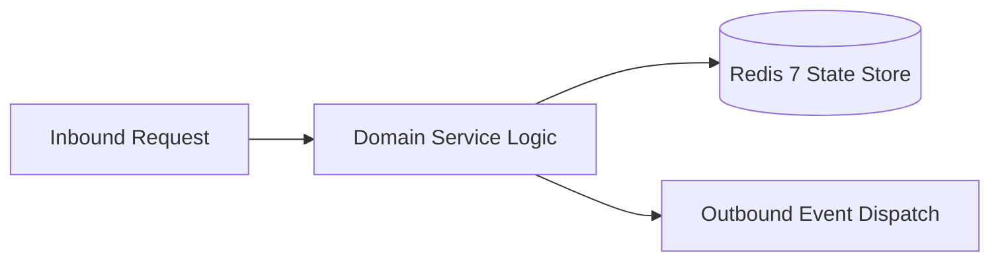

# Component Reference: `bot/templates/user/voice.py`
> **File Path**: [`bot/templates/user/voice.py`](../../bot/templates/user/voice.py)
> **Subsystem**: `Voice Message Templates`
> **Architecture Layer**: `Presentation Markup & Sanitization`
> **Concurrency Model**: `Synchronous Pure Function Rendering`
> **Persistence Backend**: `Stateless HTML Escape & Telegram Formatter`
> **Service Level Objective**: `Sub-1µs Render Latency`

## 1. Architectural Role & Responsibilities
The `bot/templates/user/voice.py` module implements core operational logic for the `Voice Message Templates` domain. It operates within an asynchronous microservices topology designed for ultra-low latency, zero-loss persistence guarantees, and strict single-responsibility function decomposition (≤25 lines).

### Component Architecture & Data Flow


---
## 2. Public API & Symbol Inventory
| Symbol | Nature | Line Range | Return Contract | Core Invariant |
| :--- | :--- | :--- | :--- | :--- |
| [`format_transcription_status`](#format_transcription_status) | Function | L12–L22 | `str` | Formats initial progress indicator message. |
| [`format_duration_str`](#format_duration_str) | Function | L25–L41 | `str` | Formats integer seconds into human-readable (M:SS) time... |
| [`format_transcription_result`](#format_transcription_result) | Function | L44–L58 | `str` | Formats completed speech transcription into quotation b... |
| [`format_transcription_empty`](#format_transcription_empty) | Function | L61–L74 | `str` | Formats notice indicating no audible speech was detecte... |
| [`format_transcription_error`](#format_transcription_error) | Function | L77–L87 | `str` | Formats error notification message for speech recogniti... |
| [`format_too_long_error`](#format_too_long_error) | Function | L90–L102 | `str` | Formats validation error message when audio duration ex... |
| [`format_too_big_error`](#format_too_big_error) | Function | L105–L115 | `str` | Formats validation error message when file size exceeds... |
| [`format_rate_limit_error`](#format_rate_limit_error) | Function | L118–L128 | `str` | Formats throttle warning when user exceeds concurrent t... |
| [`format_queue_status`](#format_queue_status) | Function | L131–L141 | `str` | Renders queue position indicator for pending speech rec... |

---

## 3. Comprehensive Function Specifications

### `format_transcription_status`
```python
def format_transcription_status() -> str
```

- **Source Reference**: [`bot/templates/user/voice.py#L12-L22`](../../bot/templates/user/voice.py#L12-L22)
- **Execution Mode**: `Synchronous`
- **Return Contract**: `str`

#### Overview & Architectural Purpose
Formats initial progress indicator message.

#### Parameters Contract
*This method takes no input parameters.*

#### Concurrency & Side Effects
- Stateless pure functional computation without external mutations.

#### Fault Tolerance & Error Modes
Propagates unexpected runtime errors up the call stack to global exception handlers.

#### Production Usage Example
```python
from bot.templates.user.voice import format_transcription_status

# Execute call
result = format_transcription_status()
```

---

### `format_duration_str`
```python
def format_duration_str(duration_seconds: int) -> str
```

- **Source Reference**: [`bot/templates/user/voice.py#L25-L41`](../../bot/templates/user/voice.py#L25-L41)
- **Execution Mode**: `Synchronous`
- **Return Contract**: `str`

#### Overview & Architectural Purpose
Formats integer seconds into human-readable (M:SS) timestamp.

#### Parameters Contract
| Parameter | Type | Required | Description |
| :--- | :--- | :--- | :--- |
| `duration_seconds` | `int` | Yes | Parameter `duration_seconds` of type `int`. |

#### Concurrency & Side Effects
- Stateless pure functional computation without external mutations.

#### Fault Tolerance & Error Modes
Propagates unexpected runtime errors up the call stack to global exception handlers.

#### Production Usage Example
```python
from bot.templates.user.voice import format_duration_str

# Execute call
result = format_duration_str(duration_seconds=...)
```

---

### `format_transcription_result`
```python
def format_transcription_result(sender_name: str, duration_sec: int, transcription_text: str) -> str
```

- **Source Reference**: [`bot/templates/user/voice.py#L44-L58`](../../bot/templates/user/voice.py#L44-L58)
- **Execution Mode**: `Synchronous`
- **Return Contract**: `str`

#### Overview & Architectural Purpose
Formats completed speech transcription into quotation block.

#### Parameters Contract
| Parameter | Type | Required | Description |
| :--- | :--- | :--- | :--- |
| `sender_name` | `str` | Yes | Display name of the sender for message formatting. |
| `duration_sec` | `int` | Yes | Audio duration in seconds for message formatting. |
| `transcription_text` | `str` | Yes | Transcribed raw text recognized by Whisper engine. |

#### Concurrency & Side Effects
- Stateless pure functional computation without external mutations.

#### Fault Tolerance & Error Modes
Propagates unexpected runtime errors up the call stack to global exception handlers.

#### Production Usage Example
```python
from bot.templates.user.voice import format_transcription_result

# Execute call
result = format_transcription_result(sender_name=..., duration_sec=..., transcription_text=...)
```

---

### `format_transcription_empty`
```python
def format_transcription_empty(sender_name: str, duration_sec: int) -> str
```

- **Source Reference**: [`bot/templates/user/voice.py#L61-L74`](../../bot/templates/user/voice.py#L61-L74)
- **Execution Mode**: `Synchronous`
- **Return Contract**: `str`

#### Overview & Architectural Purpose
Formats notice indicating no audible speech was detected.

#### Parameters Contract
| Parameter | Type | Required | Description |
| :--- | :--- | :--- | :--- |
| `sender_name` | `str` | Yes | Display name of the sender for message formatting. |
| `duration_sec` | `int` | Yes | Audio duration in seconds for message formatting. |

#### Concurrency & Side Effects
- Stateless pure functional computation without external mutations.

#### Fault Tolerance & Error Modes
Propagates unexpected runtime errors up the call stack to global exception handlers.

#### Production Usage Example
```python
from bot.templates.user.voice import format_transcription_empty

# Execute call
result = format_transcription_empty(sender_name=..., duration_sec=...)
```

---

### `format_transcription_error`
```python
def format_transcription_error() -> str
```

- **Source Reference**: [`bot/templates/user/voice.py#L77-L87`](../../bot/templates/user/voice.py#L77-L87)
- **Execution Mode**: `Synchronous`
- **Return Contract**: `str`

#### Overview & Architectural Purpose
Formats error notification message for speech recognition failures.

#### Parameters Contract
*This method takes no input parameters.*

#### Concurrency & Side Effects
- Stateless pure functional computation without external mutations.

#### Fault Tolerance & Error Modes
Propagates unexpected runtime errors up the call stack to global exception handlers.

#### Production Usage Example
```python
from bot.templates.user.voice import format_transcription_error

# Execute call
result = format_transcription_error()
```

---

### `format_too_long_error`
```python
def format_too_long_error(max_seconds: int = 300) -> str
```

- **Source Reference**: [`bot/templates/user/voice.py#L90-L102`](../../bot/templates/user/voice.py#L90-L102)
- **Execution Mode**: `Synchronous`
- **Return Contract**: `str`

#### Overview & Architectural Purpose
Formats validation error message when audio duration exceeds limit.

#### Parameters Contract
| Parameter | Type | Required | Description |
| :--- | :--- | :--- | :--- |
| `max_seconds` | `int` | Yes | Maximum allowed audio duration limit in seconds. |

#### Concurrency & Side Effects
- Stateless pure functional computation without external mutations.

#### Fault Tolerance & Error Modes
Propagates unexpected runtime errors up the call stack to global exception handlers.

#### Production Usage Example
```python
from bot.templates.user.voice import format_too_long_error

# Execute call
result = format_too_long_error(max_seconds=...)
```

---

### `format_too_big_error`
```python
def format_too_big_error(max_mb: int = 20) -> str
```

- **Source Reference**: [`bot/templates/user/voice.py#L105-L115`](../../bot/templates/user/voice.py#L105-L115)
- **Execution Mode**: `Synchronous`
- **Return Contract**: `str`

#### Overview & Architectural Purpose
Formats validation error message when file size exceeds limit.

#### Parameters Contract
| Parameter | Type | Required | Description |
| :--- | :--- | :--- | :--- |
| `max_mb` | `int` | Yes | Maximum allowed audio file size limit in megabytes. |

#### Concurrency & Side Effects
- Stateless pure functional computation without external mutations.

#### Fault Tolerance & Error Modes
Propagates unexpected runtime errors up the call stack to global exception handlers.

#### Production Usage Example
```python
from bot.templates.user.voice import format_too_big_error

# Execute call
result = format_too_big_error(max_mb=...)
```

---

### `format_rate_limit_error`
```python
def format_rate_limit_error() -> str
```

- **Source Reference**: [`bot/templates/user/voice.py#L118-L128`](../../bot/templates/user/voice.py#L118-L128)
- **Execution Mode**: `Synchronous`
- **Return Contract**: `str`

#### Overview & Architectural Purpose
Formats throttle warning when user exceeds concurrent task limit.

#### Parameters Contract
*This method takes no input parameters.*

#### Concurrency & Side Effects
- Stateless pure functional computation without external mutations.

#### Fault Tolerance & Error Modes
Propagates unexpected runtime errors up the call stack to global exception handlers.

#### Production Usage Example
```python
from bot.templates.user.voice import format_rate_limit_error

# Execute call
result = format_rate_limit_error()
```

---

### `format_queue_status`
```python
def format_queue_status(queue_pos: int) -> str
```

- **Source Reference**: [`bot/templates/user/voice.py#L131-L141`](../../bot/templates/user/voice.py#L131-L141)
- **Execution Mode**: `Synchronous`
- **Return Contract**: `str`

#### Overview & Architectural Purpose
Renders queue position indicator for pending speech recognition.

#### Parameters Contract
| Parameter | Type | Required | Description |
| :--- | :--- | :--- | :--- |
| `queue_pos` | `int` | Yes | 1-based queue index indicating position waiting for GPU semaphore. |

#### Concurrency & Side Effects
- Stateless pure functional computation without external mutations.

#### Fault Tolerance & Error Modes
Propagates unexpected runtime errors up the call stack to global exception handlers.

#### Production Usage Example
```python
from bot.templates.user.voice import format_queue_status

# Execute call
result = format_queue_status(queue_pos=...)
```

---
