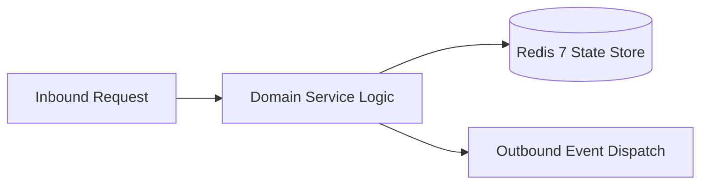

# Component Reference: `core/api_client.py`
> **File Path**: [`core/api_client.py`](../../core/api_client.py)
> **Subsystem**: `Internal RPC Client`
> **Architecture Layer**: `Enterprise Microservice Subsystem`
> **Concurrency Model**: `AsyncIO Non-blocking Concurrency`
> **Persistence Backend**: `Redis 7 Persistent Store`
> **Service Level Objective**: `High-Availability Academic Telemetry`

## 1. Architectural Role & Responsibilities
The `core/api_client.py` module implements core operational logic for the `Internal RPC Client` domain. It operates within an asynchronous microservices topology designed for ultra-low latency, zero-loss persistence guarantees, and strict single-responsibility function decomposition (≤25 lines).

### Component Architecture & Data Flow


---
## 2. Public API & Symbol Inventory
| Symbol | Nature | Line Range | Return Contract | Core Invariant |
| :--- | :--- | :--- | :--- | :--- |
| [`_build_grpc_metadata`](#_build_grpc_metadata) | Function | L45–L49 | `tuple[tuple[str, str], ...]` | Executes core domain logic for `_build_grpc_metadata`. |
| [`_get_client`](#_get_client) | Function | L52–L70 | `httpx.AsyncClient` | Executes core domain logic for `_get_client`. |
| [`_get_grpc_channel`](#_get_grpc_channel) | Function | L73–L93 | `grpc.aio.Channel` | Executes core domain logic for `_get_grpc_channel`. |
| [`close_api_client`](#close_api_client) | Function | L96–L111 | `None` | Executes core domain logic for `close_api_client`. |
| [`_api_get`](#_api_get) | Function | L114–L138 | `dict[str, Any]` | Executes core domain logic for `_api_get`. |
| [`_fetch_day_schedule_grpc`](#_fetch_day_schedule_grpc) | Function | L141–L159 | `dict[str, Any]` | Executes core domain logic for `_fetch_day_schedule_grp... |
| [`fetch_day_schedule`](#fetch_day_schedule) | Function | L162–L178 | `dict[str, Any]` | Executes core domain logic for `fetch_day_schedule`. |
| [`_fetch_week_schedule_grpc`](#_fetch_week_schedule_grpc) | Function | L181–L199 | `dict[str, Any]` | Executes core domain logic for `_fetch_week_schedule_gr... |
| [`fetch_week_schedule`](#fetch_week_schedule) | Function | L202–L218 | `dict[str, Any]` | Executes core domain logic for `fetch_week_schedule`. |
| [`_fetch_exams_grpc`](#_fetch_exams_grpc) | Function | L221–L236 | `dict[str, Any]` | Executes core domain logic for `_fetch_exams_grpc`. |
| [`fetch_exams`](#fetch_exams) | Function | L239–L252 | `dict[str, Any]` | Executes core domain logic for `fetch_exams`. |
| [`_fetch_teachers_grpc`](#_fetch_teachers_grpc) | Function | L255–L270 | `dict[str, Any]` | Executes core domain logic for `_fetch_teachers_grpc`. |
| [`fetch_teachers`](#fetch_teachers) | Function | L273–L286 | `dict[str, Any]` | Executes core domain logic for `fetch_teachers`. |
| [`get_api_schedule_for_date`](#get_api_schedule_for_date) | Function | L289–L299 | `list[Lesson]` | Retrieves and resolves domain data for `get_api_schedul... |
| [`get_api_week_schedule`](#get_api_week_schedule) | Function | L302–L319 | `list[tuple[date, list[Lesson]]]` | Retrieves and resolves domain data for `get_api_week_sc... |
| [`get_api_exams`](#get_api_exams) | Function | L322–L332 | `list[ExamItem]` | Retrieves and resolves domain data for `get_api_exams`. |
| [`get_api_teachers`](#get_api_teachers) | Function | L335–L345 | `dict[str, Any]` | Retrieves and resolves domain data for `get_api_teacher... |

---

## 3. Comprehensive Function Specifications

### `_build_grpc_metadata`
```python
def _build_grpc_metadata() -> tuple[tuple[str, str], ...]
```

- **Source Reference**: [`core/api_client.py#L45-L49`](../../core/api_client.py#L45-L49)
- **Execution Mode**: `Synchronous`
- **Return Contract**: `tuple[tuple[str, str], ...]`

#### Overview & Architectural Purpose
Executes core domain logic for `_build_grpc_metadata`.

#### Parameters Contract
*This method takes no input parameters.*

#### Concurrency & Side Effects
- Stateless pure functional computation without external mutations.

#### Fault Tolerance & Error Modes
Propagates unexpected runtime errors up the call stack to global exception handlers.

#### Production Usage Example
```python
from core.api_client import _build_grpc_metadata

# Execute call
result = _build_grpc_metadata()
```

---

### `_get_client`
```python
def _get_client() -> httpx.AsyncClient
```

- **Source Reference**: [`core/api_client.py#L52-L70`](../../core/api_client.py#L52-L70)
- **Execution Mode**: `Synchronous`
- **Return Contract**: `httpx.AsyncClient`

#### Overview & Architectural Purpose
Executes core domain logic for `_get_client`.

#### Parameters Contract
*This method takes no input parameters.*

#### Concurrency & Side Effects
- Performs non-blocking network I/O over HTTP or gRPC.

#### Fault Tolerance & Error Modes
Propagates unexpected runtime errors up the call stack to global exception handlers.

#### Production Usage Example
```python
from core.api_client import _get_client

# Execute call
result = _get_client()
```

---

### `_get_grpc_channel`
```python
def _get_grpc_channel() -> grpc.aio.Channel
```

- **Source Reference**: [`core/api_client.py#L73-L93`](../../core/api_client.py#L73-L93)
- **Execution Mode**: `Synchronous`
- **Return Contract**: `grpc.aio.Channel`

#### Overview & Architectural Purpose
Executes core domain logic for `_get_grpc_channel`.

#### Parameters Contract
*This method takes no input parameters.*

#### Concurrency & Side Effects
- Stateless pure functional computation without external mutations.

#### Fault Tolerance & Error Modes
Propagates unexpected runtime errors up the call stack to global exception handlers.

#### Production Usage Example
```python
from core.api_client import _get_grpc_channel

# Execute call
result = _get_grpc_channel()
```

---

### `close_api_client`
```python
async def close_api_client() -> None
```

- **Source Reference**: [`core/api_client.py#L96-L111`](../../core/api_client.py#L96-L111)
- **Execution Mode**: `Asynchronous (non-blocking)`
- **Return Contract**: `None`

#### Overview & Architectural Purpose
Executes core domain logic for `close_api_client`.

#### Parameters Contract
*This method takes no input parameters.*

#### Concurrency & Side Effects
- Stateless pure functional computation without external mutations.

#### Fault Tolerance & Error Modes
Propagates unexpected runtime errors up the call stack to global exception handlers.

#### Production Usage Example
```python
from core.api_client import close_api_client

# Execute call
result = await close_api_client()
```

---

### `_api_get`
```python
async def _api_get(path: str, params: dict[str, Any] | None = None) -> dict[str, Any]
```

- **Source Reference**: [`core/api_client.py#L114-L138`](../../core/api_client.py#L114-L138)
- **Execution Mode**: `Asynchronous (non-blocking)`
- **Return Contract**: `dict[str, Any]`

#### Overview & Architectural Purpose
Executes core domain logic for `_api_get`.

#### Parameters Contract
| Parameter | Type | Required | Description |
| :--- | :--- | :--- | :--- |
| `path` | `str` | Yes | Parameter `path` of type `str`. |
| `params` | `dict[str, Any] | None` | Yes | Parameter `params` of type `dict[str, Any] | None`. |

#### Concurrency & Side Effects
- Emits structured telemetry events to system logging subsystem.

#### Fault Tolerance & Error Modes
Explicitly raises domain exceptions (e.g., `PermissionError`, `ValueError`) upon invariant violation.

#### Production Usage Example
```python
from core.api_client import _api_get

# Execute call
result = await _api_get(path=..., params=...)
```

---

### `_fetch_day_schedule_grpc`
```python
async def _fetch_day_schedule_grpc(target_date: date | None, force_refresh: bool) -> dict[str, Any]
```

- **Source Reference**: [`core/api_client.py#L141-L159`](../../core/api_client.py#L141-L159)
- **Execution Mode**: `Asynchronous (non-blocking)`
- **Return Contract**: `dict[str, Any]`

#### Overview & Architectural Purpose
Executes core domain logic for `_fetch_day_schedule_grpc`.

#### Parameters Contract
| Parameter | Type | Required | Description |
| :--- | :--- | :--- | :--- |
| `target_date` | `date | None` | Yes | Target calendar date for schedule or attendance resolution (ISO-8601). |
| `force_refresh` | `bool` | Yes | Parameter `force_refresh` of type `bool`. |

#### Concurrency & Side Effects
- Stateless pure functional computation without external mutations.

#### Fault Tolerance & Error Modes
Propagates unexpected runtime errors up the call stack to global exception handlers.

#### Production Usage Example
```python
from core.api_client import _fetch_day_schedule_grpc

# Execute call
result = await _fetch_day_schedule_grpc(target_date=..., force_refresh=...)
```

---

### `fetch_day_schedule`
```python
async def fetch_day_schedule(target_date: date | None = None, force_refresh: bool = False) -> dict[str, Any]
```

- **Source Reference**: [`core/api_client.py#L162-L178`](../../core/api_client.py#L162-L178)
- **Execution Mode**: `Asynchronous (non-blocking)`
- **Return Contract**: `dict[str, Any]`

#### Overview & Architectural Purpose
Executes core domain logic for `fetch_day_schedule`.

#### Parameters Contract
| Parameter | Type | Required | Description |
| :--- | :--- | :--- | :--- |
| `target_date` | `date | None` | Yes | Target calendar date for schedule or attendance resolution (ISO-8601). |
| `force_refresh` | `bool` | Yes | Parameter `force_refresh` of type `bool`. |

#### Concurrency & Side Effects
- Emits structured telemetry events to system logging subsystem.

#### Fault Tolerance & Error Modes
Encapsulates faults within `try/except` blocks, logging errors and returning safe fallback defaults.

#### Production Usage Example
```python
from core.api_client import fetch_day_schedule

# Execute call
result = await fetch_day_schedule(target_date=..., force_refresh=...)
```

---

### `_fetch_week_schedule_grpc`
```python
async def _fetch_week_schedule_grpc(monday: date | None, force_refresh: bool) -> dict[str, Any]
```

- **Source Reference**: [`core/api_client.py#L181-L199`](../../core/api_client.py#L181-L199)
- **Execution Mode**: `Asynchronous (non-blocking)`
- **Return Contract**: `dict[str, Any]`

#### Overview & Architectural Purpose
Executes core domain logic for `_fetch_week_schedule_grpc`.

#### Parameters Contract
| Parameter | Type | Required | Description |
| :--- | :--- | :--- | :--- |
| `monday` | `date | None` | Yes | Parameter `monday` of type `date | None`. |
| `force_refresh` | `bool` | Yes | Parameter `force_refresh` of type `bool`. |

#### Concurrency & Side Effects
- Stateless pure functional computation without external mutations.

#### Fault Tolerance & Error Modes
Propagates unexpected runtime errors up the call stack to global exception handlers.

#### Production Usage Example
```python
from core.api_client import _fetch_week_schedule_grpc

# Execute call
result = await _fetch_week_schedule_grpc(monday=..., force_refresh=...)
```

---

### `fetch_week_schedule`
```python
async def fetch_week_schedule(monday: date | None = None, force_refresh: bool = False) -> dict[str, Any]
```

- **Source Reference**: [`core/api_client.py#L202-L218`](../../core/api_client.py#L202-L218)
- **Execution Mode**: `Asynchronous (non-blocking)`
- **Return Contract**: `dict[str, Any]`

#### Overview & Architectural Purpose
Executes core domain logic for `fetch_week_schedule`.

#### Parameters Contract
| Parameter | Type | Required | Description |
| :--- | :--- | :--- | :--- |
| `monday` | `date | None` | Yes | Parameter `monday` of type `date | None`. |
| `force_refresh` | `bool` | Yes | Parameter `force_refresh` of type `bool`. |

#### Concurrency & Side Effects
- Emits structured telemetry events to system logging subsystem.

#### Fault Tolerance & Error Modes
Encapsulates faults within `try/except` blocks, logging errors and returning safe fallback defaults.

#### Production Usage Example
```python
from core.api_client import fetch_week_schedule

# Execute call
result = await fetch_week_schedule(monday=..., force_refresh=...)
```

---

### `_fetch_exams_grpc`
```python
async def _fetch_exams_grpc(force_refresh: bool) -> dict[str, Any]
```

- **Source Reference**: [`core/api_client.py#L221-L236`](../../core/api_client.py#L221-L236)
- **Execution Mode**: `Asynchronous (non-blocking)`
- **Return Contract**: `dict[str, Any]`

#### Overview & Architectural Purpose
Executes core domain logic for `_fetch_exams_grpc`.

#### Parameters Contract
| Parameter | Type | Required | Description |
| :--- | :--- | :--- | :--- |
| `force_refresh` | `bool` | Yes | Parameter `force_refresh` of type `bool`. |

#### Concurrency & Side Effects
- Stateless pure functional computation without external mutations.

#### Fault Tolerance & Error Modes
Propagates unexpected runtime errors up the call stack to global exception handlers.

#### Production Usage Example
```python
from core.api_client import _fetch_exams_grpc

# Execute call
result = await _fetch_exams_grpc(force_refresh=...)
```

---

### `fetch_exams`
```python
async def fetch_exams(force_refresh: bool = False) -> dict[str, Any]
```

- **Source Reference**: [`core/api_client.py#L239-L252`](../../core/api_client.py#L239-L252)
- **Execution Mode**: `Asynchronous (non-blocking)`
- **Return Contract**: `dict[str, Any]`

#### Overview & Architectural Purpose
Executes core domain logic for `fetch_exams`.

#### Parameters Contract
| Parameter | Type | Required | Description |
| :--- | :--- | :--- | :--- |
| `force_refresh` | `bool` | Yes | Parameter `force_refresh` of type `bool`. |

#### Concurrency & Side Effects
- Emits structured telemetry events to system logging subsystem.

#### Fault Tolerance & Error Modes
Encapsulates faults within `try/except` blocks, logging errors and returning safe fallback defaults.

#### Production Usage Example
```python
from core.api_client import fetch_exams

# Execute call
result = await fetch_exams(force_refresh=...)
```

---

### `_fetch_teachers_grpc`
```python
async def _fetch_teachers_grpc(force_refresh: bool) -> dict[str, Any]
```

- **Source Reference**: [`core/api_client.py#L255-L270`](../../core/api_client.py#L255-L270)
- **Execution Mode**: `Asynchronous (non-blocking)`
- **Return Contract**: `dict[str, Any]`

#### Overview & Architectural Purpose
Executes core domain logic for `_fetch_teachers_grpc`.

#### Parameters Contract
| Parameter | Type | Required | Description |
| :--- | :--- | :--- | :--- |
| `force_refresh` | `bool` | Yes | Parameter `force_refresh` of type `bool`. |

#### Concurrency & Side Effects
- Stateless pure functional computation without external mutations.

#### Fault Tolerance & Error Modes
Propagates unexpected runtime errors up the call stack to global exception handlers.

#### Production Usage Example
```python
from core.api_client import _fetch_teachers_grpc

# Execute call
result = await _fetch_teachers_grpc(force_refresh=...)
```

---

### `fetch_teachers`
```python
async def fetch_teachers(force_refresh: bool = False) -> dict[str, Any]
```

- **Source Reference**: [`core/api_client.py#L273-L286`](../../core/api_client.py#L273-L286)
- **Execution Mode**: `Asynchronous (non-blocking)`
- **Return Contract**: `dict[str, Any]`

#### Overview & Architectural Purpose
Executes core domain logic for `fetch_teachers`.

#### Parameters Contract
| Parameter | Type | Required | Description |
| :--- | :--- | :--- | :--- |
| `force_refresh` | `bool` | Yes | Parameter `force_refresh` of type `bool`. |

#### Concurrency & Side Effects
- Emits structured telemetry events to system logging subsystem.

#### Fault Tolerance & Error Modes
Encapsulates faults within `try/except` blocks, logging errors and returning safe fallback defaults.

#### Production Usage Example
```python
from core.api_client import fetch_teachers

# Execute call
result = await fetch_teachers(force_refresh=...)
```

---

### `get_api_schedule_for_date`
```python
async def get_api_schedule_for_date(target_date: date | None = None, force_refresh: bool = False) -> list[Lesson]
```

- **Source Reference**: [`core/api_client.py#L289-L299`](../../core/api_client.py#L289-L299)
- **Execution Mode**: `Asynchronous (non-blocking)`
- **Return Contract**: `list[Lesson]`

#### Overview & Architectural Purpose
Retrieves and resolves domain data for `get_api_schedule_for_date`.

#### Parameters Contract
| Parameter | Type | Required | Description |
| :--- | :--- | :--- | :--- |
| `target_date` | `date | None` | Yes | Target calendar date for schedule or attendance resolution (ISO-8601). |
| `force_refresh` | `bool` | Yes | Parameter `force_refresh` of type `bool`. |

#### Concurrency & Side Effects
- Stateless pure functional computation without external mutations.

#### Fault Tolerance & Error Modes
Propagates unexpected runtime errors up the call stack to global exception handlers.

#### Production Usage Example
```python
from core.api_client import get_api_schedule_for_date

# Execute call
result = await get_api_schedule_for_date(target_date=..., force_refresh=...)
```

---

### `get_api_week_schedule`
```python
async def get_api_week_schedule( monday: date | None = None, force_refresh: bool = False ) -> list[tuple[date, list[Lesson]]]
```

- **Source Reference**: [`core/api_client.py#L302-L319`](../../core/api_client.py#L302-L319)
- **Execution Mode**: `Asynchronous (non-blocking)`
- **Return Contract**: `list[tuple[date, list[Lesson]]]`

#### Overview & Architectural Purpose
Retrieves and resolves domain data for `get_api_week_schedule`.

#### Parameters Contract
| Parameter | Type | Required | Description |
| :--- | :--- | :--- | :--- |
| `monday` | `date | None` | Yes | Parameter `monday` of type `date | None`. |
| `force_refresh` | `bool` | Yes | Parameter `force_refresh` of type `bool`. |

#### Concurrency & Side Effects
- Stateless pure functional computation without external mutations.

#### Fault Tolerance & Error Modes
Propagates unexpected runtime errors up the call stack to global exception handlers.

#### Production Usage Example
```python
from core.api_client import get_api_week_schedule

# Execute call
result = await get_api_week_schedule(monday=..., force_refresh=...)
```

---

### `get_api_exams`
```python
async def get_api_exams(force_refresh: bool = False) -> list[ExamItem]
```

- **Source Reference**: [`core/api_client.py#L322-L332`](../../core/api_client.py#L322-L332)
- **Execution Mode**: `Asynchronous (non-blocking)`
- **Return Contract**: `list[ExamItem]`

#### Overview & Architectural Purpose
Retrieves and resolves domain data for `get_api_exams`.

#### Parameters Contract
| Parameter | Type | Required | Description |
| :--- | :--- | :--- | :--- |
| `force_refresh` | `bool` | Yes | Parameter `force_refresh` of type `bool`. |

#### Concurrency & Side Effects
- Stateless pure functional computation without external mutations.

#### Fault Tolerance & Error Modes
Propagates unexpected runtime errors up the call stack to global exception handlers.

#### Production Usage Example
```python
from core.api_client import get_api_exams

# Execute call
result = await get_api_exams(force_refresh=...)
```

---

### `get_api_teachers`
```python
async def get_api_teachers(force_refresh: bool = False) -> dict[str, Any]
```

- **Source Reference**: [`core/api_client.py#L335-L345`](../../core/api_client.py#L335-L345)
- **Execution Mode**: `Asynchronous (non-blocking)`
- **Return Contract**: `dict[str, Any]`

#### Overview & Architectural Purpose
Retrieves and resolves domain data for `get_api_teachers`.

#### Parameters Contract
| Parameter | Type | Required | Description |
| :--- | :--- | :--- | :--- |
| `force_refresh` | `bool` | Yes | Parameter `force_refresh` of type `bool`. |

#### Concurrency & Side Effects
- Stateless pure functional computation without external mutations.

#### Fault Tolerance & Error Modes
Propagates unexpected runtime errors up the call stack to global exception handlers.

#### Production Usage Example
```python
from core.api_client import get_api_teachers

# Execute call
result = await get_api_teachers(force_refresh=...)
```

---
