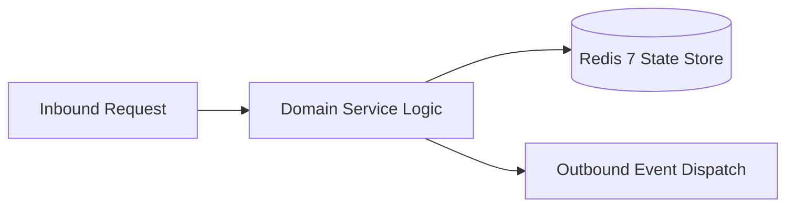

# Component Reference: `core/bot.py`
> **File Path**: [`core/bot.py`](../../core/bot.py)  
> **Subsystem**: `Bot Instance Singleton`  
> **Architecture Layer**: `Enterprise Microservice Subsystem`  
> **Concurrency Model**: `AsyncIO Non-blocking Concurrency`  
> **Persistence Backend**: `Redis 7 Persistent Store`  
> **Service Level Objective**: `High-Availability Academic Telemetry`

## 1. Architectural Role & Responsibilities
The `core/bot.py` module implements core operational logic for the `Bot Instance Singleton` domain. It operates within an asynchronous microservices topology designed for ultra-low latency, zero-loss persistence guarantees, and strict single-responsibility function decomposition (≤25 lines).

### Component Architecture & Data Flow


---
## 2. Public API & Symbol Inventory
| Symbol | Nature | Line Range | Return Contract | Core Invariant |
| :--- | :--- | :--- | :--- | :--- |
| [`create_bot_session`](#create_bot_session) | Function | L19–L31 | `AiohttpSession` | Initializes and constructs a new instance of `create_bo... |
| [`create_fsm_storage`](#create_fsm_storage) | Function | L34–L58 | `Any` | Initializes and constructs a new instance of `create_fs... |

---

## 3. Comprehensive Function Specifications

### `create_bot_session`
```python
def create_bot_session() -> AiohttpSession
```

- **Source Reference**: [`core/bot.py#L19-L31`](../../core/bot.py#L19-L31)
- **Execution Mode**: `Synchronous`
- **Return Contract**: `AiohttpSession`

#### Overview & Architectural Purpose
Initializes and constructs a new instance of `create_bot_session`.

#### Parameters Contract
*This method takes no input parameters.*

#### Concurrency & Side Effects
- Emits structured telemetry events to system logging subsystem.
- Performs non-blocking network I/O over HTTP or gRPC.

#### Fault Tolerance & Error Modes
Propagates unexpected runtime errors up the call stack to global exception handlers.

#### Production Usage Example
```python
from core.bot import create_bot_session

# Execute call
result = create_bot_session()
```

---

### `create_fsm_storage`
```python
def create_fsm_storage()
```

- **Source Reference**: [`core/bot.py#L34-L58`](../../core/bot.py#L34-L58)
- **Execution Mode**: `Synchronous`
- **Return Contract**: `Any`

#### Overview & Architectural Purpose
Initializes and constructs a new instance of `create_fsm_storage`.

#### Parameters Contract
*This method takes no input parameters.*

#### Concurrency & Side Effects
- Mutates or reads Redis L2 key space via asynchronous connection pool.
- Emits structured telemetry events to system logging subsystem.

#### Fault Tolerance & Error Modes
Encapsulates faults within `try/except` blocks, logging errors and returning safe fallback defaults.

#### Production Usage Example
```python
from core.bot import create_fsm_storage

# Execute call
result = create_fsm_storage()
```

---
