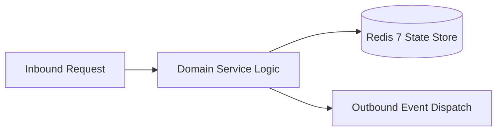

# Component Reference: `core/circuit_breaker.py`
> **File Path**: [`core/circuit_breaker.py`](../../core/circuit_breaker.py)
> **Subsystem**: `Resilience & Circuit Breaker`
> **Architecture Layer**: `Enterprise Microservice Subsystem`
> **Concurrency Model**: `AsyncIO Non-blocking Concurrency`
> **Persistence Backend**: `Redis 7 Persistent Store`
> **Service Level Objective**: `High-Availability Academic Telemetry`

## 1. Architectural Role & Responsibilities
The `core/circuit_breaker.py` module implements core operational logic for the `Resilience & Circuit Breaker` domain. It operates within an asynchronous microservices topology designed for ultra-low latency, zero-loss persistence guarantees, and strict single-responsibility function decomposition (≤25 lines).

### Component Architecture & Data Flow


---
## 2. Public API & Symbol Inventory
| Symbol | Nature | Line Range | Return Contract | Core Invariant |
| :--- | :--- | :--- | :--- | :--- |
| [`CircuitOpenError.__init__`](#circuitopenerror__init__) | Method | L32–L35 | `Any` | Executes core domain logic for `__init__`. |
| [`CircuitBreaker.__init__`](#circuitbreaker__init__) | Method | L41–L48 | `Any` | Executes core domain logic for `__init__`. |
| [`CircuitBreaker.state`](#circuitbreakerstate) | Method | L51–L57 | `CircuitState` | Executes core domain logic for `state`. |
| [`CircuitBreaker.check_permission`](#circuitbreakercheck_permission) | Method | L59–L68 | `None` | Executes core domain logic for `check_permission`. |
| [`CircuitBreaker.record_success`](#circuitbreakerrecord_success) | Method | L70–L77 | `None` | Executes core domain logic for `record_success`. |
| [`CircuitBreaker.record_failure`](#circuitbreakerrecord_failure) | Method | L79–L87 | `None` | Executes core domain logic for `record_failure`. |
| [`async_retry_with_backoff`](#async_retry_with_backoff) | Function | L90–L111 | `T` | Executes core domain logic for `async_retry_with_backof... |

---

## 3. Comprehensive Function Specifications

## Class Model: `CircuitState`

Encapsulates domain entities and data transfer logic for `CircuitState`.

## Class Model: `CircuitOpenError`

Encapsulates domain entities and data transfer logic for `CircuitOpenError`.

### `CircuitOpenError.__init__`
```python
def __init__(self, name: str, retry_after: float)
```

- **Source Reference**: [`core/circuit_breaker.py#L32-L35`](../../core/circuit_breaker.py#L32-L35)
- **Execution Mode**: `Synchronous`
- **Return Contract**: `Any`

#### Overview & Architectural Purpose
Executes core domain logic for `__init__`.

#### Parameters Contract
| Parameter | Type | Required | Description |
| :--- | :--- | :--- | :--- |
| `name` | `str` | Yes | Parameter `name` of type `str`. |
| `retry_after` | `float` | Yes | Parameter `retry_after` of type `float`. |

#### Concurrency & Side Effects
- Stateless pure functional computation without external mutations.

#### Fault Tolerance & Error Modes
Propagates unexpected runtime errors up the call stack to global exception handlers.

#### Production Usage Example
```python
from core.circuit_breaker import __init__

# Execute call
result = __init__(name=..., retry_after=...)
```

---

## Class Model: `CircuitBreaker`

Encapsulates domain entities and data transfer logic for `CircuitBreaker`.

### `CircuitBreaker.__init__`
```python
def __init__(self, name: str, failure_threshold: int = 3, recovery_timeout: float = 30.0)
```

- **Source Reference**: [`core/circuit_breaker.py#L41-L48`](../../core/circuit_breaker.py#L41-L48)
- **Execution Mode**: `Synchronous`
- **Return Contract**: `Any`

#### Overview & Architectural Purpose
Executes core domain logic for `__init__`.

#### Parameters Contract
| Parameter | Type | Required | Description |
| :--- | :--- | :--- | :--- |
| `name` | `str` | Yes | Parameter `name` of type `str`. |
| `failure_threshold` | `int` | Yes | Parameter `failure_threshold` of type `int`. |
| `recovery_timeout` | `float` | Yes | Parameter `recovery_timeout` of type `float`. |

#### Concurrency & Side Effects
- Stateless pure functional computation without external mutations.

#### Fault Tolerance & Error Modes
Propagates unexpected runtime errors up the call stack to global exception handlers.

#### Production Usage Example
```python
from core.circuit_breaker import __init__

# Execute call
result = __init__(name=..., failure_threshold=..., recovery_timeout=...)
```

---

### `CircuitBreaker.state`
```python
def state(self) -> CircuitState
```

- **Source Reference**: [`core/circuit_breaker.py#L51-L57`](../../core/circuit_breaker.py#L51-L57)
- **Execution Mode**: `Synchronous`
- **Return Contract**: `CircuitState`

#### Overview & Architectural Purpose
Executes core domain logic for `state`.

#### Parameters Contract
*This method takes no input parameters.*

#### Concurrency & Side Effects
- Stateless pure functional computation without external mutations.

#### Fault Tolerance & Error Modes
Propagates unexpected runtime errors up the call stack to global exception handlers.

#### Production Usage Example
```python
from core.circuit_breaker import state

# Execute call
result = state()
```

---

### `CircuitBreaker.check_permission`
```python
async def check_permission(self) -> None
```

- **Source Reference**: [`core/circuit_breaker.py#L59-L68`](../../core/circuit_breaker.py#L59-L68)
- **Execution Mode**: `Asynchronous (non-blocking)`
- **Return Contract**: `None`

#### Overview & Architectural Purpose
Executes core domain logic for `check_permission`.

#### Parameters Contract
*This method takes no input parameters.*

#### Concurrency & Side Effects
- Emits structured telemetry events to system logging subsystem.

#### Fault Tolerance & Error Modes
Explicitly raises domain exceptions (e.g., `PermissionError`, `ValueError`) upon invariant violation.

#### Production Usage Example
```python
from core.circuit_breaker import check_permission

# Execute call
result = await check_permission()
```

---

### `CircuitBreaker.record_success`
```python
async def record_success(self) -> None
```

- **Source Reference**: [`core/circuit_breaker.py#L70-L77`](../../core/circuit_breaker.py#L70-L77)
- **Execution Mode**: `Asynchronous (non-blocking)`
- **Return Contract**: `None`

#### Overview & Architectural Purpose
Executes core domain logic for `record_success`.

#### Parameters Contract
*This method takes no input parameters.*

#### Concurrency & Side Effects
- Emits structured telemetry events to system logging subsystem.

#### Fault Tolerance & Error Modes
Propagates unexpected runtime errors up the call stack to global exception handlers.

#### Production Usage Example
```python
from core.circuit_breaker import record_success

# Execute call
result = await record_success()
```

---

### `CircuitBreaker.record_failure`
```python
async def record_failure(self, error: Exception) -> None
```

- **Source Reference**: [`core/circuit_breaker.py#L79-L87`](../../core/circuit_breaker.py#L79-L87)
- **Execution Mode**: `Asynchronous (non-blocking)`
- **Return Contract**: `None`

#### Overview & Architectural Purpose
Executes core domain logic for `record_failure`.

#### Parameters Contract
| Parameter | Type | Required | Description |
| :--- | :--- | :--- | :--- |
| `error` | `Exception` | Yes | Parameter `error` of type `Exception`. |

#### Concurrency & Side Effects
- Emits structured telemetry events to system logging subsystem.

#### Fault Tolerance & Error Modes
Propagates unexpected runtime errors up the call stack to global exception handlers.

#### Production Usage Example
```python
from core.circuit_breaker import record_failure

# Execute call
result = await record_failure(error=...)
```

---

### `async_retry_with_backoff`
```python
async def async_retry_with_backoff( coro_fn: Callable[[], Awaitable[T]], max_retries: int = 3, base_delay: float = 0.5, max_delay: float = 5.0, retryable_exceptions: tuple[type[Exception], ...] = (Exception,), ) -> T
```

- **Source Reference**: [`core/circuit_breaker.py#L90-L111`](../../core/circuit_breaker.py#L90-L111)
- **Execution Mode**: `Asynchronous (non-blocking)`
- **Return Contract**: `T`

#### Overview & Architectural Purpose
Executes core domain logic for `async_retry_with_backoff`.

#### Parameters Contract
| Parameter | Type | Required | Description |
| :--- | :--- | :--- | :--- |
| `coro_fn` | `Callable[[], Awaitable[T]]` | Yes | Parameter `coro_fn` of type `Callable[[], Awaitable[T]]`. |
| `max_retries` | `int` | Yes | Parameter `max_retries` of type `int`. |
| `base_delay` | `float` | Yes | Parameter `base_delay` of type `float`. |
| `max_delay` | `float` | Yes | Parameter `max_delay` of type `float`. |
| `retryable_exceptions` | `tuple[type[Exception], ...]` | Yes | Parameter `retryable_exceptions` of type `tuple[type[Exception], ...]`. |

#### Concurrency & Side Effects
- Emits structured telemetry events to system logging subsystem.

#### Fault Tolerance & Error Modes
Explicitly raises domain exceptions (e.g., `PermissionError`, `ValueError`) upon invariant violation.

#### Production Usage Example
```python
from core.circuit_breaker import async_retry_with_backoff

# Execute call
result = await async_retry_with_backoff(coro_fn=..., max_retries=..., base_delay=...)
```

---
