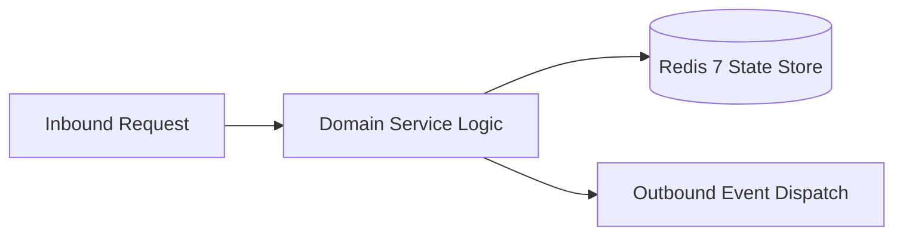

# Component Reference: `core/config_models.py`
> **File Path**: [`core/config_models.py`](../../core/config_models.py)
> **Subsystem**: `Domain Configuration Models`
> **Architecture Layer**: `Enterprise Microservice Subsystem`
> **Concurrency Model**: `AsyncIO Non-blocking Concurrency`
> **Persistence Backend**: `Redis 7 Persistent Store`
> **Service Level Objective**: `High-Availability Academic Telemetry`

## 1. Architectural Role & Responsibilities
The `core/config_models.py` module implements core operational logic for the `Domain Configuration Models` domain. It operates within an asynchronous microservices topology designed for ultra-low latency, zero-loss persistence guarantees, and strict single-responsibility function decomposition (≤25 lines).

### Component Architecture & Data Flow


---
## 2. Public API & Symbol Inventory
| Symbol | Nature | Line Range | Return Contract | Core Invariant |
| :--- | :--- | :--- | :--- | :--- |
| [`TelegramConfig.allowed_attendance_user_ids`](#telegramconfigallowed_attendance_user_ids) | Method | L33–L35 | `set[int]` | Executes core domain logic for `allowed_attendance_user... |
| [`ScheduleConfig.timezone`](#scheduleconfigtimezone) | Method | L54–L56 | `ZoneInfo` | Executes core domain logic for `timezone`. |

---

## 3. Comprehensive Function Specifications

## Class Model: `TelegramConfig`

Encapsulates domain entities and data transfer logic for `TelegramConfig`.

### `TelegramConfig.allowed_attendance_user_ids`
```python
def allowed_attendance_user_ids(self) -> set[int]
```

- **Source Reference**: [`core/config_models.py#L33-L35`](../../core/config_models.py#L33-L35)
- **Execution Mode**: `Synchronous`
- **Return Contract**: `set[int]`

#### Overview & Architectural Purpose
Executes core domain logic for `allowed_attendance_user_ids`.

#### Parameters Contract
*This method takes no input parameters.*

#### Concurrency & Side Effects
- Stateless pure functional computation without external mutations.

#### Fault Tolerance & Error Modes
Propagates unexpected runtime errors up the call stack to global exception handlers.

#### Production Usage Example
```python
from core.config_models import allowed_attendance_user_ids

# Execute call
result = allowed_attendance_user_ids()
```

---

## Class Model: `ScheduleConfig`

Encapsulates domain entities and data transfer logic for `ScheduleConfig`.

### `ScheduleConfig.timezone`
```python
def timezone(self) -> ZoneInfo
```

- **Source Reference**: [`core/config_models.py#L54-L56`](../../core/config_models.py#L54-L56)
- **Execution Mode**: `Synchronous`
- **Return Contract**: `ZoneInfo`

#### Overview & Architectural Purpose
Executes core domain logic for `timezone`.

#### Parameters Contract
*This method takes no input parameters.*

#### Concurrency & Side Effects
- Stateless pure functional computation without external mutations.

#### Fault Tolerance & Error Modes
Propagates unexpected runtime errors up the call stack to global exception handlers.

#### Production Usage Example
```python
from core.config_models import timezone

# Execute call
result = timezone()
```

---

## Class Model: `CampusConfig`

Encapsulates domain entities and data transfer logic for `CampusConfig`.

## Class Model: `RedisConfig`

Encapsulates domain entities and data transfer logic for `RedisConfig`.

## Class Model: `YandexConfig`

Encapsulates domain entities and data transfer logic for `YandexConfig`.

## Class Model: `ApiConfig`

Encapsulates domain entities and data transfer logic for `ApiConfig`.

## Class Model: `AiSolverConfig`

Encapsulates domain entities and data transfer logic for `AiSolverConfig`.

## Class Model: `WhisperConfig`

Encapsulates domain entities and data transfer logic for `WhisperConfig`.

## Class Model: `NotificationConfig`

Encapsulates domain entities and data transfer logic for `NotificationConfig`.
