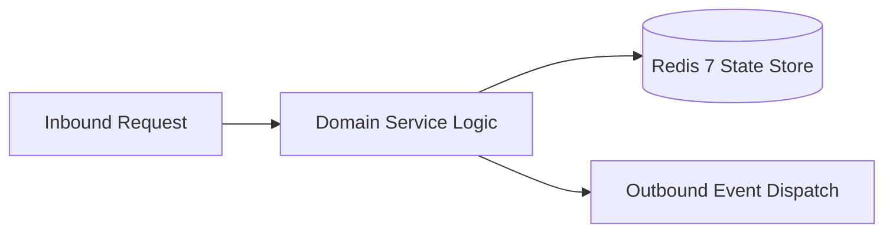

# Component Reference: `core/database.py`
> **File Path**: [`core/database.py`](../../core/database.py)
> **Subsystem**: `Relational SQLite Engine`
> **Architecture Layer**: `Enterprise Microservice Subsystem`
> **Concurrency Model**: `AsyncIO Non-blocking Concurrency`
> **Persistence Backend**: `Redis 7 Persistent Store`
> **Service Level Objective**: `High-Availability Academic Telemetry`

## 1. Architectural Role & Responsibilities
The `core/database.py` module implements core operational logic for the `Relational SQLite Engine` domain. It operates within an asynchronous microservices topology designed for ultra-low latency, zero-loss persistence guarantees, and strict single-responsibility function decomposition (≤25 lines).

### Component Architecture & Data Flow


---
## 2. Public API & Symbol Inventory
| Symbol | Nature | Line Range | Return Contract | Core Invariant |
| :--- | :--- | :--- | :--- | :--- |
| [`_set_sqlite_pragmas`](#_set_sqlite_pragmas) | Function | L28–L35 | `None` | Executes core domain logic for `_set_sqlite_pragmas`. |
| [`get_database_engine`](#get_database_engine) | Function | L38–L51 | `AsyncEngine` | Retrieves and resolves domain data for `get_database_en... |
| [`get_session_factory`](#get_session_factory) | Function | L54–L65 | `async_sessionmaker[AsyncSession]` | Retrieves and resolves domain data for `get_session_fac... |
| [`get_async_session`](#get_async_session) | Function | L69–L78 | `AsyncGenerator[AsyncSession, None]` | Retrieves and resolves domain data for `get_async_sessi... |
| [`_migrate_subscribers_from_json`](#_migrate_subscribers_from_json) | Function | L81–L94 | `None` | Executes core domain logic for `_migrate_subscribers_fr... |
| [`init_db`](#init_db) | Function | L97–L107 | `None` | Executes core domain logic for `init_db`. |

---

## 3. Comprehensive Function Specifications

### `_set_sqlite_pragmas`
```python
def _set_sqlite_pragmas(dbapi_connection: Any, _connection_record: Any) -> None
```

- **Source Reference**: [`core/database.py#L28-L35`](../../core/database.py#L28-L35)
- **Execution Mode**: `Synchronous`
- **Return Contract**: `None`

#### Overview & Architectural Purpose
Executes core domain logic for `_set_sqlite_pragmas`.

#### Parameters Contract
| Parameter | Type | Required | Description |
| :--- | :--- | :--- | :--- |
| `dbapi_connection` | `Any` | Yes | Parameter `dbapi_connection` of type `Any`. |
| `_connection_record` | `Any` | Yes | Parameter `_connection_record` of type `Any`. |

#### Concurrency & Side Effects
- Stateless pure functional computation without external mutations.

#### Fault Tolerance & Error Modes
Propagates unexpected runtime errors up the call stack to global exception handlers.

#### Production Usage Example
```python
from core.database import _set_sqlite_pragmas

# Execute call
result = _set_sqlite_pragmas(dbapi_connection=..., _connection_record=...)
```

---

### `get_database_engine`
```python
def get_database_engine() -> AsyncEngine
```

- **Source Reference**: [`core/database.py#L38-L51`](../../core/database.py#L38-L51)
- **Execution Mode**: `Synchronous`
- **Return Contract**: `AsyncEngine`

#### Overview & Architectural Purpose
Retrieves and resolves domain data for `get_database_engine`.

#### Parameters Contract
*This method takes no input parameters.*

#### Concurrency & Side Effects
- Emits structured telemetry events to system logging subsystem.

#### Fault Tolerance & Error Modes
Propagates unexpected runtime errors up the call stack to global exception handlers.

#### Production Usage Example
```python
from core.database import get_database_engine

# Execute call
result = get_database_engine()
```

---

### `get_session_factory`
```python
def get_session_factory() -> async_sessionmaker[AsyncSession]
```

- **Source Reference**: [`core/database.py#L54-L65`](../../core/database.py#L54-L65)
- **Execution Mode**: `Synchronous`
- **Return Contract**: `async_sessionmaker[AsyncSession]`

#### Overview & Architectural Purpose
Retrieves and resolves domain data for `get_session_factory`.

#### Parameters Contract
*This method takes no input parameters.*

#### Concurrency & Side Effects
- Stateless pure functional computation without external mutations.

#### Fault Tolerance & Error Modes
Propagates unexpected runtime errors up the call stack to global exception handlers.

#### Production Usage Example
```python
from core.database import get_session_factory

# Execute call
result = get_session_factory()
```

---

### `get_async_session`
```python
async def get_async_session() -> AsyncGenerator[AsyncSession, None]
```

- **Source Reference**: [`core/database.py#L69-L78`](../../core/database.py#L69-L78)
- **Execution Mode**: `Asynchronous (non-blocking)`
- **Return Contract**: `AsyncGenerator[AsyncSession, None]`

#### Overview & Architectural Purpose
Retrieves and resolves domain data for `get_async_session`.

#### Parameters Contract
*This method takes no input parameters.*

#### Concurrency & Side Effects
- Stateless pure functional computation without external mutations.

#### Fault Tolerance & Error Modes
Explicitly raises domain exceptions (e.g., `PermissionError`, `ValueError`) upon invariant violation.

#### Production Usage Example
```python
from core.database import get_async_session

# Execute call
result = await get_async_session()
```

---

### `_migrate_subscribers_from_json`
```python
async def _migrate_subscribers_from_json(session: AsyncSession) -> None
```

- **Source Reference**: [`core/database.py#L81-L94`](../../core/database.py#L81-L94)
- **Execution Mode**: `Asynchronous (non-blocking)`
- **Return Contract**: `None`

#### Overview & Architectural Purpose
Executes core domain logic for `_migrate_subscribers_from_json`.

#### Parameters Contract
| Parameter | Type | Required | Description |
| :--- | :--- | :--- | :--- |
| `session` | `AsyncSession` | Yes | Active domain session instance containing current student index and marks. |

#### Concurrency & Side Effects
- Emits structured telemetry events to system logging subsystem.

#### Fault Tolerance & Error Modes
Propagates unexpected runtime errors up the call stack to global exception handlers.

#### Production Usage Example
```python
from core.database import _migrate_subscribers_from_json

# Execute call
result = await _migrate_subscribers_from_json(session=...)
```

---

### `init_db`
```python
async def init_db() -> None
```

- **Source Reference**: [`core/database.py#L97-L107`](../../core/database.py#L97-L107)
- **Execution Mode**: `Asynchronous (non-blocking)`
- **Return Contract**: `None`

#### Overview & Architectural Purpose
Executes core domain logic for `init_db`.

#### Parameters Contract
*This method takes no input parameters.*

#### Concurrency & Side Effects
- Emits structured telemetry events to system logging subsystem.

#### Fault Tolerance & Error Modes
Propagates unexpected runtime errors up the call stack to global exception handlers.

#### Production Usage Example
```python
from core.database import init_db

# Execute call
result = await init_db()
```

---
