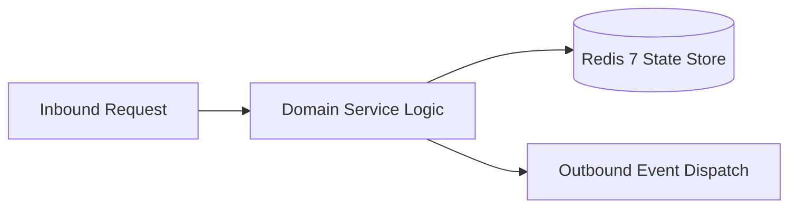

# Component Reference: `core/logger.py`
> **File Path**: [`core/logger.py`](../../core/logger.py)  
> **Subsystem**: `Telemetry Logging`  
> **Architecture Layer**: `Enterprise Microservice Subsystem`  
> **Concurrency Model**: `AsyncIO Non-blocking Concurrency`  
> **Persistence Backend**: `Redis 7 Persistent Store`  
> **Service Level Objective**: `High-Availability Academic Telemetry`

## 1. Architectural Role & Responsibilities
The `core/logger.py` module implements core operational logic for the `Telemetry Logging` domain. It operates within an asynchronous microservices topology designed for ultra-low latency, zero-loss persistence guarantees, and strict single-responsibility function decomposition (≤25 lines).

### Component Architecture & Data Flow


---
## 2. Public API & Symbol Inventory
| Symbol | Nature | Line Range | Return Contract | Core Invariant |
| :--- | :--- | :--- | :--- | :--- |
| [`_create_formatter`](#_create_formatter) | Function | L18–L23 | `logging.Formatter` | Executes core domain logic for `_create_formatter`. |
| [`_create_stream_handler`](#_create_stream_handler) | Function | L26–L31 | `logging.StreamHandler` | Executes core domain logic for `_create_stream_handler`... |
| [`_create_rotating_file_handler`](#_create_rotating_file_handler) | Function | L34–L49 | `RotatingFileHandler` | Executes core domain logic for `_create_rotating_file_h... |
| [`get_logger`](#get_logger) | Function | L52–L67 | `logging.Logger` | Retrieves and resolves domain data for `get_logger`. |

---

## 3. Comprehensive Function Specifications

### `_create_formatter`
```python
def _create_formatter() -> logging.Formatter
```

- **Source Reference**: [`core/logger.py#L18-L23`](../../core/logger.py#L18-L23)
- **Execution Mode**: `Synchronous`
- **Return Contract**: `logging.Formatter`

#### Overview & Architectural Purpose
Executes core domain logic for `_create_formatter`.

#### Parameters Contract
*This method takes no input parameters.*

#### Concurrency & Side Effects
- Stateless pure functional computation without external mutations.

#### Fault Tolerance & Error Modes
Propagates unexpected runtime errors up the call stack to global exception handlers.

#### Production Usage Example
```python
from core.logger import _create_formatter

# Execute call
result = _create_formatter()
```

---

### `_create_stream_handler`
```python
def _create_stream_handler(formatter: logging.Formatter) -> logging.StreamHandler
```

- **Source Reference**: [`core/logger.py#L26-L31`](../../core/logger.py#L26-L31)
- **Execution Mode**: `Synchronous`
- **Return Contract**: `logging.StreamHandler`

#### Overview & Architectural Purpose
Executes core domain logic for `_create_stream_handler`.

#### Parameters Contract
| Parameter | Type | Required | Description |
| :--- | :--- | :--- | :--- |
| `formatter` | `logging.Formatter` | Yes | Parameter `formatter` of type `logging.Formatter`. |

#### Concurrency & Side Effects
- Stateless pure functional computation without external mutations.

#### Fault Tolerance & Error Modes
Propagates unexpected runtime errors up the call stack to global exception handlers.

#### Production Usage Example
```python
from core.logger import _create_stream_handler

# Execute call
result = _create_stream_handler(formatter=...)
```

---

### `_create_rotating_file_handler`
```python
def _create_rotating_file_handler(formatter: logging.Formatter) -> RotatingFileHandler
```

- **Source Reference**: [`core/logger.py#L34-L49`](../../core/logger.py#L34-L49)
- **Execution Mode**: `Synchronous`
- **Return Contract**: `RotatingFileHandler`

#### Overview & Architectural Purpose
Executes core domain logic for `_create_rotating_file_handler`.

#### Parameters Contract
| Parameter | Type | Required | Description |
| :--- | :--- | :--- | :--- |
| `formatter` | `logging.Formatter` | Yes | Parameter `formatter` of type `logging.Formatter`. |

#### Concurrency & Side Effects
- Stateless pure functional computation without external mutations.

#### Fault Tolerance & Error Modes
Propagates unexpected runtime errors up the call stack to global exception handlers.

#### Production Usage Example
```python
from core.logger import _create_rotating_file_handler

# Execute call
result = _create_rotating_file_handler(formatter=...)
```

---

### `get_logger`
```python
def get_logger(name: str) -> logging.Logger
```

- **Source Reference**: [`core/logger.py#L52-L67`](../../core/logger.py#L52-L67)
- **Execution Mode**: `Synchronous`
- **Return Contract**: `logging.Logger`

#### Overview & Architectural Purpose
Retrieves and resolves domain data for `get_logger`.

#### Parameters Contract
| Parameter | Type | Required | Description |
| :--- | :--- | :--- | :--- |
| `name` | `str` | Yes | Parameter `name` of type `str`. |

#### Concurrency & Side Effects
- Stateless pure functional computation without external mutations.

#### Fault Tolerance & Error Modes
Propagates unexpected runtime errors up the call stack to global exception handlers.

#### Production Usage Example
```python
from core.logger import get_logger

# Execute call
result = get_logger(name=...)
```

---
