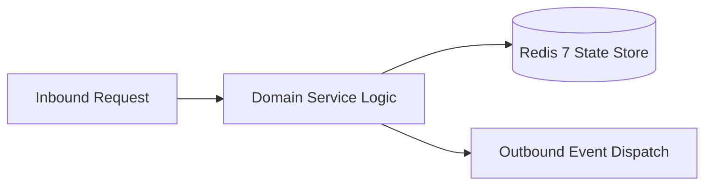

# Component Reference: `core/logger.py`
> **File Path**: [`core/logger.py`](../../core/logger.py)
> **Subsystem**: `Telemetry Logging`
> **Architecture Layer**: `Enterprise Microservice Subsystem`
> **Concurrency Model**: `AsyncIO Non-blocking Concurrency`
> **Persistence Backend**: `Redis 7 Persistent Store`
> **Service Level Objective**: `High-Availability Academic Telemetry`

## 1. Architectural Role & Responsibilities
The `core/logger.py` module implements core operational logic for the `Telemetry Logging` domain. It operates within an asynchronous microservices topology designed for ultra-low latency, zero-loss persistence guarantees, and strict single-responsibility function decomposition (≤25 lines).

### Component Architecture & Data Flow


---
## 2. Public API & Symbol Inventory
| Symbol | Nature | Line Range | Return Contract | Core Invariant |
| :--- | :--- | :--- | :--- | :--- |
| [`set_trace_id`](#set_trace_id) | Function | L22–L30 | `None` | Persists state updates for `set_trace_id`. |
| [`get_trace_id`](#get_trace_id) | Function | L33–L39 | `str` | Retrieves and resolves domain data for `get_trace_id`. |
| [`_TraceIdFilter.filter`](#_traceidfilterfilter) | Method | L45–L49 | `bool` | Executes core domain logic for `filter`. |
| [`_create_formatter`](#_create_formatter) | Function | L52–L63 | `logging.Formatter` | Executes core domain logic for `_create_formatter`. |
| [`_create_stream_handler`](#_create_stream_handler) | Function | L66–L78 | `logging.StreamHandler` | Executes core domain logic for `_create_stream_handler`... |
| [`_create_rotating_file_handler`](#_create_rotating_file_handler) | Function | L81–L99 | `RotatingFileHandler` | Executes core domain logic for `_create_rotating_file_h... |
| [`get_logger`](#get_logger) | Function | L102–L118 | `logging.Logger` | Retrieves and resolves domain data for `get_logger`. |

---

## 3. Comprehensive Function Specifications

### `set_trace_id`
```python
def set_trace_id(trace_id: str) -> None
```

- **Source Reference**: [`core/logger.py#L22-L30`](../../core/logger.py#L22-L30)
- **Execution Mode**: `Synchronous`
- **Return Contract**: `None`

#### Overview & Architectural Purpose
Persists state updates for `set_trace_id`.

#### Parameters Contract
| Parameter | Type | Required | Description |
| :--- | :--- | :--- | :--- |
| `trace_id` | `str` | Yes | Parameter `trace_id` of type `str`. |

#### Concurrency & Side Effects
- Stateless pure functional computation without external mutations.

#### Fault Tolerance & Error Modes
Propagates unexpected runtime errors up the call stack to global exception handlers.

#### Production Usage Example
```python
from core.logger import set_trace_id

# Execute call
result = set_trace_id(trace_id=...)
```

---

### `get_trace_id`
```python
def get_trace_id() -> str
```

- **Source Reference**: [`core/logger.py#L33-L39`](../../core/logger.py#L33-L39)
- **Execution Mode**: `Synchronous`
- **Return Contract**: `str`

#### Overview & Architectural Purpose
Retrieves and resolves domain data for `get_trace_id`.

#### Parameters Contract
*This method takes no input parameters.*

#### Concurrency & Side Effects
- Stateless pure functional computation without external mutations.

#### Fault Tolerance & Error Modes
Propagates unexpected runtime errors up the call stack to global exception handlers.

#### Production Usage Example
```python
from core.logger import get_trace_id

# Execute call
result = get_trace_id()
```

---

## Class Model: `_TraceIdFilter`

Encapsulates domain entities and data transfer logic for `_TraceIdFilter`.

### `_TraceIdFilter.filter`
```python
def filter(self, record: logging.LogRecord) -> bool
```

- **Source Reference**: [`core/logger.py#L45-L49`](../../core/logger.py#L45-L49)
- **Execution Mode**: `Synchronous`
- **Return Contract**: `bool`

#### Overview & Architectural Purpose
Executes core domain logic for `filter`.

#### Parameters Contract
| Parameter | Type | Required | Description |
| :--- | :--- | :--- | :--- |
| `record` | `logging.LogRecord` | Yes | Parameter `record` of type `logging.LogRecord`. |

#### Concurrency & Side Effects
- Stateless pure functional computation without external mutations.

#### Fault Tolerance & Error Modes
Propagates unexpected runtime errors up the call stack to global exception handlers.

#### Production Usage Example
```python
from core.logger import filter

# Execute call
result = filter(record=...)
```

---

### `_create_formatter`
```python
def _create_formatter() -> logging.Formatter
```

- **Source Reference**: [`core/logger.py#L52-L63`](../../core/logger.py#L52-L63)
- **Execution Mode**: `Synchronous`
- **Return Contract**: `logging.Formatter`

#### Overview & Architectural Purpose
Executes core domain logic for `_create_formatter`.

#### Parameters Contract
*This method takes no input parameters.*

#### Concurrency & Side Effects
- Stateless pure functional computation without external mutations.

#### Fault Tolerance & Error Modes
Propagates unexpected runtime errors up the call stack to global exception handlers.

#### Production Usage Example
```python
from core.logger import _create_formatter

# Execute call
result = _create_formatter()
```

---

### `_create_stream_handler`
```python
def _create_stream_handler(formatter: logging.Formatter) -> logging.StreamHandler
```

- **Source Reference**: [`core/logger.py#L66-L78`](../../core/logger.py#L66-L78)
- **Execution Mode**: `Synchronous`
- **Return Contract**: `logging.StreamHandler`

#### Overview & Architectural Purpose
Executes core domain logic for `_create_stream_handler`.

#### Parameters Contract
| Parameter | Type | Required | Description |
| :--- | :--- | :--- | :--- |
| `formatter` | `logging.Formatter` | Yes | Parameter `formatter` of type `logging.Formatter`. |

#### Concurrency & Side Effects
- Stateless pure functional computation without external mutations.

#### Fault Tolerance & Error Modes
Propagates unexpected runtime errors up the call stack to global exception handlers.

#### Production Usage Example
```python
from core.logger import _create_stream_handler

# Execute call
result = _create_stream_handler(formatter=...)
```

---

### `_create_rotating_file_handler`
```python
def _create_rotating_file_handler(formatter: logging.Formatter) -> RotatingFileHandler
```

- **Source Reference**: [`core/logger.py#L81-L99`](../../core/logger.py#L81-L99)
- **Execution Mode**: `Synchronous`
- **Return Contract**: `RotatingFileHandler`

#### Overview & Architectural Purpose
Executes core domain logic for `_create_rotating_file_handler`.

#### Parameters Contract
| Parameter | Type | Required | Description |
| :--- | :--- | :--- | :--- |
| `formatter` | `logging.Formatter` | Yes | Parameter `formatter` of type `logging.Formatter`. |

#### Concurrency & Side Effects
- Stateless pure functional computation without external mutations.

#### Fault Tolerance & Error Modes
Propagates unexpected runtime errors up the call stack to global exception handlers.

#### Production Usage Example
```python
from core.logger import _create_rotating_file_handler

# Execute call
result = _create_rotating_file_handler(formatter=...)
```

---

### `get_logger`
```python
def get_logger(name: str) -> logging.Logger
```

- **Source Reference**: [`core/logger.py#L102-L118`](../../core/logger.py#L102-L118)
- **Execution Mode**: `Synchronous`
- **Return Contract**: `logging.Logger`

#### Overview & Architectural Purpose
Retrieves and resolves domain data for `get_logger`.

#### Parameters Contract
| Parameter | Type | Required | Description |
| :--- | :--- | :--- | :--- |
| `name` | `str` | Yes | Parameter `name` of type `str`. |

#### Concurrency & Side Effects
- Stateless pure functional computation without external mutations.

#### Fault Tolerance & Error Modes
Propagates unexpected runtime errors up the call stack to global exception handlers.

#### Production Usage Example
```python
from core.logger import get_logger

# Execute call
result = get_logger(name=...)
```

---
