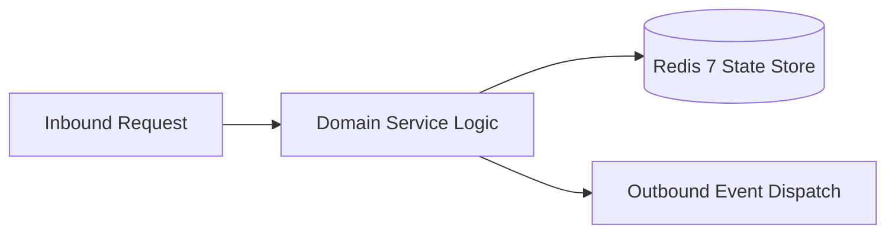

# Component Reference: `core/metrics.py`
> **File Path**: [`core/metrics.py`](../../core/metrics.py)
> **Subsystem**: `Prometheus Metrics Engine`
> **Architecture Layer**: `Enterprise Microservice Subsystem`
> **Concurrency Model**: `AsyncIO Non-blocking Concurrency`
> **Persistence Backend**: `Redis 7 Persistent Store`
> **Service Level Objective**: `High-Availability Academic Telemetry`

## 1. Architectural Role & Responsibilities
The `core/metrics.py` module implements core operational logic for the `Prometheus Metrics Engine` domain. It operates within an asynchronous microservices topology designed for ultra-low latency, zero-loss persistence guarantees, and strict single-responsibility function decomposition (≤25 lines).

### Component Architecture & Data Flow


---
## 2. Public API & Symbol Inventory
| Symbol | Nature | Line Range | Return Contract | Core Invariant |
| :--- | :--- | :--- | :--- | :--- |
| [`normalize_http_method`](#normalize_http_method) | Function | L44–L51 | `str` | Executes core domain logic for `normalize_http_method`. |
| [`record_http_request`](#record_http_request) | Function | L54–L63 | `None` | Executes core domain logic for `record_http_request`. |
| [`record_ai_inference`](#record_ai_inference) | Function | L66–L74 | `None` | Executes core domain logic for `record_ai_inference`. |
| [`set_redis_queue_length`](#set_redis_queue_length) | Function | L77–L85 | `None` | Persists state updates for `set_redis_queue_length`. |
| [`generate_metrics_payload`](#generate_metrics_payload) | Function | L88–L96 | `tuple[bytes, str]` | Executes core domain logic for `generate_metrics_payloa... |

---

## 3. Comprehensive Function Specifications

### `normalize_http_method`
```python
def normalize_http_method(method: str) -> str
```

- **Source Reference**: [`core/metrics.py#L44-L51`](../../core/metrics.py#L44-L51)
- **Execution Mode**: `Synchronous`
- **Return Contract**: `str`

#### Overview & Architectural Purpose
Executes core domain logic for `normalize_http_method`.

#### Parameters Contract
| Parameter | Type | Required | Description |
| :--- | :--- | :--- | :--- |
| `method` | `str` | Yes | Parameter `method` of type `str`. |

#### Concurrency & Side Effects
- Stateless pure functional computation without external mutations.

#### Fault Tolerance & Error Modes
Propagates unexpected runtime errors up the call stack to global exception handlers.

#### Production Usage Example
```python
from core.metrics import normalize_http_method

# Execute call
result = normalize_http_method(method=...)
```

---

### `record_http_request`
```python
def record_http_request(method: str, endpoint: str, status: int, duration: float) -> None
```

- **Source Reference**: [`core/metrics.py#L54-L63`](../../core/metrics.py#L54-L63)
- **Execution Mode**: `Synchronous`
- **Return Contract**: `None`

#### Overview & Architectural Purpose
Executes core domain logic for `record_http_request`.

#### Parameters Contract
| Parameter | Type | Required | Description |
| :--- | :--- | :--- | :--- |
| `method` | `str` | Yes | Parameter `method` of type `str`. |
| `endpoint` | `str` | Yes | Parameter `endpoint` of type `str`. |
| `status` | `int` | Yes | Attendance status code ('Present', 'Late', 'Excused', 'Absent'). |
| `duration` | `float` | Yes | Audio duration in seconds. |

#### Concurrency & Side Effects
- Stateless pure functional computation without external mutations.

#### Fault Tolerance & Error Modes
Propagates unexpected runtime errors up the call stack to global exception handlers.

#### Production Usage Example
```python
from core.metrics import record_http_request

# Execute call
result = record_http_request(method=..., endpoint=..., status=...)
```

---

### `record_ai_inference`
```python
def record_ai_inference(subsystem: str, model: str, duration: float) -> None
```

- **Source Reference**: [`core/metrics.py#L66-L74`](../../core/metrics.py#L66-L74)
- **Execution Mode**: `Synchronous`
- **Return Contract**: `None`

#### Overview & Architectural Purpose
Executes core domain logic for `record_ai_inference`.

#### Parameters Contract
| Parameter | Type | Required | Description |
| :--- | :--- | :--- | :--- |
| `subsystem` | `str` | Yes | Parameter `subsystem` of type `str`. |
| `model` | `str` | Yes | Parameter `model` of type `str`. |
| `duration` | `float` | Yes | Audio duration in seconds. |

#### Concurrency & Side Effects
- Stateless pure functional computation without external mutations.

#### Fault Tolerance & Error Modes
Propagates unexpected runtime errors up the call stack to global exception handlers.

#### Production Usage Example
```python
from core.metrics import record_ai_inference

# Execute call
result = record_ai_inference(subsystem=..., model=..., duration=...)
```

---

### `set_redis_queue_length`
```python
def set_redis_queue_length(queue_name: str, length: int) -> None
```

- **Source Reference**: [`core/metrics.py#L77-L85`](../../core/metrics.py#L77-L85)
- **Execution Mode**: `Synchronous`
- **Return Contract**: `None`

#### Overview & Architectural Purpose
Persists state updates for `set_redis_queue_length`.

#### Parameters Contract
| Parameter | Type | Required | Description |
| :--- | :--- | :--- | :--- |
| `queue_name` | `str` | Yes | Parameter `queue_name` of type `str`. |
| `length` | `int` | Yes | Parameter `length` of type `int`. |

#### Concurrency & Side Effects
- Stateless pure functional computation without external mutations.

#### Fault Tolerance & Error Modes
Propagates unexpected runtime errors up the call stack to global exception handlers.

#### Production Usage Example
```python
from core.metrics import set_redis_queue_length

# Execute call
result = set_redis_queue_length(queue_name=..., length=...)
```

---

### `generate_metrics_payload`
```python
def generate_metrics_payload() -> tuple[bytes, str]
```

- **Source Reference**: [`core/metrics.py#L88-L96`](../../core/metrics.py#L88-L96)
- **Execution Mode**: `Synchronous`
- **Return Contract**: `tuple[bytes, str]`

#### Overview & Architectural Purpose
Executes core domain logic for `generate_metrics_payload`.

#### Parameters Contract
*This method takes no input parameters.*

#### Concurrency & Side Effects
- Stateless pure functional computation without external mutations.

#### Fault Tolerance & Error Modes
Propagates unexpected runtime errors up the call stack to global exception handlers.

#### Production Usage Example
```python
from core.metrics import generate_metrics_payload

# Execute call
result = generate_metrics_payload()
```

---
