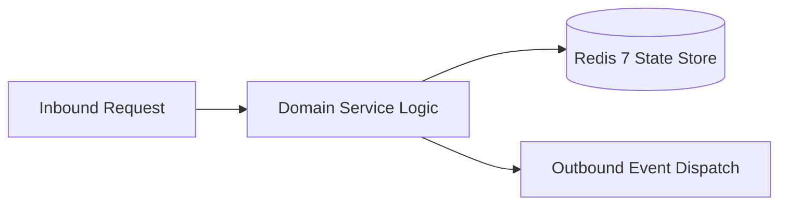

# Component Reference: `core/prompt_sanitizer.py`
> **File Path**: [`core/prompt_sanitizer.py`](../../core/prompt_sanitizer.py)
> **Subsystem**: `AI Prompt Sanitization`
> **Architecture Layer**: `Enterprise Microservice Subsystem`
> **Concurrency Model**: `AsyncIO Non-blocking Concurrency`
> **Persistence Backend**: `Redis 7 Persistent Store`
> **Service Level Objective**: `High-Availability Academic Telemetry`

## 1. Architectural Role & Responsibilities
The `core/prompt_sanitizer.py` module implements core operational logic for the `AI Prompt Sanitization` domain. It operates within an asynchronous microservices topology designed for ultra-low latency, zero-loss persistence guarantees, and strict single-responsibility function decomposition (≤25 lines).

### Component Architecture & Data Flow


---
## 2. Public API & Symbol Inventory
| Symbol | Nature | Line Range | Return Contract | Core Invariant |
| :--- | :--- | :--- | :--- | :--- |
| [`remove_invisible_control_chars`](#remove_invisible_control_chars) | Function | L40–L43 | `str` | Executes core domain logic for `remove_invisible_contro... |
| [`escape_context_delimiters`](#escape_context_delimiters) | Function | L46–L53 | `str` | Executes core domain logic for `escape_context_delimite... |
| [`detect_injection_indicators`](#detect_injection_indicators) | Function | L56–L62 | `list[str]` | Executes core domain logic for `detect_injection_indica... |
| [`sanitize_prompt`](#sanitize_prompt) | Function | L65–L83 | `SanitizeResult` | Executes core domain logic for `sanitize_prompt`. |

---

## 3. Comprehensive Function Specifications

## Class Model: `SanitizeResult`

Encapsulates domain entities and data transfer logic for `SanitizeResult`.

### `remove_invisible_control_chars`
```python
def remove_invisible_control_chars(text: str) -> str
```

- **Source Reference**: [`core/prompt_sanitizer.py#L40-L43`](../../core/prompt_sanitizer.py#L40-L43)
- **Execution Mode**: `Synchronous`
- **Return Contract**: `str`

#### Overview & Architectural Purpose
Executes core domain logic for `remove_invisible_control_chars`.

#### Parameters Contract
| Parameter | Type | Required | Description |
| :--- | :--- | :--- | :--- |
| `text` | `str` | Yes | Parameter `text` of type `str`. |

#### Concurrency & Side Effects
- Stateless pure functional computation without external mutations.

#### Fault Tolerance & Error Modes
Propagates unexpected runtime errors up the call stack to global exception handlers.

#### Production Usage Example
```python
from core.prompt_sanitizer import remove_invisible_control_chars

# Execute call
result = remove_invisible_control_chars(text=...)
```

---

### `escape_context_delimiters`
```python
def escape_context_delimiters(text: str) -> str
```

- **Source Reference**: [`core/prompt_sanitizer.py#L46-L53`](../../core/prompt_sanitizer.py#L46-L53)
- **Execution Mode**: `Synchronous`
- **Return Contract**: `str`

#### Overview & Architectural Purpose
Executes core domain logic for `escape_context_delimiters`.

#### Parameters Contract
| Parameter | Type | Required | Description |
| :--- | :--- | :--- | :--- |
| `text` | `str` | Yes | Parameter `text` of type `str`. |

#### Concurrency & Side Effects
- Stateless pure functional computation without external mutations.

#### Fault Tolerance & Error Modes
Propagates unexpected runtime errors up the call stack to global exception handlers.

#### Production Usage Example
```python
from core.prompt_sanitizer import escape_context_delimiters

# Execute call
result = escape_context_delimiters(text=...)
```

---

### `detect_injection_indicators`
```python
def detect_injection_indicators(text: str) -> list[str]
```

- **Source Reference**: [`core/prompt_sanitizer.py#L56-L62`](../../core/prompt_sanitizer.py#L56-L62)
- **Execution Mode**: `Synchronous`
- **Return Contract**: `list[str]`

#### Overview & Architectural Purpose
Executes core domain logic for `detect_injection_indicators`.

#### Parameters Contract
| Parameter | Type | Required | Description |
| :--- | :--- | :--- | :--- |
| `text` | `str` | Yes | Parameter `text` of type `str`. |

#### Concurrency & Side Effects
- Stateless pure functional computation without external mutations.

#### Fault Tolerance & Error Modes
Propagates unexpected runtime errors up the call stack to global exception handlers.

#### Production Usage Example
```python
from core.prompt_sanitizer import detect_injection_indicators

# Execute call
result = detect_injection_indicators(text=...)
```

---

### `sanitize_prompt`
```python
def sanitize_prompt(raw_text: str | None, max_length: int = 15000) -> SanitizeResult
```

- **Source Reference**: [`core/prompt_sanitizer.py#L65-L83`](../../core/prompt_sanitizer.py#L65-L83)
- **Execution Mode**: `Synchronous`
- **Return Contract**: `SanitizeResult`

#### Overview & Architectural Purpose
Executes core domain logic for `sanitize_prompt`.

#### Parameters Contract
| Parameter | Type | Required | Description |
| :--- | :--- | :--- | :--- |
| `raw_text` | `str | None` | Yes | Parameter `raw_text` of type `str | None`. |
| `max_length` | `int` | Yes | Parameter `max_length` of type `int`. |

#### Concurrency & Side Effects
- Emits structured telemetry events to system logging subsystem.

#### Fault Tolerance & Error Modes
Propagates unexpected runtime errors up the call stack to global exception handlers.

#### Production Usage Example
```python
from core.prompt_sanitizer import sanitize_prompt

# Execute call
result = sanitize_prompt(raw_text=..., max_length=...)
```

---
