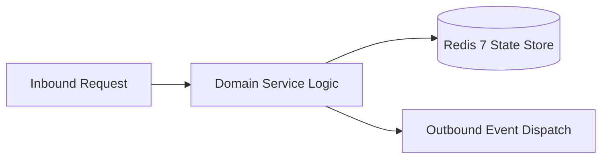

# Component Reference: `core/redis.py`
> **File Path**: [`core/redis.py`](../../core/redis.py)  
> **Subsystem**: `Redis Engine`  
> **Architecture Layer**: `Enterprise Microservice Subsystem`  
> **Concurrency Model**: `AsyncIO Non-blocking Concurrency`  
> **Persistence Backend**: `Redis 7 Persistent Store`  
> **Service Level Objective**: `High-Availability Academic Telemetry`

## 1. Architectural Role & Responsibilities
The `core/redis.py` module implements core operational logic for the `Redis Engine` domain. It operates within an asynchronous microservices topology designed for ultra-low latency, zero-loss persistence guarantees, and strict single-responsibility function decomposition (≤25 lines).

### Component Architecture & Data Flow


---
## 2. Public API & Symbol Inventory
| Symbol | Nature | Line Range | Return Contract | Core Invariant |
| :--- | :--- | :--- | :--- | :--- |
| [`get_redis_pool`](#get_redis_pool) | Function | L18–L31 | `ConnectionPool` | Retrieves and resolves domain data for `get_redis_pool`... |
| [`init_redis`](#init_redis) | Function | L34–L50 | `Redis | None` | Executes core domain logic for `init_redis`. |
| [`get_redis`](#get_redis) | Function | L53–L62 | `Redis | None` | Retrieves and resolves domain data for `get_redis`. |
| [`close_redis`](#close_redis) | Function | L65–L74 | `None` | Executes core domain logic for `close_redis`. |

---

## 3. Comprehensive Function Specifications

### `get_redis_pool`
```python
def get_redis_pool() -> ConnectionPool
```

- **Source Reference**: [`core/redis.py#L18-L31`](../../core/redis.py#L18-L31)
- **Execution Mode**: `Synchronous`
- **Return Contract**: `ConnectionPool`

#### Overview & Architectural Purpose
Retrieves and resolves domain data for `get_redis_pool`.

#### Parameters Contract
*This method takes no input parameters.*

#### Concurrency & Side Effects
- Stateless pure functional computation without external mutations.

#### Fault Tolerance & Error Modes
Propagates unexpected runtime errors up the call stack to global exception handlers.

#### Production Usage Example
```python
from core.redis import get_redis_pool

# Execute call
result = get_redis_pool()
```

---

### `init_redis`
```python
async def init_redis() -> Redis | None
```

- **Source Reference**: [`core/redis.py#L34-L50`](../../core/redis.py#L34-L50)
- **Execution Mode**: `Asynchronous (non-blocking)`
- **Return Contract**: `Redis | None`

#### Overview & Architectural Purpose
Executes core domain logic for `init_redis`.

#### Parameters Contract
*This method takes no input parameters.*

#### Concurrency & Side Effects
- Mutates or reads Redis L2 key space via asynchronous connection pool.
- Emits structured telemetry events to system logging subsystem.

#### Fault Tolerance & Error Modes
Encapsulates faults within `try/except` blocks, logging errors and returning safe fallback defaults.

#### Production Usage Example
```python
from core.redis import init_redis

# Execute call
result = await init_redis()
```

---

### `get_redis`
```python
async def get_redis() -> Redis | None
```

- **Source Reference**: [`core/redis.py#L53-L62`](../../core/redis.py#L53-L62)
- **Execution Mode**: `Asynchronous (non-blocking)`
- **Return Contract**: `Redis | None`

#### Overview & Architectural Purpose
Retrieves and resolves domain data for `get_redis`.

#### Parameters Contract
*This method takes no input parameters.*

#### Concurrency & Side Effects
- Stateless pure functional computation without external mutations.

#### Fault Tolerance & Error Modes
Propagates unexpected runtime errors up the call stack to global exception handlers.

#### Production Usage Example
```python
from core.redis import get_redis

# Execute call
result = await get_redis()
```

---

### `close_redis`
```python
async def close_redis() -> None
```

- **Source Reference**: [`core/redis.py#L65-L74`](../../core/redis.py#L65-L74)
- **Execution Mode**: `Asynchronous (non-blocking)`
- **Return Contract**: `None`

#### Overview & Architectural Purpose
Executes core domain logic for `close_redis`.

#### Parameters Contract
*This method takes no input parameters.*

#### Concurrency & Side Effects
- Emits structured telemetry events to system logging subsystem.

#### Fault Tolerance & Error Modes
Propagates unexpected runtime errors up the call stack to global exception handlers.

#### Production Usage Example
```python
from core.redis import close_redis

# Execute call
result = await close_redis()
```

---
