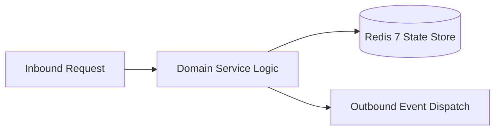

# Component Reference: `core/redis_cache.py`
> **File Path**: [`core/redis_cache.py`](../../core/redis_cache.py)  
> **Subsystem**: `Distributed L2 Cache`  
> **Architecture Layer**: `Enterprise Microservice Subsystem`  
> **Concurrency Model**: `AsyncIO Non-blocking Concurrency`  
> **Persistence Backend**: `Redis 7 Persistent Store`  
> **Service Level Objective**: `High-Availability Academic Telemetry`

## 1. Architectural Role & Responsibilities
The `core/redis_cache.py` module implements core operational logic for the `Distributed L2 Cache` domain. It operates within an asynchronous microservices topology designed for ultra-low latency, zero-loss persistence guarantees, and strict single-responsibility function decomposition (≤25 lines).

### Component Architecture & Data Flow


---
## 2. Public API & Symbol Inventory
| Symbol | Nature | Line Range | Return Contract | Core Invariant |
| :--- | :--- | :--- | :--- | :--- |
| [`cache_get`](#cache_get) | Function | L31–L49 | `str | None` | Executes core domain logic for `cache_get`. |
| [`cache_set`](#cache_set) | Function | L52–L70 | `None` | Executes core domain logic for `cache_set`. |
| [`cache_flush`](#cache_flush) | Function | L73–L92 | `int` | Executes core domain logic for `cache_flush`. |
| [`is_message_processed`](#is_message_processed) | Function | L95–L106 | `bool` | Executes core domain logic for `is_message_processed`. |
| [`mark_message_processed`](#mark_message_processed) | Function | L109–L119 | `None` | Executes core domain logic for `mark_message_processed`... |
| [`check_user_rate_limit`](#check_user_rate_limit) | Function | L122–L143 | `bool` | Executes core domain logic for `check_user_rate_limit`. |
| [`is_hash_processed`](#is_hash_processed) | Function | L146–L157 | `bool` | Executes core domain logic for `is_hash_processed`. |
| [`mark_hash_processed`](#mark_hash_processed) | Function | L160–L170 | `None` | Executes core domain logic for `mark_hash_processed`. |
| [`push_hw_task`](#push_hw_task) | Function | L173–L192 | `bool` | Executes core domain logic for `push_hw_task`. |
| [`pop_hw_task`](#pop_hw_task) | Function | L195–L211 | `dict | None` | Executes core domain logic for `pop_hw_task`. |
| [`ack_hw_task`](#ack_hw_task) | Function | L214–L230 | `None` | Executes core domain logic for `ack_hw_task`. |
| [`recover_stale_hw_tasks`](#recover_stale_hw_tasks) | Function | L233–L252 | `int` | Executes core domain logic for `recover_stale_hw_tasks`... |
| [`clear_hw_queue`](#clear_hw_queue) | Function | L255–L272 | `int` | Flushes and resets state for `clear_hw_queue`. |
| [`save_schedule_snapshot`](#save_schedule_snapshot) | Function | L275–L295 | `None` | Saves serialized entity data to storage for `save_sched... |
| [`load_schedule_snapshot`](#load_schedule_snapshot) | Function | L298–L317 | `tuple[dict | None, dict | None]` | Executes core domain logic for `load_schedule_snapshot`... |
| [`is_reminder_sent`](#is_reminder_sent) | Function | L320–L330 | `bool` | Executes core domain logic for `is_reminder_sent`. |
| [`mark_reminder_sent`](#mark_reminder_sent) | Function | L333–L342 | `None` | Executes core domain logic for `mark_reminder_sent`. |
| [`get_topic_state_redis`](#get_topic_state_redis) | Function | L345–L355 | `int | None` | Retrieves and resolves domain data for `get_topic_state... |
| [`set_topic_state_redis`](#set_topic_state_redis) | Function | L358–L367 | `None` | Persists state updates for `set_topic_state_redis`. |
| [`register_message_for_cleanup`](#register_message_for_cleanup) | Function | L370–L386 | `None` | Executes core domain logic for `register_message_for_cl... |
| [`get_expired_messages_for_cleanup`](#get_expired_messages_for_cleanup) | Function | L389–L409 | `list[tuple[int, int]]` | Retrieves and resolves domain data for `get_expired_mes... |
| [`redis_lock`](#redis_lock) | Function | L413–L437 | `AsyncGenerator[bool, None]` | Executes core domain logic for `redis_lock`. |
| [`nack_hw_task`](#nack_hw_task) | Function | L440–L462 | `bool` | Executes core domain logic for `nack_hw_task`. |

---

## 3. Comprehensive Function Specifications

### `cache_get`
```python
async def cache_get(key: str) -> str | None
```

- **Source Reference**: [`core/redis_cache.py#L31-L49`](../../core/redis_cache.py#L31-L49)
- **Execution Mode**: `Asynchronous (non-blocking)`
- **Return Contract**: `str | None`

#### Overview & Architectural Purpose
Executes core domain logic for `cache_get`.

#### Parameters Contract
| Parameter | Type | Required | Description |
| :--- | :--- | :--- | :--- |
| `key` | `str` | Yes | Parameter `key` of type `str`. |

#### Concurrency & Side Effects
- Emits structured telemetry events to system logging subsystem.
- Performs non-blocking network I/O over HTTP or gRPC.

#### Fault Tolerance & Error Modes
Encapsulates faults within `try/except` blocks, logging errors and returning safe fallback defaults.

#### Production Usage Example
```python
from core.redis_cache import cache_get

# Execute call
result = await cache_get(key=...)
```

---

### `cache_set`
```python
async def cache_set(key: str, value: str, ttl: int | None = REDIS_CACHE_TTL_SECONDS) -> None
```

- **Source Reference**: [`core/redis_cache.py#L52-L70`](../../core/redis_cache.py#L52-L70)
- **Execution Mode**: `Asynchronous (non-blocking)`
- **Return Contract**: `None`

#### Overview & Architectural Purpose
Executes core domain logic for `cache_set`.

#### Parameters Contract
| Parameter | Type | Required | Description |
| :--- | :--- | :--- | :--- |
| `key` | `str` | Yes | Parameter `key` of type `str`. |
| `value` | `str` | Yes | Parameter `value` of type `str`. |
| `ttl` | `int | None` | Yes | Parameter `ttl` of type `int | None`. |

#### Concurrency & Side Effects
- Mutates or reads Redis L2 key space via asynchronous connection pool.
- Emits structured telemetry events to system logging subsystem.

#### Fault Tolerance & Error Modes
Encapsulates faults within `try/except` blocks, logging errors and returning safe fallback defaults.

#### Production Usage Example
```python
from core.redis_cache import cache_set

# Execute call
result = await cache_set(key=..., value=..., ttl=...)
```

---

### `cache_flush`
```python
async def cache_flush(pattern: str = "sched:*") -> int
```

- **Source Reference**: [`core/redis_cache.py#L73-L92`](../../core/redis_cache.py#L73-L92)
- **Execution Mode**: `Asynchronous (non-blocking)`
- **Return Contract**: `int`

#### Overview & Architectural Purpose
Executes core domain logic for `cache_flush`.

#### Parameters Contract
| Parameter | Type | Required | Description |
| :--- | :--- | :--- | :--- |
| `pattern` | `str` | Yes | Parameter `pattern` of type `str`. |

#### Concurrency & Side Effects
- Emits structured telemetry events to system logging subsystem.

#### Fault Tolerance & Error Modes
Encapsulates faults within `try/except` blocks, logging errors and returning safe fallback defaults.

#### Production Usage Example
```python
from core.redis_cache import cache_flush

# Execute call
result = await cache_flush(pattern=...)
```

---

### `is_message_processed`
```python
async def is_message_processed(message_id: int) -> bool
```

- **Source Reference**: [`core/redis_cache.py#L95-L106`](../../core/redis_cache.py#L95-L106)
- **Execution Mode**: `Asynchronous (non-blocking)`
- **Return Contract**: `bool`

#### Overview & Architectural Purpose
Executes core domain logic for `is_message_processed`.

#### Parameters Contract
| Parameter | Type | Required | Description |
| :--- | :--- | :--- | :--- |
| `message_id` | `int` | Yes | Parameter `message_id` of type `int`. |

#### Concurrency & Side Effects
- Stateless pure functional computation without external mutations.

#### Fault Tolerance & Error Modes
Propagates unexpected runtime errors up the call stack to global exception handlers.

#### Production Usage Example
```python
from core.redis_cache import is_message_processed

# Execute call
result = await is_message_processed(message_id=...)
```

---

### `mark_message_processed`
```python
async def mark_message_processed(message_id: int) -> None
```

- **Source Reference**: [`core/redis_cache.py#L109-L119`](../../core/redis_cache.py#L109-L119)
- **Execution Mode**: `Asynchronous (non-blocking)`
- **Return Contract**: `None`

#### Overview & Architectural Purpose
Executes core domain logic for `mark_message_processed`.

#### Parameters Contract
| Parameter | Type | Required | Description |
| :--- | :--- | :--- | :--- |
| `message_id` | `int` | Yes | Parameter `message_id` of type `int`. |

#### Concurrency & Side Effects
- Stateless pure functional computation without external mutations.

#### Fault Tolerance & Error Modes
Propagates unexpected runtime errors up the call stack to global exception handlers.

#### Production Usage Example
```python
from core.redis_cache import mark_message_processed

# Execute call
result = await mark_message_processed(message_id=...)
```

---

### `check_user_rate_limit`
```python
async def check_user_rate_limit(user_id: int) -> bool
```

- **Source Reference**: [`core/redis_cache.py#L122-L143`](../../core/redis_cache.py#L122-L143)
- **Execution Mode**: `Asynchronous (non-blocking)`
- **Return Contract**: `bool`

#### Overview & Architectural Purpose
Executes core domain logic for `check_user_rate_limit`.

#### Parameters Contract
| Parameter | Type | Required | Description |
| :--- | :--- | :--- | :--- |
| `user_id` | `int` | Yes | Unique 64-bit Telegram user identifier. |

#### Concurrency & Side Effects
- Emits structured telemetry events to system logging subsystem.

#### Fault Tolerance & Error Modes
Encapsulates faults within `try/except` blocks, logging errors and returning safe fallback defaults.

#### Production Usage Example
```python
from core.redis_cache import check_user_rate_limit

# Execute call
result = await check_user_rate_limit(user_id=...)
```

---

### `is_hash_processed`
```python
async def is_hash_processed(content_hash: str) -> bool
```

- **Source Reference**: [`core/redis_cache.py#L146-L157`](../../core/redis_cache.py#L146-L157)
- **Execution Mode**: `Asynchronous (non-blocking)`
- **Return Contract**: `bool`

#### Overview & Architectural Purpose
Executes core domain logic for `is_hash_processed`.

#### Parameters Contract
| Parameter | Type | Required | Description |
| :--- | :--- | :--- | :--- |
| `content_hash` | `str` | Yes | Parameter `content_hash` of type `str`. |

#### Concurrency & Side Effects
- Stateless pure functional computation without external mutations.

#### Fault Tolerance & Error Modes
Propagates unexpected runtime errors up the call stack to global exception handlers.

#### Production Usage Example
```python
from core.redis_cache import is_hash_processed

# Execute call
result = await is_hash_processed(content_hash=...)
```

---

### `mark_hash_processed`
```python
async def mark_hash_processed(content_hash: str) -> None
```

- **Source Reference**: [`core/redis_cache.py#L160-L170`](../../core/redis_cache.py#L160-L170)
- **Execution Mode**: `Asynchronous (non-blocking)`
- **Return Contract**: `None`

#### Overview & Architectural Purpose
Executes core domain logic for `mark_hash_processed`.

#### Parameters Contract
| Parameter | Type | Required | Description |
| :--- | :--- | :--- | :--- |
| `content_hash` | `str` | Yes | Parameter `content_hash` of type `str`. |

#### Concurrency & Side Effects
- Stateless pure functional computation without external mutations.

#### Fault Tolerance & Error Modes
Propagates unexpected runtime errors up the call stack to global exception handlers.

#### Production Usage Example
```python
from core.redis_cache import mark_hash_processed

# Execute call
result = await mark_hash_processed(content_hash=...)
```

---

### `push_hw_task`
```python
async def push_hw_task(task_data: dict) -> bool
```

- **Source Reference**: [`core/redis_cache.py#L173-L192`](../../core/redis_cache.py#L173-L192)
- **Execution Mode**: `Asynchronous (non-blocking)`
- **Return Contract**: `bool`

#### Overview & Architectural Purpose
Executes core domain logic for `push_hw_task`.

#### Parameters Contract
| Parameter | Type | Required | Description |
| :--- | :--- | :--- | :--- |
| `task_data` | `dict` | Yes | Parameter `task_data` of type `dict`. |

#### Concurrency & Side Effects
- Emits structured telemetry events to system logging subsystem.

#### Fault Tolerance & Error Modes
Encapsulates faults within `try/except` blocks, logging errors and returning safe fallback defaults.

#### Production Usage Example
```python
from core.redis_cache import push_hw_task

# Execute call
result = await push_hw_task(task_data=...)
```

---

### `pop_hw_task`
```python
async def pop_hw_task(timeout: int = 2) -> dict | None
```

- **Source Reference**: [`core/redis_cache.py#L195-L211`](../../core/redis_cache.py#L195-L211)
- **Execution Mode**: `Asynchronous (non-blocking)`
- **Return Contract**: `dict | None`

#### Overview & Architectural Purpose
Executes core domain logic for `pop_hw_task`.

#### Parameters Contract
| Parameter | Type | Required | Description |
| :--- | :--- | :--- | :--- |
| `timeout` | `int` | Yes | Parameter `timeout` of type `int`. |

#### Concurrency & Side Effects
- Emits structured telemetry events to system logging subsystem.

#### Fault Tolerance & Error Modes
Encapsulates faults within `try/except` blocks, logging errors and returning safe fallback defaults.

#### Production Usage Example
```python
from core.redis_cache import pop_hw_task

# Execute call
result = await pop_hw_task(timeout=...)
```

---

### `ack_hw_task`
```python
async def ack_hw_task(task_data: dict) -> None
```

- **Source Reference**: [`core/redis_cache.py#L214-L230`](../../core/redis_cache.py#L214-L230)
- **Execution Mode**: `Asynchronous (non-blocking)`
- **Return Contract**: `None`

#### Overview & Architectural Purpose
Executes core domain logic for `ack_hw_task`.

#### Parameters Contract
| Parameter | Type | Required | Description |
| :--- | :--- | :--- | :--- |
| `task_data` | `dict` | Yes | Parameter `task_data` of type `dict`. |

#### Concurrency & Side Effects
- Emits structured telemetry events to system logging subsystem.

#### Fault Tolerance & Error Modes
Encapsulates faults within `try/except` blocks, logging errors and returning safe fallback defaults.

#### Production Usage Example
```python
from core.redis_cache import ack_hw_task

# Execute call
result = await ack_hw_task(task_data=...)
```

---

### `recover_stale_hw_tasks`
```python
async def recover_stale_hw_tasks() -> int
```

- **Source Reference**: [`core/redis_cache.py#L233-L252`](../../core/redis_cache.py#L233-L252)
- **Execution Mode**: `Asynchronous (non-blocking)`
- **Return Contract**: `int`

#### Overview & Architectural Purpose
Executes core domain logic for `recover_stale_hw_tasks`.

#### Parameters Contract
*This method takes no input parameters.*

#### Concurrency & Side Effects
- Emits structured telemetry events to system logging subsystem.

#### Fault Tolerance & Error Modes
Encapsulates faults within `try/except` blocks, logging errors and returning safe fallback defaults.

#### Production Usage Example
```python
from core.redis_cache import recover_stale_hw_tasks

# Execute call
result = await recover_stale_hw_tasks()
```

---

### `clear_hw_queue`
```python
async def clear_hw_queue() -> int
```

- **Source Reference**: [`core/redis_cache.py#L255-L272`](../../core/redis_cache.py#L255-L272)
- **Execution Mode**: `Asynchronous (non-blocking)`
- **Return Contract**: `int`

#### Overview & Architectural Purpose
Flushes and resets state for `clear_hw_queue`.

#### Parameters Contract
*This method takes no input parameters.*

#### Concurrency & Side Effects
- Emits structured telemetry events to system logging subsystem.

#### Fault Tolerance & Error Modes
Encapsulates faults within `try/except` blocks, logging errors and returning safe fallback defaults.

#### Production Usage Example
```python
from core.redis_cache import clear_hw_queue

# Execute call
result = await clear_hw_queue()
```

---

### `save_schedule_snapshot`
```python
async def save_schedule_snapshot(snapshot: dict, meta: dict, ttl: int = 86400) -> None
```

- **Source Reference**: [`core/redis_cache.py#L275-L295`](../../core/redis_cache.py#L275-L295)
- **Execution Mode**: `Asynchronous (non-blocking)`
- **Return Contract**: `None`

#### Overview & Architectural Purpose
Saves serialized entity data to storage for `save_schedule_snapshot`.

#### Parameters Contract
| Parameter | Type | Required | Description |
| :--- | :--- | :--- | :--- |
| `snapshot` | `dict` | Yes | Parameter `snapshot` of type `dict`. |
| `meta` | `dict` | Yes | Parameter `meta` of type `dict`. |
| `ttl` | `int` | Yes | Parameter `ttl` of type `int`. |

#### Concurrency & Side Effects
- Emits structured telemetry events to system logging subsystem.

#### Fault Tolerance & Error Modes
Encapsulates faults within `try/except` blocks, logging errors and returning safe fallback defaults.

#### Production Usage Example
```python
from core.redis_cache import save_schedule_snapshot

# Execute call
result = await save_schedule_snapshot(snapshot=..., meta=..., ttl=...)
```

---

### `load_schedule_snapshot`
```python
async def load_schedule_snapshot() -> tuple[dict | None, dict | None]
```

- **Source Reference**: [`core/redis_cache.py#L298-L317`](../../core/redis_cache.py#L298-L317)
- **Execution Mode**: `Asynchronous (non-blocking)`
- **Return Contract**: `tuple[dict | None, dict | None]`

#### Overview & Architectural Purpose
Executes core domain logic for `load_schedule_snapshot`.

#### Parameters Contract
*This method takes no input parameters.*

#### Concurrency & Side Effects
- Emits structured telemetry events to system logging subsystem.
- Performs non-blocking network I/O over HTTP or gRPC.

#### Fault Tolerance & Error Modes
Encapsulates faults within `try/except` blocks, logging errors and returning safe fallback defaults.

#### Production Usage Example
```python
from core.redis_cache import load_schedule_snapshot

# Execute call
result = await load_schedule_snapshot()
```

---

### `is_reminder_sent`
```python
async def is_reminder_sent(rem_key: str) -> bool
```

- **Source Reference**: [`core/redis_cache.py#L320-L330`](../../core/redis_cache.py#L320-L330)
- **Execution Mode**: `Asynchronous (non-blocking)`
- **Return Contract**: `bool`

#### Overview & Architectural Purpose
Executes core domain logic for `is_reminder_sent`.

#### Parameters Contract
| Parameter | Type | Required | Description |
| :--- | :--- | :--- | :--- |
| `rem_key` | `str` | Yes | Parameter `rem_key` of type `str`. |

#### Concurrency & Side Effects
- Stateless pure functional computation without external mutations.

#### Fault Tolerance & Error Modes
Propagates unexpected runtime errors up the call stack to global exception handlers.

#### Production Usage Example
```python
from core.redis_cache import is_reminder_sent

# Execute call
result = await is_reminder_sent(rem_key=...)
```

---

### `mark_reminder_sent`
```python
async def mark_reminder_sent(rem_key: str, ttl: int = 86400) -> None
```

- **Source Reference**: [`core/redis_cache.py#L333-L342`](../../core/redis_cache.py#L333-L342)
- **Execution Mode**: `Asynchronous (non-blocking)`
- **Return Contract**: `None`

#### Overview & Architectural Purpose
Executes core domain logic for `mark_reminder_sent`.

#### Parameters Contract
| Parameter | Type | Required | Description |
| :--- | :--- | :--- | :--- |
| `rem_key` | `str` | Yes | Parameter `rem_key` of type `str`. |
| `ttl` | `int` | Yes | Parameter `ttl` of type `int`. |

#### Concurrency & Side Effects
- Stateless pure functional computation without external mutations.

#### Fault Tolerance & Error Modes
Propagates unexpected runtime errors up the call stack to global exception handlers.

#### Production Usage Example
```python
from core.redis_cache import mark_reminder_sent

# Execute call
result = await mark_reminder_sent(rem_key=..., ttl=...)
```

---

### `get_topic_state_redis`
```python
async def get_topic_state_redis(key: str = "topic:main_msg_id") -> int | None
```

- **Source Reference**: [`core/redis_cache.py#L345-L355`](../../core/redis_cache.py#L345-L355)
- **Execution Mode**: `Asynchronous (non-blocking)`
- **Return Contract**: `int | None`

#### Overview & Architectural Purpose
Retrieves and resolves domain data for `get_topic_state_redis`.

#### Parameters Contract
| Parameter | Type | Required | Description |
| :--- | :--- | :--- | :--- |
| `key` | `str` | Yes | Parameter `key` of type `str`. |

#### Concurrency & Side Effects
- Stateless pure functional computation without external mutations.

#### Fault Tolerance & Error Modes
Propagates unexpected runtime errors up the call stack to global exception handlers.

#### Production Usage Example
```python
from core.redis_cache import get_topic_state_redis

# Execute call
result = await get_topic_state_redis(key=...)
```

---

### `set_topic_state_redis`
```python
async def set_topic_state_redis(val: int, key: str = "topic:main_msg_id") -> None
```

- **Source Reference**: [`core/redis_cache.py#L358-L367`](../../core/redis_cache.py#L358-L367)
- **Execution Mode**: `Asynchronous (non-blocking)`
- **Return Contract**: `None`

#### Overview & Architectural Purpose
Persists state updates for `set_topic_state_redis`.

#### Parameters Contract
| Parameter | Type | Required | Description |
| :--- | :--- | :--- | :--- |
| `val` | `int` | Yes | Parameter `val` of type `int`. |
| `key` | `str` | Yes | Parameter `key` of type `str`. |

#### Concurrency & Side Effects
- Stateless pure functional computation without external mutations.

#### Fault Tolerance & Error Modes
Propagates unexpected runtime errors up the call stack to global exception handlers.

#### Production Usage Example
```python
from core.redis_cache import set_topic_state_redis

# Execute call
result = await set_topic_state_redis(val=..., key=...)
```

---

### `register_message_for_cleanup`
```python
async def register_message_for_cleanup(chat_id: int, msg_id: int, delay_sec: int = 900) -> None
```

- **Source Reference**: [`core/redis_cache.py#L370-L386`](../../core/redis_cache.py#L370-L386)
- **Execution Mode**: `Asynchronous (non-blocking)`
- **Return Contract**: `None`

#### Overview & Architectural Purpose
Executes core domain logic for `register_message_for_cleanup`.

#### Parameters Contract
| Parameter | Type | Required | Description |
| :--- | :--- | :--- | :--- |
| `chat_id` | `int` | Yes | Unique 64-bit Telegram chat or supergroup identifier. |
| `msg_id` | `int` | Yes | Parameter `msg_id` of type `int`. |
| `delay_sec` | `int` | Yes | Parameter `delay_sec` of type `int`. |

#### Concurrency & Side Effects
- Emits structured telemetry events to system logging subsystem.

#### Fault Tolerance & Error Modes
Encapsulates faults within `try/except` blocks, logging errors and returning safe fallback defaults.

#### Production Usage Example
```python
from core.redis_cache import register_message_for_cleanup

# Execute call
result = await register_message_for_cleanup(chat_id=..., msg_id=..., delay_sec=...)
```

---

### `get_expired_messages_for_cleanup`
```python
async def get_expired_messages_for_cleanup() -> list[tuple[int, int]]
```

- **Source Reference**: [`core/redis_cache.py#L389-L409`](../../core/redis_cache.py#L389-L409)
- **Execution Mode**: `Asynchronous (non-blocking)`
- **Return Contract**: `list[tuple[int, int]]`

#### Overview & Architectural Purpose
Retrieves and resolves domain data for `get_expired_messages_for_cleanup`.

#### Parameters Contract
*This method takes no input parameters.*

#### Concurrency & Side Effects
- Emits structured telemetry events to system logging subsystem.

#### Fault Tolerance & Error Modes
Encapsulates faults within `try/except` blocks, logging errors and returning safe fallback defaults.

#### Production Usage Example
```python
from core.redis_cache import get_expired_messages_for_cleanup

# Execute call
result = await get_expired_messages_for_cleanup()
```

---

### `redis_lock`
```python
async def redis_lock(key: str, ttl: int = 20) -> AsyncGenerator[bool, None]
```

- **Source Reference**: [`core/redis_cache.py#L413-L437`](../../core/redis_cache.py#L413-L437)
- **Execution Mode**: `Asynchronous (non-blocking)`
- **Return Contract**: `AsyncGenerator[bool, None]`

#### Overview & Architectural Purpose
Executes core domain logic for `redis_lock`.

#### Parameters Contract
| Parameter | Type | Required | Description |
| :--- | :--- | :--- | :--- |
| `key` | `str` | Yes | Parameter `key` of type `str`. |
| `ttl` | `int` | Yes | Parameter `ttl` of type `int`. |

#### Concurrency & Side Effects
- Mutates or reads Redis L2 key space via asynchronous connection pool.
- Emits structured telemetry events to system logging subsystem.

#### Fault Tolerance & Error Modes
Encapsulates faults within `try/except` blocks, logging errors and returning safe fallback defaults.

#### Production Usage Example
```python
from core.redis_cache import redis_lock

# Execute call
result = await redis_lock(key=..., ttl=...)
```

---

### `nack_hw_task`
```python
async def nack_hw_task(task_data: dict, max_retries: int = 3) -> bool
```

- **Source Reference**: [`core/redis_cache.py#L440-L462`](../../core/redis_cache.py#L440-L462)
- **Execution Mode**: `Asynchronous (non-blocking)`
- **Return Contract**: `bool`

#### Overview & Architectural Purpose
Executes core domain logic for `nack_hw_task`.

#### Parameters Contract
| Parameter | Type | Required | Description |
| :--- | :--- | :--- | :--- |
| `task_data` | `dict` | Yes | Parameter `task_data` of type `dict`. |
| `max_retries` | `int` | Yes | Parameter `max_retries` of type `int`. |

#### Concurrency & Side Effects
- Emits structured telemetry events to system logging subsystem.

#### Fault Tolerance & Error Modes
Propagates unexpected runtime errors up the call stack to global exception handlers.

#### Production Usage Example
```python
from core.redis_cache import nack_hw_task

# Execute call
result = await nack_hw_task(task_data=..., max_retries=...)
```

---
