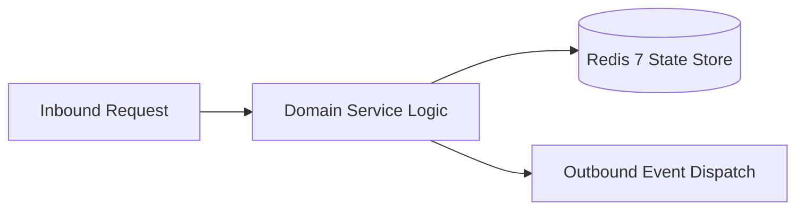

# Component Reference: `core/telemetry.py`
> **File Path**: [`core/telemetry.py`](../../core/telemetry.py)
> **Subsystem**: `OpenTelemetry Tracing`
> **Architecture Layer**: `Enterprise Microservice Subsystem`
> **Concurrency Model**: `AsyncIO Non-blocking Concurrency`
> **Persistence Backend**: `Redis 7 Persistent Store`
> **Service Level Objective**: `High-Availability Academic Telemetry`

## 1. Architectural Role & Responsibilities
The `core/telemetry.py` module implements core operational logic for the `OpenTelemetry Tracing` domain. It operates within an asynchronous microservices topology designed for ultra-low latency, zero-loss persistence guarantees, and strict single-responsibility function decomposition (≤25 lines).

### Component Architecture & Data Flow


---
## 2. Public API & Symbol Inventory
| Symbol | Nature | Line Range | Return Contract | Core Invariant |
| :--- | :--- | :--- | :--- | :--- |
| [`get_telemetry_sampler`](#get_telemetry_sampler) | Function | L45–L56 | `Sampler` | Retrieves and resolves domain data for `get_telemetry_s... |
| [`setup_telemetry`](#setup_telemetry) | Function | L59–L82 | `None` | Executes core domain logic for `setup_telemetry`. |
| [`get_tracer`](#get_tracer) | Function | L85–L91 | `trace.Tracer` | Retrieves and resolves domain data for `get_tracer`. |
| [`format_trace_id`](#format_trace_id) | Function | L94–L104 | `str` | Formats message payload and presentation markup for `fo... |
| [`inject_trace_carrier`](#inject_trace_carrier) | Function | L107–L115 | `dict[str, str]` | Executes core domain logic for `inject_trace_carrier`. |
| [`extract_trace_context`](#extract_trace_context) | Function | L118–L126 | `context.Context` | Executes core domain logic for `extract_trace_context`. |
| [`carrier_from_grpc_metadata`](#carrier_from_grpc_metadata) | Function | L129–L141 | `dict[str, str]` | Executes core domain logic for `carrier_from_grpc_metad... |
| [`carrier_to_grpc_metadata`](#carrier_to_grpc_metadata) | Function | L144–L150 | `tuple[tuple[str, str], ...]` | Executes core domain logic for `carrier_to_grpc_metadat... |
| [`SpanContextManager.__init__`](#spancontextmanager__init__) | Method | L156–L168 | `None` | Executes core domain logic for `__init__`. |
| [`SpanContextManager.__enter__`](#spancontextmanager__enter__) | Method | L170–L180 | `trace.Span` | Executes core domain logic for `__enter__`. |
| [`SpanContextManager.__exit__`](#spancontextmanager__exit__) | Method | L182–L188 | `bool | None` | Executes core domain logic for `__exit__`. |
| [`SpanContextManager.__aenter__`](#spancontextmanager__aenter__) | Method | L190–L191 | `trace.Span` | Executes core domain logic for `__aenter__`. |
| [`SpanContextManager.__aexit__`](#spancontextmanager__aexit__) | Method | L193–L194 | `bool | None` | Executes core domain logic for `__aexit__`. |
| [`trace_span`](#trace_span) | Function | L197–L213 | `SpanContextManager` | Executes core domain logic for `trace_span`. |

---

## 3. Comprehensive Function Specifications

### `get_telemetry_sampler`
```python
def get_telemetry_sampler(ratio: float = 1.0) -> Sampler
```

- **Source Reference**: [`core/telemetry.py#L45-L56`](../../core/telemetry.py#L45-L56)
- **Execution Mode**: `Synchronous`
- **Return Contract**: `Sampler`

#### Overview & Architectural Purpose
Retrieves and resolves domain data for `get_telemetry_sampler`.

#### Parameters Contract
| Parameter | Type | Required | Description |
| :--- | :--- | :--- | :--- |
| `ratio` | `float` | Yes | Parameter `ratio` of type `float`. |

#### Concurrency & Side Effects
- Stateless pure functional computation without external mutations.

#### Fault Tolerance & Error Modes
Propagates unexpected runtime errors up the call stack to global exception handlers.

#### Production Usage Example
```python
from core.telemetry import get_telemetry_sampler

# Execute call
result = get_telemetry_sampler(ratio=...)
```

---

### `setup_telemetry`
```python
def setup_telemetry( service_name: str | None = None, sampling_ratio: float | None = None, ) -> None
```

- **Source Reference**: [`core/telemetry.py#L59-L82`](../../core/telemetry.py#L59-L82)
- **Execution Mode**: `Synchronous`
- **Return Contract**: `None`

#### Overview & Architectural Purpose
Executes core domain logic for `setup_telemetry`.

#### Parameters Contract
| Parameter | Type | Required | Description |
| :--- | :--- | :--- | :--- |
| `service_name` | `str | None` | Yes | Parameter `service_name` of type `str | None`. |
| `sampling_ratio` | `float | None` | Yes | Parameter `sampling_ratio` of type `float | None`. |

#### Concurrency & Side Effects
- Emits structured telemetry events to system logging subsystem.

#### Fault Tolerance & Error Modes
Propagates unexpected runtime errors up the call stack to global exception handlers.

#### Production Usage Example
```python
from core.telemetry import setup_telemetry

# Execute call
result = setup_telemetry(service_name=..., sampling_ratio=...)
```

---

### `get_tracer`
```python
def get_tracer(name: str = "para") -> trace.Tracer
```

- **Source Reference**: [`core/telemetry.py#L85-L91`](../../core/telemetry.py#L85-L91)
- **Execution Mode**: `Synchronous`
- **Return Contract**: `trace.Tracer`

#### Overview & Architectural Purpose
Retrieves and resolves domain data for `get_tracer`.

#### Parameters Contract
| Parameter | Type | Required | Description |
| :--- | :--- | :--- | :--- |
| `name` | `str` | Yes | Parameter `name` of type `str`. |

#### Concurrency & Side Effects
- Stateless pure functional computation without external mutations.

#### Fault Tolerance & Error Modes
Propagates unexpected runtime errors up the call stack to global exception handlers.

#### Production Usage Example
```python
from core.telemetry import get_tracer

# Execute call
result = get_tracer(name=...)
```

---

### `format_trace_id`
```python
def format_trace_id(span: trace.Span | None = None) -> str
```

- **Source Reference**: [`core/telemetry.py#L94-L104`](../../core/telemetry.py#L94-L104)
- **Execution Mode**: `Synchronous`
- **Return Contract**: `str`

#### Overview & Architectural Purpose
Formats message payload and presentation markup for `format_trace_id`.

#### Parameters Contract
| Parameter | Type | Required | Description |
| :--- | :--- | :--- | :--- |
| `span` | `trace.Span | None` | Yes | Parameter `span` of type `trace.Span | None`. |

#### Concurrency & Side Effects
- Stateless pure functional computation without external mutations.

#### Fault Tolerance & Error Modes
Propagates unexpected runtime errors up the call stack to global exception handlers.

#### Production Usage Example
```python
from core.telemetry import format_trace_id

# Execute call
result = format_trace_id(span=...)
```

---

### `inject_trace_carrier`
```python
def inject_trace_carrier(carrier: dict[str, str] | None = None) -> dict[str, str]
```

- **Source Reference**: [`core/telemetry.py#L107-L115`](../../core/telemetry.py#L107-L115)
- **Execution Mode**: `Synchronous`
- **Return Contract**: `dict[str, str]`

#### Overview & Architectural Purpose
Executes core domain logic for `inject_trace_carrier`.

#### Parameters Contract
| Parameter | Type | Required | Description |
| :--- | :--- | :--- | :--- |
| `carrier` | `dict[str, str] | None` | Yes | Parameter `carrier` of type `dict[str, str] | None`. |

#### Concurrency & Side Effects
- Stateless pure functional computation without external mutations.

#### Fault Tolerance & Error Modes
Propagates unexpected runtime errors up the call stack to global exception handlers.

#### Production Usage Example
```python
from core.telemetry import inject_trace_carrier

# Execute call
result = inject_trace_carrier(carrier=...)
```

---

### `extract_trace_context`
```python
def extract_trace_context(carrier: dict[str, str] | None) -> context.Context
```

- **Source Reference**: [`core/telemetry.py#L118-L126`](../../core/telemetry.py#L118-L126)
- **Execution Mode**: `Synchronous`
- **Return Contract**: `context.Context`

#### Overview & Architectural Purpose
Executes core domain logic for `extract_trace_context`.

#### Parameters Contract
| Parameter | Type | Required | Description |
| :--- | :--- | :--- | :--- |
| `carrier` | `dict[str, str] | None` | Yes | Parameter `carrier` of type `dict[str, str] | None`. |

#### Concurrency & Side Effects
- Stateless pure functional computation without external mutations.

#### Fault Tolerance & Error Modes
Propagates unexpected runtime errors up the call stack to global exception handlers.

#### Production Usage Example
```python
from core.telemetry import extract_trace_context

# Execute call
result = extract_trace_context(carrier=...)
```

---

### `carrier_from_grpc_metadata`
```python
def carrier_from_grpc_metadata(metadata: Any) -> dict[str, str]
```

- **Source Reference**: [`core/telemetry.py#L129-L141`](../../core/telemetry.py#L129-L141)
- **Execution Mode**: `Synchronous`
- **Return Contract**: `dict[str, str]`

#### Overview & Architectural Purpose
Executes core domain logic for `carrier_from_grpc_metadata`.

#### Parameters Contract
| Parameter | Type | Required | Description |
| :--- | :--- | :--- | :--- |
| `metadata` | `Any` | Yes | Parameter `metadata` of type `Any`. |

#### Concurrency & Side Effects
- Stateless pure functional computation without external mutations.

#### Fault Tolerance & Error Modes
Propagates unexpected runtime errors up the call stack to global exception handlers.

#### Production Usage Example
```python
from core.telemetry import carrier_from_grpc_metadata

# Execute call
result = carrier_from_grpc_metadata(metadata=...)
```

---

### `carrier_to_grpc_metadata`
```python
def carrier_to_grpc_metadata(carrier: dict[str, str]) -> tuple[tuple[str, str], ...]
```

- **Source Reference**: [`core/telemetry.py#L144-L150`](../../core/telemetry.py#L144-L150)
- **Execution Mode**: `Synchronous`
- **Return Contract**: `tuple[tuple[str, str], ...]`

#### Overview & Architectural Purpose
Executes core domain logic for `carrier_to_grpc_metadata`.

#### Parameters Contract
| Parameter | Type | Required | Description |
| :--- | :--- | :--- | :--- |
| `carrier` | `dict[str, str]` | Yes | Parameter `carrier` of type `dict[str, str]`. |

#### Concurrency & Side Effects
- Stateless pure functional computation without external mutations.

#### Fault Tolerance & Error Modes
Propagates unexpected runtime errors up the call stack to global exception handlers.

#### Production Usage Example
```python
from core.telemetry import carrier_to_grpc_metadata

# Execute call
result = carrier_to_grpc_metadata(carrier=...)
```

---

## Class Model: `SpanContextManager`

Encapsulates domain entities and data transfer logic for `SpanContextManager`.

### `SpanContextManager.__init__`
```python
def __init__( self, name: str, attributes: dict[str, Any] | None = None, parent_context: context.Context | None = None, tracer_name: str = "para", ) -> None
```

- **Source Reference**: [`core/telemetry.py#L156-L168`](../../core/telemetry.py#L156-L168)
- **Execution Mode**: `Synchronous`
- **Return Contract**: `None`

#### Overview & Architectural Purpose
Executes core domain logic for `__init__`.

#### Parameters Contract
| Parameter | Type | Required | Description |
| :--- | :--- | :--- | :--- |
| `name` | `str` | Yes | Parameter `name` of type `str`. |
| `attributes` | `dict[str, Any] | None` | Yes | Parameter `attributes` of type `dict[str, Any] | None`. |
| `parent_context` | `context.Context | None` | Yes | Parameter `parent_context` of type `context.Context | None`. |
| `tracer_name` | `str` | Yes | Parameter `tracer_name` of type `str`. |

#### Concurrency & Side Effects
- Stateless pure functional computation without external mutations.

#### Fault Tolerance & Error Modes
Propagates unexpected runtime errors up the call stack to global exception handlers.

#### Production Usage Example
```python
from core.telemetry import __init__

# Execute call
result = __init__(name=..., attributes=..., parent_context=...)
```

---

### `SpanContextManager.__enter__`
```python
def __enter__(self) -> trace.Span
```

- **Source Reference**: [`core/telemetry.py#L170-L180`](../../core/telemetry.py#L170-L180)
- **Execution Mode**: `Synchronous`
- **Return Contract**: `trace.Span`

#### Overview & Architectural Purpose
Executes core domain logic for `__enter__`.

#### Parameters Contract
*This method takes no input parameters.*

#### Concurrency & Side Effects
- Stateless pure functional computation without external mutations.

#### Fault Tolerance & Error Modes
Propagates unexpected runtime errors up the call stack to global exception handlers.

#### Production Usage Example
```python
from core.telemetry import __enter__

# Execute call
result = __enter__()
```

---

### `SpanContextManager.__exit__`
```python
def __exit__(self, exc_type: Any, exc_val: Any, exc_tb: Any) -> bool | None
```

- **Source Reference**: [`core/telemetry.py#L182-L188`](../../core/telemetry.py#L182-L188)
- **Execution Mode**: `Synchronous`
- **Return Contract**: `bool | None`

#### Overview & Architectural Purpose
Executes core domain logic for `__exit__`.

#### Parameters Contract
| Parameter | Type | Required | Description |
| :--- | :--- | :--- | :--- |
| `exc_type` | `Any` | Yes | Parameter `exc_type` of type `Any`. |
| `exc_val` | `Any` | Yes | Parameter `exc_val` of type `Any`. |
| `exc_tb` | `Any` | Yes | Parameter `exc_tb` of type `Any`. |

#### Concurrency & Side Effects
- Stateless pure functional computation without external mutations.

#### Fault Tolerance & Error Modes
Propagates unexpected runtime errors up the call stack to global exception handlers.

#### Production Usage Example
```python
from core.telemetry import __exit__

# Execute call
result = __exit__(exc_type=..., exc_val=..., exc_tb=...)
```

---

### `SpanContextManager.__aenter__`
```python
async def __aenter__(self) -> trace.Span
```

- **Source Reference**: [`core/telemetry.py#L190-L191`](../../core/telemetry.py#L190-L191)
- **Execution Mode**: `Asynchronous (non-blocking)`
- **Return Contract**: `trace.Span`

#### Overview & Architectural Purpose
Executes core domain logic for `__aenter__`.

#### Parameters Contract
*This method takes no input parameters.*

#### Concurrency & Side Effects
- Stateless pure functional computation without external mutations.

#### Fault Tolerance & Error Modes
Propagates unexpected runtime errors up the call stack to global exception handlers.

#### Production Usage Example
```python
from core.telemetry import __aenter__

# Execute call
result = await __aenter__()
```

---

### `SpanContextManager.__aexit__`
```python
async def __aexit__(self, exc_type: Any, exc_val: Any, exc_tb: Any) -> bool | None
```

- **Source Reference**: [`core/telemetry.py#L193-L194`](../../core/telemetry.py#L193-L194)
- **Execution Mode**: `Asynchronous (non-blocking)`
- **Return Contract**: `bool | None`

#### Overview & Architectural Purpose
Executes core domain logic for `__aexit__`.

#### Parameters Contract
| Parameter | Type | Required | Description |
| :--- | :--- | :--- | :--- |
| `exc_type` | `Any` | Yes | Parameter `exc_type` of type `Any`. |
| `exc_val` | `Any` | Yes | Parameter `exc_val` of type `Any`. |
| `exc_tb` | `Any` | Yes | Parameter `exc_tb` of type `Any`. |

#### Concurrency & Side Effects
- Stateless pure functional computation without external mutations.

#### Fault Tolerance & Error Modes
Propagates unexpected runtime errors up the call stack to global exception handlers.

#### Production Usage Example
```python
from core.telemetry import __aexit__

# Execute call
result = await __aexit__(exc_type=..., exc_val=..., exc_tb=...)
```

---

### `trace_span`
```python
def trace_span( name: str, attributes: dict[str, Any] | None = None, parent_context: context.Context | None = None, tracer_name: str = "para", ) -> SpanContextManager
```

- **Source Reference**: [`core/telemetry.py#L197-L213`](../../core/telemetry.py#L197-L213)
- **Execution Mode**: `Synchronous`
- **Return Contract**: `SpanContextManager`

#### Overview & Architectural Purpose
Executes core domain logic for `trace_span`.

#### Parameters Contract
| Parameter | Type | Required | Description |
| :--- | :--- | :--- | :--- |
| `name` | `str` | Yes | Parameter `name` of type `str`. |
| `attributes` | `dict[str, Any] | None` | Yes | Parameter `attributes` of type `dict[str, Any] | None`. |
| `parent_context` | `context.Context | None` | Yes | Parameter `parent_context` of type `context.Context | None`. |
| `tracer_name` | `str` | Yes | Parameter `tracer_name` of type `str`. |

#### Concurrency & Side Effects
- Stateless pure functional computation without external mutations.

#### Fault Tolerance & Error Modes
Propagates unexpected runtime errors up the call stack to global exception handlers.

#### Production Usage Example
```python
from core.telemetry import trace_span

# Execute call
result = trace_span(name=..., attributes=..., parent_context=...)
```

---
