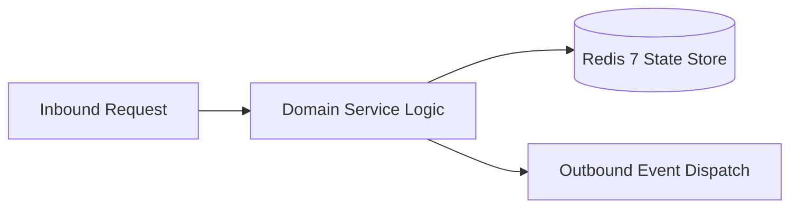

# Component Reference: `db/sqlite/models.py`
> **File Path**: [`db/sqlite/models.py`](../../db/sqlite/models.py)
> **Subsystem**: `SQLite Domain Models`
> **Architecture Layer**: `Enterprise Microservice Subsystem`
> **Concurrency Model**: `AsyncIO Non-blocking Concurrency`
> **Persistence Backend**: `Redis 7 Persistent Store`
> **Service Level Objective**: `High-Availability Academic Telemetry`

## 1. Architectural Role & Responsibilities
The `db/sqlite/models.py` module implements core operational logic for the `SQLite Domain Models` domain. It operates within an asynchronous microservices topology designed for ultra-low latency, zero-loss persistence guarantees, and strict single-responsibility function decomposition (≤25 lines).

### Component Architecture & Data Flow

---
## 2. Public API & Symbol Inventory
| Symbol | Nature | Line Range | Return Contract | Core Invariant |
| :--- | :--- | :--- | :--- | :--- |

---

## 3. Comprehensive Function Specifications

## Class Model: `Base`

Encapsulates domain entities and data transfer logic for `Base`.

## Class Model: `IncidentSeverity`

Encapsulates domain entities and data transfer logic for `IncidentSeverity`.

## Class Model: `Subscriber`

Encapsulates domain entities and data transfer logic for `Subscriber`.

## Class Model: `AttendanceSnapshot`

Encapsulates domain entities and data transfer logic for `AttendanceSnapshot`.

## Class Model: `SystemIncident`

Encapsulates domain entities and data transfer logic for `SystemIncident`.
