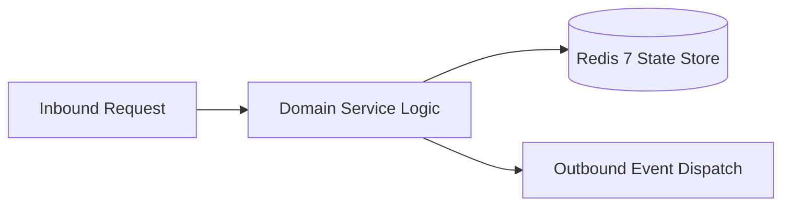

# Component Reference: `db/sqlite/repositories.py`
> **File Path**: [`db/sqlite/repositories.py`](../../db/sqlite/repositories.py)
> **Subsystem**: `SQLite Repositories`
> **Architecture Layer**: `Enterprise Microservice Subsystem`
> **Concurrency Model**: `AsyncIO Non-blocking Concurrency`
> **Persistence Backend**: `Redis 7 Persistent Store`
> **Service Level Objective**: `High-Availability Academic Telemetry`

## 1. Architectural Role & Responsibilities
The `db/sqlite/repositories.py` module implements core operational logic for the `SQLite Repositories` domain. It operates within an asynchronous microservices topology designed for ultra-low latency, zero-loss persistence guarantees, and strict single-responsibility function decomposition (≤25 lines).

### Component Architecture & Data Flow


---
## 2. Public API & Symbol Inventory
| Symbol | Nature | Line Range | Return Contract | Core Invariant |
| :--- | :--- | :--- | :--- | :--- |
| [`SubscriberRepository.get_active_chat_ids`](#subscriberrepositoryget_active_chat_ids) | Method | L31–L36 | `set[int]` | Retrieves and resolves domain data for `get_active_chat... |
| [`SubscriberRepository.add_subscriber`](#subscriberrepositoryadd_subscriber) | Method | L39–L53 | `bool` | Executes core domain logic for `add_subscriber`. |
| [`SubscriberRepository.remove_subscriber`](#subscriberrepositoryremove_subscriber) | Method | L56–L65 | `bool` | Executes core domain logic for `remove_subscriber`. |
| [`SubscriberRepository.count_active`](#subscriberrepositorycount_active) | Method | L68–L72 | `int` | Executes core domain logic for `count_active`. |
| [`IncidentRepository.record_incident`](#incidentrepositoryrecord_incident) | Method | L79–L98 | `SystemIncident` | Executes core domain logic for `record_incident`. |
| [`IncidentRepository.get_recent_incidents`](#incidentrepositoryget_recent_incidents) | Method | L101–L107 | `Sequence[SystemIncident]` | Retrieves and resolves domain data for `get_recent_inci... |
| [`AttendanceRepository.save_daily_snapshots`](#attendancerepositorysave_daily_snapshots) | Method | L114–L136 | `int` | Saves serialized entity data to storage for `save_daily... |
| [`AttendanceRepository.get_latest_snapshots`](#attendancerepositoryget_latest_snapshots) | Method | L139–L145 | `Sequence[AttendanceSnapshot]` | Retrieves and resolves domain data for `get_latest_snap... |
| [`GamificationRepository.get_all_unlocked_map`](#gamificationrepositoryget_all_unlocked_map) | Method | L152–L164 | `dict[str, set[str]]` | Retrieves and resolves domain data for `get_all_unlocke... |
| [`GamificationRepository.unlock_achievement`](#gamificationrepositoryunlock_achievement) | Method | L167–L181 | `bool` | Executes core domain logic for `unlock_achievement`. |

---

## 3. Comprehensive Function Specifications

## Class Model: `SubscriberRepository`

Encapsulates domain entities and data transfer logic for `SubscriberRepository`.

### `SubscriberRepository.get_active_chat_ids`
```python
async def get_active_chat_ids() -> set[int]
```

- **Source Reference**: [`db/sqlite/repositories.py#L31-L36`](../../db/sqlite/repositories.py#L31-L36)
- **Execution Mode**: `Asynchronous (non-blocking)`
- **Return Contract**: `set[int]`

#### Overview & Architectural Purpose
Retrieves and resolves domain data for `get_active_chat_ids`.

#### Parameters Contract
*This method takes no input parameters.*

#### Concurrency & Side Effects
- Stateless pure functional computation without external mutations.

#### Fault Tolerance & Error Modes
Propagates unexpected runtime errors up the call stack to global exception handlers.

#### Production Usage Example
```python
from db.sqlite.repositories import get_active_chat_ids

# Execute call
result = await get_active_chat_ids()
```

---

### `SubscriberRepository.add_subscriber`
```python
async def add_subscriber(chat_id: int, username: str | None = None, full_name: str | None = None) -> bool
```

- **Source Reference**: [`db/sqlite/repositories.py#L39-L53`](../../db/sqlite/repositories.py#L39-L53)
- **Execution Mode**: `Asynchronous (non-blocking)`
- **Return Contract**: `bool`

#### Overview & Architectural Purpose
Executes core domain logic for `add_subscriber`.

#### Parameters Contract
| Parameter | Type | Required | Description |
| :--- | :--- | :--- | :--- |
| `chat_id` | `int` | Yes | Unique 64-bit Telegram chat or supergroup identifier. |
| `username` | `str | None` | Yes | Parameter `username` of type `str | None`. |
| `full_name` | `str | None` | Yes | Parameter `full_name` of type `str | None`. |

#### Concurrency & Side Effects
- Emits structured telemetry events to system logging subsystem.

#### Fault Tolerance & Error Modes
Propagates unexpected runtime errors up the call stack to global exception handlers.

#### Production Usage Example
```python
from db.sqlite.repositories import add_subscriber

# Execute call
result = await add_subscriber(chat_id=..., username=..., full_name=...)
```

---

### `SubscriberRepository.remove_subscriber`
```python
async def remove_subscriber(chat_id: int) -> bool
```

- **Source Reference**: [`db/sqlite/repositories.py#L56-L65`](../../db/sqlite/repositories.py#L56-L65)
- **Execution Mode**: `Asynchronous (non-blocking)`
- **Return Contract**: `bool`

#### Overview & Architectural Purpose
Executes core domain logic for `remove_subscriber`.

#### Parameters Contract
| Parameter | Type | Required | Description |
| :--- | :--- | :--- | :--- |
| `chat_id` | `int` | Yes | Unique 64-bit Telegram chat or supergroup identifier. |

#### Concurrency & Side Effects
- Emits structured telemetry events to system logging subsystem.

#### Fault Tolerance & Error Modes
Propagates unexpected runtime errors up the call stack to global exception handlers.

#### Production Usage Example
```python
from db.sqlite.repositories import remove_subscriber

# Execute call
result = await remove_subscriber(chat_id=...)
```

---

### `SubscriberRepository.count_active`
```python
async def count_active() -> int
```

- **Source Reference**: [`db/sqlite/repositories.py#L68-L72`](../../db/sqlite/repositories.py#L68-L72)
- **Execution Mode**: `Asynchronous (non-blocking)`
- **Return Contract**: `int`

#### Overview & Architectural Purpose
Executes core domain logic for `count_active`.

#### Parameters Contract
*This method takes no input parameters.*

#### Concurrency & Side Effects
- Stateless pure functional computation without external mutations.

#### Fault Tolerance & Error Modes
Propagates unexpected runtime errors up the call stack to global exception handlers.

#### Production Usage Example
```python
from db.sqlite.repositories import count_active

# Execute call
result = await count_active()
```

---

## Class Model: `IncidentRepository`

Encapsulates domain entities and data transfer logic for `IncidentRepository`.

### `IncidentRepository.record_incident`
```python
async def record_incident( incident_type: str, title: str, description: str, severity: str = IncidentSeverity.WARNING, trace_id: str | None = None, ) -> SystemIncident
```

- **Source Reference**: [`db/sqlite/repositories.py#L79-L98`](../../db/sqlite/repositories.py#L79-L98)
- **Execution Mode**: `Asynchronous (non-blocking)`
- **Return Contract**: `SystemIncident`

#### Overview & Architectural Purpose
Executes core domain logic for `record_incident`.

#### Parameters Contract
| Parameter | Type | Required | Description |
| :--- | :--- | :--- | :--- |
| `incident_type` | `str` | Yes | Parameter `incident_type` of type `str`. |
| `title` | `str` | Yes | Parameter `title` of type `str`. |
| `description` | `str` | Yes | Parameter `description` of type `str`. |
| `severity` | `str` | Yes | Parameter `severity` of type `str`. |
| `trace_id` | `str | None` | Yes | Parameter `trace_id` of type `str | None`. |

#### Concurrency & Side Effects
- Emits structured telemetry events to system logging subsystem.

#### Fault Tolerance & Error Modes
Propagates unexpected runtime errors up the call stack to global exception handlers.

#### Production Usage Example
```python
from db.sqlite.repositories import record_incident

# Execute call
result = await record_incident(incident_type=..., title=..., description=...)
```

---

### `IncidentRepository.get_recent_incidents`
```python
async def get_recent_incidents(limit: int = 50, unresolved_only: bool = False) -> Sequence[SystemIncident]
```

- **Source Reference**: [`db/sqlite/repositories.py#L101-L107`](../../db/sqlite/repositories.py#L101-L107)
- **Execution Mode**: `Asynchronous (non-blocking)`
- **Return Contract**: `Sequence[SystemIncident]`

#### Overview & Architectural Purpose
Retrieves and resolves domain data for `get_recent_incidents`.

#### Parameters Contract
| Parameter | Type | Required | Description |
| :--- | :--- | :--- | :--- |
| `limit` | `int` | Yes | Maximum number of records or results to retrieve. |
| `unresolved_only` | `bool` | Yes | Parameter `unresolved_only` of type `bool`. |

#### Concurrency & Side Effects
- Stateless pure functional computation without external mutations.

#### Fault Tolerance & Error Modes
Propagates unexpected runtime errors up the call stack to global exception handlers.

#### Production Usage Example
```python
from db.sqlite.repositories import get_recent_incidents

# Execute call
result = await get_recent_incidents(limit=..., unresolved_only=...)
```

---

## Class Model: `AttendanceRepository`

Encapsulates domain entities and data transfer logic for `AttendanceRepository`.

### `AttendanceRepository.save_daily_snapshots`
```python
async def save_daily_snapshots(snapshot_date: date, records: list[dict[str, Any]]) -> int
```

- **Source Reference**: [`db/sqlite/repositories.py#L114-L136`](../../db/sqlite/repositories.py#L114-L136)
- **Execution Mode**: `Asynchronous (non-blocking)`
- **Return Contract**: `int`

#### Overview & Architectural Purpose
Saves serialized entity data to storage for `save_daily_snapshots`.

#### Parameters Contract
| Parameter | Type | Required | Description |
| :--- | :--- | :--- | :--- |
| `snapshot_date` | `date` | Yes | Parameter `snapshot_date` of type `date`. |
| `records` | `list[dict[str, Any]]` | Yes | Parameter `records` of type `list[dict[str, Any]]`. |

#### Concurrency & Side Effects
- Emits structured telemetry events to system logging subsystem.

#### Fault Tolerance & Error Modes
Propagates unexpected runtime errors up the call stack to global exception handlers.

#### Production Usage Example
```python
from db.sqlite.repositories import save_daily_snapshots

# Execute call
result = await save_daily_snapshots(snapshot_date=..., records=...)
```

---

### `AttendanceRepository.get_latest_snapshots`
```python
async def get_latest_snapshots() -> Sequence[AttendanceSnapshot]
```

- **Source Reference**: [`db/sqlite/repositories.py#L139-L145`](../../db/sqlite/repositories.py#L139-L145)
- **Execution Mode**: `Asynchronous (non-blocking)`
- **Return Contract**: `Sequence[AttendanceSnapshot]`

#### Overview & Architectural Purpose
Retrieves and resolves domain data for `get_latest_snapshots`.

#### Parameters Contract
*This method takes no input parameters.*

#### Concurrency & Side Effects
- Stateless pure functional computation without external mutations.

#### Fault Tolerance & Error Modes
Propagates unexpected runtime errors up the call stack to global exception handlers.

#### Production Usage Example
```python
from db.sqlite.repositories import get_latest_snapshots

# Execute call
result = await get_latest_snapshots()
```

---

## Class Model: `GamificationRepository`

Encapsulates domain entities and data transfer logic for `GamificationRepository`.

### `GamificationRepository.get_all_unlocked_map`
```python
async def get_all_unlocked_map() -> dict[str, set[str]]
```

- **Source Reference**: [`db/sqlite/repositories.py#L152-L164`](../../db/sqlite/repositories.py#L152-L164)
- **Execution Mode**: `Asynchronous (non-blocking)`
- **Return Contract**: `dict[str, set[str]]`

#### Overview & Architectural Purpose
Retrieves and resolves domain data for `get_all_unlocked_map`.

#### Parameters Contract
*This method takes no input parameters.*

#### Concurrency & Side Effects
- Emits structured telemetry events to system logging subsystem.

#### Fault Tolerance & Error Modes
Encapsulates faults within `try/except` blocks, logging errors and returning safe fallback defaults.

#### Production Usage Example
```python
from db.sqlite.repositories import get_all_unlocked_map

# Execute call
result = await get_all_unlocked_map()
```

---

### `GamificationRepository.unlock_achievement`
```python
async def unlock_achievement(student_fio: str, achievement_id: str) -> bool
```

- **Source Reference**: [`db/sqlite/repositories.py#L167-L181`](../../db/sqlite/repositories.py#L167-L181)
- **Execution Mode**: `Asynchronous (non-blocking)`
- **Return Contract**: `bool`

#### Overview & Architectural Purpose
Executes core domain logic for `unlock_achievement`.

#### Parameters Contract
| Parameter | Type | Required | Description |
| :--- | :--- | :--- | :--- |
| `student_fio` | `str` | Yes | Parameter `student_fio` of type `str`. |
| `achievement_id` | `str` | Yes | Unique identifier of academic milestone achievement. |

#### Concurrency & Side Effects
- Emits structured telemetry events to system logging subsystem.

#### Fault Tolerance & Error Modes
Encapsulates faults within `try/except` blocks, logging errors and returning safe fallback defaults.

#### Production Usage Example
```python
from db.sqlite.repositories import unlock_achievement

# Execute call
result = await unlock_achievement(student_fio=..., achievement_id=...)
```

---
