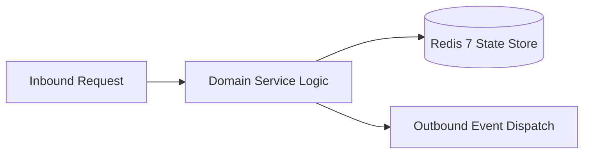

# Component Reference: `db/sqlite/repositories.py`
> **File Path**: [`db/sqlite/repositories.py`](../../db/sqlite/repositories.py)
> **Subsystem**: `SQLite Repositories`
> **Architecture Layer**: `Enterprise Microservice Subsystem`
> **Concurrency Model**: `AsyncIO Non-blocking Concurrency`
> **Persistence Backend**: `Redis 7 Persistent Store`
> **Service Level Objective**: `High-Availability Academic Telemetry`

## 1. Architectural Role & Responsibilities
The `db/sqlite/repositories.py` module implements core operational logic for the `SQLite Repositories` domain. It operates within an asynchronous microservices topology designed for ultra-low latency, zero-loss persistence guarantees, and strict single-responsibility function decomposition (≤25 lines).

### Component Architecture & Data Flow


---
## 2. Public API & Symbol Inventory
| Symbol | Nature | Line Range | Return Contract | Core Invariant |
| :--- | :--- | :--- | :--- | :--- |
| [`SubscriberRepository.get_active_chat_ids`](#subscriberrepositoryget_active_chat_ids) | Method | L35–L40 | `set[int]` | Retrieves and resolves domain data for `get_active_chat... |
| [`SubscriberRepository.add_subscriber`](#subscriberrepositoryadd_subscriber) | Method | L43–L57 | `bool` | Executes core domain logic for `add_subscriber`. |
| [`SubscriberRepository.remove_subscriber`](#subscriberrepositoryremove_subscriber) | Method | L60–L69 | `bool` | Executes core domain logic for `remove_subscriber`. |
| [`SubscriberRepository.count_active`](#subscriberrepositorycount_active) | Method | L72–L76 | `int` | Executes core domain logic for `count_active`. |
| [`IncidentRepository.record_incident`](#incidentrepositoryrecord_incident) | Method | L83–L102 | `SystemIncident` | Executes core domain logic for `record_incident`. |
| [`IncidentRepository.get_recent_incidents`](#incidentrepositoryget_recent_incidents) | Method | L105–L111 | `Sequence[SystemIncident]` | Retrieves and resolves domain data for `get_recent_inci... |
| [`AttendanceRepository.save_daily_snapshots`](#attendancerepositorysave_daily_snapshots) | Method | L118–L140 | `int` | Saves serialized entity data to storage for `save_daily... |
| [`AttendanceRepository.get_latest_snapshots`](#attendancerepositoryget_latest_snapshots) | Method | L143–L149 | `Sequence[AttendanceSnapshot]` | Retrieves and resolves domain data for `get_latest_snap... |
| [`GamificationRepository.get_all_unlocked_map`](#gamificationrepositoryget_all_unlocked_map) | Method | L156–L168 | `dict[str, set[str]]` | Retrieves and resolves domain data for `get_all_unlocke... |
| [`GamificationRepository.revoke_achievement`](#gamificationrepositoryrevoke_achievement) | Method | L171–L181 | `int` | Executes core domain logic for `revoke_achievement`. |
| [`GamificationRepository.unlock_achievement`](#gamificationrepositoryunlock_achievement) | Method | L184–L198 | `bool` | Executes core domain logic for `unlock_achievement`. |
| [`CounterRepository.increment`](#counterrepositoryincrement) | Method | L205–L227 | `int` | Executes core domain logic for `increment`. |
| [`CounterRepository.set_value`](#counterrepositoryset_value) | Method | L230–L235 | `None` | Persists state updates for `set_value`. |
| [`CounterRepository.add_value`](#counterrepositoryadd_value) | Method | L238–L249 | `int` | Executes core domain logic for `add_value`. |
| [`CounterRepository.get_key_values`](#counterrepositoryget_key_values) | Method | L252–L264 | `dict[str, int]` | Retrieves and resolves domain data for `get_key_values`... |
| [`CounterRepository.count_keys`](#counterrepositorycount_keys) | Method | L267–L283 | `int` | Executes core domain logic for `count_keys`. |
| [`AchievementResetRepository.reset_with_baseline`](#achievementresetrepositoryreset_with_baseline) | Method | L290–L307 | `tuple[int, int]` | Executes core domain logic for `reset_with_baseline`. |
| [`AchievementResetRepository.get_baselines`](#achievementresetrepositoryget_baselines) | Method | L310–L322 | `dict[str, dict[str, Any]]` | Retrieves and resolves domain data for `get_baselines`. |

---

## 3. Comprehensive Function Specifications

## Class Model: `SubscriberRepository`

Encapsulates domain entities and data transfer logic for `SubscriberRepository`.

### `SubscriberRepository.get_active_chat_ids`
```python
async def get_active_chat_ids() -> set[int]
```

- **Source Reference**: [`db/sqlite/repositories.py#L35-L40`](../../db/sqlite/repositories.py#L35-L40)
- **Execution Mode**: `Asynchronous (non-blocking)`
- **Return Contract**: `set[int]`

#### Overview & Architectural Purpose
Retrieves and resolves domain data for `get_active_chat_ids`.

#### Parameters Contract
*This method takes no input parameters.*

#### Concurrency & Side Effects
- Stateless pure functional computation without external mutations.

#### Fault Tolerance & Error Modes
Propagates unexpected runtime errors up the call stack to global exception handlers.

#### Production Usage Example
```python
from db.sqlite.repositories import get_active_chat_ids

# Execute call
result = await get_active_chat_ids()
```

---

### `SubscriberRepository.add_subscriber`
```python
async def add_subscriber(chat_id: int, username: str | None = None, full_name: str | None = None) -> bool
```

- **Source Reference**: [`db/sqlite/repositories.py#L43-L57`](../../db/sqlite/repositories.py#L43-L57)
- **Execution Mode**: `Asynchronous (non-blocking)`
- **Return Contract**: `bool`

#### Overview & Architectural Purpose
Executes core domain logic for `add_subscriber`.

#### Parameters Contract
| Parameter | Type | Required | Description |
| :--- | :--- | :--- | :--- |
| `chat_id` | `int` | Yes | Unique 64-bit Telegram chat or supergroup identifier. |
| `username` | `str | None` | Yes | Parameter `username` of type `str | None`. |
| `full_name` | `str | None` | Yes | Parameter `full_name` of type `str | None`. |

#### Concurrency & Side Effects
- Emits structured telemetry events to system logging subsystem.

#### Fault Tolerance & Error Modes
Propagates unexpected runtime errors up the call stack to global exception handlers.

#### Production Usage Example
```python
from db.sqlite.repositories import add_subscriber

# Execute call
result = await add_subscriber(chat_id=..., username=..., full_name=...)
```

---

### `SubscriberRepository.remove_subscriber`
```python
async def remove_subscriber(chat_id: int) -> bool
```

- **Source Reference**: [`db/sqlite/repositories.py#L60-L69`](../../db/sqlite/repositories.py#L60-L69)
- **Execution Mode**: `Asynchronous (non-blocking)`
- **Return Contract**: `bool`

#### Overview & Architectural Purpose
Executes core domain logic for `remove_subscriber`.

#### Parameters Contract
| Parameter | Type | Required | Description |
| :--- | :--- | :--- | :--- |
| `chat_id` | `int` | Yes | Unique 64-bit Telegram chat or supergroup identifier. |

#### Concurrency & Side Effects
- Emits structured telemetry events to system logging subsystem.

#### Fault Tolerance & Error Modes
Propagates unexpected runtime errors up the call stack to global exception handlers.

#### Production Usage Example
```python
from db.sqlite.repositories import remove_subscriber

# Execute call
result = await remove_subscriber(chat_id=...)
```

---

### `SubscriberRepository.count_active`
```python
async def count_active() -> int
```

- **Source Reference**: [`db/sqlite/repositories.py#L72-L76`](../../db/sqlite/repositories.py#L72-L76)
- **Execution Mode**: `Asynchronous (non-blocking)`
- **Return Contract**: `int`

#### Overview & Architectural Purpose
Executes core domain logic for `count_active`.

#### Parameters Contract
*This method takes no input parameters.*

#### Concurrency & Side Effects
- Stateless pure functional computation without external mutations.

#### Fault Tolerance & Error Modes
Propagates unexpected runtime errors up the call stack to global exception handlers.

#### Production Usage Example
```python
from db.sqlite.repositories import count_active

# Execute call
result = await count_active()
```

---

## Class Model: `IncidentRepository`

Encapsulates domain entities and data transfer logic for `IncidentRepository`.

### `IncidentRepository.record_incident`
```python
async def record_incident( incident_type: str, title: str, description: str, severity: str = IncidentSeverity.WARNING, trace_id: str | None = None, ) -> SystemIncident
```

- **Source Reference**: [`db/sqlite/repositories.py#L83-L102`](../../db/sqlite/repositories.py#L83-L102)
- **Execution Mode**: `Asynchronous (non-blocking)`
- **Return Contract**: `SystemIncident`

#### Overview & Architectural Purpose
Executes core domain logic for `record_incident`.

#### Parameters Contract
| Parameter | Type | Required | Description |
| :--- | :--- | :--- | :--- |
| `incident_type` | `str` | Yes | Parameter `incident_type` of type `str`. |
| `title` | `str` | Yes | Parameter `title` of type `str`. |
| `description` | `str` | Yes | Parameter `description` of type `str`. |
| `severity` | `str` | Yes | Parameter `severity` of type `str`. |
| `trace_id` | `str | None` | Yes | Parameter `trace_id` of type `str | None`. |

#### Concurrency & Side Effects
- Emits structured telemetry events to system logging subsystem.

#### Fault Tolerance & Error Modes
Propagates unexpected runtime errors up the call stack to global exception handlers.

#### Production Usage Example
```python
from db.sqlite.repositories import record_incident

# Execute call
result = await record_incident(incident_type=..., title=..., description=...)
```

---

### `IncidentRepository.get_recent_incidents`
```python
async def get_recent_incidents(limit: int = 50, unresolved_only: bool = False) -> Sequence[SystemIncident]
```

- **Source Reference**: [`db/sqlite/repositories.py#L105-L111`](../../db/sqlite/repositories.py#L105-L111)
- **Execution Mode**: `Asynchronous (non-blocking)`
- **Return Contract**: `Sequence[SystemIncident]`

#### Overview & Architectural Purpose
Retrieves and resolves domain data for `get_recent_incidents`.

#### Parameters Contract
| Parameter | Type | Required | Description |
| :--- | :--- | :--- | :--- |
| `limit` | `int` | Yes | Maximum number of records or results to retrieve. |
| `unresolved_only` | `bool` | Yes | Parameter `unresolved_only` of type `bool`. |

#### Concurrency & Side Effects
- Stateless pure functional computation without external mutations.

#### Fault Tolerance & Error Modes
Propagates unexpected runtime errors up the call stack to global exception handlers.

#### Production Usage Example
```python
from db.sqlite.repositories import get_recent_incidents

# Execute call
result = await get_recent_incidents(limit=..., unresolved_only=...)
```

---

## Class Model: `AttendanceRepository`

Encapsulates domain entities and data transfer logic for `AttendanceRepository`.

### `AttendanceRepository.save_daily_snapshots`
```python
async def save_daily_snapshots(snapshot_date: date, records: list[dict[str, Any]]) -> int
```

- **Source Reference**: [`db/sqlite/repositories.py#L118-L140`](../../db/sqlite/repositories.py#L118-L140)
- **Execution Mode**: `Asynchronous (non-blocking)`
- **Return Contract**: `int`

#### Overview & Architectural Purpose
Saves serialized entity data to storage for `save_daily_snapshots`.

#### Parameters Contract
| Parameter | Type | Required | Description |
| :--- | :--- | :--- | :--- |
| `snapshot_date` | `date` | Yes | Parameter `snapshot_date` of type `date`. |
| `records` | `list[dict[str, Any]]` | Yes | Parameter `records` of type `list[dict[str, Any]]`. |

#### Concurrency & Side Effects
- Emits structured telemetry events to system logging subsystem.

#### Fault Tolerance & Error Modes
Propagates unexpected runtime errors up the call stack to global exception handlers.

#### Production Usage Example
```python
from db.sqlite.repositories import save_daily_snapshots

# Execute call
result = await save_daily_snapshots(snapshot_date=..., records=...)
```

---

### `AttendanceRepository.get_latest_snapshots`
```python
async def get_latest_snapshots() -> Sequence[AttendanceSnapshot]
```

- **Source Reference**: [`db/sqlite/repositories.py#L143-L149`](../../db/sqlite/repositories.py#L143-L149)
- **Execution Mode**: `Asynchronous (non-blocking)`
- **Return Contract**: `Sequence[AttendanceSnapshot]`

#### Overview & Architectural Purpose
Retrieves and resolves domain data for `get_latest_snapshots`.

#### Parameters Contract
*This method takes no input parameters.*

#### Concurrency & Side Effects
- Stateless pure functional computation without external mutations.

#### Fault Tolerance & Error Modes
Propagates unexpected runtime errors up the call stack to global exception handlers.

#### Production Usage Example
```python
from db.sqlite.repositories import get_latest_snapshots

# Execute call
result = await get_latest_snapshots()
```

---

## Class Model: `GamificationRepository`

Encapsulates domain entities and data transfer logic for `GamificationRepository`.

### `GamificationRepository.get_all_unlocked_map`
```python
async def get_all_unlocked_map() -> dict[str, set[str]]
```

- **Source Reference**: [`db/sqlite/repositories.py#L156-L168`](../../db/sqlite/repositories.py#L156-L168)
- **Execution Mode**: `Asynchronous (non-blocking)`
- **Return Contract**: `dict[str, set[str]]`

#### Overview & Architectural Purpose
Retrieves and resolves domain data for `get_all_unlocked_map`.

#### Parameters Contract
*This method takes no input parameters.*

#### Concurrency & Side Effects
- Emits structured telemetry events to system logging subsystem.

#### Fault Tolerance & Error Modes
Encapsulates faults within `try/except` blocks, logging errors and returning safe fallback defaults.

#### Production Usage Example
```python
from db.sqlite.repositories import get_all_unlocked_map

# Execute call
result = await get_all_unlocked_map()
```

---

### `GamificationRepository.revoke_achievement`
```python
async def revoke_achievement(student_fios: set[str], achievement_id: str) -> int
```

- **Source Reference**: [`db/sqlite/repositories.py#L171-L181`](../../db/sqlite/repositories.py#L171-L181)
- **Execution Mode**: `Asynchronous (non-blocking)`
- **Return Contract**: `int`

#### Overview & Architectural Purpose
Executes core domain logic for `revoke_achievement`.

#### Parameters Contract
| Parameter | Type | Required | Description |
| :--- | :--- | :--- | :--- |
| `student_fios` | `set[str]` | Yes | Parameter `student_fios` of type `set[str]`. |
| `achievement_id` | `str` | Yes | Unique identifier of academic milestone achievement. |

#### Concurrency & Side Effects
- Stateless pure functional computation without external mutations.

#### Fault Tolerance & Error Modes
Propagates unexpected runtime errors up the call stack to global exception handlers.

#### Production Usage Example
```python
from db.sqlite.repositories import revoke_achievement

# Execute call
result = await revoke_achievement(student_fios=..., achievement_id=...)
```

---

### `GamificationRepository.unlock_achievement`
```python
async def unlock_achievement(student_fio: str, achievement_id: str) -> bool
```

- **Source Reference**: [`db/sqlite/repositories.py#L184-L198`](../../db/sqlite/repositories.py#L184-L198)
- **Execution Mode**: `Asynchronous (non-blocking)`
- **Return Contract**: `bool`

#### Overview & Architectural Purpose
Executes core domain logic for `unlock_achievement`.

#### Parameters Contract
| Parameter | Type | Required | Description |
| :--- | :--- | :--- | :--- |
| `student_fio` | `str` | Yes | Parameter `student_fio` of type `str`. |
| `achievement_id` | `str` | Yes | Unique identifier of academic milestone achievement. |

#### Concurrency & Side Effects
- Emits structured telemetry events to system logging subsystem.

#### Fault Tolerance & Error Modes
Encapsulates faults within `try/except` blocks, logging errors and returning safe fallback defaults.

#### Production Usage Example
```python
from db.sqlite.repositories import unlock_achievement

# Execute call
result = await unlock_achievement(student_fio=..., achievement_id=...)
```

---

## Class Model: `CounterRepository`

Encapsulates domain entities and data transfer logic for `CounterRepository`.

### `CounterRepository.increment`
```python
async def increment(student_fio: str, key: str, today: date | None = None) -> int
```

- **Source Reference**: [`db/sqlite/repositories.py#L205-L227`](../../db/sqlite/repositories.py#L205-L227)
- **Execution Mode**: `Asynchronous (non-blocking)`
- **Return Contract**: `int`

#### Overview & Architectural Purpose
Executes core domain logic for `increment`.

#### Parameters Contract
| Parameter | Type | Required | Description |
| :--- | :--- | :--- | :--- |
| `student_fio` | `str` | Yes | Parameter `student_fio` of type `str`. |
| `key` | `str` | Yes | Parameter `key` of type `str`. |
| `today` | `date | None` | Yes | Parameter `today` of type `date | None`. |

#### Concurrency & Side Effects
- Emits structured telemetry events to system logging subsystem.

#### Fault Tolerance & Error Modes
Encapsulates faults within `try/except` blocks, logging errors and returning safe fallback defaults.

#### Production Usage Example
```python
from db.sqlite.repositories import increment

# Execute call
result = await increment(student_fio=..., key=..., today=...)
```

---

### `CounterRepository.set_value`
```python
async def set_value(student_fio: str, key: str, value: int) -> None
```

- **Source Reference**: [`db/sqlite/repositories.py#L230-L235`](../../db/sqlite/repositories.py#L230-L235)
- **Execution Mode**: `Asynchronous (non-blocking)`
- **Return Contract**: `None`

#### Overview & Architectural Purpose
Persists state updates for `set_value`.

#### Parameters Contract
| Parameter | Type | Required | Description |
| :--- | :--- | :--- | :--- |
| `student_fio` | `str` | Yes | Parameter `student_fio` of type `str`. |
| `key` | `str` | Yes | Parameter `key` of type `str`. |
| `value` | `int` | Yes | Parameter `value` of type `int`. |

#### Concurrency & Side Effects
- Stateless pure functional computation without external mutations.

#### Fault Tolerance & Error Modes
Propagates unexpected runtime errors up the call stack to global exception handlers.

#### Production Usage Example
```python
from db.sqlite.repositories import set_value

# Execute call
result = await set_value(student_fio=..., key=..., value=...)
```

---

### `CounterRepository.add_value`
```python
async def add_value(student_fio: str, key: str, delta: int) -> int
```

- **Source Reference**: [`db/sqlite/repositories.py#L238-L249`](../../db/sqlite/repositories.py#L238-L249)
- **Execution Mode**: `Asynchronous (non-blocking)`
- **Return Contract**: `int`

#### Overview & Architectural Purpose
Executes core domain logic for `add_value`.

#### Parameters Contract
| Parameter | Type | Required | Description |
| :--- | :--- | :--- | :--- |
| `student_fio` | `str` | Yes | Parameter `student_fio` of type `str`. |
| `key` | `str` | Yes | Parameter `key` of type `str`. |
| `delta` | `int` | Yes | Parameter `delta` of type `int`. |

#### Concurrency & Side Effects
- Stateless pure functional computation without external mutations.

#### Fault Tolerance & Error Modes
Propagates unexpected runtime errors up the call stack to global exception handlers.

#### Production Usage Example
```python
from db.sqlite.repositories import add_value

# Execute call
result = await add_value(student_fio=..., key=..., delta=...)
```

---

### `CounterRepository.get_key_values`
```python
async def get_key_values(key: str) -> dict[str, int]
```

- **Source Reference**: [`db/sqlite/repositories.py#L252-L264`](../../db/sqlite/repositories.py#L252-L264)
- **Execution Mode**: `Asynchronous (non-blocking)`
- **Return Contract**: `dict[str, int]`

#### Overview & Architectural Purpose
Retrieves and resolves domain data for `get_key_values`.

#### Parameters Contract
| Parameter | Type | Required | Description |
| :--- | :--- | :--- | :--- |
| `key` | `str` | Yes | Parameter `key` of type `str`. |

#### Concurrency & Side Effects
- Emits structured telemetry events to system logging subsystem.

#### Fault Tolerance & Error Modes
Encapsulates faults within `try/except` blocks, logging errors and returning safe fallback defaults.

#### Production Usage Example
```python
from db.sqlite.repositories import get_key_values

# Execute call
result = await get_key_values(key=...)
```

---

### `CounterRepository.count_keys`
```python
async def count_keys(student_fio: str, prefix: str) -> int
```

- **Source Reference**: [`db/sqlite/repositories.py#L267-L283`](../../db/sqlite/repositories.py#L267-L283)
- **Execution Mode**: `Asynchronous (non-blocking)`
- **Return Contract**: `int`

#### Overview & Architectural Purpose
Executes core domain logic for `count_keys`.

#### Parameters Contract
| Parameter | Type | Required | Description |
| :--- | :--- | :--- | :--- |
| `student_fio` | `str` | Yes | Parameter `student_fio` of type `str`. |
| `prefix` | `str` | Yes | Parameter `prefix` of type `str`. |

#### Concurrency & Side Effects
- Emits structured telemetry events to system logging subsystem.

#### Fault Tolerance & Error Modes
Encapsulates faults within `try/except` blocks, logging errors and returning safe fallback defaults.

#### Production Usage Example
```python
from db.sqlite.repositories import count_keys

# Execute call
result = await count_keys(student_fio=..., prefix=...)
```

---

## Class Model: `AchievementResetRepository`

Encapsulates domain entities and data transfer logic for `AchievementResetRepository`.

### `AchievementResetRepository.reset_with_baseline`
```python
async def reset_with_baseline(stats: dict[str, dict[str, Any]]) -> tuple[int, int]
```

- **Source Reference**: [`db/sqlite/repositories.py#L290-L307`](../../db/sqlite/repositories.py#L290-L307)
- **Execution Mode**: `Asynchronous (non-blocking)`
- **Return Contract**: `tuple[int, int]`

#### Overview & Architectural Purpose
Executes core domain logic for `reset_with_baseline`.

#### Parameters Contract
| Parameter | Type | Required | Description |
| :--- | :--- | :--- | :--- |
| `stats` | `dict[str, dict[str, Any]]` | Yes | Parameter `stats` of type `dict[str, dict[str, Any]]`. |

#### Concurrency & Side Effects
- Stateless pure functional computation without external mutations.

#### Fault Tolerance & Error Modes
Propagates unexpected runtime errors up the call stack to global exception handlers.

#### Production Usage Example
```python
from db.sqlite.repositories import reset_with_baseline

# Execute call
result = await reset_with_baseline(stats=...)
```

---

### `AchievementResetRepository.get_baselines`
```python
async def get_baselines() -> dict[str, dict[str, Any]]
```

- **Source Reference**: [`db/sqlite/repositories.py#L310-L322`](../../db/sqlite/repositories.py#L310-L322)
- **Execution Mode**: `Asynchronous (non-blocking)`
- **Return Contract**: `dict[str, dict[str, Any]]`

#### Overview & Architectural Purpose
Retrieves and resolves domain data for `get_baselines`.

#### Parameters Contract
*This method takes no input parameters.*

#### Concurrency & Side Effects
- Emits structured telemetry events to system logging subsystem.

#### Fault Tolerance & Error Modes
Encapsulates faults within `try/except` blocks, logging errors and returning safe fallback defaults.

#### Production Usage Example
```python
from db.sqlite.repositories import get_baselines

# Execute call
result = await get_baselines()
```

---
