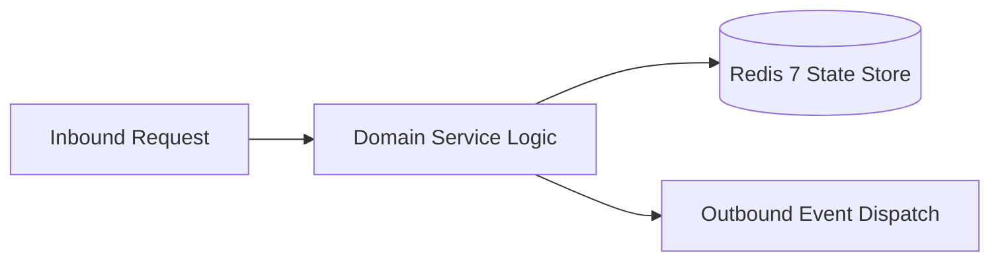

# Component Reference: `db/subscribers.py`
> **File Path**: [`db/subscribers.py`](../../db/subscribers.py)
> **Subsystem**: `Subscriber Store`
> **Architecture Layer**: `Enterprise Microservice Subsystem`
> **Concurrency Model**: `AsyncIO Non-blocking Concurrency`
> **Persistence Backend**: `Redis 7 Persistent Store`
> **Service Level Objective**: `High-Availability Academic Telemetry`

## 1. Architectural Role & Responsibilities
The `db/subscribers.py` module implements core operational logic for the `Subscriber Store` domain. It operates within an asynchronous microservices topology designed for ultra-low latency, zero-loss persistence guarantees, and strict single-responsibility function decomposition (≤25 lines).

### Component Architecture & Data Flow


---
## 2. Public API & Symbol Inventory
| Symbol | Nature | Line Range | Return Contract | Core Invariant |
| :--- | :--- | :--- | :--- | :--- |
| [`load_subscribers`](#load_subscribers) | Function | L15–L25 | `set[int]` | Executes core domain logic for `load_subscribers`. |
| [`save_subscribers`](#save_subscribers) | Function | L28–L40 | `bool` | Saves serialized entity data to storage for `save_subsc... |
| [`add_subscriber`](#add_subscriber) | Function | L43–L58 | `bool` | Executes core domain logic for `add_subscriber`. |
| [`remove_subscriber`](#remove_subscriber) | Function | L61–L76 | `bool` | Executes core domain logic for `remove_subscriber`. |
| [`is_subscribed`](#is_subscribed) | Function | L79–L88 | `bool` | Executes core domain logic for `is_subscribed`. |
| [`toggle_subscriber`](#toggle_subscriber) | Function | L91–L109 | `bool` | Executes core domain logic for `toggle_subscriber`. |

---

## 3. Comprehensive Function Specifications

### `load_subscribers`
```python
def load_subscribers() -> set[int]
```

- **Source Reference**: [`db/subscribers.py#L15-L25`](../../db/subscribers.py#L15-L25)
- **Execution Mode**: `Synchronous`
- **Return Contract**: `set[int]`

#### Overview & Architectural Purpose
Executes core domain logic for `load_subscribers`.

#### Parameters Contract
*This method takes no input parameters.*

#### Concurrency & Side Effects
- Stateless pure functional computation without external mutations.

#### Fault Tolerance & Error Modes
Propagates unexpected runtime errors up the call stack to global exception handlers.

#### Production Usage Example
```python
from db.subscribers import load_subscribers

# Execute call
result = load_subscribers()
```

---

### `save_subscribers`
```python
def save_subscribers(subs: set[int]) -> bool
```

- **Source Reference**: [`db/subscribers.py#L28-L40`](../../db/subscribers.py#L28-L40)
- **Execution Mode**: `Synchronous`
- **Return Contract**: `bool`

#### Overview & Architectural Purpose
Saves serialized entity data to storage for `save_subscribers`.

#### Parameters Contract
| Parameter | Type | Required | Description |
| :--- | :--- | :--- | :--- |
| `subs` | `set[int]` | Yes | Parameter `subs` of type `set[int]`. |

#### Concurrency & Side Effects
- Emits structured telemetry events to system logging subsystem.

#### Fault Tolerance & Error Modes
Propagates unexpected runtime errors up the call stack to global exception handlers.

#### Production Usage Example
```python
from db.subscribers import save_subscribers

# Execute call
result = save_subscribers(subs=...)
```

---

### `add_subscriber`
```python
def add_subscriber(chat_id: int) -> bool
```

- **Source Reference**: [`db/subscribers.py#L43-L58`](../../db/subscribers.py#L43-L58)
- **Execution Mode**: `Synchronous`
- **Return Contract**: `bool`

#### Overview & Architectural Purpose
Executes core domain logic for `add_subscriber`.

#### Parameters Contract
| Parameter | Type | Required | Description |
| :--- | :--- | :--- | :--- |
| `chat_id` | `int` | Yes | Unique 64-bit Telegram chat or supergroup identifier. |

#### Concurrency & Side Effects
- Emits structured telemetry events to system logging subsystem.

#### Fault Tolerance & Error Modes
Propagates unexpected runtime errors up the call stack to global exception handlers.

#### Production Usage Example
```python
from db.subscribers import add_subscriber

# Execute call
result = add_subscriber(chat_id=...)
```

---

### `remove_subscriber`
```python
def remove_subscriber(chat_id: int) -> bool
```

- **Source Reference**: [`db/subscribers.py#L61-L76`](../../db/subscribers.py#L61-L76)
- **Execution Mode**: `Synchronous`
- **Return Contract**: `bool`

#### Overview & Architectural Purpose
Executes core domain logic for `remove_subscriber`.

#### Parameters Contract
| Parameter | Type | Required | Description |
| :--- | :--- | :--- | :--- |
| `chat_id` | `int` | Yes | Unique 64-bit Telegram chat or supergroup identifier. |

#### Concurrency & Side Effects
- Emits structured telemetry events to system logging subsystem.

#### Fault Tolerance & Error Modes
Propagates unexpected runtime errors up the call stack to global exception handlers.

#### Production Usage Example
```python
from db.subscribers import remove_subscriber

# Execute call
result = remove_subscriber(chat_id=...)
```

---

### `is_subscribed`
```python
def is_subscribed(chat_id: int) -> bool
```

- **Source Reference**: [`db/subscribers.py#L79-L88`](../../db/subscribers.py#L79-L88)
- **Execution Mode**: `Synchronous`
- **Return Contract**: `bool`

#### Overview & Architectural Purpose
Executes core domain logic for `is_subscribed`.

#### Parameters Contract
| Parameter | Type | Required | Description |
| :--- | :--- | :--- | :--- |
| `chat_id` | `int` | Yes | Unique 64-bit Telegram chat or supergroup identifier. |

#### Concurrency & Side Effects
- Stateless pure functional computation without external mutations.

#### Fault Tolerance & Error Modes
Propagates unexpected runtime errors up the call stack to global exception handlers.

#### Production Usage Example
```python
from db.subscribers import is_subscribed

# Execute call
result = is_subscribed(chat_id=...)
```

---

### `toggle_subscriber`
```python
def toggle_subscriber(chat_id: int) -> bool
```

- **Source Reference**: [`db/subscribers.py#L91-L109`](../../db/subscribers.py#L91-L109)
- **Execution Mode**: `Synchronous`
- **Return Contract**: `bool`

#### Overview & Architectural Purpose
Executes core domain logic for `toggle_subscriber`.

#### Parameters Contract
| Parameter | Type | Required | Description |
| :--- | :--- | :--- | :--- |
| `chat_id` | `int` | Yes | Unique 64-bit Telegram chat or supergroup identifier. |

#### Concurrency & Side Effects
- Emits structured telemetry events to system logging subsystem.

#### Fault Tolerance & Error Modes
Propagates unexpected runtime errors up the call stack to global exception handlers.

#### Production Usage Example
```python
from db.subscribers import toggle_subscriber

# Execute call
result = toggle_subscriber(chat_id=...)
```

---
