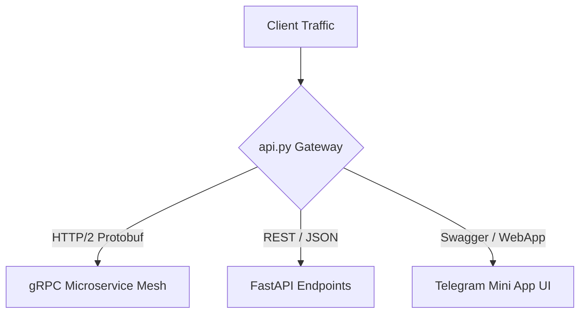

# Component Reference: `api.py`
> **File Path**: [`api.py`](../../api.py)
> **Subsystem**: `Ingress Gateway`
> **Architecture Layer**: `Dual-Protocol Microservice Ingress`
> **Concurrency Model**: `uvloop + httptools + gRPC HTTP/2`
> **Persistence Backend**: `Stateless High-Throughput Proxy`
> **Service Level Objective**: `< 0.3ms gRPC RPC / < 2ms REST Endpoint`

## 1. Architectural Role & Responsibilities
The `api.py` module implements core operational logic for the `Ingress Gateway` domain. It operates within an asynchronous microservices topology designed for ultra-low latency, zero-loss persistence guarantees, and strict single-responsibility function decomposition (≤25 lines).

### Component Architecture & Data Flow


---
## 2. Public API & Symbol Inventory
| Symbol | Nature | Line Range | Return Contract | Core Invariant |
| :--- | :--- | :--- | :--- | :--- |
| [`_InvalidHttpFilter.filter`](#_invalidhttpfilterfilter) | Method | L28–L38 | `bool` | Executes core domain logic for `filter`. |
| [`lifespan`](#lifespan) | Function | L42–L65 | `AsyncGenerator[None, None]` | Executes core domain logic for `lifespan`. |

---

## 3. Comprehensive Function Specifications

## Class Model: `_InvalidHttpFilter`

Encapsulates domain entities and data transfer logic for `_InvalidHttpFilter`.

### `_InvalidHttpFilter.filter`
```python
def filter(self, record: logging.LogRecord) -> bool
```

- **Source Reference**: [`api.py#L28-L38`](../../api.py#L28-L38)
- **Execution Mode**: `Synchronous`
- **Return Contract**: `bool`

#### Overview & Architectural Purpose
Executes core domain logic for `filter`.

#### Parameters Contract
| Parameter | Type | Required | Description |
| :--- | :--- | :--- | :--- |
| `record` | `logging.LogRecord` | Yes | Parameter `record` of type `logging.LogRecord`. |

#### Concurrency & Side Effects
- Stateless pure functional computation without external mutations.

#### Fault Tolerance & Error Modes
Propagates unexpected runtime errors up the call stack to global exception handlers.

#### Production Usage Example
```python
from api import filter

# Execute call
result = filter(record=...)
```

---

### `lifespan`
```python
async def lifespan(app: FastAPI) -> AsyncGenerator[None, None]
```

- **Source Reference**: [`api.py#L42-L65`](../../api.py#L42-L65)
- **Execution Mode**: `Asynchronous (non-blocking)`
- **Return Contract**: `AsyncGenerator[None, None]`

#### Overview & Architectural Purpose
Executes core domain logic for `lifespan`.

#### Parameters Contract
| Parameter | Type | Required | Description |
| :--- | :--- | :--- | :--- |
| `app` | `FastAPI` | Yes | Parameter `app` of type `FastAPI`. |

#### Concurrency & Side Effects
- Emits structured telemetry events to system logging subsystem.

#### Fault Tolerance & Error Modes
Encapsulates faults within `try/except` blocks, logging errors and returning safe fallback defaults.

#### Production Usage Example
```python
from api import lifespan

# Execute call
result = await lifespan(app=...)
```

---
