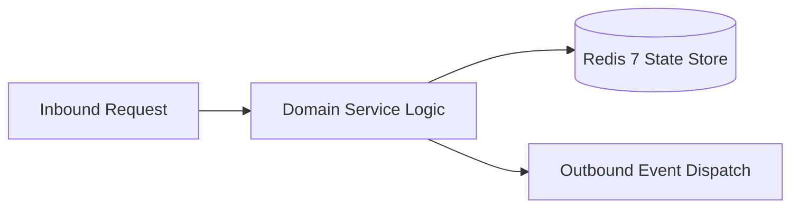

# Component Reference: `bot.py`
> **File Path**: [`bot.py`](../../bot.py)  
> **Subsystem**: `Telegram Gateway`  
> **Architecture Layer**: `Event Gateway & Bot Dispatcher`  
> **Concurrency Model**: `Long-Polling Aiogram 3.4 Worker Mesh`  
> **Persistence Backend**: `RedisStorage FSM State Engine`  
> **Service Level Objective**: `Sub-100ms Telegram Message Ingress`

## 1. Architectural Role & Responsibilities
The `bot.py` module implements core operational logic for the `Telegram Gateway` domain. It operates within an asynchronous microservices topology designed for ultra-low latency, zero-loss persistence guarantees, and strict single-responsibility function decomposition (≤25 lines).

### Component Architecture & Data Flow


---
## 2. Public API & Symbol Inventory
| Symbol | Nature | Line Range | Return Contract | Core Invariant |
| :--- | :--- | :--- | :--- | :--- |
| [`_register_admin_routers`](#_register_admin_routers) | Function | L20–L31 | `None` | Executes core domain logic for `_register_admin_routers... |
| [`_register_user_routers`](#_register_user_routers) | Function | L34–L47 | `None` | Executes core domain logic for `_register_user_routers`... |
| [`register_all_routers`](#register_all_routers) | Function | L50–L55 | `None` | Executes core domain logic for `register_all_routers`. |
| [`shutdown_bot`](#shutdown_bot) | Function | L59–L67 | `None` | Executes core domain logic for `shutdown_bot`. |
| [`setup_all_middlewares`](#setup_all_middlewares) | Function | L71–L77 | `None` | Executes core domain logic for `setup_all_middlewares`. |
| [`_warmup_stt`](#_warmup_stt) | Function | L80–L87 | `None` | Executes core domain logic for `_warmup_stt`. |
| [`main`](#main) | Function | L90–L106 | `None` | Executes core domain logic for `main`. |

---

## 3. Comprehensive Function Specifications

### `_register_admin_routers`
```python
def _register_admin_routers() -> None
```

- **Source Reference**: [`bot.py#L20-L31`](../../bot.py#L20-L31)
- **Execution Mode**: `Synchronous`
- **Return Contract**: `None`

#### Overview & Architectural Purpose
Executes core domain logic for `_register_admin_routers`.

#### Parameters Contract
*This method takes no input parameters.*

#### Concurrency & Side Effects
- Stateless pure functional computation without external mutations.

#### Fault Tolerance & Error Modes
Propagates unexpected runtime errors up the call stack to global exception handlers.

#### Production Usage Example
```python
from bot import _register_admin_routers

# Execute call
result = _register_admin_routers()
```

---

### `_register_user_routers`
```python
def _register_user_routers() -> None
```

- **Source Reference**: [`bot.py#L34-L47`](../../bot.py#L34-L47)
- **Execution Mode**: `Synchronous`
- **Return Contract**: `None`

#### Overview & Architectural Purpose
Executes core domain logic for `_register_user_routers`.

#### Parameters Contract
*This method takes no input parameters.*

#### Concurrency & Side Effects
- Stateless pure functional computation without external mutations.

#### Fault Tolerance & Error Modes
Propagates unexpected runtime errors up the call stack to global exception handlers.

#### Production Usage Example
```python
from bot import _register_user_routers

# Execute call
result = _register_user_routers()
```

---

### `register_all_routers`
```python
def register_all_routers() -> None
```

- **Source Reference**: [`bot.py#L50-L55`](../../bot.py#L50-L55)
- **Execution Mode**: `Synchronous`
- **Return Contract**: `None`

#### Overview & Architectural Purpose
Executes core domain logic for `register_all_routers`.

#### Parameters Contract
*This method takes no input parameters.*

#### Concurrency & Side Effects
- Stateless pure functional computation without external mutations.

#### Fault Tolerance & Error Modes
Propagates unexpected runtime errors up the call stack to global exception handlers.

#### Production Usage Example
```python
from bot import register_all_routers

# Execute call
result = register_all_routers()
```

---

### `shutdown_bot`
```python
async def shutdown_bot() -> None
```

- **Source Reference**: [`bot.py#L59-L67`](../../bot.py#L59-L67)
- **Execution Mode**: `Asynchronous (non-blocking)`
- **Return Contract**: `None`

#### Overview & Architectural Purpose
Executes core domain logic for `shutdown_bot`.

#### Parameters Contract
*This method takes no input parameters.*

#### Concurrency & Side Effects
- Emits structured telemetry events to system logging subsystem.

#### Fault Tolerance & Error Modes
Propagates unexpected runtime errors up the call stack to global exception handlers.

#### Production Usage Example
```python
from bot import shutdown_bot

# Execute call
result = await shutdown_bot()
```

---

### `setup_all_middlewares`
```python
def setup_all_middlewares() -> None
```

- **Source Reference**: [`bot.py#L71-L77`](../../bot.py#L71-L77)
- **Execution Mode**: `Synchronous`
- **Return Contract**: `None`

#### Overview & Architectural Purpose
Executes core domain logic for `setup_all_middlewares`.

#### Parameters Contract
*This method takes no input parameters.*

#### Concurrency & Side Effects
- Stateless pure functional computation without external mutations.

#### Fault Tolerance & Error Modes
Propagates unexpected runtime errors up the call stack to global exception handlers.

#### Production Usage Example
```python
from bot import setup_all_middlewares

# Execute call
result = setup_all_middlewares()
```

---

### `_warmup_stt`
```python
async def _warmup_stt() -> None
```

- **Source Reference**: [`bot.py#L80-L87`](../../bot.py#L80-L87)
- **Execution Mode**: `Asynchronous (non-blocking)`
- **Return Contract**: `None`

#### Overview & Architectural Purpose
Executes core domain logic for `_warmup_stt`.

#### Parameters Contract
*This method takes no input parameters.*

#### Concurrency & Side Effects
- Emits structured telemetry events to system logging subsystem.

#### Fault Tolerance & Error Modes
Encapsulates faults within `try/except` blocks, logging errors and returning safe fallback defaults.

#### Production Usage Example
```python
from bot import _warmup_stt

# Execute call
result = await _warmup_stt()
```

---

### `main`
```python
async def main() -> None
```

- **Source Reference**: [`bot.py#L90-L106`](../../bot.py#L90-L106)
- **Execution Mode**: `Asynchronous (non-blocking)`
- **Return Contract**: `None`

#### Overview & Architectural Purpose
Executes core domain logic for `main`.

#### Parameters Contract
*This method takes no input parameters.*

#### Concurrency & Side Effects
- Emits structured telemetry events to system logging subsystem.

#### Fault Tolerance & Error Modes
Encapsulates faults within `try/except` blocks, logging errors and returning safe fallback defaults.

#### Production Usage Example
```python
from bot import main

# Execute call
result = await main()
```

---
