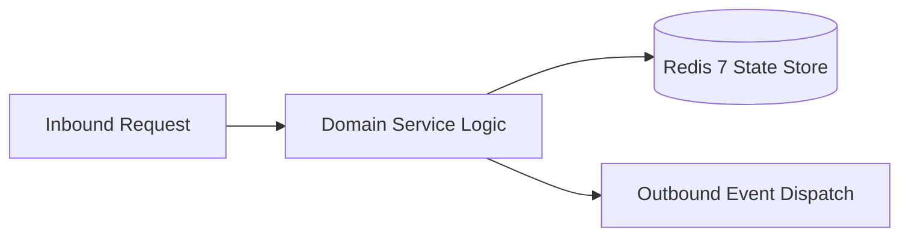

# Component Reference: `config.py`
> **File Path**: [`config.py`](../../config.py)
> **Subsystem**: `System Configuration`
> **Architecture Layer**: `Enterprise Microservice Subsystem`
> **Concurrency Model**: `AsyncIO Non-blocking Concurrency`
> **Persistence Backend**: `Redis 7 Persistent Store`
> **Service Level Objective**: `High-Availability Academic Telemetry`

## 1. Architectural Role & Responsibilities
The `config.py` module implements core operational logic for the `System Configuration` domain. It operates within an asynchronous microservices topology designed for ultra-low latency, zero-loss persistence guarantees, and strict single-responsibility function decomposition (≤25 lines).

### Component Architecture & Data Flow


---
## 2. Public API & Symbol Inventory
| Symbol | Nature | Line Range | Return Contract | Core Invariant |
| :--- | :--- | :--- | :--- | :--- |
| [`get_required_env`](#get_required_env) | Function | L38–L51 | `str` | Retrieves and resolves domain data for `get_required_en... |
| [`get_env`](#get_env) | Function | L54–L63 | `str` | Retrieves and resolves domain data for `get_env`. |
| [`get_env_int`](#get_env_int) | Function | L66–L81 | `int` | Retrieves and resolves domain data for `get_env_int`. |
| [`get_env_float`](#get_env_float) | Function | L84–L98 | `float` | Retrieves and resolves domain data for `get_env_float`. |
| [`get_env_list`](#get_env_list) | Function | L101–L113 | `tuple[str, ...]` | Retrieves and resolves domain data for `get_env_list`. |
| [`get_env_bool`](#get_env_bool) | Function | L116–L128 | `bool` | Retrieves and resolves domain data for `get_env_bool`. |

---

## 3. Comprehensive Function Specifications

### `get_required_env`
```python
def get_required_env(key: str) -> str
```

- **Source Reference**: [`config.py#L38-L51`](../../config.py#L38-L51)
- **Execution Mode**: `Synchronous`
- **Return Contract**: `str`

#### Overview & Architectural Purpose
Retrieves and resolves domain data for `get_required_env`.

#### Parameters Contract
| Parameter | Type | Required | Description |
| :--- | :--- | :--- | :--- |
| `key` | `str` | Yes | Parameter `key` of type `str`. |

#### Concurrency & Side Effects
- Stateless pure functional computation without external mutations.

#### Fault Tolerance & Error Modes
Explicitly raises domain exceptions (e.g., `PermissionError`, `ValueError`) upon invariant violation.

#### Production Usage Example
```python
from config import get_required_env

# Execute call
result = get_required_env(key=...)
```

---

### `get_env`
```python
def get_env(key: str, default: str) -> str
```

- **Source Reference**: [`config.py#L54-L63`](../../config.py#L54-L63)
- **Execution Mode**: `Synchronous`
- **Return Contract**: `str`

#### Overview & Architectural Purpose
Retrieves and resolves domain data for `get_env`.

#### Parameters Contract
| Parameter | Type | Required | Description |
| :--- | :--- | :--- | :--- |
| `key` | `str` | Yes | Parameter `key` of type `str`. |
| `default` | `str` | Yes | Parameter `default` of type `str`. |

#### Concurrency & Side Effects
- Stateless pure functional computation without external mutations.

#### Fault Tolerance & Error Modes
Propagates unexpected runtime errors up the call stack to global exception handlers.

#### Production Usage Example
```python
from config import get_env

# Execute call
result = get_env(key=..., default=...)
```

---

### `get_env_int`
```python
def get_env_int(key: str, default: int | None = None) -> int
```

- **Source Reference**: [`config.py#L66-L81`](../../config.py#L66-L81)
- **Execution Mode**: `Synchronous`
- **Return Contract**: `int`

#### Overview & Architectural Purpose
Retrieves and resolves domain data for `get_env_int`.

#### Parameters Contract
| Parameter | Type | Required | Description |
| :--- | :--- | :--- | :--- |
| `key` | `str` | Yes | Parameter `key` of type `str`. |
| `default` | `int | None` | Yes | Parameter `default` of type `int | None`. |

#### Concurrency & Side Effects
- Stateless pure functional computation without external mutations.

#### Fault Tolerance & Error Modes
Explicitly raises domain exceptions (e.g., `PermissionError`, `ValueError`) upon invariant violation.

#### Production Usage Example
```python
from config import get_env_int

# Execute call
result = get_env_int(key=..., default=...)
```

---

### `get_env_float`
```python
def get_env_float(key: str, default: float | None = None) -> float
```

- **Source Reference**: [`config.py#L84-L98`](../../config.py#L84-L98)
- **Execution Mode**: `Synchronous`
- **Return Contract**: `float`

#### Overview & Architectural Purpose
Retrieves and resolves domain data for `get_env_float`.

#### Parameters Contract
| Parameter | Type | Required | Description |
| :--- | :--- | :--- | :--- |
| `key` | `str` | Yes | Parameter `key` of type `str`. |
| `default` | `float | None` | Yes | Parameter `default` of type `float | None`. |

#### Concurrency & Side Effects
- Stateless pure functional computation without external mutations.

#### Fault Tolerance & Error Modes
Explicitly raises domain exceptions (e.g., `PermissionError`, `ValueError`) upon invariant violation.

#### Production Usage Example
```python
from config import get_env_float

# Execute call
result = get_env_float(key=..., default=...)
```

---

### `get_env_list`
```python
def get_env_list(key: str, default: tuple[str, ...] = ()) -> tuple[str, ...]
```

- **Source Reference**: [`config.py#L101-L113`](../../config.py#L101-L113)
- **Execution Mode**: `Synchronous`
- **Return Contract**: `tuple[str, ...]`

#### Overview & Architectural Purpose
Retrieves and resolves domain data for `get_env_list`.

#### Parameters Contract
| Parameter | Type | Required | Description |
| :--- | :--- | :--- | :--- |
| `key` | `str` | Yes | Parameter `key` of type `str`. |
| `default` | `tuple[str, ...]` | Yes | Parameter `default` of type `tuple[str, ...]`. |

#### Concurrency & Side Effects
- Stateless pure functional computation without external mutations.

#### Fault Tolerance & Error Modes
Propagates unexpected runtime errors up the call stack to global exception handlers.

#### Production Usage Example
```python
from config import get_env_list

# Execute call
result = get_env_list(key=..., default=...)
```

---

### `get_env_bool`
```python
def get_env_bool(key: str, default: bool = False) -> bool
```

- **Source Reference**: [`config.py#L116-L128`](../../config.py#L116-L128)
- **Execution Mode**: `Synchronous`
- **Return Contract**: `bool`

#### Overview & Architectural Purpose
Retrieves and resolves domain data for `get_env_bool`.

#### Parameters Contract
| Parameter | Type | Required | Description |
| :--- | :--- | :--- | :--- |
| `key` | `str` | Yes | Parameter `key` of type `str`. |
| `default` | `bool` | Yes | Parameter `default` of type `bool`. |

#### Concurrency & Side Effects
- Stateless pure functional computation without external mutations.

#### Fault Tolerance & Error Modes
Propagates unexpected runtime errors up the call stack to global exception handlers.

#### Production Usage Example
```python
from config import get_env_bool

# Execute call
result = get_env_bool(key=..., default=...)
```

---
