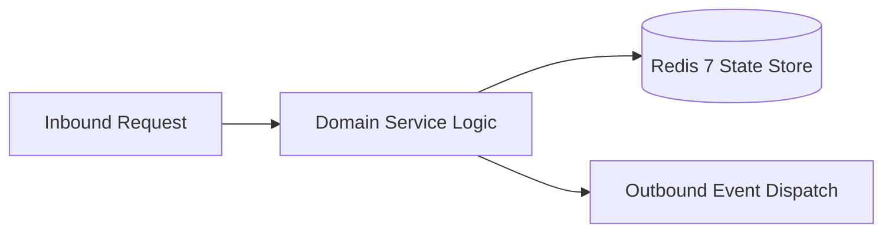

# Component Reference: `config.py`
> **File Path**: [`config.py`](../../config.py)  
> **Subsystem**: `System Configuration`  
> **Architecture Layer**: `Enterprise Microservice Subsystem`  
> **Concurrency Model**: `AsyncIO Non-blocking Concurrency`  
> **Persistence Backend**: `Redis 7 Persistent Store`  
> **Service Level Objective**: `High-Availability Academic Telemetry`

## 1. Architectural Role & Responsibilities
The `config.py` module implements core operational logic for the `System Configuration` domain. It operates within an asynchronous microservices topology designed for ultra-low latency, zero-loss persistence guarantees, and strict single-responsibility function decomposition (≤25 lines).

### Component Architecture & Data Flow


---
## 2. Public API & Symbol Inventory
| Symbol | Nature | Line Range | Return Contract | Core Invariant |
| :--- | :--- | :--- | :--- | :--- |
| [`get_required_env`](#get_required_env) | Function | L17–L27 | `str` | Retrieves and resolves domain data for `get_required_en... |

---

## 3. Comprehensive Function Specifications

### `get_required_env`
```python
def get_required_env(key: str) -> str
```

- **Source Reference**: [`config.py#L17-L27`](../../config.py#L17-L27)
- **Execution Mode**: `Synchronous`
- **Return Contract**: `str`

#### Overview & Architectural Purpose
Retrieves and resolves domain data for `get_required_env`.

#### Parameters Contract
| Parameter | Type | Required | Description |
| :--- | :--- | :--- | :--- |
| `key` | `str` | Yes | Parameter `key` of type `str`. |

#### Concurrency & Side Effects
- Stateless pure functional computation without external mutations.

#### Fault Tolerance & Error Modes
Explicitly raises domain exceptions (e.g., `PermissionError`, `ValueError`) upon invariant violation.

#### Production Usage Example
```python
from config import get_required_env

# Execute call
result = get_required_env(key=...)
```

---
