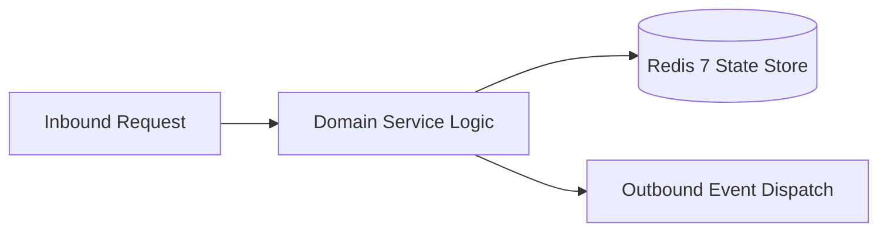

# Component Reference: `solver.py`
> **File Path**: [`solver.py`](../../solver.py)  
> **Subsystem**: `AI Queue Consumer`  
> **Architecture Layer**: `Enterprise Microservice Subsystem`  
> **Concurrency Model**: `AsyncIO Non-blocking Concurrency`  
> **Persistence Backend**: `Redis 7 Persistent Store`  
> **Service Level Objective**: `High-Availability Academic Telemetry`

## 1. Architectural Role & Responsibilities
The `solver.py` module implements core operational logic for the `AI Queue Consumer` domain. It operates within an asynchronous microservices topology designed for ultra-low latency, zero-loss persistence guarantees, and strict single-responsibility function decomposition (≤25 lines).

### Component Architecture & Data Flow


---
## 2. Public API & Symbol Inventory
| Symbol | Nature | Line Range | Return Contract | Core Invariant |
| :--- | :--- | :--- | :--- | :--- |
| [`build_post_link`](#build_post_link) | Function | L38–L41 | `str` | Executes core domain logic for `build_post_link`. |
| [`download_file_bytes`](#download_file_bytes) | Function | L44–L57 | `bytes | None` | Executes core domain logic for `download_file_bytes`. |
| [`extract_docx_data`](#extract_docx_data) | Function | L60–L76 | `tuple[str, list[bytes]]` | Executes core domain logic for `extract_docx_data`. |
| [`extract_pdf_data`](#extract_pdf_data) | Function | L79–L88 | `str` | Executes core domain logic for `extract_pdf_data`. |
| [`parse_file_payload`](#parse_file_payload) | Function | L91–L109 | `tuple[bytes | None, str | None]` | Parses and extracts structured entities from `parse_fil... |
| [`resolve_task_payload`](#resolve_task_payload) | Function | L112–L124 | `tuple[bytes | None, str | None]` | Executes core domain logic for `resolve_task_payload`. |
| [`send_solution_to_telegram`](#send_solution_to_telegram) | Function | L127–L140 | `None` | Dispatches notification message via Telegram API for `s... |
| [`notify_task_error`](#notify_task_error) | Function | L143–L157 | `None` | Executes core domain logic for `notify_task_error`. |
| [`execute_single_task`](#execute_single_task) | Function | L160–L179 | `None` | Executes core domain logic for `execute_single_task`. |
| [`_guarded_execute_task`](#_guarded_execute_task) | Function | L185–L188 | `None` | Executes core domain logic for `_guarded_execute_task`. |
| [`run_solver_loop`](#run_solver_loop) | Function | L191–L214 | `None` | Executes core domain logic for `run_solver_loop`. |
| [`main`](#main) | Function | L218–L235 | `None` | Executes core domain logic for `main`. |

---

## 3. Comprehensive Function Specifications

### `build_post_link`
```python
def build_post_link(chat_id: int, message_id: int) -> str
```

- **Source Reference**: [`solver.py#L38-L41`](../../solver.py#L38-L41)
- **Execution Mode**: `Synchronous`
- **Return Contract**: `str`

#### Overview & Architectural Purpose
Executes core domain logic for `build_post_link`.

#### Parameters Contract
| Parameter | Type | Required | Description |
| :--- | :--- | :--- | :--- |
| `chat_id` | `int` | Yes | Unique 64-bit Telegram chat or supergroup identifier. |
| `message_id` | `int` | Yes | Parameter `message_id` of type `int`. |

#### Concurrency & Side Effects
- Stateless pure functional computation without external mutations.

#### Fault Tolerance & Error Modes
Propagates unexpected runtime errors up the call stack to global exception handlers.

#### Production Usage Example
```python
from solver import build_post_link

# Execute call
result = build_post_link(chat_id=..., message_id=...)
```

---

### `download_file_bytes`
```python
async def download_file_bytes(tg_bot: Bot, file_id: str, file_size: int) -> bytes | None
```

- **Source Reference**: [`solver.py#L44-L57`](../../solver.py#L44-L57)
- **Execution Mode**: `Asynchronous (non-blocking)`
- **Return Contract**: `bytes | None`

#### Overview & Architectural Purpose
Executes core domain logic for `download_file_bytes`.

#### Parameters Contract
| Parameter | Type | Required | Description |
| :--- | :--- | :--- | :--- |
| `tg_bot` | `Bot` | Yes | Parameter `tg_bot` of type `Bot`. |
| `file_id` | `str` | Yes | Parameter `file_id` of type `str`. |
| `file_size` | `int` | Yes | Parameter `file_size` of type `int`. |

#### Concurrency & Side Effects
- Emits structured telemetry events to system logging subsystem.

#### Fault Tolerance & Error Modes
Encapsulates faults within `try/except` blocks, logging errors and returning safe fallback defaults.

#### Production Usage Example
```python
from solver import download_file_bytes

# Execute call
result = await download_file_bytes(tg_bot=..., file_id=..., file_size=...)
```

---

### `extract_docx_data`
```python
def extract_docx_data(doc_bytes: bytes) -> tuple[str, list[bytes]]
```

- **Source Reference**: [`solver.py#L60-L76`](../../solver.py#L60-L76)
- **Execution Mode**: `Synchronous`
- **Return Contract**: `tuple[str, list[bytes]]`

#### Overview & Architectural Purpose
Executes core domain logic for `extract_docx_data`.

#### Parameters Contract
| Parameter | Type | Required | Description |
| :--- | :--- | :--- | :--- |
| `doc_bytes` | `bytes` | Yes | Parameter `doc_bytes` of type `bytes`. |

#### Concurrency & Side Effects
- Stateless pure functional computation without external mutations.

#### Fault Tolerance & Error Modes
Propagates unexpected runtime errors up the call stack to global exception handlers.

#### Production Usage Example
```python
from solver import extract_docx_data

# Execute call
result = extract_docx_data(doc_bytes=...)
```

---

### `extract_pdf_data`
```python
def extract_pdf_data(doc_bytes: bytes) -> str
```

- **Source Reference**: [`solver.py#L79-L88`](../../solver.py#L79-L88)
- **Execution Mode**: `Synchronous`
- **Return Contract**: `str`

#### Overview & Architectural Purpose
Executes core domain logic for `extract_pdf_data`.

#### Parameters Contract
| Parameter | Type | Required | Description |
| :--- | :--- | :--- | :--- |
| `doc_bytes` | `bytes` | Yes | Parameter `doc_bytes` of type `bytes`. |

#### Concurrency & Side Effects
- Emits structured telemetry events to system logging subsystem.

#### Fault Tolerance & Error Modes
Encapsulates faults within `try/except` blocks, logging errors and returning safe fallback defaults.

#### Production Usage Example
```python
from solver import extract_pdf_data

# Execute call
result = extract_pdf_data(doc_bytes=...)
```

---

### `parse_file_payload`
```python
def parse_file_payload(doc_bytes: bytes, file_name: str, mime: str | None, prompt: str) -> tuple[bytes | None, str | None]
```

- **Source Reference**: [`solver.py#L91-L109`](../../solver.py#L91-L109)
- **Execution Mode**: `Synchronous`
- **Return Contract**: `tuple[bytes | None, str | None]`

#### Overview & Architectural Purpose
Parses and extracts structured entities from `parse_file_payload`.

#### Parameters Contract
| Parameter | Type | Required | Description |
| :--- | :--- | :--- | :--- |
| `doc_bytes` | `bytes` | Yes | Parameter `doc_bytes` of type `bytes`. |
| `file_name` | `str` | Yes | Parameter `file_name` of type `str`. |
| `mime` | `str | None` | Yes | Parameter `mime` of type `str | None`. |
| `prompt` | `str` | Yes | Parameter `prompt` of type `str`. |

#### Concurrency & Side Effects
- Stateless pure functional computation without external mutations.

#### Fault Tolerance & Error Modes
Propagates unexpected runtime errors up the call stack to global exception handlers.

#### Production Usage Example
```python
from solver import parse_file_payload

# Execute call
result = parse_file_payload(doc_bytes=..., file_name=..., mime=...)
```

---

### `resolve_task_payload`
```python
async def resolve_task_payload(tg_bot: Bot, task: dict) -> tuple[bytes | None, str | None]
```

- **Source Reference**: [`solver.py#L112-L124`](../../solver.py#L112-L124)
- **Execution Mode**: `Asynchronous (non-blocking)`
- **Return Contract**: `tuple[bytes | None, str | None]`

#### Overview & Architectural Purpose
Executes core domain logic for `resolve_task_payload`.

#### Parameters Contract
| Parameter | Type | Required | Description |
| :--- | :--- | :--- | :--- |
| `tg_bot` | `Bot` | Yes | Parameter `tg_bot` of type `Bot`. |
| `task` | `dict` | Yes | Parameter `task` of type `dict`. |

#### Concurrency & Side Effects
- Stateless pure functional computation without external mutations.

#### Fault Tolerance & Error Modes
Propagates unexpected runtime errors up the call stack to global exception handlers.

#### Production Usage Example
```python
from solver import resolve_task_payload

# Execute call
result = await resolve_task_payload(tg_bot=..., task=...)
```

---

### `send_solution_to_telegram`
```python
async def send_solution_to_telegram(tg_bot: Bot, task: dict, doc_path: str) -> None
```

- **Source Reference**: [`solver.py#L127-L140`](../../solver.py#L127-L140)
- **Execution Mode**: `Asynchronous (non-blocking)`
- **Return Contract**: `None`

#### Overview & Architectural Purpose
Dispatches notification message via Telegram API for `send_solution_to_telegram`.

#### Parameters Contract
| Parameter | Type | Required | Description |
| :--- | :--- | :--- | :--- |
| `tg_bot` | `Bot` | Yes | Parameter `tg_bot` of type `Bot`. |
| `task` | `dict` | Yes | Parameter `task` of type `dict`. |
| `doc_path` | `str` | Yes | Parameter `doc_path` of type `str`. |

#### Concurrency & Side Effects
- Stateless pure functional computation without external mutations.

#### Fault Tolerance & Error Modes
Propagates unexpected runtime errors up the call stack to global exception handlers.

#### Production Usage Example
```python
from solver import send_solution_to_telegram

# Execute call
result = await send_solution_to_telegram(tg_bot=..., task=..., doc_path=...)
```

---

### `notify_task_error`
```python
async def notify_task_error(tg_bot: Bot, task: dict) -> None
```

- **Source Reference**: [`solver.py#L143-L157`](../../solver.py#L143-L157)
- **Execution Mode**: `Asynchronous (non-blocking)`
- **Return Contract**: `None`

#### Overview & Architectural Purpose
Executes core domain logic for `notify_task_error`.

#### Parameters Contract
| Parameter | Type | Required | Description |
| :--- | :--- | :--- | :--- |
| `tg_bot` | `Bot` | Yes | Parameter `tg_bot` of type `Bot`. |
| `task` | `dict` | Yes | Parameter `task` of type `dict`. |

#### Concurrency & Side Effects
- Emits structured telemetry events to system logging subsystem.

#### Fault Tolerance & Error Modes
Encapsulates faults within `try/except` blocks, logging errors and returning safe fallback defaults.

#### Production Usage Example
```python
from solver import notify_task_error

# Execute call
result = await notify_task_error(tg_bot=..., task=...)
```

---

### `execute_single_task`
```python
async def execute_single_task(tg_bot: Bot, task: dict) -> None
```

- **Source Reference**: [`solver.py#L160-L179`](../../solver.py#L160-L179)
- **Execution Mode**: `Asynchronous (non-blocking)`
- **Return Contract**: `None`

#### Overview & Architectural Purpose
Executes core domain logic for `execute_single_task`.

#### Parameters Contract
| Parameter | Type | Required | Description |
| :--- | :--- | :--- | :--- |
| `tg_bot` | `Bot` | Yes | Parameter `tg_bot` of type `Bot`. |
| `task` | `dict` | Yes | Parameter `task` of type `dict`. |

#### Concurrency & Side Effects
- Emits structured telemetry events to system logging subsystem.

#### Fault Tolerance & Error Modes
Encapsulates faults within `try/except` blocks, logging errors and returning safe fallback defaults.

#### Production Usage Example
```python
from solver import execute_single_task

# Execute call
result = await execute_single_task(tg_bot=..., task=...)
```

---

### `_guarded_execute_task`
```python
async def _guarded_execute_task(tg_bot: Bot, task: dict) -> None
```

- **Source Reference**: [`solver.py#L185-L188`](../../solver.py#L185-L188)
- **Execution Mode**: `Asynchronous (non-blocking)`
- **Return Contract**: `None`

#### Overview & Architectural Purpose
Executes core domain logic for `_guarded_execute_task`.

#### Parameters Contract
| Parameter | Type | Required | Description |
| :--- | :--- | :--- | :--- |
| `tg_bot` | `Bot` | Yes | Parameter `tg_bot` of type `Bot`. |
| `task` | `dict` | Yes | Parameter `task` of type `dict`. |

#### Concurrency & Side Effects
- Stateless pure functional computation without external mutations.

#### Fault Tolerance & Error Modes
Propagates unexpected runtime errors up the call stack to global exception handlers.

#### Production Usage Example
```python
from solver import _guarded_execute_task

# Execute call
result = await _guarded_execute_task(tg_bot=..., task=...)
```

---

### `run_solver_loop`
```python
async def run_solver_loop() -> None
```

- **Source Reference**: [`solver.py#L191-L214`](../../solver.py#L191-L214)
- **Execution Mode**: `Asynchronous (non-blocking)`
- **Return Contract**: `None`

#### Overview & Architectural Purpose
Executes core domain logic for `run_solver_loop`.

#### Parameters Contract
*This method takes no input parameters.*

#### Concurrency & Side Effects
- Emits structured telemetry events to system logging subsystem.

#### Fault Tolerance & Error Modes
Encapsulates faults within `try/except` blocks, logging errors and returning safe fallback defaults.

#### Production Usage Example
```python
from solver import run_solver_loop

# Execute call
result = await run_solver_loop()
```

---

### `main`
```python
async def main() -> None
```

- **Source Reference**: [`solver.py#L218-L235`](../../solver.py#L218-L235)
- **Execution Mode**: `Asynchronous (non-blocking)`
- **Return Contract**: `None`

#### Overview & Architectural Purpose
Executes core domain logic for `main`.

#### Parameters Contract
*This method takes no input parameters.*

#### Concurrency & Side Effects
- Emits structured telemetry events to system logging subsystem.

#### Fault Tolerance & Error Modes
Encapsulates faults within `try/except` blocks, logging errors and returning safe fallback defaults.

#### Production Usage Example
```python
from solver import main

# Execute call
result = await main()
```

---
