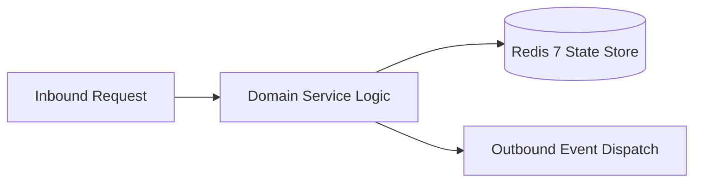

# Component Reference: `stt.py`
> **File Path**: [`stt.py`](../../stt.py)
> **Subsystem**: `Speech-to-Text Queue Consumer`
> **Architecture Layer**: `Enterprise Microservice Subsystem`
> **Concurrency Model**: `AsyncIO Non-blocking Concurrency`
> **Persistence Backend**: `Redis 7 Persistent Store`
> **Service Level Objective**: `High-Availability Academic Telemetry`

## 1. Architectural Role & Responsibilities
The `stt.py` module implements core operational logic for the `Speech-to-Text Queue Consumer` domain. It operates within an asynchronous microservices topology designed for ultra-low latency, zero-loss persistence guarantees, and strict single-responsibility function decomposition (≤25 lines).

### Component Architecture & Data Flow


---
## 2. Public API & Symbol Inventory
| Symbol | Nature | Line Range | Return Contract | Core Invariant |
| :--- | :--- | :--- | :--- | :--- |
| [`_warmup_model`](#_warmup_model) | Function | L21–L33 | `None` | Executes core domain logic for `_warmup_model`. |
| [`main`](#main) | Function | L36–L53 | `None` | Executes core domain logic for `main`. |

---

## 3. Comprehensive Function Specifications

### `_warmup_model`
```python
async def _warmup_model() -> None
```

- **Source Reference**: [`stt.py#L21-L33`](../../stt.py#L21-L33)
- **Execution Mode**: `Asynchronous (non-blocking)`
- **Return Contract**: `None`

#### Overview & Architectural Purpose
Executes core domain logic for `_warmup_model`.

#### Parameters Contract
*This method takes no input parameters.*

#### Concurrency & Side Effects
- Emits structured telemetry events to system logging subsystem.

#### Fault Tolerance & Error Modes
Encapsulates faults within `try/except` blocks, logging errors and returning safe fallback defaults.

#### Production Usage Example
```python
from stt import _warmup_model

# Execute call
result = await _warmup_model()
```

---

### `main`
```python
async def main() -> None
```

- **Source Reference**: [`stt.py#L36-L53`](../../stt.py#L36-L53)
- **Execution Mode**: `Asynchronous (non-blocking)`
- **Return Contract**: `None`

#### Overview & Architectural Purpose
Executes core domain logic for `main`.

#### Parameters Contract
*This method takes no input parameters.*

#### Concurrency & Side Effects
- Emits structured telemetry events to system logging subsystem.

#### Fault Tolerance & Error Modes
Encapsulates faults within `try/except` blocks, logging errors and returning safe fallback defaults.

#### Production Usage Example
```python
from stt import main

# Execute call
result = await main()
```

---
