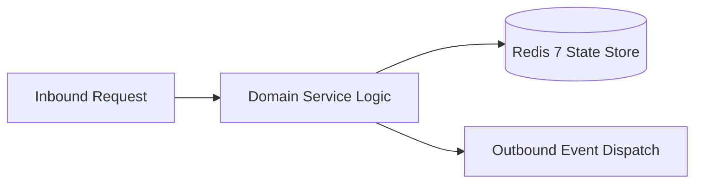

# Component Reference: `worker.py`
> **File Path**: [`worker.py`](../../worker.py)  
> **Subsystem**: `Background Daemon`  
> **Architecture Layer**: `Enterprise Microservice Subsystem`  
> **Concurrency Model**: `AsyncIO Non-blocking Concurrency`  
> **Persistence Backend**: `Redis 7 Persistent Store`  
> **Service Level Objective**: `High-Availability Academic Telemetry`

## 1. Architectural Role & Responsibilities
The `worker.py` module implements core operational logic for the `Background Daemon` domain. It operates within an asynchronous microservices topology designed for ultra-low latency, zero-loss persistence guarantees, and strict single-responsibility function decomposition (≤25 lines).

### Component Architecture & Data Flow


---
## 2. Public API & Symbol Inventory
| Symbol | Nature | Line Range | Return Contract | Core Invariant |
| :--- | :--- | :--- | :--- | :--- |
| [`schedule_today_reminders`](#schedule_today_reminders) | Function | L35–L43 | `None` | Executes core domain logic for `schedule_today_reminder... |
| [`shutdown_worker`](#shutdown_worker) | Function | L46–L54 | `None` | Executes core domain logic for `shutdown_worker`. |
| [`_start_worker_loops`](#_start_worker_loops) | Function | L57–L65 | `None` | Executes core domain logic for `_start_worker_loops`. |
| [`main`](#main) | Function | L68–L83 | `None` | Executes core domain logic for `main`. |

---

## 3. Comprehensive Function Specifications

### `schedule_today_reminders`
```python
async def schedule_today_reminders() -> None
```

- **Source Reference**: [`worker.py#L35-L43`](../../worker.py#L35-L43)
- **Execution Mode**: `Asynchronous (non-blocking)`
- **Return Contract**: `None`

#### Overview & Architectural Purpose
Executes core domain logic for `schedule_today_reminders`.

#### Parameters Contract
*This method takes no input parameters.*

#### Concurrency & Side Effects
- Emits structured telemetry events to system logging subsystem.

#### Fault Tolerance & Error Modes
Propagates unexpected runtime errors up the call stack to global exception handlers.

#### Production Usage Example
```python
from worker import schedule_today_reminders

# Execute call
result = await schedule_today_reminders()
```

---

### `shutdown_worker`
```python
async def shutdown_worker() -> None
```

- **Source Reference**: [`worker.py#L46-L54`](../../worker.py#L46-L54)
- **Execution Mode**: `Asynchronous (non-blocking)`
- **Return Contract**: `None`

#### Overview & Architectural Purpose
Executes core domain logic for `shutdown_worker`.

#### Parameters Contract
*This method takes no input parameters.*

#### Concurrency & Side Effects
- Emits structured telemetry events to system logging subsystem.

#### Fault Tolerance & Error Modes
Propagates unexpected runtime errors up the call stack to global exception handlers.

#### Production Usage Example
```python
from worker import shutdown_worker

# Execute call
result = await shutdown_worker()
```

---

### `_start_worker_loops`
```python
async def _start_worker_loops() -> None
```

- **Source Reference**: [`worker.py#L57-L65`](../../worker.py#L57-L65)
- **Execution Mode**: `Asynchronous (non-blocking)`
- **Return Contract**: `None`

#### Overview & Architectural Purpose
Executes core domain logic for `_start_worker_loops`.

#### Parameters Contract
*This method takes no input parameters.*

#### Concurrency & Side Effects
- Stateless pure functional computation without external mutations.

#### Fault Tolerance & Error Modes
Propagates unexpected runtime errors up the call stack to global exception handlers.

#### Production Usage Example
```python
from worker import _start_worker_loops

# Execute call
result = await _start_worker_loops()
```

---

### `main`
```python
async def main() -> None
```

- **Source Reference**: [`worker.py#L68-L83`](../../worker.py#L68-L83)
- **Execution Mode**: `Asynchronous (non-blocking)`
- **Return Contract**: `None`

#### Overview & Architectural Purpose
Executes core domain logic for `main`.

#### Parameters Contract
*This method takes no input parameters.*

#### Concurrency & Side Effects
- Emits structured telemetry events to system logging subsystem.

#### Fault Tolerance & Error Modes
Encapsulates faults within `try/except` blocks, logging errors and returning safe fallback defaults.

#### Production Usage Example
```python
from worker import main

# Execute call
result = await main()
```

---
