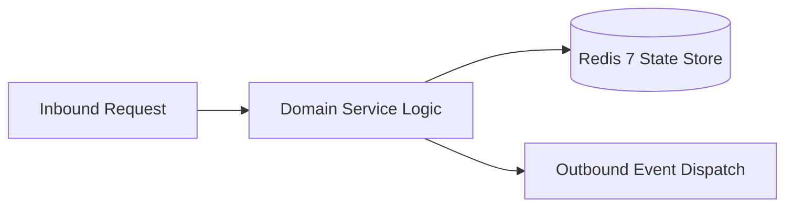

# Component Reference: `integrations/deepseek.py`
> **File Path**: [`integrations/deepseek.py`](../../integrations/deepseek.py)
> **Subsystem**: `DeepSeek LLM Integration`
> **Architecture Layer**: `Enterprise Microservice Subsystem`
> **Concurrency Model**: `AsyncIO Non-blocking Concurrency`
> **Persistence Backend**: `Redis 7 Persistent Store`
> **Service Level Objective**: `High-Availability Academic Telemetry`

## 1. Architectural Role & Responsibilities
The `integrations/deepseek.py` module implements core operational logic for the `DeepSeek LLM Integration` domain. It operates within an asynchronous microservices topology designed for ultra-low latency, zero-loss persistence guarantees, and strict single-responsibility function decomposition (≤25 lines).

### Component Architecture & Data Flow


---
## 2. Public API & Symbol Inventory
| Symbol | Nature | Line Range | Return Contract | Core Invariant |
| :--- | :--- | :--- | :--- | :--- |
| [`get_deepseek_client`](#get_deepseek_client) | Function | L21–L36 | `AsyncOpenAI` | Retrieves and resolves domain data for `get_deepseek_cl... |
| [`close_deepseek_client`](#close_deepseek_client) | Function | L39–L51 | `None` | Executes core domain logic for `close_deepseek_client`. |
| [`encode_image_bytes`](#encode_image_bytes) | Function | L54–L63 | `str` | Executes core domain logic for `encode_image_bytes`. |
| [`build_deepseek_messages`](#build_deepseek_messages) | Function | L66–L96 | `list[dict]` | Executes core domain logic for `build_deepseek_messages... |
| [`solve_homework`](#solve_homework) | Function | L99–L125 | `str` | Executes core domain logic for `solve_homework`. |

---

## 3. Comprehensive Function Specifications

### `get_deepseek_client`
```python
def get_deepseek_client() -> AsyncOpenAI
```

- **Source Reference**: [`integrations/deepseek.py#L21-L36`](../../integrations/deepseek.py#L21-L36)
- **Execution Mode**: `Synchronous`
- **Return Contract**: `AsyncOpenAI`

#### Overview & Architectural Purpose
Retrieves and resolves domain data for `get_deepseek_client`.

#### Parameters Contract
*This method takes no input parameters.*

#### Concurrency & Side Effects
- Stateless pure functional computation without external mutations.

#### Fault Tolerance & Error Modes
Propagates unexpected runtime errors up the call stack to global exception handlers.

#### Production Usage Example
```python
from integrations.deepseek import get_deepseek_client

# Execute call
result = get_deepseek_client()
```

---

### `close_deepseek_client`
```python
async def close_deepseek_client() -> None
```

- **Source Reference**: [`integrations/deepseek.py#L39-L51`](../../integrations/deepseek.py#L39-L51)
- **Execution Mode**: `Asynchronous (non-blocking)`
- **Return Contract**: `None`

#### Overview & Architectural Purpose
Executes core domain logic for `close_deepseek_client`.

#### Parameters Contract
*This method takes no input parameters.*

#### Concurrency & Side Effects
- Stateless pure functional computation without external mutations.

#### Fault Tolerance & Error Modes
Propagates unexpected runtime errors up the call stack to global exception handlers.

#### Production Usage Example
```python
from integrations.deepseek import close_deepseek_client

# Execute call
result = await close_deepseek_client()
```

---

### `encode_image_bytes`
```python
def encode_image_bytes(image_bytes: bytes) -> str
```

- **Source Reference**: [`integrations/deepseek.py#L54-L63`](../../integrations/deepseek.py#L54-L63)
- **Execution Mode**: `Synchronous`
- **Return Contract**: `str`

#### Overview & Architectural Purpose
Executes core domain logic for `encode_image_bytes`.

#### Parameters Contract
| Parameter | Type | Required | Description |
| :--- | :--- | :--- | :--- |
| `image_bytes` | `bytes` | Yes | Parameter `image_bytes` of type `bytes`. |

#### Concurrency & Side Effects
- Stateless pure functional computation without external mutations.

#### Fault Tolerance & Error Modes
Propagates unexpected runtime errors up the call stack to global exception handlers.

#### Production Usage Example
```python
from integrations.deepseek import encode_image_bytes

# Execute call
result = encode_image_bytes(image_bytes=...)
```

---

### `build_deepseek_messages`
```python
def build_deepseek_messages( image_bytes: bytes | None, text_prompt: str | None, ) -> list[dict]
```

- **Source Reference**: [`integrations/deepseek.py#L66-L96`](../../integrations/deepseek.py#L66-L96)
- **Execution Mode**: `Synchronous`
- **Return Contract**: `list[dict]`

#### Overview & Architectural Purpose
Executes core domain logic for `build_deepseek_messages`.

#### Parameters Contract
| Parameter | Type | Required | Description |
| :--- | :--- | :--- | :--- |
| `image_bytes` | `bytes | None` | Yes | Parameter `image_bytes` of type `bytes | None`. |
| `text_prompt` | `str | None` | Yes | Parameter `text_prompt` of type `str | None`. |

#### Concurrency & Side Effects
- Stateless pure functional computation without external mutations.

#### Fault Tolerance & Error Modes
Propagates unexpected runtime errors up the call stack to global exception handlers.

#### Production Usage Example
```python
from integrations.deepseek import build_deepseek_messages

# Execute call
result = build_deepseek_messages(image_bytes=..., text_prompt=...)
```

---

### `solve_homework`
```python
async def solve_homework( image_bytes: bytes | None = None, text_prompt: str | None = None, ) -> str
```

- **Source Reference**: [`integrations/deepseek.py#L99-L125`](../../integrations/deepseek.py#L99-L125)
- **Execution Mode**: `Asynchronous (non-blocking)`
- **Return Contract**: `str`

#### Overview & Architectural Purpose
Executes core domain logic for `solve_homework`.

#### Parameters Contract
| Parameter | Type | Required | Description |
| :--- | :--- | :--- | :--- |
| `image_bytes` | `bytes | None` | Yes | Parameter `image_bytes` of type `bytes | None`. |
| `text_prompt` | `str | None` | Yes | Parameter `text_prompt` of type `str | None`. |

#### Concurrency & Side Effects
- Emits structured telemetry events to system logging subsystem.

#### Fault Tolerance & Error Modes
Explicitly raises domain exceptions (e.g., `PermissionError`, `ValueError`) upon invariant violation.

#### Production Usage Example
```python
from integrations.deepseek import solve_homework

# Execute call
result = await solve_homework(image_bytes=..., text_prompt=...)
```

---
