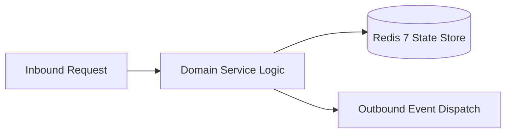

# Component Reference: `integrations/docx_parser.py`
> **File Path**: [`integrations/docx_parser.py`](../../integrations/docx_parser.py)  
> **Subsystem**: `Cloud DOCX Parser`  
> **Architecture Layer**: `Enterprise Microservice Subsystem`  
> **Concurrency Model**: `AsyncIO Non-blocking Concurrency`  
> **Persistence Backend**: `Redis 7 Persistent Store`  
> **Service Level Objective**: `High-Availability Academic Telemetry`

## 1. Architectural Role & Responsibilities
The `integrations/docx_parser.py` module implements core operational logic for the `Cloud DOCX Parser` domain. It operates within an asynchronous microservices topology designed for ultra-low latency, zero-loss persistence guarantees, and strict single-responsibility function decomposition (≤25 lines).

### Component Architecture & Data Flow


---
## 2. Public API & Symbol Inventory
| Symbol | Nature | Line Range | Return Contract | Core Invariant |
| :--- | :--- | :--- | :--- | :--- |
| [`fetch_docx_bytes`](#fetch_docx_bytes) | Function | L39–L60 | `bytes | None` | Executes core domain logic for `fetch_docx_bytes`. |
| [`extract_row_texts`](#extract_row_texts) | Function | L63–L77 | `tuple[str, str]` | Executes core domain logic for `extract_row_texts`. |
| [`parse_docx_teachers`](#parse_docx_teachers) | Function | L80–L95 | `dict[str, TeacherData]` | Parses and extracts structured entities from `parse_doc... |
| [`_get_docx_lock`](#_get_docx_lock) | Function | L102–L107 | `asyncio.Lock` | Executes core domain logic for `_get_docx_lock`. |
| [`_is_cache_fresh`](#_is_cache_fresh) | Function | L110–L117 | `bool` | Executes core domain logic for `_is_cache_fresh`. |
| [`_fetch_and_cache_teachers`](#_fetch_and_cache_teachers) | Function | L120–L130 | `dict[str, TeacherData]` | Executes core domain logic for `_fetch_and_cache_teache... |
| [`get_teacher_links`](#get_teacher_links) | Function | L133–L142 | `dict[str, TeacherData]` | Retrieves and resolves domain data for `get_teacher_lin... |

---

## 3. Comprehensive Function Specifications

## Class Model: `TeacherData`

Encapsulates domain entities and data transfer logic for `TeacherData`.

### `fetch_docx_bytes`
```python
async def fetch_docx_bytes() -> bytes | None
```

- **Source Reference**: [`integrations/docx_parser.py#L39-L60`](../../integrations/docx_parser.py#L39-L60)
- **Execution Mode**: `Asynchronous (non-blocking)`
- **Return Contract**: `bytes | None`

#### Overview & Architectural Purpose
Executes core domain logic for `fetch_docx_bytes`.

#### Parameters Contract
*This method takes no input parameters.*

#### Concurrency & Side Effects
- Emits structured telemetry events to system logging subsystem.
- Performs non-blocking network I/O over HTTP or gRPC.

#### Fault Tolerance & Error Modes
Encapsulates faults within `try/except` blocks, logging errors and returning safe fallback defaults.

#### Production Usage Example
```python
from integrations.docx_parser import fetch_docx_bytes

# Execute call
result = await fetch_docx_bytes()
```

---

### `extract_row_texts`
```python
def extract_row_texts(row_elem: Any) -> tuple[str, str]
```

- **Source Reference**: [`integrations/docx_parser.py#L63-L77`](../../integrations/docx_parser.py#L63-L77)
- **Execution Mode**: `Synchronous`
- **Return Contract**: `tuple[str, str]`

#### Overview & Architectural Purpose
Executes core domain logic for `extract_row_texts`.

#### Parameters Contract
| Parameter | Type | Required | Description |
| :--- | :--- | :--- | :--- |
| `row_elem` | `Any` | Yes | Parameter `row_elem` of type `Any`. |

#### Concurrency & Side Effects
- Stateless pure functional computation without external mutations.

#### Fault Tolerance & Error Modes
Propagates unexpected runtime errors up the call stack to global exception handlers.

#### Production Usage Example
```python
from integrations.docx_parser import extract_row_texts

# Execute call
result = extract_row_texts(row_elem=...)
```

---

### `parse_docx_teachers`
```python
def parse_docx_teachers(content: bytes) -> dict[str, TeacherData]
```

- **Source Reference**: [`integrations/docx_parser.py#L80-L95`](../../integrations/docx_parser.py#L80-L95)
- **Execution Mode**: `Synchronous`
- **Return Contract**: `dict[str, TeacherData]`

#### Overview & Architectural Purpose
Parses and extracts structured entities from `parse_docx_teachers`.

#### Parameters Contract
| Parameter | Type | Required | Description |
| :--- | :--- | :--- | :--- |
| `content` | `bytes` | Yes | Parameter `content` of type `bytes`. |

#### Concurrency & Side Effects
- Emits structured telemetry events to system logging subsystem.

#### Fault Tolerance & Error Modes
Encapsulates faults within `try/except` blocks, logging errors and returning safe fallback defaults.

#### Production Usage Example
```python
from integrations.docx_parser import parse_docx_teachers

# Execute call
result = parse_docx_teachers(content=...)
```

---

### `_get_docx_lock`
```python
def _get_docx_lock() -> asyncio.Lock
```

- **Source Reference**: [`integrations/docx_parser.py#L102-L107`](../../integrations/docx_parser.py#L102-L107)
- **Execution Mode**: `Synchronous`
- **Return Contract**: `asyncio.Lock`

#### Overview & Architectural Purpose
Executes core domain logic for `_get_docx_lock`.

#### Parameters Contract
*This method takes no input parameters.*

#### Concurrency & Side Effects
- Stateless pure functional computation without external mutations.

#### Fault Tolerance & Error Modes
Propagates unexpected runtime errors up the call stack to global exception handlers.

#### Production Usage Example
```python
from integrations.docx_parser import _get_docx_lock

# Execute call
result = _get_docx_lock()
```

---

### `_is_cache_fresh`
```python
def _is_cache_fresh(now: float, force_refresh: bool) -> bool
```

- **Source Reference**: [`integrations/docx_parser.py#L110-L117`](../../integrations/docx_parser.py#L110-L117)
- **Execution Mode**: `Synchronous`
- **Return Contract**: `bool`

#### Overview & Architectural Purpose
Executes core domain logic for `_is_cache_fresh`.

#### Parameters Contract
| Parameter | Type | Required | Description |
| :--- | :--- | :--- | :--- |
| `now` | `float` | Yes | Parameter `now` of type `float`. |
| `force_refresh` | `bool` | Yes | Parameter `force_refresh` of type `bool`. |

#### Concurrency & Side Effects
- Stateless pure functional computation without external mutations.

#### Fault Tolerance & Error Modes
Propagates unexpected runtime errors up the call stack to global exception handlers.

#### Production Usage Example
```python
from integrations.docx_parser import _is_cache_fresh

# Execute call
result = _is_cache_fresh(now=..., force_refresh=...)
```

---

### `_fetch_and_cache_teachers`
```python
async def _fetch_and_cache_teachers(now: float) -> dict[str, TeacherData]
```

- **Source Reference**: [`integrations/docx_parser.py#L120-L130`](../../integrations/docx_parser.py#L120-L130)
- **Execution Mode**: `Asynchronous (non-blocking)`
- **Return Contract**: `dict[str, TeacherData]`

#### Overview & Architectural Purpose
Executes core domain logic for `_fetch_and_cache_teachers`.

#### Parameters Contract
| Parameter | Type | Required | Description |
| :--- | :--- | :--- | :--- |
| `now` | `float` | Yes | Parameter `now` of type `float`. |

#### Concurrency & Side Effects
- Emits structured telemetry events to system logging subsystem.

#### Fault Tolerance & Error Modes
Propagates unexpected runtime errors up the call stack to global exception handlers.

#### Production Usage Example
```python
from integrations.docx_parser import _fetch_and_cache_teachers

# Execute call
result = await _fetch_and_cache_teachers(now=...)
```

---

### `get_teacher_links`
```python
async def get_teacher_links(force_refresh: bool = False) -> dict[str, TeacherData]
```

- **Source Reference**: [`integrations/docx_parser.py#L133-L142`](../../integrations/docx_parser.py#L133-L142)
- **Execution Mode**: `Asynchronous (non-blocking)`
- **Return Contract**: `dict[str, TeacherData]`

#### Overview & Architectural Purpose
Retrieves and resolves domain data for `get_teacher_links`.

#### Parameters Contract
| Parameter | Type | Required | Description |
| :--- | :--- | :--- | :--- |
| `force_refresh` | `bool` | Yes | Parameter `force_refresh` of type `bool`. |

#### Concurrency & Side Effects
- Stateless pure functional computation without external mutations.

#### Fault Tolerance & Error Modes
Propagates unexpected runtime errors up the call stack to global exception handlers.

#### Production Usage Example
```python
from integrations.docx_parser import get_teacher_links

# Execute call
result = await get_teacher_links(force_refresh=...)
```

---
