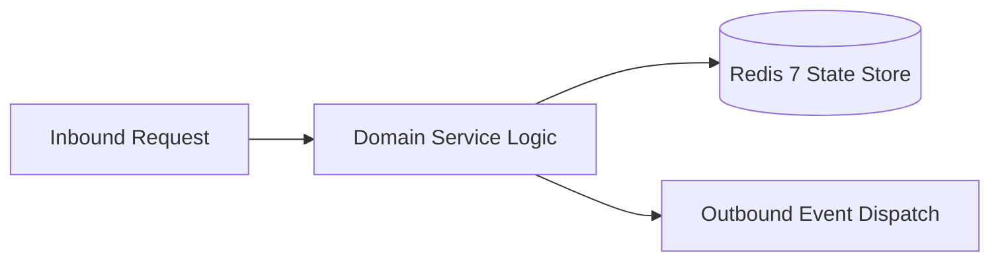

# Component Reference: `integrations/yandex_docs.py`
> **File Path**: [`integrations/yandex_docs.py`](../../integrations/yandex_docs.py)  
> **Subsystem**: `WOPI Cloud Service`  
> **Architecture Layer**: `Enterprise Microservice Subsystem`  
> **Concurrency Model**: `AsyncIO Non-blocking Concurrency`  
> **Persistence Backend**: `Redis 7 Persistent Store`  
> **Service Level Objective**: `High-Availability Academic Telemetry`

## 1. Architectural Role & Responsibilities
The `integrations/yandex_docs.py` module implements core operational logic for the `WOPI Cloud Service` domain. It operates within an asynchronous microservices topology designed for ultra-low latency, zero-loss persistence guarantees, and strict single-responsibility function decomposition (≤25 lines).

### Component Architecture & Data Flow


---
## 2. Public API & Symbol Inventory
| Symbol | Nature | Line Range | Return Contract | Core Invariant |
| :--- | :--- | :--- | :--- | :--- |
| [`WopiSession.__init__`](#wopisession__init__) | Method | L40–L46 | `Any` | Executes core domain logic for `__init__`. |
| [`extract_client_config`](#extract_client_config) | Function | L49–L61 | `dict` | Executes core domain logic for `extract_client_config`. |
| [`merge_cookie_header`](#merge_cookie_header) | Function | L64–L73 | `str` | Executes core domain logic for `merge_cookie_header`. |
| [`get_yandex_cookie_header`](#get_yandex_cookie_header) | Function | L76–L83 | `str` | Retrieves and resolves domain data for `get_yandex_cook... |
| [`get_effective_yandex_cookie`](#get_effective_yandex_cookie) | Function | L86–L97 | `str` | Retrieves and resolves domain data for `get_effective_y... |
| [`save_effective_yandex_cookie`](#save_effective_yandex_cookie) | Function | L100–L109 | `None` | Saves serialized entity data to storage for `save_effec... |
| [`update_cookies_from_response`](#update_cookies_from_response) | Function | L112–L119 | `None` | Synchronizes and updates domain state for `update_cooki... |
| [`fetch_page_dom`](#fetch_page_dom) | Function | L122–L145 | `str` | Executes core domain logic for `fetch_page_dom`. |
| [`get_active_wopi_lock`](#get_active_wopi_lock) | Function | L148–L160 | `str` | Retrieves and resolves domain data for `get_active_wopi... |
| [`init_wopi_session`](#init_wopi_session) | Function | L163–L179 | `WopiSession` | Executes core domain logic for `init_wopi_session`. |
| [`load_workbook_from_bytes`](#load_workbook_from_bytes) | Function | L182–L187 | `openpyxl.Workbook` | Executes core domain logic for `load_workbook_from_byte... |
| [`compute_sheet_summary_counts`](#compute_sheet_summary_counts) | Function | L190–L205 | `dict[tuple[str, int], int]` | Executes core domain logic for `compute_sheet_summary_c... |
| [`patch_sheet_xml_counts`](#patch_sheet_xml_counts) | Function | L208–L226 | `str` | Executes core domain logic for `patch_sheet_xml_counts`... |
| [`ensure_all_summary_headers`](#ensure_all_summary_headers) | Function | L229–L252 | `None` | Executes core domain logic for `ensure_all_summary_head... |
| [`inject_summary_cache`](#inject_summary_cache) | Function | L255–L268 | `bytes` | Executes core domain logic for `inject_summary_cache`. |
| [`save_workbook_to_bytes`](#save_workbook_to_bytes) | Function | L271–L279 | `bytes` | Saves serialized entity data to storage for `save_workb... |
| [`download_workbook`](#download_workbook) | Function | L282–L295 | `openpyxl.Workbook` | Executes core domain logic for `download_workbook`. |
| [`acquire_wopi_lock`](#acquire_wopi_lock) | Function | L298–L303 | `bool` | Executes core domain logic for `acquire_wopi_lock`. |
| [`release_wopi_lock`](#release_wopi_lock) | Function | L306–L311 | `bool` | Executes core domain logic for `release_wopi_lock`. |
| [`put_wopi_contents`](#put_wopi_contents) | Function | L314–L330 | `httpx.Response` | Executes core domain logic for `put_wopi_contents`. |
| [`_try_put_with_lock`](#_try_put_with_lock) | Function | L333–L348 | `bool` | Executes core domain logic for `_try_put_with_lock`. |
| [`upload_workbook`](#upload_workbook) | Function | L351–L359 | `bool` | Executes core domain logic for `upload_workbook`. |
| [`verify_upload`](#verify_upload) | Function | L362–L379 | `bool` | Executes core domain logic for `verify_upload`. |
| [`_download_raw_bytes`](#_download_raw_bytes) | Function | L382–L390 | `bytes` | Executes core domain logic for `_download_raw_bytes`. |
| [`_find_sheet_rid`](#_find_sheet_rid) | Function | L393–L410 | `str | None` | Executes core domain logic for `_find_sheet_rid`. |
| [`_resolve_sheet_target_path`](#_resolve_sheet_target_path) | Function | L413–L429 | `str | None` | Executes core domain logic for `_resolve_sheet_target_p... |
| [`_extract_sheet_xml`](#_extract_sheet_xml) | Function | L432–L454 | `str | None` | Executes core domain logic for `_extract_sheet_xml`. |
| [`_cell_has_expected_mark`](#_cell_has_expected_mark) | Function | L457–L466 | `bool` | Executes core domain logic for `_cell_has_expected_mark... |
| [`_marks_found_in_xml`](#_marks_found_in_xml) | Function | L469–L490 | `bool` | Executes core domain logic for `_marks_found_in_xml`. |
| [`_verify_marks_in_raw`](#_verify_marks_in_raw) | Function | L493–L512 | `bool` | Executes core domain logic for `_verify_marks_in_raw`. |
| [`get_month_sheet`](#get_month_sheet) | Function | L515–L524 | `Worksheet` | Retrieves and resolves domain data for `get_month_sheet... |
| [`parse_date_cell`](#parse_date_cell) | Function | L527–L533 | `str | None` | Parses and extracts structured entities from `parse_dat... |
| [`find_date_column_start`](#find_date_column_start) | Function | L536–L548 | `int | None` | Executes core domain logic for `find_date_column_start`... |
| [`find_lesson_column`](#find_lesson_column) | Function | L551–L567 | `int | None` | Executes core domain logic for `find_lesson_column`. |
| [`normalize_fio`](#normalize_fio) | Function | L570–L572 | `str` | Executes core domain logic for `normalize_fio`. |
| [`get_students_list`](#get_students_list) | Function | L575–L589 | `list[tuple[int, str]]` | Retrieves and resolves domain data for `get_students_li... |
| [`find_student_row`](#find_student_row) | Function | L592–L602 | `int | None` | Executes core domain logic for `find_student_row`. |
| [`write_student_mark`](#write_student_mark) | Function | L605–L622 | `None` | Executes core domain logic for `write_student_mark`. |

---

## 3. Comprehensive Function Specifications

## Class Model: `WopiSession`

Encapsulates domain entities and data transfer logic for `WopiSession`.

### `WopiSession.__init__`
```python
def __init__(self, resource_url: str, access_token: str, lock_id: str)
```

- **Source Reference**: [`integrations/yandex_docs.py#L40-L46`](../../integrations/yandex_docs.py#L40-L46)
- **Execution Mode**: `Synchronous`
- **Return Contract**: `Any`

#### Overview & Architectural Purpose
Executes core domain logic for `__init__`.

#### Parameters Contract
| Parameter | Type | Required | Description |
| :--- | :--- | :--- | :--- |
| `resource_url` | `str` | Yes | Parameter `resource_url` of type `str`. |
| `access_token` | `str` | Yes | Parameter `access_token` of type `str`. |
| `lock_id` | `str` | Yes | Parameter `lock_id` of type `str`. |

#### Concurrency & Side Effects
- Stateless pure functional computation without external mutations.

#### Fault Tolerance & Error Modes
Propagates unexpected runtime errors up the call stack to global exception handlers.

#### Production Usage Example
```python
from integrations.yandex_docs import __init__

# Execute call
result = __init__(resource_url=..., access_token=..., lock_id=...)
```

---

### `extract_client_config`
```python
def extract_client_config(html_content: str) -> dict
```

- **Source Reference**: [`integrations/yandex_docs.py#L49-L61`](../../integrations/yandex_docs.py#L49-L61)
- **Execution Mode**: `Synchronous`
- **Return Contract**: `dict`

#### Overview & Architectural Purpose
Executes core domain logic for `extract_client_config`.

#### Parameters Contract
| Parameter | Type | Required | Description |
| :--- | :--- | :--- | :--- |
| `html_content` | `str` | Yes | Parameter `html_content` of type `str`. |

#### Concurrency & Side Effects
- Stateless pure functional computation without external mutations.

#### Fault Tolerance & Error Modes
Explicitly raises domain exceptions (e.g., `PermissionError`, `ValueError`) upon invariant violation.

#### Production Usage Example
```python
from integrations.yandex_docs import extract_client_config

# Execute call
result = extract_client_config(html_content=...)
```

---

### `merge_cookie_header`
```python
def merge_cookie_header(current_cookie: str, new_cookies: dict[str, str]) -> str
```

- **Source Reference**: [`integrations/yandex_docs.py#L64-L73`](../../integrations/yandex_docs.py#L64-L73)
- **Execution Mode**: `Synchronous`
- **Return Contract**: `str`

#### Overview & Architectural Purpose
Executes core domain logic for `merge_cookie_header`.

#### Parameters Contract
| Parameter | Type | Required | Description |
| :--- | :--- | :--- | :--- |
| `current_cookie` | `str` | Yes | Parameter `current_cookie` of type `str`. |
| `new_cookies` | `dict[str, str]` | Yes | Parameter `new_cookies` of type `dict[str, str]`. |

#### Concurrency & Side Effects
- Stateless pure functional computation without external mutations.

#### Fault Tolerance & Error Modes
Propagates unexpected runtime errors up the call stack to global exception handlers.

#### Production Usage Example
```python
from integrations.yandex_docs import merge_cookie_header

# Execute call
result = merge_cookie_header(current_cookie=..., new_cookies=...)
```

---

### `get_yandex_cookie_header`
```python
def get_yandex_cookie_header() -> str
```

- **Source Reference**: [`integrations/yandex_docs.py#L76-L83`](../../integrations/yandex_docs.py#L76-L83)
- **Execution Mode**: `Synchronous`
- **Return Contract**: `str`

#### Overview & Architectural Purpose
Retrieves and resolves domain data for `get_yandex_cookie_header`.

#### Parameters Contract
*This method takes no input parameters.*

#### Concurrency & Side Effects
- Stateless pure functional computation without external mutations.

#### Fault Tolerance & Error Modes
Propagates unexpected runtime errors up the call stack to global exception handlers.

#### Production Usage Example
```python
from integrations.yandex_docs import get_yandex_cookie_header

# Execute call
result = get_yandex_cookie_header()
```

---

### `get_effective_yandex_cookie`
```python
async def get_effective_yandex_cookie() -> str
```

- **Source Reference**: [`integrations/yandex_docs.py#L86-L97`](../../integrations/yandex_docs.py#L86-L97)
- **Execution Mode**: `Asynchronous (non-blocking)`
- **Return Contract**: `str`

#### Overview & Architectural Purpose
Retrieves and resolves domain data for `get_effective_yandex_cookie`.

#### Parameters Contract
*This method takes no input parameters.*

#### Concurrency & Side Effects
- Mutates or reads Redis L2 key space via asynchronous connection pool.
- Emits structured telemetry events to system logging subsystem.

#### Fault Tolerance & Error Modes
Encapsulates faults within `try/except` blocks, logging errors and returning safe fallback defaults.

#### Production Usage Example
```python
from integrations.yandex_docs import get_effective_yandex_cookie

# Execute call
result = await get_effective_yandex_cookie()
```

---

### `save_effective_yandex_cookie`
```python
async def save_effective_yandex_cookie(cookie_str: str) -> None
```

- **Source Reference**: [`integrations/yandex_docs.py#L100-L109`](../../integrations/yandex_docs.py#L100-L109)
- **Execution Mode**: `Asynchronous (non-blocking)`
- **Return Contract**: `None`

#### Overview & Architectural Purpose
Saves serialized entity data to storage for `save_effective_yandex_cookie`.

#### Parameters Contract
| Parameter | Type | Required | Description |
| :--- | :--- | :--- | :--- |
| `cookie_str` | `str` | Yes | Parameter `cookie_str` of type `str`. |

#### Concurrency & Side Effects
- Mutates or reads Redis L2 key space via asynchronous connection pool.
- Emits structured telemetry events to system logging subsystem.

#### Fault Tolerance & Error Modes
Encapsulates faults within `try/except` blocks, logging errors and returning safe fallback defaults.

#### Production Usage Example
```python
from integrations.yandex_docs import save_effective_yandex_cookie

# Execute call
result = await save_effective_yandex_cookie(cookie_str=...)
```

---

### `update_cookies_from_response`
```python
async def update_cookies_from_response(res: httpx.Response, current_cookie: str) -> None
```

- **Source Reference**: [`integrations/yandex_docs.py#L112-L119`](../../integrations/yandex_docs.py#L112-L119)
- **Execution Mode**: `Asynchronous (non-blocking)`
- **Return Contract**: `None`

#### Overview & Architectural Purpose
Synchronizes and updates domain state for `update_cookies_from_response`.

#### Parameters Contract
| Parameter | Type | Required | Description |
| :--- | :--- | :--- | :--- |
| `res` | `httpx.Response` | Yes | Parameter `res` of type `httpx.Response`. |
| `current_cookie` | `str` | Yes | Parameter `current_cookie` of type `str`. |

#### Concurrency & Side Effects
- Stateless pure functional computation without external mutations.

#### Fault Tolerance & Error Modes
Propagates unexpected runtime errors up the call stack to global exception handlers.

#### Production Usage Example
```python
from integrations.yandex_docs import update_cookies_from_response

# Execute call
result = await update_cookies_from_response(res=..., current_cookie=...)
```

---

### `fetch_page_dom`
```python
async def fetch_page_dom(doc_url: str) -> str
```

- **Source Reference**: [`integrations/yandex_docs.py#L122-L145`](../../integrations/yandex_docs.py#L122-L145)
- **Execution Mode**: `Asynchronous (non-blocking)`
- **Return Contract**: `str`

#### Overview & Architectural Purpose
Executes core domain logic for `fetch_page_dom`.

#### Parameters Contract
| Parameter | Type | Required | Description |
| :--- | :--- | :--- | :--- |
| `doc_url` | `str` | Yes | Parameter `doc_url` of type `str`. |

#### Concurrency & Side Effects
- Performs non-blocking network I/O over HTTP or gRPC.

#### Fault Tolerance & Error Modes
Explicitly raises domain exceptions (e.g., `PermissionError`, `ValueError`) upon invariant violation.

#### Production Usage Example
```python
from integrations.yandex_docs import fetch_page_dom

# Execute call
result = await fetch_page_dom(doc_url=...)
```

---

### `get_active_wopi_lock`
```python
async def get_active_wopi_lock(resource_url: str, token: str) -> str
```

- **Source Reference**: [`integrations/yandex_docs.py#L148-L160`](../../integrations/yandex_docs.py#L148-L160)
- **Execution Mode**: `Asynchronous (non-blocking)`
- **Return Contract**: `str`

#### Overview & Architectural Purpose
Retrieves and resolves domain data for `get_active_wopi_lock`.

#### Parameters Contract
| Parameter | Type | Required | Description |
| :--- | :--- | :--- | :--- |
| `resource_url` | `str` | Yes | Parameter `resource_url` of type `str`. |
| `token` | `str` | Yes | Parameter `token` of type `str`. |

#### Concurrency & Side Effects
- Emits structured telemetry events to system logging subsystem.
- Performs non-blocking network I/O over HTTP or gRPC.

#### Fault Tolerance & Error Modes
Propagates unexpected runtime errors up the call stack to global exception handlers.

#### Production Usage Example
```python
from integrations.yandex_docs import get_active_wopi_lock

# Execute call
result = await get_active_wopi_lock(resource_url=..., token=...)
```

---

### `init_wopi_session`
```python
async def init_wopi_session(doc_url: str = ATTENDANCE_DOC_URL) -> WopiSession
```

- **Source Reference**: [`integrations/yandex_docs.py#L163-L179`](../../integrations/yandex_docs.py#L163-L179)
- **Execution Mode**: `Asynchronous (non-blocking)`
- **Return Contract**: `WopiSession`

#### Overview & Architectural Purpose
Executes core domain logic for `init_wopi_session`.

#### Parameters Contract
| Parameter | Type | Required | Description |
| :--- | :--- | :--- | :--- |
| `doc_url` | `str` | Yes | Parameter `doc_url` of type `str`. |

#### Concurrency & Side Effects
- Emits structured telemetry events to system logging subsystem.

#### Fault Tolerance & Error Modes
Explicitly raises domain exceptions (e.g., `PermissionError`, `ValueError`) upon invariant violation.

#### Production Usage Example
```python
from integrations.yandex_docs import init_wopi_session

# Execute call
result = await init_wopi_session(doc_url=...)
```

---

### `load_workbook_from_bytes`
```python
def load_workbook_from_bytes(content: bytes) -> openpyxl.Workbook
```

- **Source Reference**: [`integrations/yandex_docs.py#L182-L187`](../../integrations/yandex_docs.py#L182-L187)
- **Execution Mode**: `Synchronous`
- **Return Contract**: `openpyxl.Workbook`

#### Overview & Architectural Purpose
Executes core domain logic for `load_workbook_from_bytes`.

#### Parameters Contract
| Parameter | Type | Required | Description |
| :--- | :--- | :--- | :--- |
| `content` | `bytes` | Yes | Parameter `content` of type `bytes`. |

#### Concurrency & Side Effects
- Stateless pure functional computation without external mutations.

#### Fault Tolerance & Error Modes
Propagates unexpected runtime errors up the call stack to global exception handlers.

#### Production Usage Example
```python
from integrations.yandex_docs import load_workbook_from_bytes

# Execute call
result = load_workbook_from_bytes(content=...)
```

---

### `compute_sheet_summary_counts`
```python
def compute_sheet_summary_counts(sheet: Worksheet) -> dict[tuple[str, int], int]
```

- **Source Reference**: [`integrations/yandex_docs.py#L190-L205`](../../integrations/yandex_docs.py#L190-L205)
- **Execution Mode**: `Synchronous`
- **Return Contract**: `dict[tuple[str, int], int]`

#### Overview & Architectural Purpose
Executes core domain logic for `compute_sheet_summary_counts`.

#### Parameters Contract
| Parameter | Type | Required | Description |
| :--- | :--- | :--- | :--- |
| `sheet` | `Worksheet` | Yes | Parameter `sheet` of type `Worksheet`. |

#### Concurrency & Side Effects
- Stateless pure functional computation without external mutations.

#### Fault Tolerance & Error Modes
Propagates unexpected runtime errors up the call stack to global exception handlers.

#### Production Usage Example
```python
from integrations.yandex_docs import compute_sheet_summary_counts

# Execute call
result = compute_sheet_summary_counts(sheet=...)
```

---

### `patch_sheet_xml_counts`
```python
def patch_sheet_xml_counts(xml_text: str, counts: dict[tuple[str, int], int]) -> str
```

- **Source Reference**: [`integrations/yandex_docs.py#L208-L226`](../../integrations/yandex_docs.py#L208-L226)
- **Execution Mode**: `Synchronous`
- **Return Contract**: `str`

#### Overview & Architectural Purpose
Executes core domain logic for `patch_sheet_xml_counts`.

#### Parameters Contract
| Parameter | Type | Required | Description |
| :--- | :--- | :--- | :--- |
| `xml_text` | `str` | Yes | Parameter `xml_text` of type `str`. |
| `counts` | `dict[tuple[str, int], int]` | Yes | Parameter `counts` of type `dict[tuple[str, int], int]`. |

#### Concurrency & Side Effects
- Stateless pure functional computation without external mutations.

#### Fault Tolerance & Error Modes
Propagates unexpected runtime errors up the call stack to global exception handlers.

#### Production Usage Example
```python
from integrations.yandex_docs import patch_sheet_xml_counts

# Execute call
result = patch_sheet_xml_counts(xml_text=..., counts=...)
```

---

### `ensure_all_summary_headers`
```python
def ensure_all_summary_headers(wb: openpyxl.Workbook) -> None
```

- **Source Reference**: [`integrations/yandex_docs.py#L229-L252`](../../integrations/yandex_docs.py#L229-L252)
- **Execution Mode**: `Synchronous`
- **Return Contract**: `None`

#### Overview & Architectural Purpose
Executes core domain logic for `ensure_all_summary_headers`.

#### Parameters Contract
| Parameter | Type | Required | Description |
| :--- | :--- | :--- | :--- |
| `wb` | `openpyxl.Workbook` | Yes | Openpyxl workbook instance containing academic attendance sheets. |

#### Concurrency & Side Effects
- Stateless pure functional computation without external mutations.

#### Fault Tolerance & Error Modes
Propagates unexpected runtime errors up the call stack to global exception handlers.

#### Production Usage Example
```python
from integrations.yandex_docs import ensure_all_summary_headers

# Execute call
result = ensure_all_summary_headers(wb=...)
```

---

### `inject_summary_cache`
```python
def inject_summary_cache(raw_bytes: bytes, wb: openpyxl.Workbook) -> bytes
```

- **Source Reference**: [`integrations/yandex_docs.py#L255-L268`](../../integrations/yandex_docs.py#L255-L268)
- **Execution Mode**: `Synchronous`
- **Return Contract**: `bytes`

#### Overview & Architectural Purpose
Executes core domain logic for `inject_summary_cache`.

#### Parameters Contract
| Parameter | Type | Required | Description |
| :--- | :--- | :--- | :--- |
| `raw_bytes` | `bytes` | Yes | Parameter `raw_bytes` of type `bytes`. |
| `wb` | `openpyxl.Workbook` | Yes | Openpyxl workbook instance containing academic attendance sheets. |

#### Concurrency & Side Effects
- Stateless pure functional computation without external mutations.

#### Fault Tolerance & Error Modes
Propagates unexpected runtime errors up the call stack to global exception handlers.

#### Production Usage Example
```python
from integrations.yandex_docs import inject_summary_cache

# Execute call
result = inject_summary_cache(raw_bytes=..., wb=...)
```

---

### `save_workbook_to_bytes`
```python
def save_workbook_to_bytes(wb: openpyxl.Workbook) -> bytes
```

- **Source Reference**: [`integrations/yandex_docs.py#L271-L279`](../../integrations/yandex_docs.py#L271-L279)
- **Execution Mode**: `Synchronous`
- **Return Contract**: `bytes`

#### Overview & Architectural Purpose
Saves serialized entity data to storage for `save_workbook_to_bytes`.

#### Parameters Contract
| Parameter | Type | Required | Description |
| :--- | :--- | :--- | :--- |
| `wb` | `openpyxl.Workbook` | Yes | Openpyxl workbook instance containing academic attendance sheets. |

#### Concurrency & Side Effects
- Stateless pure functional computation without external mutations.

#### Fault Tolerance & Error Modes
Propagates unexpected runtime errors up the call stack to global exception handlers.

#### Production Usage Example
```python
from integrations.yandex_docs import save_workbook_to_bytes

# Execute call
result = save_workbook_to_bytes(wb=...)
```

---

### `download_workbook`
```python
async def download_workbook(session: WopiSession) -> openpyxl.Workbook
```

- **Source Reference**: [`integrations/yandex_docs.py#L282-L295`](../../integrations/yandex_docs.py#L282-L295)
- **Execution Mode**: `Asynchronous (non-blocking)`
- **Return Contract**: `openpyxl.Workbook`

#### Overview & Architectural Purpose
Executes core domain logic for `download_workbook`.

#### Parameters Contract
| Parameter | Type | Required | Description |
| :--- | :--- | :--- | :--- |
| `session` | `WopiSession` | Yes | Active domain session instance containing current student index and marks. |

#### Concurrency & Side Effects
- Emits structured telemetry events to system logging subsystem.
- Performs non-blocking network I/O over HTTP or gRPC.

#### Fault Tolerance & Error Modes
Explicitly raises domain exceptions (e.g., `PermissionError`, `ValueError`) upon invariant violation.

#### Production Usage Example
```python
from integrations.yandex_docs import download_workbook

# Execute call
result = await download_workbook(session=...)
```

---

### `acquire_wopi_lock`
```python
async def acquire_wopi_lock(session: WopiSession, client: httpx.AsyncClient, lock_id: str) -> bool
```

- **Source Reference**: [`integrations/yandex_docs.py#L298-L303`](../../integrations/yandex_docs.py#L298-L303)
- **Execution Mode**: `Asynchronous (non-blocking)`
- **Return Contract**: `bool`

#### Overview & Architectural Purpose
Executes core domain logic for `acquire_wopi_lock`.

#### Parameters Contract
| Parameter | Type | Required | Description |
| :--- | :--- | :--- | :--- |
| `session` | `WopiSession` | Yes | Active domain session instance containing current student index and marks. |
| `client` | `httpx.AsyncClient` | Yes | Active asynchronous Redis client or HTTP connection pool instance. |
| `lock_id` | `str` | Yes | Parameter `lock_id` of type `str`. |

#### Concurrency & Side Effects
- Stateless pure functional computation without external mutations.

#### Fault Tolerance & Error Modes
Propagates unexpected runtime errors up the call stack to global exception handlers.

#### Production Usage Example
```python
from integrations.yandex_docs import acquire_wopi_lock

# Execute call
result = await acquire_wopi_lock(session=..., client=..., lock_id=...)
```

---

### `release_wopi_lock`
```python
async def release_wopi_lock(session: WopiSession, client: httpx.AsyncClient, lock_id: str) -> bool
```

- **Source Reference**: [`integrations/yandex_docs.py#L306-L311`](../../integrations/yandex_docs.py#L306-L311)
- **Execution Mode**: `Asynchronous (non-blocking)`
- **Return Contract**: `bool`

#### Overview & Architectural Purpose
Executes core domain logic for `release_wopi_lock`.

#### Parameters Contract
| Parameter | Type | Required | Description |
| :--- | :--- | :--- | :--- |
| `session` | `WopiSession` | Yes | Active domain session instance containing current student index and marks. |
| `client` | `httpx.AsyncClient` | Yes | Active asynchronous Redis client or HTTP connection pool instance. |
| `lock_id` | `str` | Yes | Parameter `lock_id` of type `str`. |

#### Concurrency & Side Effects
- Stateless pure functional computation without external mutations.

#### Fault Tolerance & Error Modes
Propagates unexpected runtime errors up the call stack to global exception handlers.

#### Production Usage Example
```python
from integrations.yandex_docs import release_wopi_lock

# Execute call
result = await release_wopi_lock(session=..., client=..., lock_id=...)
```

---

### `put_wopi_contents`
```python
async def put_wopi_contents( session: WopiSession, client: httpx.AsyncClient, data: bytes, lock_id: str ) -> httpx.Response
```

- **Source Reference**: [`integrations/yandex_docs.py#L314-L330`](../../integrations/yandex_docs.py#L314-L330)
- **Execution Mode**: `Asynchronous (non-blocking)`
- **Return Contract**: `httpx.Response`

#### Overview & Architectural Purpose
Executes core domain logic for `put_wopi_contents`.

#### Parameters Contract
| Parameter | Type | Required | Description |
| :--- | :--- | :--- | :--- |
| `session` | `WopiSession` | Yes | Active domain session instance containing current student index and marks. |
| `client` | `httpx.AsyncClient` | Yes | Active asynchronous Redis client or HTTP connection pool instance. |
| `data` | `bytes` | Yes | Parameter `data` of type `bytes`. |
| `lock_id` | `str` | Yes | Parameter `lock_id` of type `str`. |

#### Concurrency & Side Effects
- Emits structured telemetry events to system logging subsystem.

#### Fault Tolerance & Error Modes
Propagates unexpected runtime errors up the call stack to global exception handlers.

#### Production Usage Example
```python
from integrations.yandex_docs import put_wopi_contents

# Execute call
result = await put_wopi_contents(session=..., client=..., data=...)
```

---

### `_try_put_with_lock`
```python
async def _try_put_with_lock( session: WopiSession, client: httpx.AsyncClient, data: bytes ) -> bool
```

- **Source Reference**: [`integrations/yandex_docs.py#L333-L348`](../../integrations/yandex_docs.py#L333-L348)
- **Execution Mode**: `Asynchronous (non-blocking)`
- **Return Contract**: `bool`

#### Overview & Architectural Purpose
Executes core domain logic for `_try_put_with_lock`.

#### Parameters Contract
| Parameter | Type | Required | Description |
| :--- | :--- | :--- | :--- |
| `session` | `WopiSession` | Yes | Active domain session instance containing current student index and marks. |
| `client` | `httpx.AsyncClient` | Yes | Active asynchronous Redis client or HTTP connection pool instance. |
| `data` | `bytes` | Yes | Parameter `data` of type `bytes`. |

#### Concurrency & Side Effects
- Emits structured telemetry events to system logging subsystem.

#### Fault Tolerance & Error Modes
Propagates unexpected runtime errors up the call stack to global exception handlers.

#### Production Usage Example
```python
from integrations.yandex_docs import _try_put_with_lock

# Execute call
result = await _try_put_with_lock(session=..., client=..., data=...)
```

---

### `upload_workbook`
```python
async def upload_workbook(session: WopiSession, wb: openpyxl.Workbook) -> bool
```

- **Source Reference**: [`integrations/yandex_docs.py#L351-L359`](../../integrations/yandex_docs.py#L351-L359)
- **Execution Mode**: `Asynchronous (non-blocking)`
- **Return Contract**: `bool`

#### Overview & Architectural Purpose
Executes core domain logic for `upload_workbook`.

#### Parameters Contract
| Parameter | Type | Required | Description |
| :--- | :--- | :--- | :--- |
| `session` | `WopiSession` | Yes | Active domain session instance containing current student index and marks. |
| `wb` | `openpyxl.Workbook` | Yes | Openpyxl workbook instance containing academic attendance sheets. |

#### Concurrency & Side Effects
- Emits structured telemetry events to system logging subsystem.
- Performs non-blocking network I/O over HTTP or gRPC.

#### Fault Tolerance & Error Modes
Propagates unexpected runtime errors up the call stack to global exception handlers.

#### Production Usage Example
```python
from integrations.yandex_docs import upload_workbook

# Execute call
result = await upload_workbook(session=..., wb=...)
```

---

### `verify_upload`
```python
async def verify_upload( session: WopiSession, target_date: date, lesson_num: int, expected_marks: dict[str, str], ) -> bool
```

- **Source Reference**: [`integrations/yandex_docs.py#L362-L379`](../../integrations/yandex_docs.py#L362-L379)
- **Execution Mode**: `Asynchronous (non-blocking)`
- **Return Contract**: `bool`

#### Overview & Architectural Purpose
Executes core domain logic for `verify_upload`.

#### Parameters Contract
| Parameter | Type | Required | Description |
| :--- | :--- | :--- | :--- |
| `session` | `WopiSession` | Yes | Active domain session instance containing current student index and marks. |
| `target_date` | `date` | Yes | Target calendar date for schedule or attendance resolution (ISO-8601). |
| `lesson_num` | `int` | Yes | Academic class sequence index (1-based, 1 to 6). |
| `expected_marks` | `dict[str, str]` | Yes | Parameter `expected_marks` of type `dict[str, str]`. |

#### Concurrency & Side Effects
- Emits structured telemetry events to system logging subsystem.

#### Fault Tolerance & Error Modes
Encapsulates faults within `try/except` blocks, logging errors and returning safe fallback defaults.

#### Production Usage Example
```python
from integrations.yandex_docs import verify_upload

# Execute call
result = await verify_upload(session=..., target_date=..., lesson_num=...)
```

---

### `_download_raw_bytes`
```python
async def _download_raw_bytes(session: WopiSession) -> bytes
```

- **Source Reference**: [`integrations/yandex_docs.py#L382-L390`](../../integrations/yandex_docs.py#L382-L390)
- **Execution Mode**: `Asynchronous (non-blocking)`
- **Return Contract**: `bytes`

#### Overview & Architectural Purpose
Executes core domain logic for `_download_raw_bytes`.

#### Parameters Contract
| Parameter | Type | Required | Description |
| :--- | :--- | :--- | :--- |
| `session` | `WopiSession` | Yes | Active domain session instance containing current student index and marks. |

#### Concurrency & Side Effects
- Emits structured telemetry events to system logging subsystem.
- Performs non-blocking network I/O over HTTP or gRPC.

#### Fault Tolerance & Error Modes
Explicitly raises domain exceptions (e.g., `PermissionError`, `ValueError`) upon invariant violation.

#### Production Usage Example
```python
from integrations.yandex_docs import _download_raw_bytes

# Execute call
result = await _download_raw_bytes(session=...)
```

---

### `_find_sheet_rid`
```python
def _find_sheet_rid(wb_xml: str, sheet_name: str) -> str | None
```

- **Source Reference**: [`integrations/yandex_docs.py#L393-L410`](../../integrations/yandex_docs.py#L393-L410)
- **Execution Mode**: `Synchronous`
- **Return Contract**: `str | None`

#### Overview & Architectural Purpose
Executes core domain logic for `_find_sheet_rid`.

#### Parameters Contract
| Parameter | Type | Required | Description |
| :--- | :--- | :--- | :--- |
| `wb_xml` | `str` | Yes | Parameter `wb_xml` of type `str`. |
| `sheet_name` | `str` | Yes | Parameter `sheet_name` of type `str`. |

#### Concurrency & Side Effects
- Emits structured telemetry events to system logging subsystem.

#### Fault Tolerance & Error Modes
Encapsulates faults within `try/except` blocks, logging errors and returning safe fallback defaults.

#### Production Usage Example
```python
from integrations.yandex_docs import _find_sheet_rid

# Execute call
result = _find_sheet_rid(wb_xml=..., sheet_name=...)
```

---

### `_resolve_sheet_target_path`
```python
def _resolve_sheet_target_path(rels_xml: str, rid: str) -> str | None
```

- **Source Reference**: [`integrations/yandex_docs.py#L413-L429`](../../integrations/yandex_docs.py#L413-L429)
- **Execution Mode**: `Synchronous`
- **Return Contract**: `str | None`

#### Overview & Architectural Purpose
Executes core domain logic for `_resolve_sheet_target_path`.

#### Parameters Contract
| Parameter | Type | Required | Description |
| :--- | :--- | :--- | :--- |
| `rels_xml` | `str` | Yes | Parameter `rels_xml` of type `str`. |
| `rid` | `str` | Yes | Parameter `rid` of type `str`. |

#### Concurrency & Side Effects
- Emits structured telemetry events to system logging subsystem.

#### Fault Tolerance & Error Modes
Encapsulates faults within `try/except` blocks, logging errors and returning safe fallback defaults.

#### Production Usage Example
```python
from integrations.yandex_docs import _resolve_sheet_target_path

# Execute call
result = _resolve_sheet_target_path(rels_xml=..., rid=...)
```

---

### `_extract_sheet_xml`
```python
def _extract_sheet_xml(raw: bytes, sheet_name: str) -> str | None
```

- **Source Reference**: [`integrations/yandex_docs.py#L432-L454`](../../integrations/yandex_docs.py#L432-L454)
- **Execution Mode**: `Synchronous`
- **Return Contract**: `str | None`

#### Overview & Architectural Purpose
Executes core domain logic for `_extract_sheet_xml`.

#### Parameters Contract
| Parameter | Type | Required | Description |
| :--- | :--- | :--- | :--- |
| `raw` | `bytes` | Yes | Parameter `raw` of type `bytes`. |
| `sheet_name` | `str` | Yes | Parameter `sheet_name` of type `str`. |

#### Concurrency & Side Effects
- Emits structured telemetry events to system logging subsystem.

#### Fault Tolerance & Error Modes
Encapsulates faults within `try/except` blocks, logging errors and returning safe fallback defaults.

#### Production Usage Example
```python
from integrations.yandex_docs import _extract_sheet_xml

# Execute call
result = _extract_sheet_xml(raw=..., sheet_name=...)
```

---

### `_cell_has_expected_mark`
```python
def _cell_has_expected_mark(cell_xml: str, mark: str) -> bool
```

- **Source Reference**: [`integrations/yandex_docs.py#L457-L466`](../../integrations/yandex_docs.py#L457-L466)
- **Execution Mode**: `Synchronous`
- **Return Contract**: `bool`

#### Overview & Architectural Purpose
Executes core domain logic for `_cell_has_expected_mark`.

#### Parameters Contract
| Parameter | Type | Required | Description |
| :--- | :--- | :--- | :--- |
| `cell_xml` | `str` | Yes | Parameter `cell_xml` of type `str`. |
| `mark` | `str` | Yes | Attendance evaluation symbol assigned to the student. |

#### Concurrency & Side Effects
- Stateless pure functional computation without external mutations.

#### Fault Tolerance & Error Modes
Propagates unexpected runtime errors up the call stack to global exception handlers.

#### Production Usage Example
```python
from integrations.yandex_docs import _cell_has_expected_mark

# Execute call
result = _cell_has_expected_mark(cell_xml=..., mark=...)
```

---

### `_marks_found_in_xml`
```python
def _marks_found_in_xml( xml_text: str, check_marks: dict[str, str] ) -> bool
```

- **Source Reference**: [`integrations/yandex_docs.py#L469-L490`](../../integrations/yandex_docs.py#L469-L490)
- **Execution Mode**: `Synchronous`
- **Return Contract**: `bool`

#### Overview & Architectural Purpose
Executes core domain logic for `_marks_found_in_xml`.

#### Parameters Contract
| Parameter | Type | Required | Description |
| :--- | :--- | :--- | :--- |
| `xml_text` | `str` | Yes | Parameter `xml_text` of type `str`. |
| `check_marks` | `dict[str, str]` | Yes | Parameter `check_marks` of type `dict[str, str]`. |

#### Concurrency & Side Effects
- Emits structured telemetry events to system logging subsystem.

#### Fault Tolerance & Error Modes
Propagates unexpected runtime errors up the call stack to global exception handlers.

#### Production Usage Example
```python
from integrations.yandex_docs import _marks_found_in_xml

# Execute call
result = _marks_found_in_xml(xml_text=..., check_marks=...)
```

---

### `_verify_marks_in_raw`
```python
def _verify_marks_in_raw( raw: bytes, target_date: date, expected_marks: dict[str, str] ) -> bool
```

- **Source Reference**: [`integrations/yandex_docs.py#L493-L512`](../../integrations/yandex_docs.py#L493-L512)
- **Execution Mode**: `Synchronous`
- **Return Contract**: `bool`

#### Overview & Architectural Purpose
Executes core domain logic for `_verify_marks_in_raw`.

#### Parameters Contract
| Parameter | Type | Required | Description |
| :--- | :--- | :--- | :--- |
| `raw` | `bytes` | Yes | Parameter `raw` of type `bytes`. |
| `target_date` | `date` | Yes | Target calendar date for schedule or attendance resolution (ISO-8601). |
| `expected_marks` | `dict[str, str]` | Yes | Parameter `expected_marks` of type `dict[str, str]`. |

#### Concurrency & Side Effects
- Emits structured telemetry events to system logging subsystem.

#### Fault Tolerance & Error Modes
Propagates unexpected runtime errors up the call stack to global exception handlers.

#### Production Usage Example
```python
from integrations.yandex_docs import _verify_marks_in_raw

# Execute call
result = _verify_marks_in_raw(raw=..., target_date=..., expected_marks=...)
```

---

### `get_month_sheet`
```python
def get_month_sheet(wb: openpyxl.Workbook, target_date: date) -> Worksheet
```

- **Source Reference**: [`integrations/yandex_docs.py#L515-L524`](../../integrations/yandex_docs.py#L515-L524)
- **Execution Mode**: `Synchronous`
- **Return Contract**: `Worksheet`

#### Overview & Architectural Purpose
Retrieves and resolves domain data for `get_month_sheet`.

#### Parameters Contract
| Parameter | Type | Required | Description |
| :--- | :--- | :--- | :--- |
| `wb` | `openpyxl.Workbook` | Yes | Openpyxl workbook instance containing academic attendance sheets. |
| `target_date` | `date` | Yes | Target calendar date for schedule or attendance resolution (ISO-8601). |

#### Concurrency & Side Effects
- Stateless pure functional computation without external mutations.

#### Fault Tolerance & Error Modes
Explicitly raises domain exceptions (e.g., `PermissionError`, `ValueError`) upon invariant violation.

#### Production Usage Example
```python
from integrations.yandex_docs import get_month_sheet

# Execute call
result = get_month_sheet(wb=..., target_date=...)
```

---

### `parse_date_cell`
```python
def parse_date_cell(cell_value: object) -> str | None
```

- **Source Reference**: [`integrations/yandex_docs.py#L527-L533`](../../integrations/yandex_docs.py#L527-L533)
- **Execution Mode**: `Synchronous`
- **Return Contract**: `str | None`

#### Overview & Architectural Purpose
Parses and extracts structured entities from `parse_date_cell`.

#### Parameters Contract
| Parameter | Type | Required | Description |
| :--- | :--- | :--- | :--- |
| `cell_value` | `object` | Yes | Parameter `cell_value` of type `object`. |

#### Concurrency & Side Effects
- Stateless pure functional computation without external mutations.

#### Fault Tolerance & Error Modes
Propagates unexpected runtime errors up the call stack to global exception handlers.

#### Production Usage Example
```python
from integrations.yandex_docs import parse_date_cell

# Execute call
result = parse_date_cell(cell_value=...)
```

---

### `find_date_column_start`
```python
def find_date_column_start(sheet: Worksheet, target_date: date) -> int | None
```

- **Source Reference**: [`integrations/yandex_docs.py#L536-L548`](../../integrations/yandex_docs.py#L536-L548)
- **Execution Mode**: `Synchronous`
- **Return Contract**: `int | None`

#### Overview & Architectural Purpose
Executes core domain logic for `find_date_column_start`.

#### Parameters Contract
| Parameter | Type | Required | Description |
| :--- | :--- | :--- | :--- |
| `sheet` | `Worksheet` | Yes | Parameter `sheet` of type `Worksheet`. |
| `target_date` | `date` | Yes | Target calendar date for schedule or attendance resolution (ISO-8601). |

#### Concurrency & Side Effects
- Emits structured telemetry events to system logging subsystem.

#### Fault Tolerance & Error Modes
Propagates unexpected runtime errors up the call stack to global exception handlers.

#### Production Usage Example
```python
from integrations.yandex_docs import find_date_column_start

# Execute call
result = find_date_column_start(sheet=..., target_date=...)
```

---

### `find_lesson_column`
```python
def find_lesson_column(sheet: Worksheet, target_date: date, lesson_num: int) -> int | None
```

- **Source Reference**: [`integrations/yandex_docs.py#L551-L567`](../../integrations/yandex_docs.py#L551-L567)
- **Execution Mode**: `Synchronous`
- **Return Contract**: `int | None`

#### Overview & Architectural Purpose
Executes core domain logic for `find_lesson_column`.

#### Parameters Contract
| Parameter | Type | Required | Description |
| :--- | :--- | :--- | :--- |
| `sheet` | `Worksheet` | Yes | Parameter `sheet` of type `Worksheet`. |
| `target_date` | `date` | Yes | Target calendar date for schedule or attendance resolution (ISO-8601). |
| `lesson_num` | `int` | Yes | Academic class sequence index (1-based, 1 to 6). |

#### Concurrency & Side Effects
- Emits structured telemetry events to system logging subsystem.

#### Fault Tolerance & Error Modes
Propagates unexpected runtime errors up the call stack to global exception handlers.

#### Production Usage Example
```python
from integrations.yandex_docs import find_lesson_column

# Execute call
result = find_lesson_column(sheet=..., target_date=..., lesson_num=...)
```

---

### `normalize_fio`
```python
def normalize_fio(name: str) -> str
```

- **Source Reference**: [`integrations/yandex_docs.py#L570-L572`](../../integrations/yandex_docs.py#L570-L572)
- **Execution Mode**: `Synchronous`
- **Return Contract**: `str`

#### Overview & Architectural Purpose
Executes core domain logic for `normalize_fio`.

#### Parameters Contract
| Parameter | Type | Required | Description |
| :--- | :--- | :--- | :--- |
| `name` | `str` | Yes | Parameter `name` of type `str`. |

#### Concurrency & Side Effects
- Stateless pure functional computation without external mutations.

#### Fault Tolerance & Error Modes
Propagates unexpected runtime errors up the call stack to global exception handlers.

#### Production Usage Example
```python
from integrations.yandex_docs import normalize_fio

# Execute call
result = normalize_fio(name=...)
```

---

### `get_students_list`
```python
def get_students_list(sheet: Worksheet) -> list[tuple[int, str]]
```

- **Source Reference**: [`integrations/yandex_docs.py#L575-L589`](../../integrations/yandex_docs.py#L575-L589)
- **Execution Mode**: `Synchronous`
- **Return Contract**: `list[tuple[int, str]]`

#### Overview & Architectural Purpose
Retrieves and resolves domain data for `get_students_list`.

#### Parameters Contract
| Parameter | Type | Required | Description |
| :--- | :--- | :--- | :--- |
| `sheet` | `Worksheet` | Yes | Parameter `sheet` of type `Worksheet`. |

#### Concurrency & Side Effects
- Stateless pure functional computation without external mutations.

#### Fault Tolerance & Error Modes
Propagates unexpected runtime errors up the call stack to global exception handlers.

#### Production Usage Example
```python
from integrations.yandex_docs import get_students_list

# Execute call
result = get_students_list(sheet=...)
```

---

### `find_student_row`
```python
def find_student_row(sheet: Worksheet, student_name: str) -> int | None
```

- **Source Reference**: [`integrations/yandex_docs.py#L592-L602`](../../integrations/yandex_docs.py#L592-L602)
- **Execution Mode**: `Synchronous`
- **Return Contract**: `int | None`

#### Overview & Architectural Purpose
Executes core domain logic for `find_student_row`.

#### Parameters Contract
| Parameter | Type | Required | Description |
| :--- | :--- | :--- | :--- |
| `sheet` | `Worksheet` | Yes | Parameter `sheet` of type `Worksheet`. |
| `student_name` | `str` | Yes | Full name of the student recorded in the academic roster. |

#### Concurrency & Side Effects
- Stateless pure functional computation without external mutations.

#### Fault Tolerance & Error Modes
Propagates unexpected runtime errors up the call stack to global exception handlers.

#### Production Usage Example
```python
from integrations.yandex_docs import find_student_row

# Execute call
result = find_student_row(sheet=..., student_name=...)
```

---

### `write_student_mark`
```python
def write_student_mark( sheet: Worksheet, row: int, col: int, mark: str ) -> None
```

- **Source Reference**: [`integrations/yandex_docs.py#L605-L622`](../../integrations/yandex_docs.py#L605-L622)
- **Execution Mode**: `Synchronous`
- **Return Contract**: `None`

#### Overview & Architectural Purpose
Executes core domain logic for `write_student_mark`.

#### Parameters Contract
| Parameter | Type | Required | Description |
| :--- | :--- | :--- | :--- |
| `sheet` | `Worksheet` | Yes | Parameter `sheet` of type `Worksheet`. |
| `row` | `int` | Yes | Parameter `row` of type `int`. |
| `col` | `int` | Yes | Parameter `col` of type `int`. |
| `mark` | `str` | Yes | Attendance evaluation symbol assigned to the student. |

#### Concurrency & Side Effects
- Emits structured telemetry events to system logging subsystem.

#### Fault Tolerance & Error Modes
Explicitly raises domain exceptions (e.g., `PermissionError`, `ValueError`) upon invariant violation.

#### Production Usage Example
```python
from integrations.yandex_docs import write_student_mark

# Execute call
result = write_student_mark(sheet=..., row=..., col=...)
```

---
