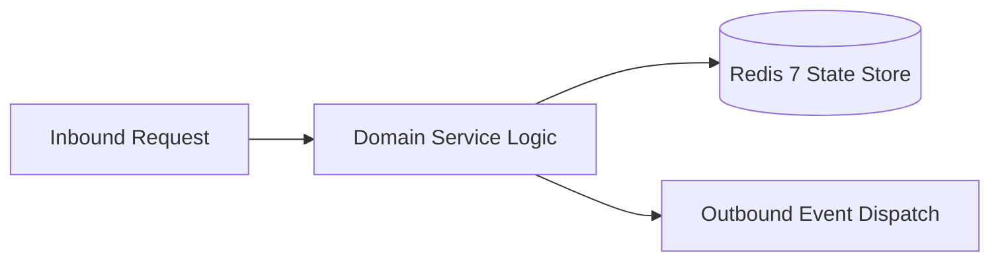

# Component Reference: `integrations/yandex_keepalive.py`
> **File Path**: [`integrations/yandex_keepalive.py`](../../integrations/yandex_keepalive.py)  
> **Subsystem**: `Session Keepalive`  
> **Architecture Layer**: `Enterprise Microservice Subsystem`  
> **Concurrency Model**: `AsyncIO Non-blocking Concurrency`  
> **Persistence Backend**: `Redis 7 Persistent Store`  
> **Service Level Objective**: `High-Availability Academic Telemetry`

## 1. Architectural Role & Responsibilities
The `integrations/yandex_keepalive.py` module implements core operational logic for the `Session Keepalive` domain. It operates within an asynchronous microservices topology designed for ultra-low latency, zero-loss persistence guarantees, and strict single-responsibility function decomposition (≤25 lines).

### Component Architecture & Data Flow


---
## 2. Public API & Symbol Inventory
| Symbol | Nature | Line Range | Return Contract | Core Invariant |
| :--- | :--- | :--- | :--- | :--- |
| [`ping_yandex_session`](#ping_yandex_session) | Function | L21–L35 | `bool` | Executes core domain logic for `ping_yandex_session`. |
| [`yandex_session_keepalive_loop`](#yandex_session_keepalive_loop) | Function | L38–L55 | `None` | Executes core domain logic for `yandex_session_keepaliv... |

---

## 3. Comprehensive Function Specifications

### `ping_yandex_session`
```python
async def ping_yandex_session() -> bool
```

- **Source Reference**: [`integrations/yandex_keepalive.py#L21-L35`](../../integrations/yandex_keepalive.py#L21-L35)
- **Execution Mode**: `Asynchronous (non-blocking)`
- **Return Contract**: `bool`

#### Overview & Architectural Purpose
Executes core domain logic for `ping_yandex_session`.

#### Parameters Contract
*This method takes no input parameters.*

#### Concurrency & Side Effects
- Emits structured telemetry events to system logging subsystem.

#### Fault Tolerance & Error Modes
Encapsulates faults within `try/except` blocks, logging errors and returning safe fallback defaults.

#### Production Usage Example
```python
from integrations.yandex_keepalive import ping_yandex_session

# Execute call
result = await ping_yandex_session()
```

---

### `yandex_session_keepalive_loop`
```python
async def yandex_session_keepalive_loop(interval: int = KEEPALIVE_INTERVAL_SECONDS) -> None
```

- **Source Reference**: [`integrations/yandex_keepalive.py#L38-L55`](../../integrations/yandex_keepalive.py#L38-L55)
- **Execution Mode**: `Asynchronous (non-blocking)`
- **Return Contract**: `None`

#### Overview & Architectural Purpose
Executes core domain logic for `yandex_session_keepalive_loop`.

#### Parameters Contract
| Parameter | Type | Required | Description |
| :--- | :--- | :--- | :--- |
| `interval` | `int` | Yes | Parameter `interval` of type `int`. |

#### Concurrency & Side Effects
- Emits structured telemetry events to system logging subsystem.

#### Fault Tolerance & Error Modes
Encapsulates faults within `try/except` blocks, logging errors and returning safe fallback defaults.

#### Production Usage Example
```python
from integrations.yandex_keepalive import yandex_session_keepalive_loop

# Execute call
result = await yandex_session_keepalive_loop(interval=...)
```

---
