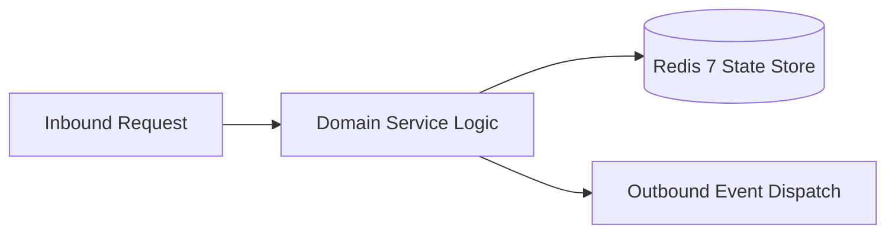

# Component Reference: `scripts/tunnel_sync.py`
> **File Path**: [`scripts/tunnel_sync.py`](../../scripts/tunnel_sync.py)  
> **Subsystem**: `Cloudflare Tunnel Syncer`  
> **Architecture Layer**: `Enterprise Microservice Subsystem`  
> **Concurrency Model**: `AsyncIO Non-blocking Concurrency`  
> **Persistence Backend**: `Redis 7 Persistent Store`  
> **Service Level Objective**: `High-Availability Academic Telemetry`

## 1. Architectural Role & Responsibilities
The `scripts/tunnel_sync.py` module implements core operational logic for the `Cloudflare Tunnel Syncer` domain. It operates within an asynchronous microservices topology designed for ultra-low latency, zero-loss persistence guarantees, and strict single-responsibility function decomposition (≤25 lines).

### Component Architecture & Data Flow


---
## 2. Public API & Symbol Inventory
| Symbol | Nature | Line Range | Return Contract | Core Invariant |
| :--- | :--- | :--- | :--- | :--- |
| [`parse_tunnel_url`](#parse_tunnel_url) | Function | L24–L27 | `str | None` | Parses and extracts structured entities from `parse_tun... |
| [`update_env_urls`](#update_env_urls) | Function | L30–L40 | `bool` | Synchronizes and updates domain state for `update_env_u... |
| [`restart_bot_service`](#restart_bot_service) | Function | L46–L49 | `None` | Executes core domain logic for `restart_bot_service`. |
| [`monitor_tunnel_stream`](#monitor_tunnel_stream) | Function | L52–L67 | `None` | Executes core domain logic for `monitor_tunnel_stream`. |
| [`run_tunnel_process`](#run_tunnel_process) | Function | L70–L80 | `None` | Executes core domain logic for `run_tunnel_process`. |
| [`main`](#main) | Function | L83–L92 | `None` | Executes core domain logic for `main`. |

---

## 3. Comprehensive Function Specifications

### `parse_tunnel_url`
```python
def parse_tunnel_url(line: str) -> str | None
```

- **Source Reference**: [`scripts/tunnel_sync.py#L24-L27`](../../scripts/tunnel_sync.py#L24-L27)
- **Execution Mode**: `Synchronous`
- **Return Contract**: `str | None`

#### Overview & Architectural Purpose
Parses and extracts structured entities from `parse_tunnel_url`.

#### Parameters Contract
| Parameter | Type | Required | Description |
| :--- | :--- | :--- | :--- |
| `line` | `str` | Yes | Parameter `line` of type `str`. |

#### Concurrency & Side Effects
- Stateless pure functional computation without external mutations.

#### Fault Tolerance & Error Modes
Propagates unexpected runtime errors up the call stack to global exception handlers.

#### Production Usage Example
```python
from scripts.tunnel_sync import parse_tunnel_url

# Execute call
result = parse_tunnel_url(line=...)
```

---

### `update_env_urls`
```python
def update_env_urls(new_url: str) -> bool
```

- **Source Reference**: [`scripts/tunnel_sync.py#L30-L40`](../../scripts/tunnel_sync.py#L30-L40)
- **Execution Mode**: `Synchronous`
- **Return Contract**: `bool`

#### Overview & Architectural Purpose
Synchronizes and updates domain state for `update_env_urls`.

#### Parameters Contract
| Parameter | Type | Required | Description |
| :--- | :--- | :--- | :--- |
| `new_url` | `str` | Yes | Parameter `new_url` of type `str`. |

#### Concurrency & Side Effects
- Stateless pure functional computation without external mutations.

#### Fault Tolerance & Error Modes
Propagates unexpected runtime errors up the call stack to global exception handlers.

#### Production Usage Example
```python
from scripts.tunnel_sync import update_env_urls

# Execute call
result = update_env_urls(new_url=...)
```

---

### `restart_bot_service`
```python
def restart_bot_service() -> None
```

- **Source Reference**: [`scripts/tunnel_sync.py#L46-L49`](../../scripts/tunnel_sync.py#L46-L49)
- **Execution Mode**: `Synchronous`
- **Return Contract**: `None`

#### Overview & Architectural Purpose
Executes core domain logic for `restart_bot_service`.

#### Parameters Contract
*This method takes no input parameters.*

#### Concurrency & Side Effects
- Stateless pure functional computation without external mutations.

#### Fault Tolerance & Error Modes
Propagates unexpected runtime errors up the call stack to global exception handlers.

#### Production Usage Example
```python
from scripts.tunnel_sync import restart_bot_service

# Execute call
result = restart_bot_service()
```

---

### `monitor_tunnel_stream`
```python
async def monitor_tunnel_stream(proc: asyncio.subprocess.Process) -> None
```

- **Source Reference**: [`scripts/tunnel_sync.py#L52-L67`](../../scripts/tunnel_sync.py#L52-L67)
- **Execution Mode**: `Asynchronous (non-blocking)`
- **Return Contract**: `None`

#### Overview & Architectural Purpose
Executes core domain logic for `monitor_tunnel_stream`.

#### Parameters Contract
| Parameter | Type | Required | Description |
| :--- | :--- | :--- | :--- |
| `proc` | `asyncio.subprocess.Process` | Yes | Parameter `proc` of type `asyncio.subprocess.Process`. |

#### Concurrency & Side Effects
- Stateless pure functional computation without external mutations.

#### Fault Tolerance & Error Modes
Propagates unexpected runtime errors up the call stack to global exception handlers.

#### Production Usage Example
```python
from scripts.tunnel_sync import monitor_tunnel_stream

# Execute call
result = await monitor_tunnel_stream(proc=...)
```

---

### `run_tunnel_process`
```python
async def run_tunnel_process() -> None
```

- **Source Reference**: [`scripts/tunnel_sync.py#L70-L80`](../../scripts/tunnel_sync.py#L70-L80)
- **Execution Mode**: `Asynchronous (non-blocking)`
- **Return Contract**: `None`

#### Overview & Architectural Purpose
Executes core domain logic for `run_tunnel_process`.

#### Parameters Contract
*This method takes no input parameters.*

#### Concurrency & Side Effects
- Stateless pure functional computation without external mutations.

#### Fault Tolerance & Error Modes
Propagates unexpected runtime errors up the call stack to global exception handlers.

#### Production Usage Example
```python
from scripts.tunnel_sync import run_tunnel_process

# Execute call
result = await run_tunnel_process()
```

---

### `main`
```python
async def main() -> None
```

- **Source Reference**: [`scripts/tunnel_sync.py#L83-L92`](../../scripts/tunnel_sync.py#L83-L92)
- **Execution Mode**: `Asynchronous (non-blocking)`
- **Return Contract**: `None`

#### Overview & Architectural Purpose
Executes core domain logic for `main`.

#### Parameters Contract
*This method takes no input parameters.*

#### Concurrency & Side Effects
- Stateless pure functional computation without external mutations.

#### Fault Tolerance & Error Modes
Encapsulates faults within `try/except` blocks, logging errors and returning safe fallback defaults.

#### Production Usage Example
```python
from scripts.tunnel_sync import main

# Execute call
result = await main()
```

---
