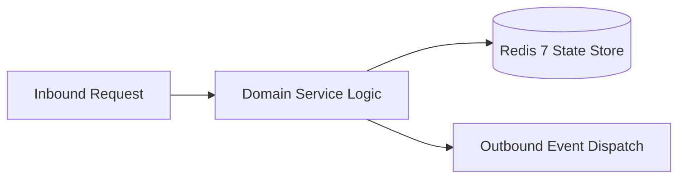

# Component Reference: `services/achievement_events.py`
> **File Path**: [`services/achievement_events.py`](../../services/achievement_events.py)
> **Subsystem**: `Achievement Rules`
> **Architecture Layer**: `Enterprise Microservice Subsystem`
> **Concurrency Model**: `AsyncIO Non-blocking Concurrency`
> **Persistence Backend**: `Redis 7 Persistent Store`
> **Service Level Objective**: `High-Availability Academic Telemetry`

## 1. Architectural Role & Responsibilities
The `services/achievement_events.py` module implements core operational logic for the `Achievement Rules` domain. It operates within an asynchronous microservices topology designed for ultra-low latency, zero-loss persistence guarantees, and strict single-responsibility function decomposition (≤25 lines).

### Component Architecture & Data Flow


---
## 2. Public API & Symbol Inventory
| Symbol | Nature | Line Range | Return Contract | Core Invariant |
| :--- | :--- | :--- | :--- | :--- |
| [`_now`](#_now) | Function | L62–L64 | `datetime` | Executes core domain logic for `_now`. |
| [`is_group_member`](#is_group_member) | Function | L67–L69 | `bool` | Executes core domain logic for `is_group_member`. |
| [`_award_all`](#_award_all) | Function | L72–L75 | `None` | Executes core domain logic for `_award_all`. |
| [`bump_counter`](#bump_counter) | Function | L78–L91 | `int` | Executes core domain logic for `bump_counter`. |
| [`on_interaction`](#on_interaction) | Function | L94–L99 | `None` | Executes core domain logic for `on_interaction`. |
| [`on_schedule_view`](#on_schedule_view) | Function | L102–L106 | `None` | Executes core domain logic for `on_schedule_view`. |
| [`on_refresh_click`](#on_refresh_click) | Function | L109–L116 | `None` | Executes core domain logic for `on_refresh_click`. |
| [`on_attendance_view`](#on_attendance_view) | Function | L119–L124 | `None` | Executes core domain logic for `on_attendance_view`. |
| [`on_homework_task`](#on_homework_task) | Function | L127–L144 | `None` | Executes core domain logic for `on_homework_task`. |
| [`mark_ping_all`](#mark_ping_all) | Function | L147–L149 | `None` | Executes core domain logic for `mark_ping_all`. |
| [`_has_birthday_today`](#_has_birthday_today) | Function | L152–L157 | `bool` | Executes core domain logic for `_has_birthday_today`. |
| [`_chat_reply_achievement`](#_chat_reply_achievement) | Function | L160–L171 | `str | None` | Executes core domain logic for `_chat_reply_achievement... |
| [`_award_chat_specials`](#_award_chat_specials) | Function | L174–L180 | `None` | Executes core domain logic for `_award_chat_specials`. |
| [`on_group_message`](#on_group_message) | Function | L183–L201 | `None` | Executes core domain logic for `on_group_message`. |
| [`on_profile_view`](#on_profile_view) | Function | L204–L220 | `bool` | Executes core domain logic for `on_profile_view`. |

---

## 3. Comprehensive Function Specifications

### `_now`
```python
def _now() -> datetime
```

- **Source Reference**: [`services/achievement_events.py#L62-L64`](../../services/achievement_events.py#L62-L64)
- **Execution Mode**: `Synchronous`
- **Return Contract**: `datetime`

#### Overview & Architectural Purpose
Executes core domain logic for `_now`.

#### Parameters Contract
*This method takes no input parameters.*

#### Concurrency & Side Effects
- Stateless pure functional computation without external mutations.

#### Fault Tolerance & Error Modes
Propagates unexpected runtime errors up the call stack to global exception handlers.

#### Production Usage Example
```python
from services.achievement_events import _now

# Execute call
result = _now()
```

---

### `is_group_member`
```python
def is_group_member(user_id: int) -> bool
```

- **Source Reference**: [`services/achievement_events.py#L67-L69`](../../services/achievement_events.py#L67-L69)
- **Execution Mode**: `Synchronous`
- **Return Contract**: `bool`

#### Overview & Architectural Purpose
Executes core domain logic for `is_group_member`.

#### Parameters Contract
| Parameter | Type | Required | Description |
| :--- | :--- | :--- | :--- |
| `user_id` | `int` | Yes | Unique 64-bit Telegram user identifier. |

#### Concurrency & Side Effects
- Stateless pure functional computation without external mutations.

#### Fault Tolerance & Error Modes
Propagates unexpected runtime errors up the call stack to global exception handlers.

#### Production Usage Example
```python
from services.achievement_events import is_group_member

# Execute call
result = is_group_member(user_id=...)
```

---

### `_award_all`
```python
async def _award_all(uid: int, ids: set[str], bot: Any, name: str | None) -> None
```

- **Source Reference**: [`services/achievement_events.py#L72-L75`](../../services/achievement_events.py#L72-L75)
- **Execution Mode**: `Asynchronous (non-blocking)`
- **Return Contract**: `None`

#### Overview & Architectural Purpose
Executes core domain logic for `_award_all`.

#### Parameters Contract
| Parameter | Type | Required | Description |
| :--- | :--- | :--- | :--- |
| `uid` | `int` | Yes | Parameter `uid` of type `int`. |
| `ids` | `set[str]` | Yes | Parameter `ids` of type `set[str]`. |
| `bot` | `Any` | Yes | Parameter `bot` of type `Any`. |
| `name` | `str | None` | Yes | Parameter `name` of type `str | None`. |

#### Concurrency & Side Effects
- Stateless pure functional computation without external mutations.

#### Fault Tolerance & Error Modes
Propagates unexpected runtime errors up the call stack to global exception handlers.

#### Production Usage Example
```python
from services.achievement_events import _award_all

# Execute call
result = await _award_all(uid=..., ids=..., bot=...)
```

---

### `bump_counter`
```python
async def bump_counter(uid: int, key: str, bot: Any, name: str | None) -> int
```

- **Source Reference**: [`services/achievement_events.py#L78-L91`](../../services/achievement_events.py#L78-L91)
- **Execution Mode**: `Asynchronous (non-blocking)`
- **Return Contract**: `int`

#### Overview & Architectural Purpose
Executes core domain logic for `bump_counter`.

#### Parameters Contract
| Parameter | Type | Required | Description |
| :--- | :--- | :--- | :--- |
| `uid` | `int` | Yes | Parameter `uid` of type `int`. |
| `key` | `str` | Yes | Parameter `key` of type `str`. |
| `bot` | `Any` | Yes | Parameter `bot` of type `Any`. |
| `name` | `str | None` | Yes | Parameter `name` of type `str | None`. |

#### Concurrency & Side Effects
- Stateless pure functional computation without external mutations.

#### Fault Tolerance & Error Modes
Propagates unexpected runtime errors up the call stack to global exception handlers.

#### Production Usage Example
```python
from services.achievement_events import bump_counter

# Execute call
result = await bump_counter(uid=..., key=..., bot=...)
```

---

### `on_interaction`
```python
async def on_interaction(user: User, bot: Any) -> None
```

- **Source Reference**: [`services/achievement_events.py#L94-L99`](../../services/achievement_events.py#L94-L99)
- **Execution Mode**: `Asynchronous (non-blocking)`
- **Return Contract**: `None`

#### Overview & Architectural Purpose
Executes core domain logic for `on_interaction`.

#### Parameters Contract
| Parameter | Type | Required | Description |
| :--- | :--- | :--- | :--- |
| `user` | `User` | Yes | Parameter `user` of type `User`. |
| `bot` | `Any` | Yes | Parameter `bot` of type `Any`. |

#### Concurrency & Side Effects
- Stateless pure functional computation without external mutations.

#### Fault Tolerance & Error Modes
Propagates unexpected runtime errors up the call stack to global exception handlers.

#### Production Usage Example
```python
from services.achievement_events import on_interaction

# Execute call
result = await on_interaction(user=..., bot=...)
```

---

### `on_schedule_view`
```python
async def on_schedule_view(user: User | None, bot: Any, view: ScheduleView, lessons: list[Lesson]) -> None
```

- **Source Reference**: [`services/achievement_events.py#L102-L106`](../../services/achievement_events.py#L102-L106)
- **Execution Mode**: `Asynchronous (non-blocking)`
- **Return Contract**: `None`

#### Overview & Architectural Purpose
Executes core domain logic for `on_schedule_view`.

#### Parameters Contract
| Parameter | Type | Required | Description |
| :--- | :--- | :--- | :--- |
| `user` | `User | None` | Yes | Parameter `user` of type `User | None`. |
| `bot` | `Any` | Yes | Parameter `bot` of type `Any`. |
| `view` | `ScheduleView` | Yes | Parameter `view` of type `ScheduleView`. |
| `lessons` | `list[Lesson]` | Yes | Parameter `lessons` of type `list[Lesson]`. |

#### Concurrency & Side Effects
- Stateless pure functional computation without external mutations.

#### Fault Tolerance & Error Modes
Propagates unexpected runtime errors up the call stack to global exception handlers.

#### Production Usage Example
```python
from services.achievement_events import on_schedule_view

# Execute call
result = await on_schedule_view(user=..., bot=..., view=...)
```

---

### `on_refresh_click`
```python
async def on_refresh_click(user: User | None, bot: Any) -> None
```

- **Source Reference**: [`services/achievement_events.py#L109-L116`](../../services/achievement_events.py#L109-L116)
- **Execution Mode**: `Asynchronous (non-blocking)`
- **Return Contract**: `None`

#### Overview & Architectural Purpose
Executes core domain logic for `on_refresh_click`.

#### Parameters Contract
| Parameter | Type | Required | Description |
| :--- | :--- | :--- | :--- |
| `user` | `User | None` | Yes | Parameter `user` of type `User | None`. |
| `bot` | `Any` | Yes | Parameter `bot` of type `Any`. |

#### Concurrency & Side Effects
- Stateless pure functional computation without external mutations.

#### Fault Tolerance & Error Modes
Propagates unexpected runtime errors up the call stack to global exception handlers.

#### Production Usage Example
```python
from services.achievement_events import on_refresh_click

# Execute call
result = await on_refresh_click(user=..., bot=...)
```

---

### `on_attendance_view`
```python
async def on_attendance_view(user: User | None, bot: Any) -> None
```

- **Source Reference**: [`services/achievement_events.py#L119-L124`](../../services/achievement_events.py#L119-L124)
- **Execution Mode**: `Asynchronous (non-blocking)`
- **Return Contract**: `None`

#### Overview & Architectural Purpose
Executes core domain logic for `on_attendance_view`.

#### Parameters Contract
| Parameter | Type | Required | Description |
| :--- | :--- | :--- | :--- |
| `user` | `User | None` | Yes | Parameter `user` of type `User | None`. |
| `bot` | `Any` | Yes | Parameter `bot` of type `Any`. |

#### Concurrency & Side Effects
- Stateless pure functional computation without external mutations.

#### Fault Tolerance & Error Modes
Propagates unexpected runtime errors up the call stack to global exception handlers.

#### Production Usage Example
```python
from services.achievement_events import on_attendance_view

# Execute call
result = await on_attendance_view(user=..., bot=...)
```

---

### `on_homework_task`
```python
async def on_homework_task(uid: int, name: str | None, bot: Any, task: HomeworkTask) -> None
```

- **Source Reference**: [`services/achievement_events.py#L127-L144`](../../services/achievement_events.py#L127-L144)
- **Execution Mode**: `Asynchronous (non-blocking)`
- **Return Contract**: `None`

#### Overview & Architectural Purpose
Executes core domain logic for `on_homework_task`.

#### Parameters Contract
| Parameter | Type | Required | Description |
| :--- | :--- | :--- | :--- |
| `uid` | `int` | Yes | Parameter `uid` of type `int`. |
| `name` | `str | None` | Yes | Parameter `name` of type `str | None`. |
| `bot` | `Any` | Yes | Parameter `bot` of type `Any`. |
| `task` | `HomeworkTask` | Yes | Parameter `task` of type `HomeworkTask`. |

#### Concurrency & Side Effects
- Stateless pure functional computation without external mutations.

#### Fault Tolerance & Error Modes
Propagates unexpected runtime errors up the call stack to global exception handlers.

#### Production Usage Example
```python
from services.achievement_events import on_homework_task

# Execute call
result = await on_homework_task(uid=..., name=..., bot=...)
```

---

### `mark_ping_all`
```python
async def mark_ping_all() -> None
```

- **Source Reference**: [`services/achievement_events.py#L147-L149`](../../services/achievement_events.py#L147-L149)
- **Execution Mode**: `Asynchronous (non-blocking)`
- **Return Contract**: `None`

#### Overview & Architectural Purpose
Executes core domain logic for `mark_ping_all`.

#### Parameters Contract
*This method takes no input parameters.*

#### Concurrency & Side Effects
- Stateless pure functional computation without external mutations.

#### Fault Tolerance & Error Modes
Propagates unexpected runtime errors up the call stack to global exception handlers.

#### Production Usage Example
```python
from services.achievement_events import mark_ping_all

# Execute call
result = await mark_ping_all()
```

---

### `_has_birthday_today`
```python
def _has_birthday_today(exclude_uid: int, today: date) -> bool
```

- **Source Reference**: [`services/achievement_events.py#L152-L157`](../../services/achievement_events.py#L152-L157)
- **Execution Mode**: `Synchronous`
- **Return Contract**: `bool`

#### Overview & Architectural Purpose
Executes core domain logic for `_has_birthday_today`.

#### Parameters Contract
| Parameter | Type | Required | Description |
| :--- | :--- | :--- | :--- |
| `exclude_uid` | `int` | Yes | Parameter `exclude_uid` of type `int`. |
| `today` | `date` | Yes | Parameter `today` of type `date`. |

#### Concurrency & Side Effects
- Stateless pure functional computation without external mutations.

#### Fault Tolerance & Error Modes
Propagates unexpected runtime errors up the call stack to global exception handlers.

#### Production Usage Example
```python
from services.achievement_events import _has_birthday_today

# Execute call
result = _has_birthday_today(exclude_uid=..., today=...)
```

---

### `_chat_reply_achievement`
```python
def _chat_reply_achievement(message: Message, uid: int) -> str | None
```

- **Source Reference**: [`services/achievement_events.py#L160-L171`](../../services/achievement_events.py#L160-L171)
- **Execution Mode**: `Synchronous`
- **Return Contract**: `str | None`

#### Overview & Architectural Purpose
Executes core domain logic for `_chat_reply_achievement`.

#### Parameters Contract
| Parameter | Type | Required | Description |
| :--- | :--- | :--- | :--- |
| `message` | `Message` | Yes | Aiogram Message event object encapsulating inbound user payload. |
| `uid` | `int` | Yes | Parameter `uid` of type `int`. |

#### Concurrency & Side Effects
- Stateless pure functional computation without external mutations.

#### Fault Tolerance & Error Modes
Propagates unexpected runtime errors up the call stack to global exception handlers.

#### Production Usage Example
```python
from services.achievement_events import _chat_reply_achievement

# Execute call
result = _chat_reply_achievement(message=..., uid=...)
```

---

### `_award_chat_specials`
```python
async def _award_chat_specials(message: Message, uid: int, bot: Any, name: str | None) -> None
```

- **Source Reference**: [`services/achievement_events.py#L174-L180`](../../services/achievement_events.py#L174-L180)
- **Execution Mode**: `Asynchronous (non-blocking)`
- **Return Contract**: `None`

#### Overview & Architectural Purpose
Executes core domain logic for `_award_chat_specials`.

#### Parameters Contract
| Parameter | Type | Required | Description |
| :--- | :--- | :--- | :--- |
| `message` | `Message` | Yes | Aiogram Message event object encapsulating inbound user payload. |
| `uid` | `int` | Yes | Parameter `uid` of type `int`. |
| `bot` | `Any` | Yes | Parameter `bot` of type `Any`. |
| `name` | `str | None` | Yes | Parameter `name` of type `str | None`. |

#### Concurrency & Side Effects
- Stateless pure functional computation without external mutations.

#### Fault Tolerance & Error Modes
Propagates unexpected runtime errors up the call stack to global exception handlers.

#### Production Usage Example
```python
from services.achievement_events import _award_chat_specials

# Execute call
result = await _award_chat_specials(message=..., uid=..., bot=...)
```

---

### `on_group_message`
```python
async def on_group_message(message: Message, bot: Any) -> None
```

- **Source Reference**: [`services/achievement_events.py#L183-L201`](../../services/achievement_events.py#L183-L201)
- **Execution Mode**: `Asynchronous (non-blocking)`
- **Return Contract**: `None`

#### Overview & Architectural Purpose
Executes core domain logic for `on_group_message`.

#### Parameters Contract
| Parameter | Type | Required | Description |
| :--- | :--- | :--- | :--- |
| `message` | `Message` | Yes | Aiogram Message event object encapsulating inbound user payload. |
| `bot` | `Any` | Yes | Parameter `bot` of type `Any`. |

#### Concurrency & Side Effects
- Stateless pure functional computation without external mutations.

#### Fault Tolerance & Error Modes
Propagates unexpected runtime errors up the call stack to global exception handlers.

#### Production Usage Example
```python
from services.achievement_events import on_group_message

# Execute call
result = await on_group_message(message=..., bot=...)
```

---

### `on_profile_view`
```python
async def on_profile_view(uid: int, viewed_fio: str) -> bool
```

- **Source Reference**: [`services/achievement_events.py#L204-L220`](../../services/achievement_events.py#L204-L220)
- **Execution Mode**: `Asynchronous (non-blocking)`
- **Return Contract**: `bool`

#### Overview & Architectural Purpose
Executes core domain logic for `on_profile_view`.

#### Parameters Contract
| Parameter | Type | Required | Description |
| :--- | :--- | :--- | :--- |
| `uid` | `int` | Yes | Parameter `uid` of type `int`. |
| `viewed_fio` | `str` | Yes | Parameter `viewed_fio` of type `str`. |

#### Concurrency & Side Effects
- Stateless pure functional computation without external mutations.

#### Fault Tolerance & Error Modes
Propagates unexpected runtime errors up the call stack to global exception handlers.

#### Production Usage Example
```python
from services.achievement_events import on_profile_view

# Execute call
result = await on_profile_view(uid=..., viewed_fio=...)
```

---
