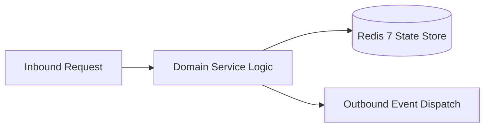

# Component Reference: `services/achievement_reset.py`
> **File Path**: [`services/achievement_reset.py`](../../services/achievement_reset.py)
> **Subsystem**: `Achievement Rules`
> **Architecture Layer**: `Enterprise Microservice Subsystem`
> **Concurrency Model**: `AsyncIO Non-blocking Concurrency`
> **Persistence Backend**: `Redis 7 Persistent Store`
> **Service Level Objective**: `High-Availability Academic Telemetry`

## 1. Architectural Role & Responsibilities
The `services/achievement_reset.py` module implements core operational logic for the `Achievement Rules` domain. It operates within an asynchronous microservices topology designed for ultra-low latency, zero-loss persistence guarantees, and strict single-responsibility function decomposition (≤25 lines).

### Component Architecture & Data Flow


---
## 2. Public API & Symbol Inventory
| Symbol | Nature | Line Range | Return Contract | Core Invariant |
| :--- | :--- | :--- | :--- | :--- |
| [`_backup_database`](#_backup_database) | Function | L28–L39 | `str | None` | Executes core domain logic for `_backup_database`. |
| [`reset_achievements`](#reset_achievements) | Function | L42–L68 | `bool` | Executes core domain logic for `reset_achievements`. |
| [`_run`](#_run) | Function | L71–L79 | `bool` | Executes core domain logic for `_run`. |
| [`main`](#main) | Function | L82–L91 | `int` | Executes core domain logic for `main`. |

---

## 3. Comprehensive Function Specifications

### `_backup_database`
```python
async def _backup_database() -> str | None
```

- **Source Reference**: [`services/achievement_reset.py#L28-L39`](../../services/achievement_reset.py#L28-L39)
- **Execution Mode**: `Asynchronous (non-blocking)`
- **Return Contract**: `str | None`

#### Overview & Architectural Purpose
Executes core domain logic for `_backup_database`.

#### Parameters Contract
*This method takes no input parameters.*

#### Concurrency & Side Effects
- Stateless pure functional computation without external mutations.

#### Fault Tolerance & Error Modes
Propagates unexpected runtime errors up the call stack to global exception handlers.

#### Production Usage Example
```python
from services.achievement_reset import _backup_database

# Execute call
result = await _backup_database()
```

---

### `reset_achievements`
```python
async def reset_achievements() -> bool
```

- **Source Reference**: [`services/achievement_reset.py#L42-L68`](../../services/achievement_reset.py#L42-L68)
- **Execution Mode**: `Asynchronous (non-blocking)`
- **Return Contract**: `bool`

#### Overview & Architectural Purpose
Executes core domain logic for `reset_achievements`.

#### Parameters Contract
*This method takes no input parameters.*

#### Concurrency & Side Effects
- Emits structured telemetry events to system logging subsystem.

#### Fault Tolerance & Error Modes
Propagates unexpected runtime errors up the call stack to global exception handlers.

#### Production Usage Example
```python
from services.achievement_reset import reset_achievements

# Execute call
result = await reset_achievements()
```

---

### `_run`
```python
async def _run() -> bool
```

- **Source Reference**: [`services/achievement_reset.py#L71-L79`](../../services/achievement_reset.py#L71-L79)
- **Execution Mode**: `Asynchronous (non-blocking)`
- **Return Contract**: `bool`

#### Overview & Architectural Purpose
Executes core domain logic for `_run`.

#### Parameters Contract
*This method takes no input parameters.*

#### Concurrency & Side Effects
- Stateless pure functional computation without external mutations.

#### Fault Tolerance & Error Modes
Encapsulates faults within `try/except` blocks, logging errors and returning safe fallback defaults.

#### Production Usage Example
```python
from services.achievement_reset import _run

# Execute call
result = await _run()
```

---

### `main`
```python
def main(argv: list[str]) -> int
```

- **Source Reference**: [`services/achievement_reset.py#L82-L91`](../../services/achievement_reset.py#L82-L91)
- **Execution Mode**: `Synchronous`
- **Return Contract**: `int`

#### Overview & Architectural Purpose
Executes core domain logic for `main`.

#### Parameters Contract
| Parameter | Type | Required | Description |
| :--- | :--- | :--- | :--- |
| `argv` | `list[str]` | Yes | Parameter `argv` of type `list[str]`. |

#### Concurrency & Side Effects
- Emits structured telemetry events to system logging subsystem.

#### Fault Tolerance & Error Modes
Propagates unexpected runtime errors up the call stack to global exception handlers.

#### Production Usage Example
```python
from services.achievement_reset import main

# Execute call
result = main(argv=...)
```

---
