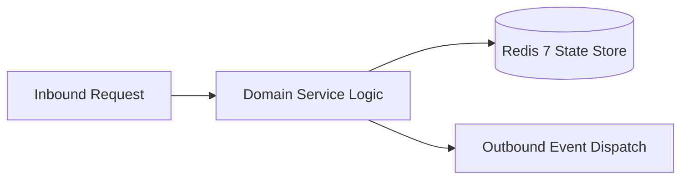

# Component Reference: `services/achievement_rules.py`
> **File Path**: [`services/achievement_rules.py`](../../services/achievement_rules.py)
> **Subsystem**: `Achievement Rules`
> **Architecture Layer**: `Enterprise Microservice Subsystem`
> **Concurrency Model**: `AsyncIO Non-blocking Concurrency`
> **Persistence Backend**: `Redis 7 Persistent Store`
> **Service Level Objective**: `High-Availability Academic Telemetry`

## 1. Architectural Role & Responsibilities
The `services/achievement_rules.py` module implements core operational logic for the `Achievement Rules` domain. It operates within an asynchronous microservices topology designed for ultra-low latency, zero-loss persistence guarantees, and strict single-responsibility function decomposition (≤25 lines).

### Component Architecture & Data Flow


---
## 2. Public API & Symbol Inventory
| Symbol | Nature | Line Range | Return Contract | Core Invariant |
| :--- | :--- | :--- | :--- | :--- |
| [`MonthStat.total`](#monthstattotal) | Method | L46–L47 | `int` | Executes core domain logic for `total`. |
| [`MonthStat.pct`](#monthstatpct) | Method | L50–L52 | `float` | Executes core domain logic for `pct`. |
| [`StudentStat.visited`](#studentstatvisited) | Method | L65–L66 | `int` | Executes core domain logic for `visited`. |
| [`_month_from_counts`](#_month_from_counts) | Function | L69–L78 | `MonthStat` | Executes core domain logic for `_month_from_counts`. |
| [`build_student_stat`](#build_student_stat) | Function | L81–L98 | `StudentStat` | Executes core domain logic for `build_student_stat`. |
| [`_full_months`](#_full_months) | Function | L101–L103 | `int` | Executes core domain logic for `_full_months`. |
| [`_has_comeback`](#_has_comeback) | Function | L106–L108 | `bool` | Executes core domain logic for `_has_comeback`. |
| [`_pct_between`](#_pct_between) | Function | L111–L113 | `bool` | Executes core domain logic for `_pct_between`. |
| [`evaluate_stat_rules`](#evaluate_stat_rules) | Function | L146–L148 | `set[str]` | Executes core domain logic for `evaluate_stat_rules`. |
| [`_categories_count`](#_categories_count) | Function | L163–L165 | `int` | Executes core domain logic for `_categories_count`. |
| [`_xp_of`](#_xp_of) | Function | L168–L170 | `int` | Executes core domain logic for `_xp_of`. |
| [`_meta_pass`](#_meta_pass) | Function | L173–L186 | `set[str]` | Executes core domain logic for `_meta_pass`. |
| [`evaluate_meta_rules`](#evaluate_meta_rules) | Function | L189–L203 | `set[str]` | Executes core domain logic for `evaluate_meta_rules`. |

---

## 3. Comprehensive Function Specifications

## Class Model: `MonthStat`

Encapsulates domain entities and data transfer logic for `MonthStat`.

### `MonthStat.total`
```python
def total(self) -> int
```

- **Source Reference**: [`services/achievement_rules.py#L46-L47`](../../services/achievement_rules.py#L46-L47)
- **Execution Mode**: `Synchronous`
- **Return Contract**: `int`

#### Overview & Architectural Purpose
Executes core domain logic for `total`.

#### Parameters Contract
*This method takes no input parameters.*

#### Concurrency & Side Effects
- Stateless pure functional computation without external mutations.

#### Fault Tolerance & Error Modes
Propagates unexpected runtime errors up the call stack to global exception handlers.

#### Production Usage Example
```python
from services.achievement_rules import total

# Execute call
result = total()
```

---

### `MonthStat.pct`
```python
def pct(self) -> float
```

- **Source Reference**: [`services/achievement_rules.py#L50-L52`](../../services/achievement_rules.py#L50-L52)
- **Execution Mode**: `Synchronous`
- **Return Contract**: `float`

#### Overview & Architectural Purpose
Executes core domain logic for `pct`.

#### Parameters Contract
*This method takes no input parameters.*

#### Concurrency & Side Effects
- Stateless pure functional computation without external mutations.

#### Fault Tolerance & Error Modes
Propagates unexpected runtime errors up the call stack to global exception handlers.

#### Production Usage Example
```python
from services.achievement_rules import pct

# Execute call
result = pct()
```

---

## Class Model: `StudentStat`

Encapsulates domain entities and data transfer logic for `StudentStat`.

### `StudentStat.visited`
```python
def visited(self) -> int
```

- **Source Reference**: [`services/achievement_rules.py#L65-L66`](../../services/achievement_rules.py#L65-L66)
- **Execution Mode**: `Synchronous`
- **Return Contract**: `int`

#### Overview & Architectural Purpose
Executes core domain logic for `visited`.

#### Parameters Contract
*This method takes no input parameters.*

#### Concurrency & Side Effects
- Stateless pure functional computation without external mutations.

#### Fault Tolerance & Error Modes
Propagates unexpected runtime errors up the call stack to global exception handlers.

#### Production Usage Example
```python
from services.achievement_rules import visited

# Execute call
result = visited()
```

---

### `_month_from_counts`
```python
def _month_from_counts(counts: dict[str, int], base: dict[str, int] | None = None) -> MonthStat
```

- **Source Reference**: [`services/achievement_rules.py#L69-L78`](../../services/achievement_rules.py#L69-L78)
- **Execution Mode**: `Synchronous`
- **Return Contract**: `MonthStat`

#### Overview & Architectural Purpose
Executes core domain logic for `_month_from_counts`.

#### Parameters Contract
| Parameter | Type | Required | Description |
| :--- | :--- | :--- | :--- |
| `counts` | `dict[str, int]` | Yes | Parameter `counts` of type `dict[str, int]`. |
| `base` | `dict[str, int] | None` | Yes | Parameter `base` of type `dict[str, int] | None`. |

#### Concurrency & Side Effects
- Stateless pure functional computation without external mutations.

#### Fault Tolerance & Error Modes
Propagates unexpected runtime errors up the call stack to global exception handlers.

#### Production Usage Example
```python
from services.achievement_rules import _month_from_counts

# Execute call
result = _month_from_counts(counts=..., base=...)
```

---

### `build_student_stat`
```python
def build_student_stat( raw: dict[str, Any], in_birthdays: bool = False, baseline: dict[str, Any] | None = None ) -> StudentStat
```

- **Source Reference**: [`services/achievement_rules.py#L81-L98`](../../services/achievement_rules.py#L81-L98)
- **Execution Mode**: `Synchronous`
- **Return Contract**: `StudentStat`

#### Overview & Architectural Purpose
Executes core domain logic for `build_student_stat`.

#### Parameters Contract
| Parameter | Type | Required | Description |
| :--- | :--- | :--- | :--- |
| `raw` | `dict[str, Any]` | Yes | Parameter `raw` of type `dict[str, Any]`. |
| `in_birthdays` | `bool` | Yes | Parameter `in_birthdays` of type `bool`. |
| `baseline` | `dict[str, Any] | None` | Yes | Parameter `baseline` of type `dict[str, Any] | None`. |

#### Concurrency & Side Effects
- Stateless pure functional computation without external mutations.

#### Fault Tolerance & Error Modes
Propagates unexpected runtime errors up the call stack to global exception handlers.

#### Production Usage Example
```python
from services.achievement_rules import build_student_stat

# Execute call
result = build_student_stat(raw=..., in_birthdays=..., baseline=...)
```

---

### `_full_months`
```python
def _full_months(s: StudentStat, *banned: str) -> int
```

- **Source Reference**: [`services/achievement_rules.py#L101-L103`](../../services/achievement_rules.py#L101-L103)
- **Execution Mode**: `Synchronous`
- **Return Contract**: `int`

#### Overview & Architectural Purpose
Executes core domain logic for `_full_months`.

#### Parameters Contract
| Parameter | Type | Required | Description |
| :--- | :--- | :--- | :--- |
| `s` | `StudentStat` | Yes | Parameter `s` of type `StudentStat`. |

#### Concurrency & Side Effects
- Stateless pure functional computation without external mutations.

#### Fault Tolerance & Error Modes
Propagates unexpected runtime errors up the call stack to global exception handlers.

#### Production Usage Example
```python
from services.achievement_rules import _full_months

# Execute call
result = _full_months(s=...)
```

---

### `_has_comeback`
```python
def _has_comeback(s: StudentStat) -> bool
```

- **Source Reference**: [`services/achievement_rules.py#L106-L108`](../../services/achievement_rules.py#L106-L108)
- **Execution Mode**: `Synchronous`
- **Return Contract**: `bool`

#### Overview & Architectural Purpose
Executes core domain logic for `_has_comeback`.

#### Parameters Contract
| Parameter | Type | Required | Description |
| :--- | :--- | :--- | :--- |
| `s` | `StudentStat` | Yes | Parameter `s` of type `StudentStat`. |

#### Concurrency & Side Effects
- Stateless pure functional computation without external mutations.

#### Fault Tolerance & Error Modes
Propagates unexpected runtime errors up the call stack to global exception handlers.

#### Production Usage Example
```python
from services.achievement_rules import _has_comeback

# Execute call
result = _has_comeback(s=...)
```

---

### `_pct_between`
```python
def _pct_between(s: StudentStat, low: float, high: float, min_marks: int = MIN_MARKS) -> bool
```

- **Source Reference**: [`services/achievement_rules.py#L111-L113`](../../services/achievement_rules.py#L111-L113)
- **Execution Mode**: `Synchronous`
- **Return Contract**: `bool`

#### Overview & Architectural Purpose
Executes core domain logic for `_pct_between`.

#### Parameters Contract
| Parameter | Type | Required | Description |
| :--- | :--- | :--- | :--- |
| `s` | `StudentStat` | Yes | Parameter `s` of type `StudentStat`. |
| `low` | `float` | Yes | Parameter `low` of type `float`. |
| `high` | `float` | Yes | Parameter `high` of type `float`. |
| `min_marks` | `int` | Yes | Parameter `min_marks` of type `int`. |

#### Concurrency & Side Effects
- Stateless pure functional computation without external mutations.

#### Fault Tolerance & Error Modes
Propagates unexpected runtime errors up the call stack to global exception handlers.

#### Production Usage Example
```python
from services.achievement_rules import _pct_between

# Execute call
result = _pct_between(s=..., low=..., high=...)
```

---

### `evaluate_stat_rules`
```python
def evaluate_stat_rules(s: StudentStat) -> set[str]
```

- **Source Reference**: [`services/achievement_rules.py#L146-L148`](../../services/achievement_rules.py#L146-L148)
- **Execution Mode**: `Synchronous`
- **Return Contract**: `set[str]`

#### Overview & Architectural Purpose
Executes core domain logic for `evaluate_stat_rules`.

#### Parameters Contract
| Parameter | Type | Required | Description |
| :--- | :--- | :--- | :--- |
| `s` | `StudentStat` | Yes | Parameter `s` of type `StudentStat`. |

#### Concurrency & Side Effects
- Stateless pure functional computation without external mutations.

#### Fault Tolerance & Error Modes
Propagates unexpected runtime errors up the call stack to global exception handlers.

#### Production Usage Example
```python
from services.achievement_rules import evaluate_stat_rules

# Execute call
result = evaluate_stat_rules(s=...)
```

---

## Class Model: `MetaContext`

Encapsulates domain entities and data transfer logic for `MetaContext`.

### `_categories_count`
```python
def _categories_count(unlocked: set[str]) -> int
```

- **Source Reference**: [`services/achievement_rules.py#L163-L165`](../../services/achievement_rules.py#L163-L165)
- **Execution Mode**: `Synchronous`
- **Return Contract**: `int`

#### Overview & Architectural Purpose
Executes core domain logic for `_categories_count`.

#### Parameters Contract
| Parameter | Type | Required | Description |
| :--- | :--- | :--- | :--- |
| `unlocked` | `set[str]` | Yes | Parameter `unlocked` of type `set[str]`. |

#### Concurrency & Side Effects
- Stateless pure functional computation without external mutations.

#### Fault Tolerance & Error Modes
Propagates unexpected runtime errors up the call stack to global exception handlers.

#### Production Usage Example
```python
from services.achievement_rules import _categories_count

# Execute call
result = _categories_count(unlocked=...)
```

---

### `_xp_of`
```python
def _xp_of(unlocked: set[str]) -> int
```

- **Source Reference**: [`services/achievement_rules.py#L168-L170`](../../services/achievement_rules.py#L168-L170)
- **Execution Mode**: `Synchronous`
- **Return Contract**: `int`

#### Overview & Architectural Purpose
Executes core domain logic for `_xp_of`.

#### Parameters Contract
| Parameter | Type | Required | Description |
| :--- | :--- | :--- | :--- |
| `unlocked` | `set[str]` | Yes | Parameter `unlocked` of type `set[str]`. |

#### Concurrency & Side Effects
- Stateless pure functional computation without external mutations.

#### Fault Tolerance & Error Modes
Propagates unexpected runtime errors up the call stack to global exception handlers.

#### Production Usage Example
```python
from services.achievement_rules import _xp_of

# Execute call
result = _xp_of(unlocked=...)
```

---

### `_meta_pass`
```python
def _meta_pass(unlocked: set[str], ctx: MetaContext) -> set[str]
```

- **Source Reference**: [`services/achievement_rules.py#L173-L186`](../../services/achievement_rules.py#L173-L186)
- **Execution Mode**: `Synchronous`
- **Return Contract**: `set[str]`

#### Overview & Architectural Purpose
Executes core domain logic for `_meta_pass`.

#### Parameters Contract
| Parameter | Type | Required | Description |
| :--- | :--- | :--- | :--- |
| `unlocked` | `set[str]` | Yes | Parameter `unlocked` of type `set[str]`. |
| `ctx` | `MetaContext` | Yes | Parameter `ctx` of type `MetaContext`. |

#### Concurrency & Side Effects
- Stateless pure functional computation without external mutations.

#### Fault Tolerance & Error Modes
Propagates unexpected runtime errors up the call stack to global exception handlers.

#### Production Usage Example
```python
from services.achievement_rules import _meta_pass

# Execute call
result = _meta_pass(unlocked=..., ctx=...)
```

---

### `evaluate_meta_rules`
```python
def evaluate_meta_rules(unlocked: set[str], ctx: MetaContext) -> set[str]
```

- **Source Reference**: [`services/achievement_rules.py#L189-L203`](../../services/achievement_rules.py#L189-L203)
- **Execution Mode**: `Synchronous`
- **Return Contract**: `set[str]`

#### Overview & Architectural Purpose
Executes core domain logic for `evaluate_meta_rules`.

#### Parameters Contract
| Parameter | Type | Required | Description |
| :--- | :--- | :--- | :--- |
| `unlocked` | `set[str]` | Yes | Parameter `unlocked` of type `set[str]`. |
| `ctx` | `MetaContext` | Yes | Parameter `ctx` of type `MetaContext`. |

#### Concurrency & Side Effects
- Stateless pure functional computation without external mutations.

#### Fault Tolerance & Error Modes
Propagates unexpected runtime errors up the call stack to global exception handlers.

#### Production Usage Example
```python
from services.achievement_rules import evaluate_meta_rules

# Execute call
result = evaluate_meta_rules(unlocked=..., ctx=...)
```

---
