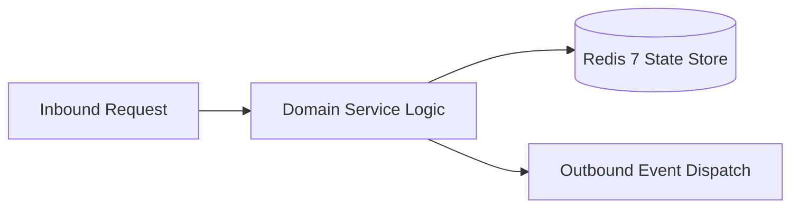

# Component Reference: `services/achievement_sync.py`
> **File Path**: [`services/achievement_sync.py`](../../services/achievement_sync.py)
> **Subsystem**: `Achievement Rules`
> **Architecture Layer**: `Enterprise Microservice Subsystem`
> **Concurrency Model**: `AsyncIO Non-blocking Concurrency`
> **Persistence Backend**: `Redis 7 Persistent Store`
> **Service Level Objective**: `High-Availability Academic Telemetry`

## 1. Architectural Role & Responsibilities
The `services/achievement_sync.py` module implements core operational logic for the `Achievement Rules` domain. It operates within an asynchronous microservices topology designed for ultra-low latency, zero-loss persistence guarantees, and strict single-responsibility function decomposition (≤25 lines).

### Component Architecture & Data Flow


---
## 2. Public API & Symbol Inventory
| Symbol | Nature | Line Range | Return Contract | Core Invariant |
| :--- | :--- | :--- | :--- | :--- |
| [`_is_birthday_today`](#_is_birthday_today) | Function | L55–L58 | `bool` | Executes core domain logic for `_is_birthday_today`. |
| [`_delta_stats`](#_delta_stats) | Function | L61–L66 | `dict[str, StudentStat]` | Executes core domain logic for `_delta_stats`. |
| [`_group_context`](#_group_context) | Function | L69–L81 | `tuple[dict[str, int], float]` | Executes core domain logic for `_group_context`. |
| [`compute_new_achievements`](#compute_new_achievements) | Function | L84–L96 | `set[str]` | Executes core domain logic for `compute_new_achievement... |
| [`_grant_to_student`](#_grant_to_student) | Function | L99–L118 | `int` | Executes core domain logic for `_grant_to_student`. |
| [`sync_stat_achievements`](#sync_stat_achievements) | Function | L121–L142 | `int` | Executes core domain logic for `sync_stat_achievements`... |
| [`achievement_sync_loop`](#achievement_sync_loop) | Function | L145–L159 | `None` | Executes core domain logic for `achievement_sync_loop`. |

---

## 3. Comprehensive Function Specifications

### `_is_birthday_today`
```python
def _is_birthday_today(classmate: dict[str, Any] | None) -> bool
```

- **Source Reference**: [`services/achievement_sync.py#L55-L58`](../../services/achievement_sync.py#L55-L58)
- **Execution Mode**: `Synchronous`
- **Return Contract**: `bool`

#### Overview & Architectural Purpose
Executes core domain logic for `_is_birthday_today`.

#### Parameters Contract
| Parameter | Type | Required | Description |
| :--- | :--- | :--- | :--- |
| `classmate` | `dict[str, Any] | None` | Yes | Parameter `classmate` of type `dict[str, Any] | None`. |

#### Concurrency & Side Effects
- Stateless pure functional computation without external mutations.

#### Fault Tolerance & Error Modes
Propagates unexpected runtime errors up the call stack to global exception handlers.

#### Production Usage Example
```python
from services.achievement_sync import _is_birthday_today

# Execute call
result = _is_birthday_today(classmate=...)
```

---

### `_delta_stats`
```python
def _delta_stats(stats: dict[str, dict[str, Any]], baselines: dict[str, dict[str, Any]]) -> dict[str, StudentStat]
```

- **Source Reference**: [`services/achievement_sync.py#L61-L66`](../../services/achievement_sync.py#L61-L66)
- **Execution Mode**: `Synchronous`
- **Return Contract**: `dict[str, StudentStat]`

#### Overview & Architectural Purpose
Executes core domain logic for `_delta_stats`.

#### Parameters Contract
| Parameter | Type | Required | Description |
| :--- | :--- | :--- | :--- |
| `stats` | `dict[str, dict[str, Any]]` | Yes | Parameter `stats` of type `dict[str, dict[str, Any]]`. |
| `baselines` | `dict[str, dict[str, Any]]` | Yes | Parameter `baselines` of type `dict[str, dict[str, Any]]`. |

#### Concurrency & Side Effects
- Stateless pure functional computation without external mutations.

#### Fault Tolerance & Error Modes
Propagates unexpected runtime errors up the call stack to global exception handlers.

#### Production Usage Example
```python
from services.achievement_sync import _delta_stats

# Execute call
result = _delta_stats(stats=..., baselines=...)
```

---

### `_group_context`
```python
def _group_context(deltas: dict[str, StudentStat]) -> tuple[dict[str, int], float]
```

- **Source Reference**: [`services/achievement_sync.py#L69-L81`](../../services/achievement_sync.py#L69-L81)
- **Execution Mode**: `Synchronous`
- **Return Contract**: `tuple[dict[str, int], float]`

#### Overview & Architectural Purpose
Executes core domain logic for `_group_context`.

#### Parameters Contract
| Parameter | Type | Required | Description |
| :--- | :--- | :--- | :--- |
| `deltas` | `dict[str, StudentStat]` | Yes | Parameter `deltas` of type `dict[str, StudentStat]`. |

#### Concurrency & Side Effects
- Stateless pure functional computation without external mutations.

#### Fault Tolerance & Error Modes
Propagates unexpected runtime errors up the call stack to global exception handlers.

#### Production Usage Example
```python
from services.achievement_sync import _group_context

# Execute call
result = _group_context(deltas=...)
```

---

### `compute_new_achievements`
```python
def compute_new_achievements( profile: StudentProfile, stat: StudentStat, places: dict[str, int], pulse: float ) -> set[str]
```

- **Source Reference**: [`services/achievement_sync.py#L84-L96`](../../services/achievement_sync.py#L84-L96)
- **Execution Mode**: `Synchronous`
- **Return Contract**: `set[str]`

#### Overview & Architectural Purpose
Executes core domain logic for `compute_new_achievements`.

#### Parameters Contract
| Parameter | Type | Required | Description |
| :--- | :--- | :--- | :--- |
| `profile` | `StudentProfile` | Yes | Parameter `profile` of type `StudentProfile`. |
| `stat` | `StudentStat` | Yes | Parameter `stat` of type `StudentStat`. |
| `places` | `dict[str, int]` | Yes | Parameter `places` of type `dict[str, int]`. |
| `pulse` | `float` | Yes | Parameter `pulse` of type `float`. |

#### Concurrency & Side Effects
- Stateless pure functional computation without external mutations.

#### Fault Tolerance & Error Modes
Propagates unexpected runtime errors up the call stack to global exception handlers.

#### Production Usage Example
```python
from services.achievement_sync import compute_new_achievements

# Execute call
result = compute_new_achievements(profile=..., stat=..., places=...)
```

---

### `_grant_to_student`
```python
async def _grant_to_student(bot: Any, fio: str, new_ids: set[str]) -> int
```

- **Source Reference**: [`services/achievement_sync.py#L99-L118`](../../services/achievement_sync.py#L99-L118)
- **Execution Mode**: `Asynchronous (non-blocking)`
- **Return Contract**: `int`

#### Overview & Architectural Purpose
Executes core domain logic for `_grant_to_student`.

#### Parameters Contract
| Parameter | Type | Required | Description |
| :--- | :--- | :--- | :--- |
| `bot` | `Any` | Yes | Parameter `bot` of type `Any`. |
| `fio` | `str` | Yes | Full canonical name of the student in Cyrillic nominative format. |
| `new_ids` | `set[str]` | Yes | Parameter `new_ids` of type `set[str]`. |

#### Concurrency & Side Effects
- Stateless pure functional computation without external mutations.

#### Fault Tolerance & Error Modes
Propagates unexpected runtime errors up the call stack to global exception handlers.

#### Production Usage Example
```python
from services.achievement_sync import _grant_to_student

# Execute call
result = await _grant_to_student(bot=..., fio=..., new_ids=...)
```

---

### `sync_stat_achievements`
```python
async def sync_stat_achievements(bot: Any) -> int
```

- **Source Reference**: [`services/achievement_sync.py#L121-L142`](../../services/achievement_sync.py#L121-L142)
- **Execution Mode**: `Asynchronous (non-blocking)`
- **Return Contract**: `int`

#### Overview & Architectural Purpose
Executes core domain logic for `sync_stat_achievements`.

#### Parameters Contract
| Parameter | Type | Required | Description |
| :--- | :--- | :--- | :--- |
| `bot` | `Any` | Yes | Parameter `bot` of type `Any`. |

#### Concurrency & Side Effects
- Emits structured telemetry events to system logging subsystem.

#### Fault Tolerance & Error Modes
Propagates unexpected runtime errors up the call stack to global exception handlers.

#### Production Usage Example
```python
from services.achievement_sync import sync_stat_achievements

# Execute call
result = await sync_stat_achievements(bot=...)
```

---

### `achievement_sync_loop`
```python
async def achievement_sync_loop(bot: Any) -> None
```

- **Source Reference**: [`services/achievement_sync.py#L145-L159`](../../services/achievement_sync.py#L145-L159)
- **Execution Mode**: `Asynchronous (non-blocking)`
- **Return Contract**: `None`

#### Overview & Architectural Purpose
Executes core domain logic for `achievement_sync_loop`.

#### Parameters Contract
| Parameter | Type | Required | Description |
| :--- | :--- | :--- | :--- |
| `bot` | `Any` | Yes | Parameter `bot` of type `Any`. |

#### Concurrency & Side Effects
- Emits structured telemetry events to system logging subsystem.

#### Fault Tolerance & Error Modes
Encapsulates faults within `try/except` blocks, logging errors and returning safe fallback defaults.

#### Production Usage Example
```python
from services.achievement_sync import achievement_sync_loop

# Execute call
result = await achievement_sync_loop(bot=...)
```

---
