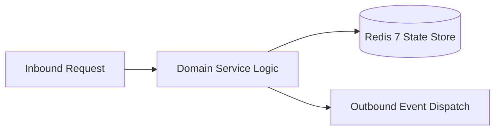

# Component Reference: `services/achievement_triggers.py`
> **File Path**: [`services/achievement_triggers.py`](../../services/achievement_triggers.py)
> **Subsystem**: `Achievement Rules`
> **Architecture Layer**: `Enterprise Microservice Subsystem`
> **Concurrency Model**: `AsyncIO Non-blocking Concurrency`
> **Persistence Backend**: `Redis 7 Persistent Store`
> **Service Level Objective**: `High-Availability Academic Telemetry`

## 1. Architectural Role & Responsibilities
The `services/achievement_triggers.py` module implements core operational logic for the `Achievement Rules` domain. It operates within an asynchronous microservices topology designed for ultra-low latency, zero-loss persistence guarantees, and strict single-responsibility function decomposition (≤25 lines).

### Component Architecture & Data Flow


---
## 2. Public API & Symbol Inventory
| Symbol | Nature | Line Range | Return Contract | Core Invariant |
| :--- | :--- | :--- | :--- | :--- |
| [`parse_lesson_slot`](#parse_lesson_slot) | Function | L56–L68 | `tuple[time, time] | None` | Parses and extracts structured entities from `parse_les... |
| [`_day_slots`](#_day_slots) | Function | L71–L74 | `list[tuple[time, time]]` | Executes core domain logic for `_day_slots`. |
| [`_minutes`](#_minutes) | Function | L77–L79 | `int` | Executes core domain logic for `_minutes`. |
| [`lesson_moment_achievements`](#lesson_moment_achievements) | Function | L82–L95 | `set[str]` | Executes core domain logic for `lesson_moment_achieveme... |
| [`time_of_day_achievements`](#time_of_day_achievements) | Function | L98–L107 | `set[str]` | Executes core domain logic for `time_of_day_achievement... |
| [`_view_specific`](#_view_specific) | Function | L110–L127 | `set[str]` | Executes core domain logic for `_view_specific`. |
| [`schedule_view_achievements`](#schedule_view_achievements) | Function | L130–L143 | `set[str]` | Executes core domain logic for `schedule_view_achieveme... |
| [`homework_kind`](#homework_kind) | Function | L158–L162 | `str` | Executes core domain logic for `homework_kind`. |
| [`homework_achievements`](#homework_achievements) | Function | L165–L181 | `set[str]` | Executes core domain logic for `homework_achievements`. |

---

## 3. Comprehensive Function Specifications

## Class Model: `ScheduleView`

Encapsulates domain entities and data transfer logic for `ScheduleView`.

### `parse_lesson_slot`
```python
def parse_lesson_slot(time_str: str) -> tuple[time, time] | None
```

- **Source Reference**: [`services/achievement_triggers.py#L56-L68`](../../services/achievement_triggers.py#L56-L68)
- **Execution Mode**: `Synchronous`
- **Return Contract**: `tuple[time, time] | None`

#### Overview & Architectural Purpose
Parses and extracts structured entities from `parse_lesson_slot`.

#### Parameters Contract
| Parameter | Type | Required | Description |
| :--- | :--- | :--- | :--- |
| `time_str` | `str` | Yes | Parameter `time_str` of type `str`. |

#### Concurrency & Side Effects
- Stateless pure functional computation without external mutations.

#### Fault Tolerance & Error Modes
Propagates unexpected runtime errors up the call stack to global exception handlers.

#### Production Usage Example
```python
from services.achievement_triggers import parse_lesson_slot

# Execute call
result = parse_lesson_slot(time_str=...)
```

---

### `_day_slots`
```python
def _day_slots(lessons: list[Lesson]) -> list[tuple[time, time]]
```

- **Source Reference**: [`services/achievement_triggers.py#L71-L74`](../../services/achievement_triggers.py#L71-L74)
- **Execution Mode**: `Synchronous`
- **Return Contract**: `list[tuple[time, time]]`

#### Overview & Architectural Purpose
Executes core domain logic for `_day_slots`.

#### Parameters Contract
| Parameter | Type | Required | Description |
| :--- | :--- | :--- | :--- |
| `lessons` | `list[Lesson]` | Yes | Parameter `lessons` of type `list[Lesson]`. |

#### Concurrency & Side Effects
- Stateless pure functional computation without external mutations.

#### Fault Tolerance & Error Modes
Propagates unexpected runtime errors up the call stack to global exception handlers.

#### Production Usage Example
```python
from services.achievement_triggers import _day_slots

# Execute call
result = _day_slots(lessons=...)
```

---

### `_minutes`
```python
def _minutes(t: time) -> int
```

- **Source Reference**: [`services/achievement_triggers.py#L77-L79`](../../services/achievement_triggers.py#L77-L79)
- **Execution Mode**: `Synchronous`
- **Return Contract**: `int`

#### Overview & Architectural Purpose
Executes core domain logic for `_minutes`.

#### Parameters Contract
| Parameter | Type | Required | Description |
| :--- | :--- | :--- | :--- |
| `t` | `time` | Yes | Parameter `t` of type `time`. |

#### Concurrency & Side Effects
- Stateless pure functional computation without external mutations.

#### Fault Tolerance & Error Modes
Propagates unexpected runtime errors up the call stack to global exception handlers.

#### Production Usage Example
```python
from services.achievement_triggers import _minutes

# Execute call
result = _minutes(t=...)
```

---

### `lesson_moment_achievements`
```python
def lesson_moment_achievements(now: time, lessons: list[Lesson]) -> set[str]
```

- **Source Reference**: [`services/achievement_triggers.py#L82-L95`](../../services/achievement_triggers.py#L82-L95)
- **Execution Mode**: `Synchronous`
- **Return Contract**: `set[str]`

#### Overview & Architectural Purpose
Executes core domain logic for `lesson_moment_achievements`.

#### Parameters Contract
| Parameter | Type | Required | Description |
| :--- | :--- | :--- | :--- |
| `now` | `time` | Yes | Parameter `now` of type `time`. |
| `lessons` | `list[Lesson]` | Yes | Parameter `lessons` of type `list[Lesson]`. |

#### Concurrency & Side Effects
- Stateless pure functional computation without external mutations.

#### Fault Tolerance & Error Modes
Propagates unexpected runtime errors up the call stack to global exception handlers.

#### Production Usage Example
```python
from services.achievement_triggers import lesson_moment_achievements

# Execute call
result = lesson_moment_achievements(now=..., lessons=...)
```

---

### `time_of_day_achievements`
```python
def time_of_day_achievements(now: datetime) -> set[str]
```

- **Source Reference**: [`services/achievement_triggers.py#L98-L107`](../../services/achievement_triggers.py#L98-L107)
- **Execution Mode**: `Synchronous`
- **Return Contract**: `set[str]`

#### Overview & Architectural Purpose
Executes core domain logic for `time_of_day_achievements`.

#### Parameters Contract
| Parameter | Type | Required | Description |
| :--- | :--- | :--- | :--- |
| `now` | `datetime` | Yes | Parameter `now` of type `datetime`. |

#### Concurrency & Side Effects
- Stateless pure functional computation without external mutations.

#### Fault Tolerance & Error Modes
Propagates unexpected runtime errors up the call stack to global exception handlers.

#### Production Usage Example
```python
from services.achievement_triggers import time_of_day_achievements

# Execute call
result = time_of_day_achievements(now=...)
```

---

### `_view_specific`
```python
def _view_specific(view: ScheduleView, now: datetime) -> set[str]
```

- **Source Reference**: [`services/achievement_triggers.py#L110-L127`](../../services/achievement_triggers.py#L110-L127)
- **Execution Mode**: `Synchronous`
- **Return Contract**: `set[str]`

#### Overview & Architectural Purpose
Executes core domain logic for `_view_specific`.

#### Parameters Contract
| Parameter | Type | Required | Description |
| :--- | :--- | :--- | :--- |
| `view` | `ScheduleView` | Yes | Parameter `view` of type `ScheduleView`. |
| `now` | `datetime` | Yes | Parameter `now` of type `datetime`. |

#### Concurrency & Side Effects
- Stateless pure functional computation without external mutations.

#### Fault Tolerance & Error Modes
Propagates unexpected runtime errors up the call stack to global exception handlers.

#### Production Usage Example
```python
from services.achievement_triggers import _view_specific

# Execute call
result = _view_specific(view=..., now=...)
```

---

### `schedule_view_achievements`
```python
def schedule_view_achievements(view: ScheduleView, now: datetime, lessons: list[Lesson]) -> set[str]
```

- **Source Reference**: [`services/achievement_triggers.py#L130-L143`](../../services/achievement_triggers.py#L130-L143)
- **Execution Mode**: `Synchronous`
- **Return Contract**: `set[str]`

#### Overview & Architectural Purpose
Executes core domain logic for `schedule_view_achievements`.

#### Parameters Contract
| Parameter | Type | Required | Description |
| :--- | :--- | :--- | :--- |
| `view` | `ScheduleView` | Yes | Parameter `view` of type `ScheduleView`. |
| `now` | `datetime` | Yes | Parameter `now` of type `datetime`. |
| `lessons` | `list[Lesson]` | Yes | Parameter `lessons` of type `list[Lesson]`. |

#### Concurrency & Side Effects
- Stateless pure functional computation without external mutations.

#### Fault Tolerance & Error Modes
Propagates unexpected runtime errors up the call stack to global exception handlers.

#### Production Usage Example
```python
from services.achievement_triggers import schedule_view_achievements

# Execute call
result = schedule_view_achievements(view=..., now=..., lessons=...)
```

---

## Class Model: `HomeworkTask`

Encapsulates domain entities and data transfer logic for `HomeworkTask`.

### `homework_kind`
```python
def homework_kind(mime_type: str | None, has_file: bool) -> str
```

- **Source Reference**: [`services/achievement_triggers.py#L158-L162`](../../services/achievement_triggers.py#L158-L162)
- **Execution Mode**: `Synchronous`
- **Return Contract**: `str`

#### Overview & Architectural Purpose
Executes core domain logic for `homework_kind`.

#### Parameters Contract
| Parameter | Type | Required | Description |
| :--- | :--- | :--- | :--- |
| `mime_type` | `str | None` | Yes | Parameter `mime_type` of type `str | None`. |
| `has_file` | `bool` | Yes | Parameter `has_file` of type `bool`. |

#### Concurrency & Side Effects
- Stateless pure functional computation without external mutations.

#### Fault Tolerance & Error Modes
Propagates unexpected runtime errors up the call stack to global exception handlers.

#### Production Usage Example
```python
from services.achievement_triggers import homework_kind

# Execute call
result = homework_kind(mime_type=..., has_file=...)
```

---

### `homework_achievements`
```python
def homework_achievements(task: HomeworkTask, now: datetime) -> set[str]
```

- **Source Reference**: [`services/achievement_triggers.py#L165-L181`](../../services/achievement_triggers.py#L165-L181)
- **Execution Mode**: `Synchronous`
- **Return Contract**: `set[str]`

#### Overview & Architectural Purpose
Executes core domain logic for `homework_achievements`.

#### Parameters Contract
| Parameter | Type | Required | Description |
| :--- | :--- | :--- | :--- |
| `task` | `HomeworkTask` | Yes | Parameter `task` of type `HomeworkTask`. |
| `now` | `datetime` | Yes | Parameter `now` of type `datetime`. |

#### Concurrency & Side Effects
- Stateless pure functional computation without external mutations.

#### Fault Tolerance & Error Modes
Propagates unexpected runtime errors up the call stack to global exception handlers.

#### Production Usage Example
```python
from services.achievement_triggers import homework_achievements

# Execute call
result = homework_achievements(task=..., now=...)
```

---
