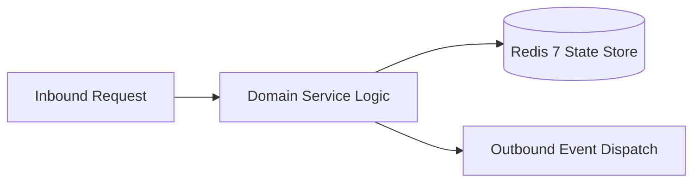

# Component Reference: `services/alerting.py`
> **File Path**: [`services/alerting.py`](../../services/alerting.py)
> **Subsystem**: `Incident Alerting`
> **Architecture Layer**: `Enterprise Microservice Subsystem`
> **Concurrency Model**: `AsyncIO Non-blocking Concurrency`
> **Persistence Backend**: `Redis 7 Persistent Store`
> **Service Level Objective**: `High-Availability Academic Telemetry`

## 1. Architectural Role & Responsibilities
The `services/alerting.py` module implements core operational logic for the `Incident Alerting` domain. It operates within an asynchronous microservices topology designed for ultra-low latency, zero-loss persistence guarantees, and strict single-responsibility function decomposition (≤25 lines).

### Component Architecture & Data Flow


---
## 2. Public API & Symbol Inventory
| Symbol | Nature | Line Range | Return Contract | Core Invariant |
| :--- | :--- | :--- | :--- | :--- |
| [`_check_redis_throttle`](#_check_redis_throttle) | Function | L46–L59 | `bool | None` | Executes core domain logic for `_check_redis_throttle`. |
| [`_should_throttle_alert`](#_should_throttle_alert) | Function | L62–L72 | `bool` | Executes core domain logic for `_should_throttle_alert`... |
| [`_is_alert_throttled`](#_is_alert_throttled) | Function | L75–L80 | `bool` | Executes core domain logic for `_is_alert_throttled`. |
| [`_format_alert_text`](#_format_alert_text) | Function | L83–L95 | `str` | Executes core domain logic for `_format_alert_text`. |
| [`_resolve_alert_destination`](#_resolve_alert_destination) | Function | L98–L106 | `tuple[int, int | None]` | Executes core domain logic for `_resolve_alert_destinat... |
| [`_record_incident_safe`](#_record_incident_safe) | Function | L109–L126 | `None` | Executes core domain logic for `_record_incident_safe`. |
| [`_deliver_alert_message`](#_deliver_alert_message) | Function | L129–L150 | `bool` | Executes core domain logic for `_deliver_alert_message`... |
| [`send_admin_alert`](#send_admin_alert) | Function | L153–L167 | `bool` | Dispatches notification message via Telegram API for `s... |

---

## 3. Comprehensive Function Specifications

## Class Model: `IncidentType`

Encapsulates domain entities and data transfer logic for `IncidentType`.

### `_check_redis_throttle`
```python
async def _check_redis_throttle(incident_type: str, cooldown_seconds: float) -> bool | None
```

- **Source Reference**: [`services/alerting.py#L46-L59`](../../services/alerting.py#L46-L59)
- **Execution Mode**: `Asynchronous (non-blocking)`
- **Return Contract**: `bool | None`

#### Overview & Architectural Purpose
Executes core domain logic for `_check_redis_throttle`.

#### Parameters Contract
| Parameter | Type | Required | Description |
| :--- | :--- | :--- | :--- |
| `incident_type` | `str` | Yes | Parameter `incident_type` of type `str`. |
| `cooldown_seconds` | `float` | Yes | Parameter `cooldown_seconds` of type `float`. |

#### Concurrency & Side Effects
- Mutates or reads Redis L2 key space via asynchronous connection pool.
- Emits structured telemetry events to system logging subsystem.

#### Fault Tolerance & Error Modes
Encapsulates faults within `try/except` blocks, logging errors and returning safe fallback defaults.

#### Production Usage Example
```python
from services.alerting import _check_redis_throttle

# Execute call
result = await _check_redis_throttle(incident_type=..., cooldown_seconds=...)
```

---

### `_should_throttle_alert`
```python
def _should_throttle_alert(incident_type: str, cooldown_seconds: float = 300.0) -> bool
```

- **Source Reference**: [`services/alerting.py#L62-L72`](../../services/alerting.py#L62-L72)
- **Execution Mode**: `Synchronous`
- **Return Contract**: `bool`

#### Overview & Architectural Purpose
Executes core domain logic for `_should_throttle_alert`.

#### Parameters Contract
| Parameter | Type | Required | Description |
| :--- | :--- | :--- | :--- |
| `incident_type` | `str` | Yes | Parameter `incident_type` of type `str`. |
| `cooldown_seconds` | `float` | Yes | Parameter `cooldown_seconds` of type `float`. |

#### Concurrency & Side Effects
- Stateless pure functional computation without external mutations.

#### Fault Tolerance & Error Modes
Propagates unexpected runtime errors up the call stack to global exception handlers.

#### Production Usage Example
```python
from services.alerting import _should_throttle_alert

# Execute call
result = _should_throttle_alert(incident_type=..., cooldown_seconds=...)
```

---

### `_is_alert_throttled`
```python
async def _is_alert_throttled(incident_type: str, cooldown_seconds: float) -> bool
```

- **Source Reference**: [`services/alerting.py#L75-L80`](../../services/alerting.py#L75-L80)
- **Execution Mode**: `Asynchronous (non-blocking)`
- **Return Contract**: `bool`

#### Overview & Architectural Purpose
Executes core domain logic for `_is_alert_throttled`.

#### Parameters Contract
| Parameter | Type | Required | Description |
| :--- | :--- | :--- | :--- |
| `incident_type` | `str` | Yes | Parameter `incident_type` of type `str`. |
| `cooldown_seconds` | `float` | Yes | Parameter `cooldown_seconds` of type `float`. |

#### Concurrency & Side Effects
- Stateless pure functional computation without external mutations.

#### Fault Tolerance & Error Modes
Propagates unexpected runtime errors up the call stack to global exception handlers.

#### Production Usage Example
```python
from services.alerting import _is_alert_throttled

# Execute call
result = await _is_alert_throttled(incident_type=..., cooldown_seconds=...)
```

---

### `_format_alert_text`
```python
def _format_alert_text( incident_type: str, severity: str, title: str, description: str, trace_id: str | None = None ) -> str
```

- **Source Reference**: [`services/alerting.py#L83-L95`](../../services/alerting.py#L83-L95)
- **Execution Mode**: `Synchronous`
- **Return Contract**: `str`

#### Overview & Architectural Purpose
Executes core domain logic for `_format_alert_text`.

#### Parameters Contract
| Parameter | Type | Required | Description |
| :--- | :--- | :--- | :--- |
| `incident_type` | `str` | Yes | Parameter `incident_type` of type `str`. |
| `severity` | `str` | Yes | Parameter `severity` of type `str`. |
| `title` | `str` | Yes | Parameter `title` of type `str`. |
| `description` | `str` | Yes | Parameter `description` of type `str`. |
| `trace_id` | `str | None` | Yes | Parameter `trace_id` of type `str | None`. |

#### Concurrency & Side Effects
- Stateless pure functional computation without external mutations.

#### Fault Tolerance & Error Modes
Propagates unexpected runtime errors up the call stack to global exception handlers.

#### Production Usage Example
```python
from services.alerting import _format_alert_text

# Execute call
result = _format_alert_text(incident_type=..., severity=..., title=...)
```

---

### `_resolve_alert_destination`
```python
def _resolve_alert_destination(severity: str) -> tuple[int, int | None]
```

- **Source Reference**: [`services/alerting.py#L98-L106`](../../services/alerting.py#L98-L106)
- **Execution Mode**: `Synchronous`
- **Return Contract**: `tuple[int, int | None]`

#### Overview & Architectural Purpose
Executes core domain logic for `_resolve_alert_destination`.

#### Parameters Contract
| Parameter | Type | Required | Description |
| :--- | :--- | :--- | :--- |
| `severity` | `str` | Yes | Parameter `severity` of type `str`. |

#### Concurrency & Side Effects
- Stateless pure functional computation without external mutations.

#### Fault Tolerance & Error Modes
Propagates unexpected runtime errors up the call stack to global exception handlers.

#### Production Usage Example
```python
from services.alerting import _resolve_alert_destination

# Execute call
result = _resolve_alert_destination(severity=...)
```

---

### `_record_incident_safe`
```python
async def _record_incident_safe( incident_type: str, severity: str, title: str, description: str, trace_id: str | None, ) -> None
```

- **Source Reference**: [`services/alerting.py#L109-L126`](../../services/alerting.py#L109-L126)
- **Execution Mode**: `Asynchronous (non-blocking)`
- **Return Contract**: `None`

#### Overview & Architectural Purpose
Executes core domain logic for `_record_incident_safe`.

#### Parameters Contract
| Parameter | Type | Required | Description |
| :--- | :--- | :--- | :--- |
| `incident_type` | `str` | Yes | Parameter `incident_type` of type `str`. |
| `severity` | `str` | Yes | Parameter `severity` of type `str`. |
| `title` | `str` | Yes | Parameter `title` of type `str`. |
| `description` | `str` | Yes | Parameter `description` of type `str`. |
| `trace_id` | `str | None` | Yes | Parameter `trace_id` of type `str | None`. |

#### Concurrency & Side Effects
- Emits structured telemetry events to system logging subsystem.

#### Fault Tolerance & Error Modes
Encapsulates faults within `try/except` blocks, logging errors and returning safe fallback defaults.

#### Production Usage Example
```python
from services.alerting import _record_incident_safe

# Execute call
result = await _record_incident_safe(incident_type=..., severity=..., title=...)
```

---

### `_deliver_alert_message`
```python
async def _deliver_alert_message( incident_type: str, severity: str, title: str, description: str, trace_id: str | None, ) -> bool
```

- **Source Reference**: [`services/alerting.py#L129-L150`](../../services/alerting.py#L129-L150)
- **Execution Mode**: `Asynchronous (non-blocking)`
- **Return Contract**: `bool`

#### Overview & Architectural Purpose
Executes core domain logic for `_deliver_alert_message`.

#### Parameters Contract
| Parameter | Type | Required | Description |
| :--- | :--- | :--- | :--- |
| `incident_type` | `str` | Yes | Parameter `incident_type` of type `str`. |
| `severity` | `str` | Yes | Parameter `severity` of type `str`. |
| `title` | `str` | Yes | Parameter `title` of type `str`. |
| `description` | `str` | Yes | Parameter `description` of type `str`. |
| `trace_id` | `str | None` | Yes | Parameter `trace_id` of type `str | None`. |

#### Concurrency & Side Effects
- Emits structured telemetry events to system logging subsystem.

#### Fault Tolerance & Error Modes
Encapsulates faults within `try/except` blocks, logging errors and returning safe fallback defaults.

#### Production Usage Example
```python
from services.alerting import _deliver_alert_message

# Execute call
result = await _deliver_alert_message(incident_type=..., severity=..., title=...)
```

---

### `send_admin_alert`
```python
async def send_admin_alert( incident_type: str, title: str, description: str, severity: str = IncidentSeverity.WARNING, trace_id: str | None = None, cooldown_seconds: float | None = None, ) -> bool
```

- **Source Reference**: [`services/alerting.py#L153-L167`](../../services/alerting.py#L153-L167)
- **Execution Mode**: `Asynchronous (non-blocking)`
- **Return Contract**: `bool`

#### Overview & Architectural Purpose
Dispatches notification message via Telegram API for `send_admin_alert`.

#### Parameters Contract
| Parameter | Type | Required | Description |
| :--- | :--- | :--- | :--- |
| `incident_type` | `str` | Yes | Parameter `incident_type` of type `str`. |
| `title` | `str` | Yes | Parameter `title` of type `str`. |
| `description` | `str` | Yes | Parameter `description` of type `str`. |
| `severity` | `str` | Yes | Parameter `severity` of type `str`. |
| `trace_id` | `str | None` | Yes | Parameter `trace_id` of type `str | None`. |
| `cooldown_seconds` | `float | None` | Yes | Parameter `cooldown_seconds` of type `float | None`. |

#### Concurrency & Side Effects
- Emits structured telemetry events to system logging subsystem.

#### Fault Tolerance & Error Modes
Propagates unexpected runtime errors up the call stack to global exception handlers.

#### Production Usage Example
```python
from services.alerting import send_admin_alert

# Execute call
result = await send_admin_alert(incident_type=..., title=..., description=...)
```

---
