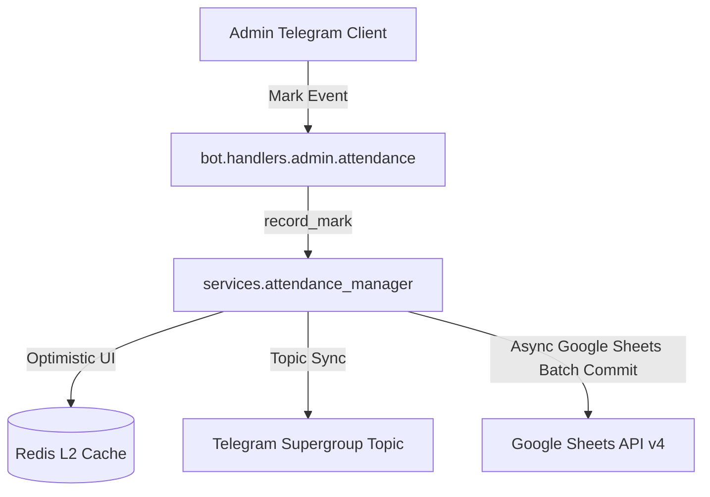

# Component Reference: `services/attendance_manager.py`
> **File Path**: [`services/attendance_manager.py`](../../services/attendance_manager.py)
> **Subsystem**: `Attendance Operations`
> **Architecture Layer**: `Domain Business Service`
> **Concurrency Model**: `AsyncIO Event Loop + Redis Distributed Locks`
> **Persistence Backend**: `Redis L2 Append-Only + Google Sheets Spreadsheets`
> **Service Level Objective**: `Sub-10ms Cache Writes / 500ms Google API Roundtrip`

## 1. Purpose
Менеджер интерактивной сессии отметки посещаемости.

### Component Architecture & Data Flow


---
## 2. Public API & Symbol Inventory
| Symbol | Nature | Line Range | Return Contract | Summary |
| :--- | :--- | :--- | :--- | :--- |
| [`save_session_to_redis`](#save_session_to_redis) | Function | L54–L74 | `None` | Сериализует и сохраняет состояние активной сессии опрос... |
| [`get_active_session`](#get_active_session) | Function | L77–L99 | `AttendanceSession \| None` | Считывает и десериализует активную сессию опроса из Red... |
| [`clear_session`](#clear_session) | Function | L102–L113 | `None` | Удаляет активную сессию опроса посещаемости из Redis. |
| [`_fetch_students_from_google`](#_fetch_students_from_google) | Function | L116–L127 | `list[tuple[int, str]]` | Считывает список студентов из Google Таблицы. |
| [`_read_cached_students`](#_read_cached_students) | Function | L130–L146 | `list[tuple[int, str]] \| None` | Считывает список студентов из кэша Redis. |
| [`fetch_target_students`](#fetch_target_students) | Function | L149–L168 | `list[tuple[int, str]]` | Возвращает список студентов с кэшированием в Redis для ... |
| [`_assert_no_initiator_conflict`](#_assert_no_initiator_conflict) | Function | L171–L179 | `None` | Проверяет отсутствие конфликта параллельных инициаторов... |
| [`create_attendance_session`](#create_attendance_session) | Function | L182–L206 | `AttendanceSession` | Инициализирует новую сессию опроса посещаемости и фикси... |
| [`record_student_mark`](#record_student_mark) | Function | L209–L226 | `AttendanceSession \| None` | Записывает отметку для текущего студента и сдвигает ука... |
| [`step_back`](#step_back) | Function | L229–L246 | `AttendanceSession \| None` | Возвращает опрос на один шаг назад для исправления ошиб... |
| [`mark_all_remaining_present`](#mark_all_remaining_present) | Function | L249–L269 | `AttendanceSession \| None` | Массово проставляет статус 'П' (присутствует) всем оста... |
| [`ensure_summary_headers`](#ensure_summary_headers) | Function | L272–L289 | `None` | Гарантирует сохранение текстовых заголовков и кодов в с... |
| [`apply_marks_to_sheet`](#apply_marks_to_sheet) | Function | L292–L301 | `None` | Записывает все собранные отметки сессии в колонку даты ... |
| [`_try_commit_once`](#_try_commit_once) | Function | L304–L312 | `bool` | Выполняет одну итерацию сохранения отметок сессии в Goo... |
| [`_post_commit_sync`](#_post_commit_sync) | Function | L315–L330 | `None` | Выполняет контрольную сверку и обновление топика после ... |
| [`_execute_commit_attempts`](#_execute_commit_attempts) | Function | L333–L351 | `bool` | Выполняет цикл повторных попыток выгрузки журнала с экс... |
| [`commit_session_to_table`](#commit_session_to_table) | Function | L354–L372 | `bool` | Выгружает все зафиксированные отметки сессии в Google Т... |
| [`calculate_summary_stats`](#calculate_summary_stats) | Function | L375–L389 | `dict[str, int]` | Подсчитывает итоговые количества отметок по категориям ... |

---

## 3. Comprehensive Function Specifications

## Class Model: `AttendanceSession`

Модель активной сессии отметки посещаемости пары.

### `save_session_to_redis`
```python
async def save_session_to_redis(session: AttendanceSession) -> None
```

- **Source Reference**: [`services/attendance_manager.py#L54-L74`](../../services/attendance_manager.py#L54-L74)
- **Execution Mode**: `Asynchronous (non-blocking)`
- **Return Contract**: `None`

#### Overview & Architectural Purpose
Сериализует и сохраняет состояние активной сессии опроса в Redis.

#### Parameters Contract
| Parameter | Type | Required | Description |
| :--- | :--- | :--- | :--- |
| `session` | `AttendanceSession` | Yes | Active domain session instance containing current student index and marks. |

#### Concurrency & Side Effects
- Mutates or reads Redis L2 key space via asynchronous connection pool.
- Serializes entity state into JSON using Pydantic V2 engine.
- Emits structured telemetry events to system logging subsystem.

#### Fault Tolerance & Error Modes
Propagates unexpected runtime errors up the call stack to global exception handlers.

#### Production Usage Example
```python
from services.attendance_manager import save_session_to_redis

# Execute call
result = await save_session_to_redis(session=...)
```

---

### `get_active_session`
```python
async def get_active_session() -> AttendanceSession | None
```

- **Source Reference**: [`services/attendance_manager.py#L77-L99`](../../services/attendance_manager.py#L77-L99)
- **Execution Mode**: `Asynchronous (non-blocking)`
- **Return Contract**: `AttendanceSession | None`

#### Overview & Architectural Purpose
Считывает и десериализует активную сессию опроса из Redis.

#### Parameters Contract
*This method takes no input parameters.*

#### Concurrency & Side Effects
- Mutates or reads Redis L2 key space via asynchronous connection pool.
- Emits structured telemetry events to system logging subsystem.
- Performs non-blocking network I/O over HTTP or gRPC.

#### Fault Tolerance & Error Modes
Encapsulates faults within `try/except` blocks, logging errors and returning safe fallback defaults.

#### Production Usage Example
```python
from services.attendance_manager import get_active_session

# Execute call
result = await get_active_session()
```

---

### `clear_session`
```python
async def clear_session() -> None
```

- **Source Reference**: [`services/attendance_manager.py#L102-L113`](../../services/attendance_manager.py#L102-L113)
- **Execution Mode**: `Asynchronous (non-blocking)`
- **Return Contract**: `None`

#### Overview & Architectural Purpose
Удаляет активную сессию опроса посещаемости из Redis.

#### Parameters Contract
*This method takes no input parameters.*

#### Concurrency & Side Effects
- Mutates or reads Redis L2 key space via asynchronous connection pool.
- Emits structured telemetry events to system logging subsystem.

#### Fault Tolerance & Error Modes
Propagates unexpected runtime errors up the call stack to global exception handlers.

#### Production Usage Example
```python
from services.attendance_manager import clear_session

# Execute call
result = await clear_session()
```

---

### `_fetch_students_from_google`
```python
async def _fetch_students_from_google(target_date: date) -> list[tuple[int, str]]
```

- **Source Reference**: [`services/attendance_manager.py#L116-L127`](../../services/attendance_manager.py#L116-L127)
- **Execution Mode**: `Asynchronous (non-blocking)`
- **Return Contract**: `list[tuple[int, str]]`

#### Overview & Architectural Purpose
Считывает список студентов из Google Таблицы.

#### Parameters Contract
| Parameter | Type | Required | Description |
| :--- | :--- | :--- | :--- |
| `target_date` | `date` | Yes | Target calendar date for schedule or attendance resolution (ISO-8601). |

#### Concurrency & Side Effects
- Stateless pure functional computation without external mutations.

#### Fault Tolerance & Error Modes
Explicitly raises domain exceptions (e.g., `PermissionError`, `ValueError`) upon invariant violation.

#### Production Usage Example
```python
from services.attendance_manager import _fetch_students_from_google

# Execute call
result = await _fetch_students_from_google(target_date=...)
```

---

### `_read_cached_students`
```python
async def _read_cached_students(client) -> list[tuple[int, str]] | None
```

- **Source Reference**: [`services/attendance_manager.py#L130-L146`](../../services/attendance_manager.py#L130-L146)
- **Execution Mode**: `Asynchronous (non-blocking)`
- **Return Contract**: `list[tuple[int, str]] | None`

#### Overview & Architectural Purpose
Считывает список студентов из кэша Redis.

#### Parameters Contract
| Parameter | Type | Required | Description |
| :--- | :--- | :--- | :--- |
| `client` | `Any` | Yes | Active asynchronous Redis client or HTTP connection pool instance. |

#### Concurrency & Side Effects
- Emits structured telemetry events to system logging subsystem.
- Performs non-blocking network I/O over HTTP or gRPC.

#### Fault Tolerance & Error Modes
Encapsulates faults within `try/except` blocks, logging errors and returning safe fallback defaults.

#### Production Usage Example
```python
from services.attendance_manager import _read_cached_students

# Execute call
result = await _read_cached_students(client=...)
```

---

### `fetch_target_students`
```python
async def fetch_target_students(target_date: date) -> list[tuple[int, str]]
```

- **Source Reference**: [`services/attendance_manager.py#L149-L168`](../../services/attendance_manager.py#L149-L168)
- **Execution Mode**: `Asynchronous (non-blocking)`
- **Return Contract**: `list[tuple[int, str]]`

#### Overview & Architectural Purpose
Возвращает список студентов с кэшированием в Redis для мгновенного отклика.

#### Parameters Contract
| Parameter | Type | Required | Description |
| :--- | :--- | :--- | :--- |
| `target_date` | `date` | Yes | Target calendar date for schedule or attendance resolution (ISO-8601). |

#### Concurrency & Side Effects
- Mutates or reads Redis L2 key space via asynchronous connection pool.

#### Fault Tolerance & Error Modes
Propagates unexpected runtime errors up the call stack to global exception handlers.

#### Production Usage Example
```python
from services.attendance_manager import fetch_target_students

# Execute call
result = await fetch_target_students(target_date=...)
```

---

### `_assert_no_initiator_conflict`
```python
async def _assert_no_initiator_conflict(initiator_id: int) -> None
```

- **Source Reference**: [`services/attendance_manager.py#L171-L179`](../../services/attendance_manager.py#L171-L179)
- **Execution Mode**: `Asynchronous (non-blocking)`
- **Return Contract**: `None`

#### Overview & Architectural Purpose
Проверяет отсутствие конфликта параллельных инициаторов опроса.

#### Parameters Contract
| Parameter | Type | Required | Description |
| :--- | :--- | :--- | :--- |
| `initiator_id` | `int` | Yes | Parameter `initiator_id` of type `int`. |

#### Concurrency & Side Effects
- Stateless pure functional computation without external mutations.

#### Fault Tolerance & Error Modes
Explicitly raises domain exceptions (e.g., `PermissionError`, `ValueError`) upon invariant violation.

#### Production Usage Example
```python
from services.attendance_manager import _assert_no_initiator_conflict

# Execute call
result = await _assert_no_initiator_conflict(initiator_id=...)
```

---

### `create_attendance_session`
```python
async def create_attendance_session( target_date: date, lesson_num: int, lesson_title: str, initiator_id: int ) -> AttendanceSession
```

- **Source Reference**: [`services/attendance_manager.py#L182-L206`](../../services/attendance_manager.py#L182-L206)
- **Execution Mode**: `Asynchronous (non-blocking)`
- **Return Contract**: `AttendanceSession`

#### Overview & Architectural Purpose
Инициализирует новую сессию опроса посещаемости и фиксирует её в Redis.

#### Parameters Contract
| Parameter | Type | Required | Description |
| :--- | :--- | :--- | :--- |
| `target_date` | `date` | Yes | Target calendar date for schedule or attendance resolution (ISO-8601). |
| `lesson_num` | `int` | Yes | Academic class sequence index (1-based, 1 to 6). |
| `lesson_title` | `str` | Yes | Parameter `lesson_title` of type `str`. |
| `initiator_id` | `int` | Yes | Parameter `initiator_id` of type `int`. |

#### Concurrency & Side Effects
- Emits structured telemetry events to system logging subsystem.

#### Fault Tolerance & Error Modes
Propagates unexpected runtime errors up the call stack to global exception handlers.

#### Production Usage Example
```python
from services.attendance_manager import create_attendance_session

# Execute call
result = await create_attendance_session(target_date=..., lesson_num=..., lesson_title=...)
```

---

### `record_student_mark`
```python
async def record_student_mark(mark: str) -> AttendanceSession | None
```

- **Source Reference**: [`services/attendance_manager.py#L209-L226`](../../services/attendance_manager.py#L209-L226)
- **Execution Mode**: `Asynchronous (non-blocking)`
- **Return Contract**: `AttendanceSession | None`

#### Overview & Architectural Purpose
Записывает отметку для текущего студента и сдвигает указатель на следующего.

#### Parameters Contract
| Parameter | Type | Required | Description |
| :--- | :--- | :--- | :--- |
| `mark` | `str` | Yes | Attendance evaluation symbol assigned to the student. |

#### Concurrency & Side Effects
- Stateless pure functional computation without external mutations.

#### Fault Tolerance & Error Modes
Propagates unexpected runtime errors up the call stack to global exception handlers.

#### Production Usage Example
```python
from services.attendance_manager import record_student_mark

# Execute call
result = await record_student_mark(mark=...)
```

---

### `step_back`
```python
async def step_back() -> AttendanceSession | None
```

- **Source Reference**: [`services/attendance_manager.py#L229-L246`](../../services/attendance_manager.py#L229-L246)
- **Execution Mode**: `Asynchronous (non-blocking)`
- **Return Contract**: `AttendanceSession | None`

#### Overview & Architectural Purpose
Возвращает опрос на один шаг назад для исправления ошибочной отметки.

#### Parameters Contract
*This method takes no input parameters.*

#### Concurrency & Side Effects
- Stateless pure functional computation without external mutations.

#### Fault Tolerance & Error Modes
Propagates unexpected runtime errors up the call stack to global exception handlers.

#### Production Usage Example
```python
from services.attendance_manager import step_back

# Execute call
result = await step_back()
```

---

### `mark_all_remaining_present`
```python
async def mark_all_remaining_present() -> AttendanceSession | None
```

- **Source Reference**: [`services/attendance_manager.py#L249-L269`](../../services/attendance_manager.py#L249-L269)
- **Execution Mode**: `Asynchronous (non-blocking)`
- **Return Contract**: `AttendanceSession | None`

#### Overview & Architectural Purpose
Массово проставляет статус 'П' (присутствует) всем оставшимся студентам.

#### Parameters Contract
*This method takes no input parameters.*

#### Concurrency & Side Effects
- Emits structured telemetry events to system logging subsystem.

#### Fault Tolerance & Error Modes
Propagates unexpected runtime errors up the call stack to global exception handlers.

#### Production Usage Example
```python
from services.attendance_manager import mark_all_remaining_present

# Execute call
result = await mark_all_remaining_present()
```

---

### `ensure_summary_headers`
```python
def ensure_summary_headers(sheet) -> None
```

- **Source Reference**: [`services/attendance_manager.py#L272-L289`](../../services/attendance_manager.py#L272-L289)
- **Execution Mode**: `Synchronous`
- **Return Contract**: `None`

#### Overview & Architectural Purpose
Гарантирует сохранение текстовых заголовков и кодов в сводных колонках.

#### Parameters Contract
| Parameter | Type | Required | Description |
| :--- | :--- | :--- | :--- |
| `sheet` | `Any` | Yes | Parameter `sheet` of type `Any`. |

#### Concurrency & Side Effects
- Stateless pure functional computation without external mutations.

#### Fault Tolerance & Error Modes
Propagates unexpected runtime errors up the call stack to global exception handlers.

#### Production Usage Example
```python
from services.attendance_manager import ensure_summary_headers

# Execute call
result = ensure_summary_headers(sheet=...)
```

---

### `apply_marks_to_sheet`
```python
def apply_marks_to_sheet(sheet, session: AttendanceSession, col: int) -> None
```

- **Source Reference**: [`services/attendance_manager.py#L292-L301`](../../services/attendance_manager.py#L292-L301)
- **Execution Mode**: `Synchronous`
- **Return Contract**: `None`

#### Overview & Architectural Purpose
Записывает все собранные отметки сессии в колонку даты в рабочем листе Excel.

#### Parameters Contract
| Parameter | Type | Required | Description |
| :--- | :--- | :--- | :--- |
| `sheet` | `Any` | Yes | Parameter `sheet` of type `Any`. |
| `session` | `AttendanceSession` | Yes | Active domain session instance containing current student index and marks. |
| `col` | `int` | Yes | Parameter `col` of type `int`. |

#### Concurrency & Side Effects
- Stateless pure functional computation without external mutations.

#### Fault Tolerance & Error Modes
Propagates unexpected runtime errors up the call stack to global exception handlers.

#### Production Usage Example
```python
from services.attendance_manager import apply_marks_to_sheet

# Execute call
result = apply_marks_to_sheet(sheet=..., session=..., col=...)
```

---

### `_try_commit_once`
```python
async def _try_commit_once(session: AttendanceSession, t_date: date) -> bool
```

- **Source Reference**: [`services/attendance_manager.py#L304-L312`](../../services/attendance_manager.py#L304-L312)
- **Execution Mode**: `Asynchronous (non-blocking)`
- **Return Contract**: `bool`

#### Overview & Architectural Purpose
Выполняет одну итерацию сохранения отметок сессии в Google Таблицу.

#### Parameters Contract
| Parameter | Type | Required | Description |
| :--- | :--- | :--- | :--- |
| `session` | `AttendanceSession` | Yes | Active domain session instance containing current student index and marks. |
| `t_date` | `date` | Yes | Parameter `t_date` of type `date`. |

#### Concurrency & Side Effects
- Stateless pure functional computation without external mutations.

#### Fault Tolerance & Error Modes
Propagates unexpected runtime errors up the call stack to global exception handlers.

#### Production Usage Example
```python
from services.attendance_manager import _try_commit_once

# Execute call
result = await _try_commit_once(session=..., t_date=...)
```

---

### `_post_commit_sync`
```python
async def _post_commit_sync() -> None
```

- **Source Reference**: [`services/attendance_manager.py#L315-L330`](../../services/attendance_manager.py#L315-L330)
- **Execution Mode**: `Asynchronous (non-blocking)`
- **Return Contract**: `None`

#### Overview & Architectural Purpose
Выполняет контрольную сверку и обновление топика после сохранения.

#### Parameters Contract
*This method takes no input parameters.*

#### Concurrency & Side Effects
- Emits structured telemetry events to system logging subsystem.

#### Fault Tolerance & Error Modes
Encapsulates faults within `try/except` blocks, logging errors and returning safe fallback defaults.

#### Production Usage Example
```python
from services.attendance_manager import _post_commit_sync

# Execute call
result = await _post_commit_sync()
```

---

### `_execute_commit_attempts`
```python
async def _execute_commit_attempts(session: AttendanceSession, t_date: date) -> bool
```

- **Source Reference**: [`services/attendance_manager.py#L333-L351`](../../services/attendance_manager.py#L333-L351)
- **Execution Mode**: `Asynchronous (non-blocking)`
- **Return Contract**: `bool`

#### Overview & Architectural Purpose
Выполняет цикл повторных попыток выгрузки журнала с экспоненциальной паузой.

#### Parameters Contract
| Parameter | Type | Required | Description |
| :--- | :--- | :--- | :--- |
| `session` | `AttendanceSession` | Yes | Active domain session instance containing current student index and marks. |
| `t_date` | `date` | Yes | Parameter `t_date` of type `date`. |

#### Concurrency & Side Effects
- Emits structured telemetry events to system logging subsystem.

#### Fault Tolerance & Error Modes
Encapsulates faults within `try/except` blocks, logging errors and returning safe fallback defaults.

#### Production Usage Example
```python
from services.attendance_manager import _execute_commit_attempts

# Execute call
result = await _execute_commit_attempts(session=..., t_date=...)
```

---

### `commit_session_to_table`
```python
async def commit_session_to_table(session: AttendanceSession) -> bool
```

- **Source Reference**: [`services/attendance_manager.py#L354-L372`](../../services/attendance_manager.py#L354-L372)
- **Execution Mode**: `Asynchronous (non-blocking)`
- **Return Contract**: `bool`

#### Overview & Architectural Purpose
Выгружает все зафиксированные отметки сессии в Google Таблицу.

#### Parameters Contract
| Parameter | Type | Required | Description |
| :--- | :--- | :--- | :--- |
| `session` | `AttendanceSession` | Yes | Active domain session instance containing current student index and marks. |

#### Concurrency & Side Effects
- Emits structured telemetry events to system logging subsystem.

#### Fault Tolerance & Error Modes
Propagates unexpected runtime errors up the call stack to global exception handlers.

#### Production Usage Example
```python
from services.attendance_manager import commit_session_to_table

# Execute call
result = await commit_session_to_table(session=...)
```

---

### `calculate_summary_stats`
```python
def calculate_summary_stats(marks: dict[str, str]) -> dict[str, int]
```

- **Source Reference**: [`services/attendance_manager.py#L375-L389`](../../services/attendance_manager.py#L375-L389)
- **Execution Mode**: `Synchronous`
- **Return Contract**: `dict[str, int]`

#### Overview & Architectural Purpose
Подсчитывает итоговые количества отметок по категориям (П, О, У, Н).

#### Parameters Contract
| Parameter | Type | Required | Description |
| :--- | :--- | :--- | :--- |
| `marks` | `dict[str, str]` | Yes | Parameter `marks` of type `dict[str, str]`. |

#### Concurrency & Side Effects
- Stateless pure functional computation without external mutations.

#### Fault Tolerance & Error Modes
Propagates unexpected runtime errors up the call stack to global exception handlers.

#### Production Usage Example
```python
from services.attendance_manager import calculate_summary_stats

# Execute call
result = calculate_summary_stats(marks=...)
```

---
