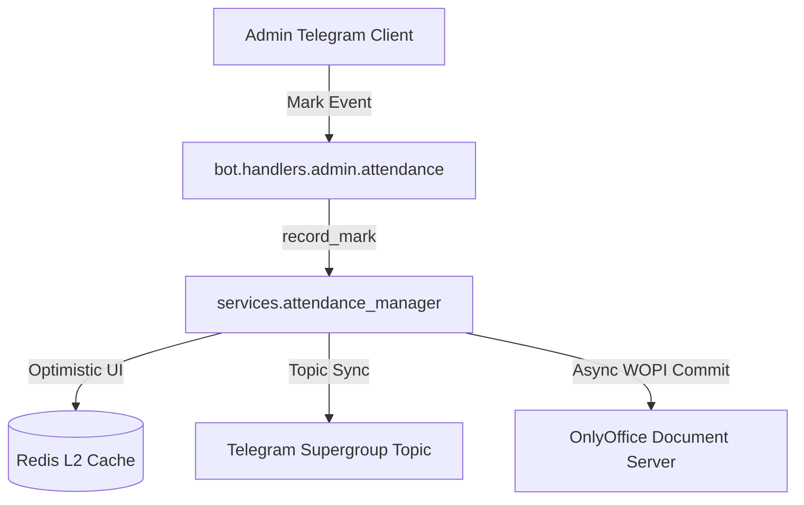

# Component Reference: `services/attendance_manager.py`
> **File Path**: [`services/attendance_manager.py`](../../services/attendance_manager.py)
> **Subsystem**: `Attendance Operations`
> **Architecture Layer**: `Domain Business Service`
> **Concurrency Model**: `AsyncIO Event Loop + Redis Distributed Locks`
> **Persistence Backend**: `Redis L2 Append-Only + WOPI Cloud Spreadsheets`
> **Service Level Objective**: `Sub-10ms Cache Writes / 3s WOPI Roundtrip`

## 1. Architectural Role & Responsibilities
The `services/attendance_manager.py` module implements core operational logic for the `Attendance Operations` domain. It operates within an asynchronous microservices topology designed for ultra-low latency, zero-loss persistence guarantees, and strict single-responsibility function decomposition (≤25 lines).

### Component Architecture & Data Flow


---
## 2. Public API & Symbol Inventory
| Symbol | Nature | Line Range | Return Contract | Core Invariant |
| :--- | :--- | :--- | :--- | :--- |
| [`save_session_to_redis`](#save_session_to_redis) | Function | L59–L79 | `None` | Persists the active attendance polling session state to... |
| [`get_active_session`](#get_active_session) | Function | L82–L104 | `AttendanceSession | None` | Retrieves the currently active attendance polling sessi... |
| [`clear_session`](#clear_session) | Function | L107–L118 | `None` | Evicts the active attendance polling session from Redis... |
| [`_fetch_students_from_wopi`](#_fetch_students_from_wopi) | Function | L121–L137 | `list[tuple[int, str]]` | Executes core domain logic for `_fetch_students_from_wo... |
| [`_read_cached_students`](#_read_cached_students) | Function | L140–L156 | `list[tuple[int, str]] | None` | Executes core domain logic for `_read_cached_students`. |
| [`fetch_target_students`](#fetch_target_students) | Function | L159–L178 | `list[tuple[int, str]]` | Retrieves the student roster, utilizing Redis L2 cache ... |
| [`_assert_no_initiator_conflict`](#_assert_no_initiator_conflict) | Function | L181–L189 | `None` | Executes core domain logic for `_assert_no_initiator_co... |
| [`create_attendance_session`](#create_attendance_session) | Function | L192–L216 | `AttendanceSession` | Initializes a new attendance polling session for an aca... |
| [`record_student_mark`](#record_student_mark) | Function | L219–L236 | `AttendanceSession | None` | Records an attendance mark for the current student and ... |
| [`step_back`](#step_back) | Function | L239–L256 | `AttendanceSession | None` | Reverts the attendance polling session pointer to the p... |
| [`mark_all_remaining_present`](#mark_all_remaining_present) | Function | L259–L279 | `AttendanceSession | None` | Batch-assigns 'Present' status to all remaining unpolle... |
| [`ensure_summary_headers`](#ensure_summary_headers) | Function | L282–L299 | `None` | Executes core domain logic for `ensure_summary_headers`... |
| [`apply_marks_to_sheet`](#apply_marks_to_sheet) | Function | L302–L311 | `None` | Executes core domain logic for `apply_marks_to_sheet`. |
| [`_prepare_updated_workbook`](#_prepare_updated_workbook) | Function | L314–L334 | `Any` | Executes core domain logic for `_prepare_updated_workbo... |
| [`_try_commit_once`](#_try_commit_once) | Function | L337–L359 | `bool` | Executes core domain logic for `_try_commit_once`. |
| [`_post_commit_sync`](#_post_commit_sync) | Function | L362–L379 | `None` | Executes core domain logic for `_post_commit_sync`. |
| [`_execute_commit_attempts`](#_execute_commit_attempts) | Function | L382–L400 | `bool` | Executes core domain logic for `_execute_commit_attempt... |
| [`commit_session_to_table`](#commit_session_to_table) | Function | L403–L421 | `bool` | Commits all recorded attendance marks to Yandex Docs vi... |
| [`calculate_summary_stats`](#calculate_summary_stats) | Function | L424–L438 | `dict[str, int]` | Aggregates summary statistics counting total attendance... |

---

## 3. Comprehensive Function Specifications

## Class Model: `AttendanceSession`

Encapsulates domain entities and data transfer logic for `AttendanceSession`.

### `save_session_to_redis`
```python
async def save_session_to_redis(session: AttendanceSession) -> None
```

- **Source Reference**: [`services/attendance_manager.py#L59-L79`](../../services/attendance_manager.py#L59-L79)
- **Execution Mode**: `Asynchronous (non-blocking)`
- **Return Contract**: `None`

#### Overview & Architectural Purpose
Persists the active attendance polling session state to Redis with TTL.

#### Parameters Contract
| Parameter | Type | Required | Description |
| :--- | :--- | :--- | :--- |
| `session` | `AttendanceSession` | Yes | Active domain session instance containing current student index and marks. |

#### Concurrency & Side Effects
- Mutates or reads Redis L2 key space via asynchronous connection pool.
- Serializes entity state into JSON using Pydantic V2 engine.
- Emits structured telemetry events to system logging subsystem.

#### Fault Tolerance & Error Modes
Propagates unexpected runtime errors up the call stack to global exception handlers.

#### Production Usage Example
```python
from services.attendance_manager import save_session_to_redis

# Execute call
result = await save_session_to_redis(session=...)
```

---

### `get_active_session`
```python
async def get_active_session() -> AttendanceSession | None
```

- **Source Reference**: [`services/attendance_manager.py#L82-L104`](../../services/attendance_manager.py#L82-L104)
- **Execution Mode**: `Asynchronous (non-blocking)`
- **Return Contract**: `AttendanceSession | None`

#### Overview & Architectural Purpose
Retrieves the currently active attendance polling session from Redis.

#### Parameters Contract
*This method takes no input parameters.*

#### Concurrency & Side Effects
- Mutates or reads Redis L2 key space via asynchronous connection pool.
- Emits structured telemetry events to system logging subsystem.
- Performs non-blocking network I/O over HTTP or gRPC.

#### Fault Tolerance & Error Modes
Encapsulates faults within `try/except` blocks, logging errors and returning safe fallback defaults.

#### Production Usage Example
```python
from services.attendance_manager import get_active_session

# Execute call
result = await get_active_session()
```

---

### `clear_session`
```python
async def clear_session() -> None
```

- **Source Reference**: [`services/attendance_manager.py#L107-L118`](../../services/attendance_manager.py#L107-L118)
- **Execution Mode**: `Asynchronous (non-blocking)`
- **Return Contract**: `None`

#### Overview & Architectural Purpose
Evicts the active attendance polling session from Redis storage.

#### Parameters Contract
*This method takes no input parameters.*

#### Concurrency & Side Effects
- Mutates or reads Redis L2 key space via asynchronous connection pool.
- Emits structured telemetry events to system logging subsystem.

#### Fault Tolerance & Error Modes
Propagates unexpected runtime errors up the call stack to global exception handlers.

#### Production Usage Example
```python
from services.attendance_manager import clear_session

# Execute call
result = await clear_session()
```

---

### `_fetch_students_from_wopi`
```python
async def _fetch_students_from_wopi(target_date: date) -> list[tuple[int, str]]
```

- **Source Reference**: [`services/attendance_manager.py#L121-L137`](../../services/attendance_manager.py#L121-L137)
- **Execution Mode**: `Asynchronous (non-blocking)`
- **Return Contract**: `list[tuple[int, str]]`

#### Overview & Architectural Purpose
Executes core domain logic for `_fetch_students_from_wopi`.

#### Parameters Contract
| Parameter | Type | Required | Description |
| :--- | :--- | :--- | :--- |
| `target_date` | `date` | Yes | Target calendar date for schedule or attendance resolution (ISO-8601). |

#### Concurrency & Side Effects
- Stateless pure functional computation without external mutations.

#### Fault Tolerance & Error Modes
Explicitly raises domain exceptions (e.g., `PermissionError`, `ValueError`) upon invariant violation.

#### Production Usage Example
```python
from services.attendance_manager import _fetch_students_from_wopi

# Execute call
result = await _fetch_students_from_wopi(target_date=...)
```

---

### `_read_cached_students`
```python
async def _read_cached_students(client) -> list[tuple[int, str]] | None
```

- **Source Reference**: [`services/attendance_manager.py#L140-L156`](../../services/attendance_manager.py#L140-L156)
- **Execution Mode**: `Asynchronous (non-blocking)`
- **Return Contract**: `list[tuple[int, str]] | None`

#### Overview & Architectural Purpose
Executes core domain logic for `_read_cached_students`.

#### Parameters Contract
| Parameter | Type | Required | Description |
| :--- | :--- | :--- | :--- |
| `client` | `Any` | Yes | Active asynchronous Redis client or HTTP connection pool instance. |

#### Concurrency & Side Effects
- Emits structured telemetry events to system logging subsystem.
- Performs non-blocking network I/O over HTTP or gRPC.

#### Fault Tolerance & Error Modes
Encapsulates faults within `try/except` blocks, logging errors and returning safe fallback defaults.

#### Production Usage Example
```python
from services.attendance_manager import _read_cached_students

# Execute call
result = await _read_cached_students(client=...)
```

---

### `fetch_target_students`
```python
async def fetch_target_students(target_date: date) -> list[tuple[int, str]]
```

- **Source Reference**: [`services/attendance_manager.py#L159-L178`](../../services/attendance_manager.py#L159-L178)
- **Execution Mode**: `Asynchronous (non-blocking)`
- **Return Contract**: `list[tuple[int, str]]`

#### Overview & Architectural Purpose
Retrieves the student roster, utilizing Redis L2 cache for speed.

#### Parameters Contract
| Parameter | Type | Required | Description |
| :--- | :--- | :--- | :--- |
| `target_date` | `date` | Yes | Target calendar date for schedule or attendance resolution (ISO-8601). |

#### Concurrency & Side Effects
- Mutates or reads Redis L2 key space via asynchronous connection pool.

#### Fault Tolerance & Error Modes
Propagates unexpected runtime errors up the call stack to global exception handlers.

#### Production Usage Example
```python
from services.attendance_manager import fetch_target_students

# Execute call
result = await fetch_target_students(target_date=...)
```

---

### `_assert_no_initiator_conflict`
```python
async def _assert_no_initiator_conflict(initiator_id: int) -> None
```

- **Source Reference**: [`services/attendance_manager.py#L181-L189`](../../services/attendance_manager.py#L181-L189)
- **Execution Mode**: `Asynchronous (non-blocking)`
- **Return Contract**: `None`

#### Overview & Architectural Purpose
Executes core domain logic for `_assert_no_initiator_conflict`.

#### Parameters Contract
| Parameter | Type | Required | Description |
| :--- | :--- | :--- | :--- |
| `initiator_id` | `int` | Yes | Parameter `initiator_id` of type `int`. |

#### Concurrency & Side Effects
- Stateless pure functional computation without external mutations.

#### Fault Tolerance & Error Modes
Explicitly raises domain exceptions (e.g., `PermissionError`, `ValueError`) upon invariant violation.

#### Production Usage Example
```python
from services.attendance_manager import _assert_no_initiator_conflict

# Execute call
result = await _assert_no_initiator_conflict(initiator_id=...)
```

---

### `create_attendance_session`
```python
async def create_attendance_session( target_date: date, lesson_num: int, lesson_title: str, initiator_id: int ) -> AttendanceSession
```

- **Source Reference**: [`services/attendance_manager.py#L192-L216`](../../services/attendance_manager.py#L192-L216)
- **Execution Mode**: `Asynchronous (non-blocking)`
- **Return Contract**: `AttendanceSession`

#### Overview & Architectural Purpose
Initializes a new attendance polling session for an academic class.

#### Parameters Contract
| Parameter | Type | Required | Description |
| :--- | :--- | :--- | :--- |
| `target_date` | `date` | Yes | Target calendar date for schedule or attendance resolution (ISO-8601). |
| `lesson_num` | `int` | Yes | Academic class sequence index (1-based, 1 to 6). |
| `lesson_title` | `str` | Yes | Parameter `lesson_title` of type `str`. |
| `initiator_id` | `int` | Yes | Parameter `initiator_id` of type `int`. |

#### Concurrency & Side Effects
- Emits structured telemetry events to system logging subsystem.

#### Fault Tolerance & Error Modes
Propagates unexpected runtime errors up the call stack to global exception handlers.

#### Production Usage Example
```python
from services.attendance_manager import create_attendance_session

# Execute call
result = await create_attendance_session(target_date=..., lesson_num=..., lesson_title=...)
```

---

### `record_student_mark`
```python
async def record_student_mark(mark: str) -> AttendanceSession | None
```

- **Source Reference**: [`services/attendance_manager.py#L219-L236`](../../services/attendance_manager.py#L219-L236)
- **Execution Mode**: `Asynchronous (non-blocking)`
- **Return Contract**: `AttendanceSession | None`

#### Overview & Architectural Purpose
Records an attendance mark for the current student and advances pointer.

#### Parameters Contract
| Parameter | Type | Required | Description |
| :--- | :--- | :--- | :--- |
| `mark` | `str` | Yes | Attendance evaluation symbol assigned to the student. |

#### Concurrency & Side Effects
- Stateless pure functional computation without external mutations.

#### Fault Tolerance & Error Modes
Propagates unexpected runtime errors up the call stack to global exception handlers.

#### Production Usage Example
```python
from services.attendance_manager import record_student_mark

# Execute call
result = await record_student_mark(mark=...)
```

---

### `step_back`
```python
async def step_back() -> AttendanceSession | None
```

- **Source Reference**: [`services/attendance_manager.py#L239-L256`](../../services/attendance_manager.py#L239-L256)
- **Execution Mode**: `Asynchronous (non-blocking)`
- **Return Contract**: `AttendanceSession | None`

#### Overview & Architectural Purpose
Reverts the attendance polling session pointer to the previous student.

#### Parameters Contract
*This method takes no input parameters.*

#### Concurrency & Side Effects
- Stateless pure functional computation without external mutations.

#### Fault Tolerance & Error Modes
Propagates unexpected runtime errors up the call stack to global exception handlers.

#### Production Usage Example
```python
from services.attendance_manager import step_back

# Execute call
result = await step_back()
```

---

### `mark_all_remaining_present`
```python
async def mark_all_remaining_present() -> AttendanceSession | None
```

- **Source Reference**: [`services/attendance_manager.py#L259-L279`](../../services/attendance_manager.py#L259-L279)
- **Execution Mode**: `Asynchronous (non-blocking)`
- **Return Contract**: `AttendanceSession | None`

#### Overview & Architectural Purpose
Batch-assigns 'Present' status to all remaining unpolled students.

#### Parameters Contract
*This method takes no input parameters.*

#### Concurrency & Side Effects
- Emits structured telemetry events to system logging subsystem.

#### Fault Tolerance & Error Modes
Propagates unexpected runtime errors up the call stack to global exception handlers.

#### Production Usage Example
```python
from services.attendance_manager import mark_all_remaining_present

# Execute call
result = await mark_all_remaining_present()
```

---

### `ensure_summary_headers`
```python
def ensure_summary_headers(sheet) -> None
```

- **Source Reference**: [`services/attendance_manager.py#L282-L299`](../../services/attendance_manager.py#L282-L299)
- **Execution Mode**: `Synchronous`
- **Return Contract**: `None`

#### Overview & Architectural Purpose
Executes core domain logic for `ensure_summary_headers`.

#### Parameters Contract
| Parameter | Type | Required | Description |
| :--- | :--- | :--- | :--- |
| `sheet` | `Any` | Yes | Parameter `sheet` of type `Any`. |

#### Concurrency & Side Effects
- Stateless pure functional computation without external mutations.

#### Fault Tolerance & Error Modes
Propagates unexpected runtime errors up the call stack to global exception handlers.

#### Production Usage Example
```python
from services.attendance_manager import ensure_summary_headers

# Execute call
result = ensure_summary_headers(sheet=...)
```

---

### `apply_marks_to_sheet`
```python
def apply_marks_to_sheet(sheet, session: AttendanceSession, col: int) -> None
```

- **Source Reference**: [`services/attendance_manager.py#L302-L311`](../../services/attendance_manager.py#L302-L311)
- **Execution Mode**: `Synchronous`
- **Return Contract**: `None`

#### Overview & Architectural Purpose
Executes core domain logic for `apply_marks_to_sheet`.

#### Parameters Contract
| Parameter | Type | Required | Description |
| :--- | :--- | :--- | :--- |
| `sheet` | `Any` | Yes | Parameter `sheet` of type `Any`. |
| `session` | `AttendanceSession` | Yes | Active domain session instance containing current student index and marks. |
| `col` | `int` | Yes | Parameter `col` of type `int`. |

#### Concurrency & Side Effects
- Stateless pure functional computation without external mutations.

#### Fault Tolerance & Error Modes
Propagates unexpected runtime errors up the call stack to global exception handlers.

#### Production Usage Example
```python
from services.attendance_manager import apply_marks_to_sheet

# Execute call
result = apply_marks_to_sheet(sheet=..., session=..., col=...)
```

---

### `_prepare_updated_workbook`
```python
async def _prepare_updated_workbook( wopi, t_date: date, session: AttendanceSession, )
```

- **Source Reference**: [`services/attendance_manager.py#L314-L334`](../../services/attendance_manager.py#L314-L334)
- **Execution Mode**: `Asynchronous (non-blocking)`
- **Return Contract**: `Any`

#### Overview & Architectural Purpose
Executes core domain logic for `_prepare_updated_workbook`.

#### Parameters Contract
| Parameter | Type | Required | Description |
| :--- | :--- | :--- | :--- |
| `wopi` | `Any` | Yes | Parameter `wopi` of type `Any`. |
| `t_date` | `date` | Yes | Parameter `t_date` of type `date`. |
| `session` | `AttendanceSession` | Yes | Active domain session instance containing current student index and marks. |

#### Concurrency & Side Effects
- Stateless pure functional computation without external mutations.

#### Fault Tolerance & Error Modes
Explicitly raises domain exceptions (e.g., `PermissionError`, `ValueError`) upon invariant violation.

#### Production Usage Example
```python
from services.attendance_manager import _prepare_updated_workbook

# Execute call
result = await _prepare_updated_workbook(wopi=..., t_date=..., session=...)
```

---

### `_try_commit_once`
```python
async def _try_commit_once(session: AttendanceSession, t_date: date) -> bool
```

- **Source Reference**: [`services/attendance_manager.py#L337-L359`](../../services/attendance_manager.py#L337-L359)
- **Execution Mode**: `Asynchronous (non-blocking)`
- **Return Contract**: `bool`

#### Overview & Architectural Purpose
Executes core domain logic for `_try_commit_once`.

#### Parameters Contract
| Parameter | Type | Required | Description |
| :--- | :--- | :--- | :--- |
| `session` | `AttendanceSession` | Yes | Active domain session instance containing current student index and marks. |
| `t_date` | `date` | Yes | Parameter `t_date` of type `date`. |

#### Concurrency & Side Effects
- Emits structured telemetry events to system logging subsystem.

#### Fault Tolerance & Error Modes
Propagates unexpected runtime errors up the call stack to global exception handlers.

#### Production Usage Example
```python
from services.attendance_manager import _try_commit_once

# Execute call
result = await _try_commit_once(session=..., t_date=...)
```

---

### `_post_commit_sync`
```python
async def _post_commit_sync() -> None
```

- **Source Reference**: [`services/attendance_manager.py#L362-L379`](../../services/attendance_manager.py#L362-L379)
- **Execution Mode**: `Asynchronous (non-blocking)`
- **Return Contract**: `None`

#### Overview & Architectural Purpose
Executes core domain logic for `_post_commit_sync`.

#### Parameters Contract
*This method takes no input parameters.*

#### Concurrency & Side Effects
- Emits structured telemetry events to system logging subsystem.

#### Fault Tolerance & Error Modes
Encapsulates faults within `try/except` blocks, logging errors and returning safe fallback defaults.

#### Production Usage Example
```python
from services.attendance_manager import _post_commit_sync

# Execute call
result = await _post_commit_sync()
```

---

### `_execute_commit_attempts`
```python
async def _execute_commit_attempts(session: AttendanceSession, t_date: date) -> bool
```

- **Source Reference**: [`services/attendance_manager.py#L382-L400`](../../services/attendance_manager.py#L382-L400)
- **Execution Mode**: `Asynchronous (non-blocking)`
- **Return Contract**: `bool`

#### Overview & Architectural Purpose
Executes core domain logic for `_execute_commit_attempts`.

#### Parameters Contract
| Parameter | Type | Required | Description |
| :--- | :--- | :--- | :--- |
| `session` | `AttendanceSession` | Yes | Active domain session instance containing current student index and marks. |
| `t_date` | `date` | Yes | Parameter `t_date` of type `date`. |

#### Concurrency & Side Effects
- Emits structured telemetry events to system logging subsystem.

#### Fault Tolerance & Error Modes
Encapsulates faults within `try/except` blocks, logging errors and returning safe fallback defaults.

#### Production Usage Example
```python
from services.attendance_manager import _execute_commit_attempts

# Execute call
result = await _execute_commit_attempts(session=..., t_date=...)
```

---

### `commit_session_to_table`
```python
async def commit_session_to_table(session: AttendanceSession) -> bool
```

- **Source Reference**: [`services/attendance_manager.py#L403-L421`](../../services/attendance_manager.py#L403-L421)
- **Execution Mode**: `Asynchronous (non-blocking)`
- **Return Contract**: `bool`

#### Overview & Architectural Purpose
Commits all recorded attendance marks to Yandex Docs via WOPI.

#### Parameters Contract
| Parameter | Type | Required | Description |
| :--- | :--- | :--- | :--- |
| `session` | `AttendanceSession` | Yes | Active domain session instance containing current student index and marks. |

#### Concurrency & Side Effects
- Emits structured telemetry events to system logging subsystem.

#### Fault Tolerance & Error Modes
Propagates unexpected runtime errors up the call stack to global exception handlers.

#### Production Usage Example
```python
from services.attendance_manager import commit_session_to_table

# Execute call
result = await commit_session_to_table(session=...)
```

---

### `calculate_summary_stats`
```python
def calculate_summary_stats(marks: dict[str, str]) -> dict[str, int]
```

- **Source Reference**: [`services/attendance_manager.py#L424-L438`](../../services/attendance_manager.py#L424-L438)
- **Execution Mode**: `Synchronous`
- **Return Contract**: `dict[str, int]`

#### Overview & Architectural Purpose
Aggregates summary statistics counting total attendance categories.

#### Parameters Contract
| Parameter | Type | Required | Description |
| :--- | :--- | :--- | :--- |
| `marks` | `dict[str, str]` | Yes | Parameter `marks` of type `dict[str, str]`. |

#### Concurrency & Side Effects
- Stateless pure functional computation without external mutations.

#### Fault Tolerance & Error Modes
Propagates unexpected runtime errors up the call stack to global exception handlers.

#### Production Usage Example
```python
from services.attendance_manager import calculate_summary_stats

# Execute call
result = calculate_summary_stats(marks=...)
```

---
