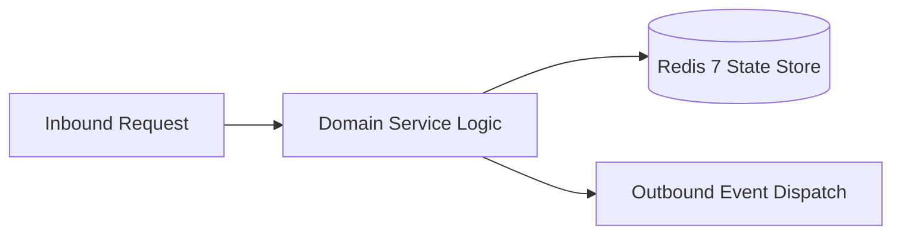

# Component Reference: `services/attendance_stats.py`
> **File Path**: [`services/attendance_stats.py`](../../services/attendance_stats.py)  
> **Subsystem**: `Spreadsheet Analytics`  
> **Architecture Layer**: `Enterprise Microservice Subsystem`  
> **Concurrency Model**: `AsyncIO Non-blocking Concurrency`  
> **Persistence Backend**: `Redis 7 Persistent Store`  
> **Service Level Objective**: `High-Availability Academic Telemetry`

## 1. Architectural Role & Responsibilities
The `services/attendance_stats.py` module implements core operational logic for the `Spreadsheet Analytics` domain. It operates within an asynchronous microservices topology designed for ultra-low latency, zero-loss persistence guarantees, and strict single-responsibility function decomposition (≤25 lines).

### Component Architecture & Data Flow


---
## 2. Public API & Symbol Inventory
| Symbol | Nature | Line Range | Return Contract | Core Invariant |
| :--- | :--- | :--- | :--- | :--- |
| [`_init_student_stat`](#_init_student_stat) | Function | L38–L51 | `dict[str, Any]` | Executes core domain logic for `_init_student_stat`. |
| [`_count_row_marks`](#_count_row_marks) | Function | L54–L71 | `dict[str, int]` | Executes core domain logic for `_count_row_marks`. |
| [`_process_student_row`](#_process_student_row) | Function | L74–L96 | `None` | Executes core domain logic for `_process_student_row`. |
| [`_aggregate_sheet_stats`](#_aggregate_sheet_stats) | Function | L99–L112 | `None` | Executes core domain logic for `_aggregate_sheet_stats`... |
| [`parse_workbook_attendance`](#parse_workbook_attendance) | Function | L115–L131 | `dict[str, dict[str, Any]]` | Parses and extracts structured entities from `parse_wor... |
| [`_load_from_redis_cache`](#_load_from_redis_cache) | Function | L134–L150 | `dict[str, dict[str, Any]] | None` | Executes core domain logic for `_load_from_redis_cache`... |
| [`_save_to_redis_cache`](#_save_to_redis_cache) | Function | L153–L167 | `None` | Executes core domain logic for `_save_to_redis_cache`. |
| [`invalidate_attendance_stats_cache`](#invalidate_attendance_stats_cache) | Function | L170–L180 | `None` | Executes core domain logic for `invalidate_attendance_s... |
| [`fetch_all_time_attendance`](#fetch_all_time_attendance) | Function | L183–L203 | `dict[str, dict[str, Any]]` | Executes core domain logic for `fetch_all_time_attendan... |
| [`find_student_attendance`](#find_student_attendance) | Function | L206–L228 | `dict[str, Any] | None` | Executes core domain logic for `find_student_attendance... |
| [`_adjust_student_counts`](#_adjust_student_counts) | Function | L231–L244 | `None` | Executes core domain logic for `_adjust_student_counts`... |
| [`_get_saved_lesson_marks`](#_get_saved_lesson_marks) | Function | L247–L261 | `dict[str, str]` | Executes core domain logic for `_get_saved_lesson_marks... |
| [`_save_lesson_marks`](#_save_lesson_marks) | Function | L264–L273 | `None` | Executes core domain logic for `_save_lesson_marks`. |
| [`_update_session_marks_in_stats`](#_update_session_marks_in_stats) | Function | L276–L294 | `dict[str, str]` | Executes core domain logic for `_update_session_marks_i... |
| [`apply_session_optimistic_update`](#apply_session_optimistic_update) | Function | L297–L312 | `dict[str, dict[str, Any]]` | Executes core domain logic for `apply_session_optimisti... |

---

## 3. Comprehensive Function Specifications

### `_init_student_stat`
```python
def _init_student_stat(fio: str) -> dict[str, Any]
```

- **Source Reference**: [`services/attendance_stats.py#L38-L51`](../../services/attendance_stats.py#L38-L51)
- **Execution Mode**: `Synchronous`
- **Return Contract**: `dict[str, Any]`

#### Overview & Architectural Purpose
Executes core domain logic for `_init_student_stat`.

#### Parameters Contract
| Parameter | Type | Required | Description |
| :--- | :--- | :--- | :--- |
| `fio` | `str` | Yes | Full canonical name of the student in Cyrillic nominative format. |

#### Concurrency & Side Effects
- Stateless pure functional computation without external mutations.

#### Fault Tolerance & Error Modes
Propagates unexpected runtime errors up the call stack to global exception handlers.

#### Production Usage Example
```python
from services.attendance_stats import _init_student_stat

# Execute call
result = _init_student_stat(fio=...)
```

---

### `_count_row_marks`
```python
def _count_row_marks(sheet: Worksheet, row: int, mc: int) -> dict[str, int]
```

- **Source Reference**: [`services/attendance_stats.py#L54-L71`](../../services/attendance_stats.py#L54-L71)
- **Execution Mode**: `Synchronous`
- **Return Contract**: `dict[str, int]`

#### Overview & Architectural Purpose
Executes core domain logic for `_count_row_marks`.

#### Parameters Contract
| Parameter | Type | Required | Description |
| :--- | :--- | :--- | :--- |
| `sheet` | `Worksheet` | Yes | Parameter `sheet` of type `Worksheet`. |
| `row` | `int` | Yes | Parameter `row` of type `int`. |
| `mc` | `int` | Yes | Parameter `mc` of type `int`. |

#### Concurrency & Side Effects
- Stateless pure functional computation without external mutations.

#### Fault Tolerance & Error Modes
Propagates unexpected runtime errors up the call stack to global exception handlers.

#### Production Usage Example
```python
from services.attendance_stats import _count_row_marks

# Execute call
result = _count_row_marks(sheet=..., row=..., mc=...)
```

---

### `_process_student_row`
```python
def _process_student_row( sheet: Worksheet, r: int, mc: int, s_name: str, stats: dict[str, dict[str, Any]] ) -> None
```

- **Source Reference**: [`services/attendance_stats.py#L74-L96`](../../services/attendance_stats.py#L74-L96)
- **Execution Mode**: `Synchronous`
- **Return Contract**: `None`

#### Overview & Architectural Purpose
Executes core domain logic for `_process_student_row`.

#### Parameters Contract
| Parameter | Type | Required | Description |
| :--- | :--- | :--- | :--- |
| `sheet` | `Worksheet` | Yes | Parameter `sheet` of type `Worksheet`. |
| `r` | `int` | Yes | Parameter `r` of type `int`. |
| `mc` | `int` | Yes | Parameter `mc` of type `int`. |
| `s_name` | `str` | Yes | Parameter `s_name` of type `str`. |
| `stats` | `dict[str, dict[str, Any]]` | Yes | Parameter `stats` of type `dict[str, dict[str, Any]]`. |

#### Concurrency & Side Effects
- Stateless pure functional computation without external mutations.

#### Fault Tolerance & Error Modes
Propagates unexpected runtime errors up the call stack to global exception handlers.

#### Production Usage Example
```python
from services.attendance_stats import _process_student_row

# Execute call
result = _process_student_row(sheet=..., r=..., mc=...)
```

---

### `_aggregate_sheet_stats`
```python
def _aggregate_sheet_stats( sheet: Worksheet, s_name: str, stats: dict[str, dict[str, Any]] ) -> None
```

- **Source Reference**: [`services/attendance_stats.py#L99-L112`](../../services/attendance_stats.py#L99-L112)
- **Execution Mode**: `Synchronous`
- **Return Contract**: `None`

#### Overview & Architectural Purpose
Executes core domain logic for `_aggregate_sheet_stats`.

#### Parameters Contract
| Parameter | Type | Required | Description |
| :--- | :--- | :--- | :--- |
| `sheet` | `Worksheet` | Yes | Parameter `sheet` of type `Worksheet`. |
| `s_name` | `str` | Yes | Parameter `s_name` of type `str`. |
| `stats` | `dict[str, dict[str, Any]]` | Yes | Parameter `stats` of type `dict[str, dict[str, Any]]`. |

#### Concurrency & Side Effects
- Stateless pure functional computation without external mutations.

#### Fault Tolerance & Error Modes
Propagates unexpected runtime errors up the call stack to global exception handlers.

#### Production Usage Example
```python
from services.attendance_stats import _aggregate_sheet_stats

# Execute call
result = _aggregate_sheet_stats(sheet=..., s_name=..., stats=...)
```

---

### `parse_workbook_attendance`
```python
def parse_workbook_attendance(wb: openpyxl.Workbook) -> dict[str, dict[str, Any]]
```

- **Source Reference**: [`services/attendance_stats.py#L115-L131`](../../services/attendance_stats.py#L115-L131)
- **Execution Mode**: `Synchronous`
- **Return Contract**: `dict[str, dict[str, Any]]`

#### Overview & Architectural Purpose
Parses and extracts structured entities from `parse_workbook_attendance`.

#### Parameters Contract
| Parameter | Type | Required | Description |
| :--- | :--- | :--- | :--- |
| `wb` | `openpyxl.Workbook` | Yes | Openpyxl workbook instance containing academic attendance sheets. |

#### Concurrency & Side Effects
- Emits structured telemetry events to system logging subsystem.

#### Fault Tolerance & Error Modes
Propagates unexpected runtime errors up the call stack to global exception handlers.

#### Production Usage Example
```python
from services.attendance_stats import parse_workbook_attendance

# Execute call
result = parse_workbook_attendance(wb=...)
```

---

### `_load_from_redis_cache`
```python
async def _load_from_redis_cache() -> dict[str, dict[str, Any]] | None
```

- **Source Reference**: [`services/attendance_stats.py#L134-L150`](../../services/attendance_stats.py#L134-L150)
- **Execution Mode**: `Asynchronous (non-blocking)`
- **Return Contract**: `dict[str, dict[str, Any]] | None`

#### Overview & Architectural Purpose
Executes core domain logic for `_load_from_redis_cache`.

#### Parameters Contract
*This method takes no input parameters.*

#### Concurrency & Side Effects
- Emits structured telemetry events to system logging subsystem.

#### Fault Tolerance & Error Modes
Encapsulates faults within `try/except` blocks, logging errors and returning safe fallback defaults.

#### Production Usage Example
```python
from services.attendance_stats import _load_from_redis_cache

# Execute call
result = await _load_from_redis_cache()
```

---

### `_save_to_redis_cache`
```python
async def _save_to_redis_cache(stats: dict[str, dict[str, Any]]) -> None
```

- **Source Reference**: [`services/attendance_stats.py#L153-L167`](../../services/attendance_stats.py#L153-L167)
- **Execution Mode**: `Asynchronous (non-blocking)`
- **Return Contract**: `None`

#### Overview & Architectural Purpose
Executes core domain logic for `_save_to_redis_cache`.

#### Parameters Contract
| Parameter | Type | Required | Description |
| :--- | :--- | :--- | :--- |
| `stats` | `dict[str, dict[str, Any]]` | Yes | Parameter `stats` of type `dict[str, dict[str, Any]]`. |

#### Concurrency & Side Effects
- Emits structured telemetry events to system logging subsystem.

#### Fault Tolerance & Error Modes
Encapsulates faults within `try/except` blocks, logging errors and returning safe fallback defaults.

#### Production Usage Example
```python
from services.attendance_stats import _save_to_redis_cache

# Execute call
result = await _save_to_redis_cache(stats=...)
```

---

### `invalidate_attendance_stats_cache`
```python
async def invalidate_attendance_stats_cache() -> None
```

- **Source Reference**: [`services/attendance_stats.py#L170-L180`](../../services/attendance_stats.py#L170-L180)
- **Execution Mode**: `Asynchronous (non-blocking)`
- **Return Contract**: `None`

#### Overview & Architectural Purpose
Executes core domain logic for `invalidate_attendance_stats_cache`.

#### Parameters Contract
*This method takes no input parameters.*

#### Concurrency & Side Effects
- Emits structured telemetry events to system logging subsystem.

#### Fault Tolerance & Error Modes
Propagates unexpected runtime errors up the call stack to global exception handlers.

#### Production Usage Example
```python
from services.attendance_stats import invalidate_attendance_stats_cache

# Execute call
result = await invalidate_attendance_stats_cache()
```

---

### `fetch_all_time_attendance`
```python
async def fetch_all_time_attendance( force_refresh: bool = False ) -> dict[str, dict[str, Any]]
```

- **Source Reference**: [`services/attendance_stats.py#L183-L203`](../../services/attendance_stats.py#L183-L203)
- **Execution Mode**: `Asynchronous (non-blocking)`
- **Return Contract**: `dict[str, dict[str, Any]]`

#### Overview & Architectural Purpose
Executes core domain logic for `fetch_all_time_attendance`.

#### Parameters Contract
| Parameter | Type | Required | Description |
| :--- | :--- | :--- | :--- |
| `force_refresh` | `bool` | Yes | Parameter `force_refresh` of type `bool`. |

#### Concurrency & Side Effects
- Emits structured telemetry events to system logging subsystem.

#### Fault Tolerance & Error Modes
Propagates unexpected runtime errors up the call stack to global exception handlers.

#### Production Usage Example
```python
from services.attendance_stats import fetch_all_time_attendance

# Execute call
result = await fetch_all_time_attendance(force_refresh=...)
```

---

### `find_student_attendance`
```python
def find_student_attendance( stats: dict[str, dict[str, Any]], target_name: str ) -> dict[str, Any] | None
```

- **Source Reference**: [`services/attendance_stats.py#L206-L228`](../../services/attendance_stats.py#L206-L228)
- **Execution Mode**: `Synchronous`
- **Return Contract**: `dict[str, Any] | None`

#### Overview & Architectural Purpose
Executes core domain logic for `find_student_attendance`.

#### Parameters Contract
| Parameter | Type | Required | Description |
| :--- | :--- | :--- | :--- |
| `stats` | `dict[str, dict[str, Any]]` | Yes | Parameter `stats` of type `dict[str, dict[str, Any]]`. |
| `target_name` | `str` | Yes | Parameter `target_name` of type `str`. |

#### Concurrency & Side Effects
- Stateless pure functional computation without external mutations.

#### Fault Tolerance & Error Modes
Propagates unexpected runtime errors up the call stack to global exception handlers.

#### Production Usage Example
```python
from services.attendance_stats import find_student_attendance

# Execute call
result = find_student_attendance(stats=..., target_name=...)
```

---

### `_adjust_student_counts`
```python
def _adjust_student_counts(stat: dict[str, Any], old_mark: str | None, new_mark: str) -> None
```

- **Source Reference**: [`services/attendance_stats.py#L231-L244`](../../services/attendance_stats.py#L231-L244)
- **Execution Mode**: `Synchronous`
- **Return Contract**: `None`

#### Overview & Architectural Purpose
Executes core domain logic for `_adjust_student_counts`.

#### Parameters Contract
| Parameter | Type | Required | Description |
| :--- | :--- | :--- | :--- |
| `stat` | `dict[str, Any]` | Yes | Parameter `stat` of type `dict[str, Any]`. |
| `old_mark` | `str | None` | Yes | Parameter `old_mark` of type `str | None`. |
| `new_mark` | `str` | Yes | Parameter `new_mark` of type `str`. |

#### Concurrency & Side Effects
- Stateless pure functional computation without external mutations.

#### Fault Tolerance & Error Modes
Propagates unexpected runtime errors up the call stack to global exception handlers.

#### Production Usage Example
```python
from services.attendance_stats import _adjust_student_counts

# Execute call
result = _adjust_student_counts(stat=..., old_mark=..., new_mark=...)
```

---

### `_get_saved_lesson_marks`
```python
async def _get_saved_lesson_marks(t_date: str, l_num: int) -> dict[str, str]
```

- **Source Reference**: [`services/attendance_stats.py#L247-L261`](../../services/attendance_stats.py#L247-L261)
- **Execution Mode**: `Asynchronous (non-blocking)`
- **Return Contract**: `dict[str, str]`

#### Overview & Architectural Purpose
Executes core domain logic for `_get_saved_lesson_marks`.

#### Parameters Contract
| Parameter | Type | Required | Description |
| :--- | :--- | :--- | :--- |
| `t_date` | `str` | Yes | Parameter `t_date` of type `str`. |
| `l_num` | `int` | Yes | Parameter `l_num` of type `int`. |

#### Concurrency & Side Effects
- Stateless pure functional computation without external mutations.

#### Fault Tolerance & Error Modes
Encapsulates faults within `try/except` blocks, logging errors and returning safe fallback defaults.

#### Production Usage Example
```python
from services.attendance_stats import _get_saved_lesson_marks

# Execute call
result = await _get_saved_lesson_marks(t_date=..., l_num=...)
```

---

### `_save_lesson_marks`
```python
async def _save_lesson_marks(t_date: str, l_num: int, marks: dict[str, str]) -> None
```

- **Source Reference**: [`services/attendance_stats.py#L264-L273`](../../services/attendance_stats.py#L264-L273)
- **Execution Mode**: `Asynchronous (non-blocking)`
- **Return Contract**: `None`

#### Overview & Architectural Purpose
Executes core domain logic for `_save_lesson_marks`.

#### Parameters Contract
| Parameter | Type | Required | Description |
| :--- | :--- | :--- | :--- |
| `t_date` | `str` | Yes | Parameter `t_date` of type `str`. |
| `l_num` | `int` | Yes | Parameter `l_num` of type `int`. |
| `marks` | `dict[str, str]` | Yes | Parameter `marks` of type `dict[str, str]`. |

#### Concurrency & Side Effects
- Stateless pure functional computation without external mutations.

#### Fault Tolerance & Error Modes
Propagates unexpected runtime errors up the call stack to global exception handlers.

#### Production Usage Example
```python
from services.attendance_stats import _save_lesson_marks

# Execute call
result = await _save_lesson_marks(t_date=..., l_num=..., marks=...)
```

---

### `_update_session_marks_in_stats`
```python
def _update_session_marks_in_stats( session: Any, saved_marks: dict[str, str], stats: dict[str, dict[str, Any]] ) -> dict[str, str]
```

- **Source Reference**: [`services/attendance_stats.py#L276-L294`](../../services/attendance_stats.py#L276-L294)
- **Execution Mode**: `Synchronous`
- **Return Contract**: `dict[str, str]`

#### Overview & Architectural Purpose
Executes core domain logic for `_update_session_marks_in_stats`.

#### Parameters Contract
| Parameter | Type | Required | Description |
| :--- | :--- | :--- | :--- |
| `session` | `Any` | Yes | Active domain session instance containing current student index and marks. |
| `saved_marks` | `dict[str, str]` | Yes | Parameter `saved_marks` of type `dict[str, str]`. |
| `stats` | `dict[str, dict[str, Any]]` | Yes | Parameter `stats` of type `dict[str, dict[str, Any]]`. |

#### Concurrency & Side Effects
- Stateless pure functional computation without external mutations.

#### Fault Tolerance & Error Modes
Propagates unexpected runtime errors up the call stack to global exception handlers.

#### Production Usage Example
```python
from services.attendance_stats import _update_session_marks_in_stats

# Execute call
result = _update_session_marks_in_stats(session=..., saved_marks=..., stats=...)
```

---

### `apply_session_optimistic_update`
```python
async def apply_session_optimistic_update(session: Any) -> dict[str, dict[str, Any]]
```

- **Source Reference**: [`services/attendance_stats.py#L297-L312`](../../services/attendance_stats.py#L297-L312)
- **Execution Mode**: `Asynchronous (non-blocking)`
- **Return Contract**: `dict[str, dict[str, Any]]`

#### Overview & Architectural Purpose
Executes core domain logic for `apply_session_optimistic_update`.

#### Parameters Contract
| Parameter | Type | Required | Description |
| :--- | :--- | :--- | :--- |
| `session` | `Any` | Yes | Active domain session instance containing current student index and marks. |

#### Concurrency & Side Effects
- Emits structured telemetry events to system logging subsystem.

#### Fault Tolerance & Error Modes
Propagates unexpected runtime errors up the call stack to global exception handlers.

#### Production Usage Example
```python
from services.attendance_stats import apply_session_optimistic_update

# Execute call
result = await apply_session_optimistic_update(session=...)
```

---
