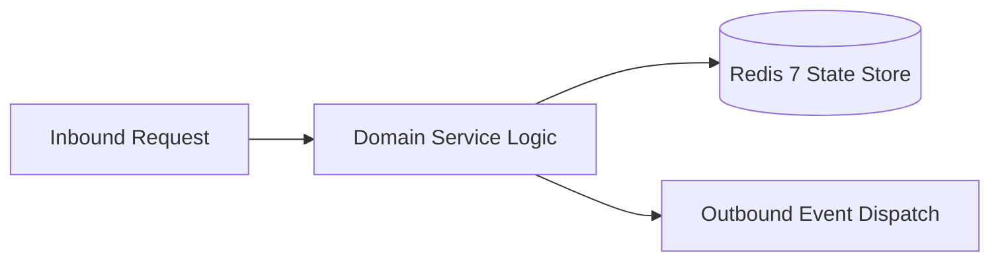

# Component Reference: `services/attendance_topic_updater.py`
> **File Path**: [`services/attendance_topic_updater.py`](../../services/attendance_topic_updater.py)  
> **Subsystem**: `Telemetry Topic`  
> **Architecture Layer**: `Enterprise Microservice Subsystem`  
> **Concurrency Model**: `AsyncIO Non-blocking Concurrency`  
> **Persistence Backend**: `Redis 7 Persistent Store`  
> **Service Level Objective**: `High-Availability Academic Telemetry`

## 1. Architectural Role & Responsibilities
The `services/attendance_topic_updater.py` module implements core operational logic for the `Telemetry Topic` domain. It operates within an asynchronous microservices topology designed for ultra-low latency, zero-loss persistence guarantees, and strict single-responsibility function decomposition (≤25 lines).

### Component Architecture & Data Flow


---
## 2. Public API & Symbol Inventory
| Symbol | Nature | Line Range | Return Contract | Core Invariant |
| :--- | :--- | :--- | :--- | :--- |
| [`load_attendance_topic_state`](#load_attendance_topic_state) | Function | L37–L47 | `int | None` | Executes core domain logic for `load_attendance_topic_s... |
| [`save_attendance_topic_state`](#save_attendance_topic_state) | Function | L50–L58 | `None` | Saves serialized entity data to storage for `save_atten... |
| [`make_progress_bar`](#make_progress_bar) | Function | L61–L71 | `str` | Executes core domain logic for `make_progress_bar`. |
| [`extract_short_fio`](#extract_short_fio) | Function | L74–L87 | `str` | Executes core domain logic for `extract_short_fio`. |
| [`_build_student_item`](#_build_student_item) | Function | L90–L113 | `dict[str, Any]` | Executes core domain logic for `_build_student_item`. |
| [`_build_compact_topic_header`](#_build_compact_topic_header) | Function | L116–L130 | `str` | Executes core domain logic for `_build_compact_topic_he... |
| [`_decline_absence`](#_decline_absence) | Function | L133–L150 | `str` | Executes core domain logic for `_decline_absence`. |
| [`_format_debt_details`](#_format_debt_details) | Function | L153–L168 | `str` | Executes core domain logic for `_format_debt_details`. |
| [`_format_debt_student`](#_format_debt_student) | Function | L171–L189 | `str` | Executes core domain logic for `_format_debt_student`. |
| [`_format_perfect_student`](#_format_perfect_student) | Function | L192–L205 | `str` | Executes core domain logic for `_format_perfect_student... |
| [`_build_topic_footer`](#_build_topic_footer) | Function | L208–L220 | `str` | Executes core domain logic for `_build_topic_footer`. |
| [`_group_students_by_debts`](#_group_students_by_debts) | Function | L223–L235 | `tuple[list[dict], list[dict]]` | Executes core domain logic for `_group_students_by_debt... |
| [`_build_topic_body_lines`](#_build_topic_body_lines) | Function | L238–L251 | `list[str]` | Executes core domain logic for `_build_topic_body_lines... |
| [`format_attendance_topic_message`](#format_attendance_topic_message) | Function | L254–L274 | `str` | Formats message payload and presentation markup for `fo... |
| [`_pin_attendance_silently`](#_pin_attendance_silently) | Function | L277–L292 | `None` | Executes core domain logic for `_pin_attendance_silentl... |
| [`create_attendance_message`](#create_attendance_message) | Function | L295–L312 | `int` | Initializes and constructs a new instance of `create_at... |
| [`handle_attendance_edit_error`](#handle_attendance_edit_error) | Function | L315–L337 | `bool` | Executes core domain logic for `handle_attendance_edit_... |
| [`_edit_attendance_msg`](#_edit_attendance_msg) | Function | L340–L352 | `bool` | Executes core domain logic for `_edit_attendance_msg`. |
| [`send_or_edit_attendance_msg`](#send_or_edit_attendance_msg) | Function | L355–L375 | `bool` | Dispatches notification message via Telegram API for `s... |
| [`_delete_old_attendance_msg`](#_delete_old_attendance_msg) | Function | L378–L391 | `None` | Executes core domain logic for `_delete_old_attendance_... |
| [`recreate_attendance_topic_message`](#recreate_attendance_topic_message) | Function | L394–L410 | `bool` | Executes core domain logic for `recreate_attendance_top... |
| [`sync_attendance_topic_message`](#sync_attendance_topic_message) | Function | L413–L437 | `bool` | Executes core domain logic for `sync_attendance_topic_m... |
| [`_get_attendance_sync_sleep_seconds`](#_get_attendance_sync_sleep_seconds) | Function | L440–L453 | `int` | Executes core domain logic for `_get_attendance_sync_sl... |
| [`attendance_topic_sync_loop`](#attendance_topic_sync_loop) | Function | L456–L473 | `None` | Executes core domain logic for `attendance_topic_sync_l... |

---

## 3. Comprehensive Function Specifications

### `load_attendance_topic_state`
```python
def load_attendance_topic_state() -> int | None
```

- **Source Reference**: [`services/attendance_topic_updater.py#L37-L47`](../../services/attendance_topic_updater.py#L37-L47)
- **Execution Mode**: `Synchronous`
- **Return Contract**: `int | None`

#### Overview & Architectural Purpose
Executes core domain logic for `load_attendance_topic_state`.

#### Parameters Contract
*This method takes no input parameters.*

#### Concurrency & Side Effects
- Stateless pure functional computation without external mutations.

#### Fault Tolerance & Error Modes
Propagates unexpected runtime errors up the call stack to global exception handlers.

#### Production Usage Example
```python
from services.attendance_topic_updater import load_attendance_topic_state

# Execute call
result = load_attendance_topic_state()
```

---

### `save_attendance_topic_state`
```python
def save_attendance_topic_state(msg_id: int | None) -> None
```

- **Source Reference**: [`services/attendance_topic_updater.py#L50-L58`](../../services/attendance_topic_updater.py#L50-L58)
- **Execution Mode**: `Synchronous`
- **Return Contract**: `None`

#### Overview & Architectural Purpose
Saves serialized entity data to storage for `save_attendance_topic_state`.

#### Parameters Contract
| Parameter | Type | Required | Description |
| :--- | :--- | :--- | :--- |
| `msg_id` | `int | None` | Yes | Parameter `msg_id` of type `int | None`. |

#### Concurrency & Side Effects
- Stateless pure functional computation without external mutations.

#### Fault Tolerance & Error Modes
Propagates unexpected runtime errors up the call stack to global exception handlers.

#### Production Usage Example
```python
from services.attendance_topic_updater import save_attendance_topic_state

# Execute call
result = save_attendance_topic_state(msg_id=...)
```

---

### `make_progress_bar`
```python
def make_progress_bar(pct: float) -> str
```

- **Source Reference**: [`services/attendance_topic_updater.py#L61-L71`](../../services/attendance_topic_updater.py#L61-L71)
- **Execution Mode**: `Synchronous`
- **Return Contract**: `str`

#### Overview & Architectural Purpose
Executes core domain logic for `make_progress_bar`.

#### Parameters Contract
| Parameter | Type | Required | Description |
| :--- | :--- | :--- | :--- |
| `pct` | `float` | Yes | Parameter `pct` of type `float`. |

#### Concurrency & Side Effects
- Stateless pure functional computation without external mutations.

#### Fault Tolerance & Error Modes
Propagates unexpected runtime errors up the call stack to global exception handlers.

#### Production Usage Example
```python
from services.attendance_topic_updater import make_progress_bar

# Execute call
result = make_progress_bar(pct=...)
```

---

### `extract_short_fio`
```python
def extract_short_fio(fio: str) -> str
```

- **Source Reference**: [`services/attendance_topic_updater.py#L74-L87`](../../services/attendance_topic_updater.py#L74-L87)
- **Execution Mode**: `Synchronous`
- **Return Contract**: `str`

#### Overview & Architectural Purpose
Executes core domain logic for `extract_short_fio`.

#### Parameters Contract
| Parameter | Type | Required | Description |
| :--- | :--- | :--- | :--- |
| `fio` | `str` | Yes | Full canonical name of the student in Cyrillic nominative format. |

#### Concurrency & Side Effects
- Stateless pure functional computation without external mutations.

#### Fault Tolerance & Error Modes
Propagates unexpected runtime errors up the call stack to global exception handlers.

#### Production Usage Example
```python
from services.attendance_topic_updater import extract_short_fio

# Execute call
result = extract_short_fio(fio=...)
```

---

### `_build_student_item`
```python
def _build_student_item(fio: str, data: dict[str, Any]) -> dict[str, Any]
```

- **Source Reference**: [`services/attendance_topic_updater.py#L90-L113`](../../services/attendance_topic_updater.py#L90-L113)
- **Execution Mode**: `Synchronous`
- **Return Contract**: `dict[str, Any]`

#### Overview & Architectural Purpose
Executes core domain logic for `_build_student_item`.

#### Parameters Contract
| Parameter | Type | Required | Description |
| :--- | :--- | :--- | :--- |
| `fio` | `str` | Yes | Full canonical name of the student in Cyrillic nominative format. |
| `data` | `dict[str, Any]` | Yes | Parameter `data` of type `dict[str, Any]`. |

#### Concurrency & Side Effects
- Stateless pure functional computation without external mutations.

#### Fault Tolerance & Error Modes
Propagates unexpected runtime errors up the call stack to global exception handlers.

#### Production Usage Example
```python
from services.attendance_topic_updater import _build_student_item

# Execute call
result = _build_student_item(fio=..., data=...)
```

---

### `_build_compact_topic_header`
```python
def _build_compact_topic_header(pulse: float, total: int, p_cnt: int, d_cnt: int) -> str
```

- **Source Reference**: [`services/attendance_topic_updater.py#L116-L130`](../../services/attendance_topic_updater.py#L116-L130)
- **Execution Mode**: `Synchronous`
- **Return Contract**: `str`

#### Overview & Architectural Purpose
Executes core domain logic for `_build_compact_topic_header`.

#### Parameters Contract
| Parameter | Type | Required | Description |
| :--- | :--- | :--- | :--- |
| `pulse` | `float` | Yes | Parameter `pulse` of type `float`. |
| `total` | `int` | Yes | Parameter `total` of type `int`. |
| `p_cnt` | `int` | Yes | Parameter `p_cnt` of type `int`. |
| `d_cnt` | `int` | Yes | Parameter `d_cnt` of type `int`. |

#### Concurrency & Side Effects
- Stateless pure functional computation without external mutations.

#### Fault Tolerance & Error Modes
Propagates unexpected runtime errors up the call stack to global exception handlers.

#### Production Usage Example
```python
from services.attendance_topic_updater import _build_compact_topic_header

# Execute call
result = _build_compact_topic_header(pulse=..., total=..., p_cnt=...)
```

---

### `_decline_absence`
```python
def _decline_absence(n: int) -> str
```

- **Source Reference**: [`services/attendance_topic_updater.py#L133-L150`](../../services/attendance_topic_updater.py#L133-L150)
- **Execution Mode**: `Synchronous`
- **Return Contract**: `str`

#### Overview & Architectural Purpose
Executes core domain logic for `_decline_absence`.

#### Parameters Contract
| Parameter | Type | Required | Description |
| :--- | :--- | :--- | :--- |
| `n` | `int` | Yes | Parameter `n` of type `int`. |

#### Concurrency & Side Effects
- Stateless pure functional computation without external mutations.

#### Fault Tolerance & Error Modes
Propagates unexpected runtime errors up the call stack to global exception handlers.

#### Production Usage Example
```python
from services.attendance_topic_updater import _decline_absence

# Execute call
result = _decline_absence(n=...)
```

---

### `_format_debt_details`
```python
def _format_debt_details(s: dict[str, Any]) -> str
```

- **Source Reference**: [`services/attendance_topic_updater.py#L153-L168`](../../services/attendance_topic_updater.py#L153-L168)
- **Execution Mode**: `Synchronous`
- **Return Contract**: `str`

#### Overview & Architectural Purpose
Executes core domain logic for `_format_debt_details`.

#### Parameters Contract
| Parameter | Type | Required | Description |
| :--- | :--- | :--- | :--- |
| `s` | `dict[str, Any]` | Yes | Parameter `s` of type `dict[str, Any]`. |

#### Concurrency & Side Effects
- Stateless pure functional computation without external mutations.

#### Fault Tolerance & Error Modes
Propagates unexpected runtime errors up the call stack to global exception handlers.

#### Production Usage Example
```python
from services.attendance_topic_updater import _format_debt_details

# Execute call
result = _format_debt_details(s=...)
```

---

### `_format_debt_student`
```python
def _format_debt_student(s: dict[str, Any]) -> str
```

- **Source Reference**: [`services/attendance_topic_updater.py#L171-L189`](../../services/attendance_topic_updater.py#L171-L189)
- **Execution Mode**: `Synchronous`
- **Return Contract**: `str`

#### Overview & Architectural Purpose
Executes core domain logic for `_format_debt_student`.

#### Parameters Contract
| Parameter | Type | Required | Description |
| :--- | :--- | :--- | :--- |
| `s` | `dict[str, Any]` | Yes | Parameter `s` of type `dict[str, Any]`. |

#### Concurrency & Side Effects
- Stateless pure functional computation without external mutations.

#### Fault Tolerance & Error Modes
Propagates unexpected runtime errors up the call stack to global exception handlers.

#### Production Usage Example
```python
from services.attendance_topic_updater import _format_debt_student

# Execute call
result = _format_debt_student(s=...)
```

---

### `_format_perfect_student`
```python
def _format_perfect_student(s: dict[str, Any]) -> str
```

- **Source Reference**: [`services/attendance_topic_updater.py#L192-L205`](../../services/attendance_topic_updater.py#L192-L205)
- **Execution Mode**: `Synchronous`
- **Return Contract**: `str`

#### Overview & Architectural Purpose
Executes core domain logic for `_format_perfect_student`.

#### Parameters Contract
| Parameter | Type | Required | Description |
| :--- | :--- | :--- | :--- |
| `s` | `dict[str, Any]` | Yes | Parameter `s` of type `dict[str, Any]`. |

#### Concurrency & Side Effects
- Stateless pure functional computation without external mutations.

#### Fault Tolerance & Error Modes
Propagates unexpected runtime errors up the call stack to global exception handlers.

#### Production Usage Example
```python
from services.attendance_topic_updater import _format_perfect_student

# Execute call
result = _format_perfect_student(s=...)
```

---

### `_build_topic_footer`
```python
def _build_topic_footer() -> str
```

- **Source Reference**: [`services/attendance_topic_updater.py#L208-L220`](../../services/attendance_topic_updater.py#L208-L220)
- **Execution Mode**: `Synchronous`
- **Return Contract**: `str`

#### Overview & Architectural Purpose
Executes core domain logic for `_build_topic_footer`.

#### Parameters Contract
*This method takes no input parameters.*

#### Concurrency & Side Effects
- Stateless pure functional computation without external mutations.

#### Fault Tolerance & Error Modes
Propagates unexpected runtime errors up the call stack to global exception handlers.

#### Production Usage Example
```python
from services.attendance_topic_updater import _build_topic_footer

# Execute call
result = _build_topic_footer()
```

---

### `_group_students_by_debts`
```python
def _group_students_by_debts(items: list[dict[str, Any]]) -> tuple[list[dict], list[dict]]
```

- **Source Reference**: [`services/attendance_topic_updater.py#L223-L235`](../../services/attendance_topic_updater.py#L223-L235)
- **Execution Mode**: `Synchronous`
- **Return Contract**: `tuple[list[dict], list[dict]]`

#### Overview & Architectural Purpose
Executes core domain logic for `_group_students_by_debts`.

#### Parameters Contract
| Parameter | Type | Required | Description |
| :--- | :--- | :--- | :--- |
| `items` | `list[dict[str, Any]]` | Yes | Parameter `items` of type `list[dict[str, Any]]`. |

#### Concurrency & Side Effects
- Stateless pure functional computation without external mutations.

#### Fault Tolerance & Error Modes
Propagates unexpected runtime errors up the call stack to global exception handlers.

#### Production Usage Example
```python
from services.attendance_topic_updater import _group_students_by_debts

# Execute call
result = _group_students_by_debts(items=...)
```

---

### `_build_topic_body_lines`
```python
def _build_topic_body_lines(perfect: list[dict[str, Any]], debts: list[dict[str, Any]]) -> list[str]
```

- **Source Reference**: [`services/attendance_topic_updater.py#L238-L251`](../../services/attendance_topic_updater.py#L238-L251)
- **Execution Mode**: `Synchronous`
- **Return Contract**: `list[str]`

#### Overview & Architectural Purpose
Executes core domain logic for `_build_topic_body_lines`.

#### Parameters Contract
| Parameter | Type | Required | Description |
| :--- | :--- | :--- | :--- |
| `perfect` | `list[dict[str, Any]]` | Yes | Parameter `perfect` of type `list[dict[str, Any]]`. |
| `debts` | `list[dict[str, Any]]` | Yes | Parameter `debts` of type `list[dict[str, Any]]`. |

#### Concurrency & Side Effects
- Stateless pure functional computation without external mutations.

#### Fault Tolerance & Error Modes
Propagates unexpected runtime errors up the call stack to global exception handlers.

#### Production Usage Example
```python
from services.attendance_topic_updater import _build_topic_body_lines

# Execute call
result = _build_topic_body_lines(perfect=..., debts=...)
```

---

### `format_attendance_topic_message`
```python
def format_attendance_topic_message(stats: dict[str, dict[str, Any]]) -> str
```

- **Source Reference**: [`services/attendance_topic_updater.py#L254-L274`](../../services/attendance_topic_updater.py#L254-L274)
- **Execution Mode**: `Synchronous`
- **Return Contract**: `str`

#### Overview & Architectural Purpose
Formats message payload and presentation markup for `format_attendance_topic_message`.

#### Parameters Contract
| Parameter | Type | Required | Description |
| :--- | :--- | :--- | :--- |
| `stats` | `dict[str, dict[str, Any]]` | Yes | Parameter `stats` of type `dict[str, dict[str, Any]]`. |

#### Concurrency & Side Effects
- Stateless pure functional computation without external mutations.

#### Fault Tolerance & Error Modes
Propagates unexpected runtime errors up the call stack to global exception handlers.

#### Production Usage Example
```python
from services.attendance_topic_updater import format_attendance_topic_message

# Execute call
result = format_attendance_topic_message(stats=...)
```

---

### `_pin_attendance_silently`
```python
async def _pin_attendance_silently(message_id: int) -> None
```

- **Source Reference**: [`services/attendance_topic_updater.py#L277-L292`](../../services/attendance_topic_updater.py#L277-L292)
- **Execution Mode**: `Asynchronous (non-blocking)`
- **Return Contract**: `None`

#### Overview & Architectural Purpose
Executes core domain logic for `_pin_attendance_silently`.

#### Parameters Contract
| Parameter | Type | Required | Description |
| :--- | :--- | :--- | :--- |
| `message_id` | `int` | Yes | Parameter `message_id` of type `int`. |

#### Concurrency & Side Effects
- Emits structured telemetry events to system logging subsystem.

#### Fault Tolerance & Error Modes
Encapsulates faults within `try/except` blocks, logging errors and returning safe fallback defaults.

#### Production Usage Example
```python
from services.attendance_topic_updater import _pin_attendance_silently

# Execute call
result = await _pin_attendance_silently(message_id=...)
```

---

### `create_attendance_message`
```python
async def create_attendance_message(text: str) -> int
```

- **Source Reference**: [`services/attendance_topic_updater.py#L295-L312`](../../services/attendance_topic_updater.py#L295-L312)
- **Execution Mode**: `Asynchronous (non-blocking)`
- **Return Contract**: `int`

#### Overview & Architectural Purpose
Initializes and constructs a new instance of `create_attendance_message`.

#### Parameters Contract
| Parameter | Type | Required | Description |
| :--- | :--- | :--- | :--- |
| `text` | `str` | Yes | Parameter `text` of type `str`. |

#### Concurrency & Side Effects
- Emits structured telemetry events to system logging subsystem.

#### Fault Tolerance & Error Modes
Propagates unexpected runtime errors up the call stack to global exception handlers.

#### Production Usage Example
```python
from services.attendance_topic_updater import create_attendance_message

# Execute call
result = await create_attendance_message(text=...)
```

---

### `handle_attendance_edit_error`
```python
async def handle_attendance_edit_error(text: str, err_str: str, retry: bool) -> bool
```

- **Source Reference**: [`services/attendance_topic_updater.py#L315-L337`](../../services/attendance_topic_updater.py#L315-L337)
- **Execution Mode**: `Asynchronous (non-blocking)`
- **Return Contract**: `bool`

#### Overview & Architectural Purpose
Executes core domain logic for `handle_attendance_edit_error`.

#### Parameters Contract
| Parameter | Type | Required | Description |
| :--- | :--- | :--- | :--- |
| `text` | `str` | Yes | Parameter `text` of type `str`. |
| `err_str` | `str` | Yes | Parameter `err_str` of type `str`. |
| `retry` | `bool` | Yes | Parameter `retry` of type `bool`. |

#### Concurrency & Side Effects
- Emits structured telemetry events to system logging subsystem.

#### Fault Tolerance & Error Modes
Propagates unexpected runtime errors up the call stack to global exception handlers.

#### Production Usage Example
```python
from services.attendance_topic_updater import handle_attendance_edit_error

# Execute call
result = await handle_attendance_edit_error(text=..., err_str=..., retry=...)
```

---

### `_edit_attendance_msg`
```python
async def _edit_attendance_msg(text: str) -> bool
```

- **Source Reference**: [`services/attendance_topic_updater.py#L340-L352`](../../services/attendance_topic_updater.py#L340-L352)
- **Execution Mode**: `Asynchronous (non-blocking)`
- **Return Contract**: `bool`

#### Overview & Architectural Purpose
Executes core domain logic for `_edit_attendance_msg`.

#### Parameters Contract
| Parameter | Type | Required | Description |
| :--- | :--- | :--- | :--- |
| `text` | `str` | Yes | Parameter `text` of type `str`. |

#### Concurrency & Side Effects
- Emits structured telemetry events to system logging subsystem.

#### Fault Tolerance & Error Modes
Propagates unexpected runtime errors up the call stack to global exception handlers.

#### Production Usage Example
```python
from services.attendance_topic_updater import _edit_attendance_msg

# Execute call
result = await _edit_attendance_msg(text=...)
```

---

### `send_or_edit_attendance_msg`
```python
async def send_or_edit_attendance_msg(text: str, _retry: bool = False) -> bool
```

- **Source Reference**: [`services/attendance_topic_updater.py#L355-L375`](../../services/attendance_topic_updater.py#L355-L375)
- **Execution Mode**: `Asynchronous (non-blocking)`
- **Return Contract**: `bool`

#### Overview & Architectural Purpose
Dispatches notification message via Telegram API for `send_or_edit_attendance_msg`.

#### Parameters Contract
| Parameter | Type | Required | Description |
| :--- | :--- | :--- | :--- |
| `text` | `str` | Yes | Parameter `text` of type `str`. |
| `_retry` | `bool` | Yes | Parameter `_retry` of type `bool`. |

#### Concurrency & Side Effects
- Emits structured telemetry events to system logging subsystem.

#### Fault Tolerance & Error Modes
Encapsulates faults within `try/except` blocks, logging errors and returning safe fallback defaults.

#### Production Usage Example
```python
from services.attendance_topic_updater import send_or_edit_attendance_msg

# Execute call
result = await send_or_edit_attendance_msg(text=..., _retry=...)
```

---

### `_delete_old_attendance_msg`
```python
async def _delete_old_attendance_msg(old_id: int | None) -> None
```

- **Source Reference**: [`services/attendance_topic_updater.py#L378-L391`](../../services/attendance_topic_updater.py#L378-L391)
- **Execution Mode**: `Asynchronous (non-blocking)`
- **Return Contract**: `None`

#### Overview & Architectural Purpose
Executes core domain logic for `_delete_old_attendance_msg`.

#### Parameters Contract
| Parameter | Type | Required | Description |
| :--- | :--- | :--- | :--- |
| `old_id` | `int | None` | Yes | Parameter `old_id` of type `int | None`. |

#### Concurrency & Side Effects
- Emits structured telemetry events to system logging subsystem.

#### Fault Tolerance & Error Modes
Encapsulates faults within `try/except` blocks, logging errors and returning safe fallback defaults.

#### Production Usage Example
```python
from services.attendance_topic_updater import _delete_old_attendance_msg

# Execute call
result = await _delete_old_attendance_msg(old_id=...)
```

---

### `recreate_attendance_topic_message`
```python
async def recreate_attendance_topic_message() -> bool
```

- **Source Reference**: [`services/attendance_topic_updater.py#L394-L410`](../../services/attendance_topic_updater.py#L394-L410)
- **Execution Mode**: `Asynchronous (non-blocking)`
- **Return Contract**: `bool`

#### Overview & Architectural Purpose
Executes core domain logic for `recreate_attendance_topic_message`.

#### Parameters Contract
*This method takes no input parameters.*

#### Concurrency & Side Effects
- Stateless pure functional computation without external mutations.

#### Fault Tolerance & Error Modes
Propagates unexpected runtime errors up the call stack to global exception handlers.

#### Production Usage Example
```python
from services.attendance_topic_updater import recreate_attendance_topic_message

# Execute call
result = await recreate_attendance_topic_message()
```

---

### `sync_attendance_topic_message`
```python
async def sync_attendance_topic_message(force_refresh: bool = False) -> bool
```

- **Source Reference**: [`services/attendance_topic_updater.py#L413-L437`](../../services/attendance_topic_updater.py#L413-L437)
- **Execution Mode**: `Asynchronous (non-blocking)`
- **Return Contract**: `bool`

#### Overview & Architectural Purpose
Executes core domain logic for `sync_attendance_topic_message`.

#### Parameters Contract
| Parameter | Type | Required | Description |
| :--- | :--- | :--- | :--- |
| `force_refresh` | `bool` | Yes | Parameter `force_refresh` of type `bool`. |

#### Concurrency & Side Effects
- Acquires distributed Redis lock with automatic TTL expiration to prevent races.
- Emits structured telemetry events to system logging subsystem.

#### Fault Tolerance & Error Modes
Encapsulates faults within `try/except` blocks, logging errors and returning safe fallback defaults.

#### Production Usage Example
```python
from services.attendance_topic_updater import sync_attendance_topic_message

# Execute call
result = await sync_attendance_topic_message(force_refresh=...)
```

---

### `_get_attendance_sync_sleep_seconds`
```python
def _get_attendance_sync_sleep_seconds() -> int
```

- **Source Reference**: [`services/attendance_topic_updater.py#L440-L453`](../../services/attendance_topic_updater.py#L440-L453)
- **Execution Mode**: `Synchronous`
- **Return Contract**: `int`

#### Overview & Architectural Purpose
Executes core domain logic for `_get_attendance_sync_sleep_seconds`.

#### Parameters Contract
*This method takes no input parameters.*

#### Concurrency & Side Effects
- Stateless pure functional computation without external mutations.

#### Fault Tolerance & Error Modes
Propagates unexpected runtime errors up the call stack to global exception handlers.

#### Production Usage Example
```python
from services.attendance_topic_updater import _get_attendance_sync_sleep_seconds

# Execute call
result = _get_attendance_sync_sleep_seconds()
```

---

### `attendance_topic_sync_loop`
```python
async def attendance_topic_sync_loop() -> None
```

- **Source Reference**: [`services/attendance_topic_updater.py#L456-L473`](../../services/attendance_topic_updater.py#L456-L473)
- **Execution Mode**: `Asynchronous (non-blocking)`
- **Return Contract**: `None`

#### Overview & Architectural Purpose
Executes core domain logic for `attendance_topic_sync_loop`.

#### Parameters Contract
*This method takes no input parameters.*

#### Concurrency & Side Effects
- Emits structured telemetry events to system logging subsystem.

#### Fault Tolerance & Error Modes
Encapsulates faults within `try/except` blocks, logging errors and returning safe fallback defaults.

#### Production Usage Example
```python
from services.attendance_topic_updater import attendance_topic_sync_loop

# Execute call
result = await attendance_topic_sync_loop()
```

---
