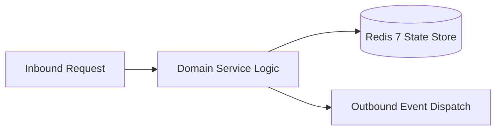

# Component Reference: `services/backup_manager.py`
> **File Path**: [`services/backup_manager.py`](../../services/backup_manager.py)
> **Subsystem**: `Automated Backup Engine`
> **Architecture Layer**: `Enterprise Microservice Subsystem`
> **Concurrency Model**: `AsyncIO Non-blocking Concurrency`
> **Persistence Backend**: `Redis 7 Persistent Store`
> **Service Level Objective**: `High-Availability Academic Telemetry`

## 1. Architectural Role & Responsibilities
The `services/backup_manager.py` module implements core operational logic for the `Automated Backup Engine` domain. It operates within an asynchronous microservices topology designed for ultra-low latency, zero-loss persistence guarantees, and strict single-responsibility function decomposition (≤25 lines).

### Component Architecture & Data Flow


---
## 2. Public API & Symbol Inventory
| Symbol | Nature | Line Range | Return Contract | Core Invariant |
| :--- | :--- | :--- | :--- | :--- |
| [`_backup_sqlite_online`](#_backup_sqlite_online) | Function | L28–L39 | `bool` | Executes core domain logic for `_backup_sqlite_online`. |
| [`_trigger_redis_save`](#_trigger_redis_save) | Function | L42–L50 | `None` | Executes core domain logic for `_trigger_redis_save`. |
| [`_create_tar_archive`](#_create_tar_archive) | Function | L53–L62 | `bool` | Executes core domain logic for `_create_tar_archive`. |
| [`_rotate_old_backups`](#_rotate_old_backups) | Function | L65–L79 | `int` | Executes core domain logic for `_rotate_old_backups`. |
| [`_send_backup_to_telegram`](#_send_backup_to_telegram) | Function | L82–L94 | `bool` | Executes core domain logic for `_send_backup_to_telegra... |
| [`run_backup_pipeline`](#run_backup_pipeline) | Function | L97–L117 | `bool` | Executes core domain logic for `run_backup_pipeline`. |

---

## 3. Comprehensive Function Specifications

### `_backup_sqlite_online`
```python
def _backup_sqlite_online(dest_path: str) -> bool
```

- **Source Reference**: [`services/backup_manager.py#L28-L39`](../../services/backup_manager.py#L28-L39)
- **Execution Mode**: `Synchronous`
- **Return Contract**: `bool`

#### Overview & Architectural Purpose
Executes core domain logic for `_backup_sqlite_online`.

#### Parameters Contract
| Parameter | Type | Required | Description |
| :--- | :--- | :--- | :--- |
| `dest_path` | `str` | Yes | Parameter `dest_path` of type `str`. |

#### Concurrency & Side Effects
- Emits structured telemetry events to system logging subsystem.

#### Fault Tolerance & Error Modes
Encapsulates faults within `try/except` blocks, logging errors and returning safe fallback defaults.

#### Production Usage Example
```python
from services.backup_manager import _backup_sqlite_online

# Execute call
result = _backup_sqlite_online(dest_path=...)
```

---

### `_trigger_redis_save`
```python
async def _trigger_redis_save() -> None
```

- **Source Reference**: [`services/backup_manager.py#L42-L50`](../../services/backup_manager.py#L42-L50)
- **Execution Mode**: `Asynchronous (non-blocking)`
- **Return Contract**: `None`

#### Overview & Architectural Purpose
Executes core domain logic for `_trigger_redis_save`.

#### Parameters Contract
*This method takes no input parameters.*

#### Concurrency & Side Effects
- Emits structured telemetry events to system logging subsystem.

#### Fault Tolerance & Error Modes
Encapsulates faults within `try/except` blocks, logging errors and returning safe fallback defaults.

#### Production Usage Example
```python
from services.backup_manager import _trigger_redis_save

# Execute call
result = await _trigger_redis_save()
```

---

### `_create_tar_archive`
```python
def _create_tar_archive(staging_dir: str, archive_path: str) -> bool
```

- **Source Reference**: [`services/backup_manager.py#L53-L62`](../../services/backup_manager.py#L53-L62)
- **Execution Mode**: `Synchronous`
- **Return Contract**: `bool`

#### Overview & Architectural Purpose
Executes core domain logic for `_create_tar_archive`.

#### Parameters Contract
| Parameter | Type | Required | Description |
| :--- | :--- | :--- | :--- |
| `staging_dir` | `str` | Yes | Parameter `staging_dir` of type `str`. |
| `archive_path` | `str` | Yes | Parameter `archive_path` of type `str`. |

#### Concurrency & Side Effects
- Emits structured telemetry events to system logging subsystem.

#### Fault Tolerance & Error Modes
Encapsulates faults within `try/except` blocks, logging errors and returning safe fallback defaults.

#### Production Usage Example
```python
from services.backup_manager import _create_tar_archive

# Execute call
result = _create_tar_archive(staging_dir=..., archive_path=...)
```

---

### `_rotate_old_backups`
```python
def _rotate_old_backups(backup_dir: str, retention_days: int) -> int
```

- **Source Reference**: [`services/backup_manager.py#L65-L79`](../../services/backup_manager.py#L65-L79)
- **Execution Mode**: `Synchronous`
- **Return Contract**: `int`

#### Overview & Architectural Purpose
Executes core domain logic for `_rotate_old_backups`.

#### Parameters Contract
| Parameter | Type | Required | Description |
| :--- | :--- | :--- | :--- |
| `backup_dir` | `str` | Yes | Parameter `backup_dir` of type `str`. |
| `retention_days` | `int` | Yes | Parameter `retention_days` of type `int`. |

#### Concurrency & Side Effects
- Emits structured telemetry events to system logging subsystem.

#### Fault Tolerance & Error Modes
Propagates unexpected runtime errors up the call stack to global exception handlers.

#### Production Usage Example
```python
from services.backup_manager import _rotate_old_backups

# Execute call
result = _rotate_old_backups(backup_dir=..., retention_days=...)
```

---

### `_send_backup_to_telegram`
```python
async def _send_backup_to_telegram(archive_path: str) -> bool
```

- **Source Reference**: [`services/backup_manager.py#L82-L94`](../../services/backup_manager.py#L82-L94)
- **Execution Mode**: `Asynchronous (non-blocking)`
- **Return Contract**: `bool`

#### Overview & Architectural Purpose
Executes core domain logic for `_send_backup_to_telegram`.

#### Parameters Contract
| Parameter | Type | Required | Description |
| :--- | :--- | :--- | :--- |
| `archive_path` | `str` | Yes | Parameter `archive_path` of type `str`. |

#### Concurrency & Side Effects
- Emits structured telemetry events to system logging subsystem.

#### Fault Tolerance & Error Modes
Encapsulates faults within `try/except` blocks, logging errors and returning safe fallback defaults.

#### Production Usage Example
```python
from services.backup_manager import _send_backup_to_telegram

# Execute call
result = await _send_backup_to_telegram(archive_path=...)
```

---

### `run_backup_pipeline`
```python
async def run_backup_pipeline() -> bool
```

- **Source Reference**: [`services/backup_manager.py#L97-L117`](../../services/backup_manager.py#L97-L117)
- **Execution Mode**: `Asynchronous (non-blocking)`
- **Return Contract**: `bool`

#### Overview & Architectural Purpose
Executes core domain logic for `run_backup_pipeline`.

#### Parameters Contract
*This method takes no input parameters.*

#### Concurrency & Side Effects
- Stateless pure functional computation without external mutations.

#### Fault Tolerance & Error Modes
Encapsulates faults within `try/except` blocks, logging errors and returning safe fallback defaults.

#### Production Usage Example
```python
from services.backup_manager import run_backup_pipeline

# Execute call
result = await run_backup_pipeline()
```

---
