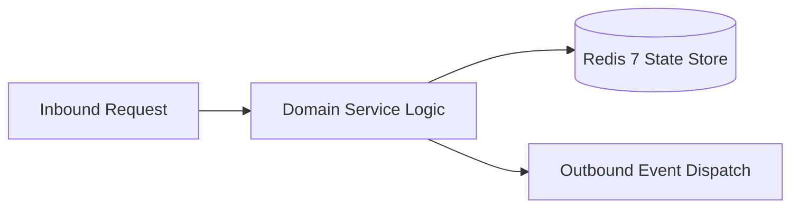

# Component Reference: `services/birthday_manager.py`
> **File Path**: [`services/birthday_manager.py`](../../services/birthday_manager.py)  
> **Subsystem**: `Student Lifecycle`  
> **Architecture Layer**: `Enterprise Microservice Subsystem`  
> **Concurrency Model**: `AsyncIO Non-blocking Concurrency`  
> **Persistence Backend**: `Redis 7 Persistent Store`  
> **Service Level Objective**: `High-Availability Academic Telemetry`

## 1. Architectural Role & Responsibilities
The `services/birthday_manager.py` module implements core operational logic for the `Student Lifecycle` domain. It operates within an asynchronous microservices topology designed for ultra-low latency, zero-loss persistence guarantees, and strict single-responsibility function decomposition (≤25 lines).

### Component Architecture & Data Flow


---
## 2. Public API & Symbol Inventory
| Symbol | Nature | Line Range | Return Contract | Core Invariant |
| :--- | :--- | :--- | :--- | :--- |
| [`calculate_days_and_age`](#calculate_days_and_age) | Function | L48–L67 | `dict[str, Any]` | Executes core domain logic for `calculate_days_and_age`... |
| [`format_person_tag`](#format_person_tag) | Function | L78–L89 | `str` | Formats message payload and presentation markup for `fo... |
| [`format_days_left_badge`](#format_days_left_badge) | Function | L92–L108 | `str` | Formats message payload and presentation markup for `fo... |
| [`format_today_block`](#format_today_block) | Function | L111–L122 | `list[str]` | Formats message payload and presentation markup for `fo... |
| [`format_age_badge`](#format_age_badge) | Function | L125–L137 | `str` | Formats message payload and presentation markup for `fo... |
| [`format_upcoming_block`](#format_upcoming_block) | Function | L140–L159 | `list[str]` | Formats message payload and presentation markup for `fo... |
| [`season_sort_key`](#season_sort_key) | Function | L162–L166 | `int` | Executes core domain logic for `season_sort_key`. |
| [`format_season_block`](#format_season_block) | Function | L169–L185 | `list[str]` | Formats message payload and presentation markup for `fo... |
| [`format_birthday_registry_text`](#format_birthday_registry_text) | Function | L188–L204 | `str` | Formats message payload and presentation markup for `fo... |
| [`pick_unique_wish`](#pick_unique_wish) | Function | L207–L221 | `str` | Executes core domain logic for `pick_unique_wish`. |
| [`get_person_mention`](#get_person_mention) | Function | L224–L234 | `str` | Retrieves and resolves domain data for `get_person_ment... |
| [`format_starosta_block`](#format_starosta_block) | Function | L237–L244 | `str` | Formats message payload and presentation markup for `fo... |
| [`format_congrats_message`](#format_congrats_message) | Function | L247–L264 | `str` | Formats message payload and presentation markup for `fo... |
| [`_send_congrats_telegram`](#_send_congrats_telegram) | Function | L267–L279 | `None` | Executes core domain logic for `_send_congrats_telegram... |
| [`send_congrats_for_item`](#send_congrats_for_item) | Function | L282–L294 | `None` | Dispatches notification message via Telegram API for `s... |
| [`is_morning_congrats_time`](#is_morning_congrats_time) | Function | L297–L299 | `bool` | Executes core domain logic for `is_morning_congrats_tim... |
| [`check_and_send_birthday_congratulations`](#check_and_send_birthday_congratulations) | Function | L302–L311 | `None` | Executes core domain logic for `check_and_send_birthday... |
| [`_edit_existing_birthday_message`](#_edit_existing_birthday_message) | Function | L314–L324 | `bool` | Executes core domain logic for `_edit_existing_birthday... |
| [`_create_new_birthday_message`](#_create_new_birthday_message) | Function | L327–L342 | `bool` | Executes core domain logic for `_create_new_birthday_me... |
| [`update_birthday_pinned_message`](#update_birthday_pinned_message) | Function | L345–L351 | `bool` | Synchronizes and updates domain state for `update_birth... |
| [`sync_birthdays_topic`](#sync_birthdays_topic) | Function | L354–L366 | `bool` | Executes core domain logic for `sync_birthdays_topic`. |
| [`birthday_sync_loop`](#birthday_sync_loop) | Function | L369–L378 | `None` | Executes core domain logic for `birthday_sync_loop`. |

---

## 3. Comprehensive Function Specifications

### `calculate_days_and_age`
```python
def calculate_days_and_age(item: dict[str, Any], today: date) -> dict[str, Any]
```

- **Source Reference**: [`services/birthday_manager.py#L48-L67`](../../services/birthday_manager.py#L48-L67)
- **Execution Mode**: `Synchronous`
- **Return Contract**: `dict[str, Any]`

#### Overview & Architectural Purpose
Executes core domain logic for `calculate_days_and_age`.

#### Parameters Contract
| Parameter | Type | Required | Description |
| :--- | :--- | :--- | :--- |
| `item` | `dict[str, Any]` | Yes | Parameter `item` of type `dict[str, Any]`. |
| `today` | `date` | Yes | Parameter `today` of type `date`. |

#### Concurrency & Side Effects
- Stateless pure functional computation without external mutations.

#### Fault Tolerance & Error Modes
Encapsulates faults within `try/except` blocks, logging errors and returning safe fallback defaults.

#### Production Usage Example
```python
from services.birthday_manager import calculate_days_and_age

# Execute call
result = calculate_days_and_age(item=..., today=...)
```

---

### `format_person_tag`
```python
def format_person_tag(item: dict[str, Any]) -> str
```

- **Source Reference**: [`services/birthday_manager.py#L78-L89`](../../services/birthday_manager.py#L78-L89)
- **Execution Mode**: `Synchronous`
- **Return Contract**: `str`

#### Overview & Architectural Purpose
Formats message payload and presentation markup for `format_person_tag`.

#### Parameters Contract
| Parameter | Type | Required | Description |
| :--- | :--- | :--- | :--- |
| `item` | `dict[str, Any]` | Yes | Parameter `item` of type `dict[str, Any]`. |

#### Concurrency & Side Effects
- Stateless pure functional computation without external mutations.

#### Fault Tolerance & Error Modes
Propagates unexpected runtime errors up the call stack to global exception handlers.

#### Production Usage Example
```python
from services.birthday_manager import format_person_tag

# Execute call
result = format_person_tag(item=...)
```

---

### `format_days_left_badge`
```python
def format_days_left_badge(days: int) -> str
```

- **Source Reference**: [`services/birthday_manager.py#L92-L108`](../../services/birthday_manager.py#L92-L108)
- **Execution Mode**: `Synchronous`
- **Return Contract**: `str`

#### Overview & Architectural Purpose
Formats message payload and presentation markup for `format_days_left_badge`.

#### Parameters Contract
| Parameter | Type | Required | Description |
| :--- | :--- | :--- | :--- |
| `days` | `int` | Yes | Parameter `days` of type `int`. |

#### Concurrency & Side Effects
- Stateless pure functional computation without external mutations.

#### Fault Tolerance & Error Modes
Propagates unexpected runtime errors up the call stack to global exception handlers.

#### Production Usage Example
```python
from services.birthday_manager import format_days_left_badge

# Execute call
result = format_days_left_badge(days=...)
```

---

### `format_today_block`
```python
def format_today_block(today_items: list[dict[str, Any]]) -> list[str]
```

- **Source Reference**: [`services/birthday_manager.py#L111-L122`](../../services/birthday_manager.py#L111-L122)
- **Execution Mode**: `Synchronous`
- **Return Contract**: `list[str]`

#### Overview & Architectural Purpose
Formats message payload and presentation markup for `format_today_block`.

#### Parameters Contract
| Parameter | Type | Required | Description |
| :--- | :--- | :--- | :--- |
| `today_items` | `list[dict[str, Any]]` | Yes | Parameter `today_items` of type `list[dict[str, Any]]`. |

#### Concurrency & Side Effects
- Stateless pure functional computation without external mutations.

#### Fault Tolerance & Error Modes
Propagates unexpected runtime errors up the call stack to global exception handlers.

#### Production Usage Example
```python
from services.birthday_manager import format_today_block

# Execute call
result = format_today_block(today_items=...)
```

---

### `format_age_badge`
```python
def format_age_badge(age: int) -> str
```

- **Source Reference**: [`services/birthday_manager.py#L125-L137`](../../services/birthday_manager.py#L125-L137)
- **Execution Mode**: `Synchronous`
- **Return Contract**: `str`

#### Overview & Architectural Purpose
Formats message payload and presentation markup for `format_age_badge`.

#### Parameters Contract
| Parameter | Type | Required | Description |
| :--- | :--- | :--- | :--- |
| `age` | `int` | Yes | Parameter `age` of type `int`. |

#### Concurrency & Side Effects
- Stateless pure functional computation without external mutations.

#### Fault Tolerance & Error Modes
Propagates unexpected runtime errors up the call stack to global exception handlers.

#### Production Usage Example
```python
from services.birthday_manager import format_age_badge

# Execute call
result = format_age_badge(age=...)
```

---

### `format_upcoming_block`
```python
def format_upcoming_block(items: list[dict[str, Any]]) -> list[str]
```

- **Source Reference**: [`services/birthday_manager.py#L140-L159`](../../services/birthday_manager.py#L140-L159)
- **Execution Mode**: `Synchronous`
- **Return Contract**: `list[str]`

#### Overview & Architectural Purpose
Formats message payload and presentation markup for `format_upcoming_block`.

#### Parameters Contract
| Parameter | Type | Required | Description |
| :--- | :--- | :--- | :--- |
| `items` | `list[dict[str, Any]]` | Yes | Parameter `items` of type `list[dict[str, Any]]`. |

#### Concurrency & Side Effects
- Stateless pure functional computation without external mutations.

#### Fault Tolerance & Error Modes
Propagates unexpected runtime errors up the call stack to global exception handlers.

#### Production Usage Example
```python
from services.birthday_manager import format_upcoming_block

# Execute call
result = format_upcoming_block(items=...)
```

---

### `season_sort_key`
```python
def season_sort_key(item: dict[str, Any], months: list[int]) -> int
```

- **Source Reference**: [`services/birthday_manager.py#L162-L166`](../../services/birthday_manager.py#L162-L166)
- **Execution Mode**: `Synchronous`
- **Return Contract**: `int`

#### Overview & Architectural Purpose
Executes core domain logic for `season_sort_key`.

#### Parameters Contract
| Parameter | Type | Required | Description |
| :--- | :--- | :--- | :--- |
| `item` | `dict[str, Any]` | Yes | Parameter `item` of type `dict[str, Any]`. |
| `months` | `list[int]` | Yes | Parameter `months` of type `list[int]`. |

#### Concurrency & Side Effects
- Stateless pure functional computation without external mutations.

#### Fault Tolerance & Error Modes
Propagates unexpected runtime errors up the call stack to global exception handlers.

#### Production Usage Example
```python
from services.birthday_manager import season_sort_key

# Execute call
result = season_sort_key(item=..., months=...)
```

---

### `format_season_block`
```python
def format_season_block(title: str, months: list[int], all_items: list[dict[str, Any]]) -> list[str]
```

- **Source Reference**: [`services/birthday_manager.py#L169-L185`](../../services/birthday_manager.py#L169-L185)
- **Execution Mode**: `Synchronous`
- **Return Contract**: `list[str]`

#### Overview & Architectural Purpose
Formats message payload and presentation markup for `format_season_block`.

#### Parameters Contract
| Parameter | Type | Required | Description |
| :--- | :--- | :--- | :--- |
| `title` | `str` | Yes | Parameter `title` of type `str`. |
| `months` | `list[int]` | Yes | Parameter `months` of type `list[int]`. |
| `all_items` | `list[dict[str, Any]]` | Yes | Parameter `all_items` of type `list[dict[str, Any]]`. |

#### Concurrency & Side Effects
- Stateless pure functional computation without external mutations.

#### Fault Tolerance & Error Modes
Propagates unexpected runtime errors up the call stack to global exception handlers.

#### Production Usage Example
```python
from services.birthday_manager import format_season_block

# Execute call
result = format_season_block(title=..., months=..., all_items=...)
```

---

### `format_birthday_registry_text`
```python
def format_birthday_registry_text(items: list[dict[str, Any]]) -> str
```

- **Source Reference**: [`services/birthday_manager.py#L188-L204`](../../services/birthday_manager.py#L188-L204)
- **Execution Mode**: `Synchronous`
- **Return Contract**: `str`

#### Overview & Architectural Purpose
Formats message payload and presentation markup for `format_birthday_registry_text`.

#### Parameters Contract
| Parameter | Type | Required | Description |
| :--- | :--- | :--- | :--- |
| `items` | `list[dict[str, Any]]` | Yes | Parameter `items` of type `list[dict[str, Any]]`. |

#### Concurrency & Side Effects
- Stateless pure functional computation without external mutations.

#### Fault Tolerance & Error Modes
Propagates unexpected runtime errors up the call stack to global exception handlers.

#### Production Usage Example
```python
from services.birthday_manager import format_birthday_registry_text

# Execute call
result = format_birthday_registry_text(items=...)
```

---

### `pick_unique_wish`
```python
def pick_unique_wish(person_key: str, wishes: list[str], history_file: str = HISTORY_FILE) -> str
```

- **Source Reference**: [`services/birthday_manager.py#L207-L221`](../../services/birthday_manager.py#L207-L221)
- **Execution Mode**: `Synchronous`
- **Return Contract**: `str`

#### Overview & Architectural Purpose
Executes core domain logic for `pick_unique_wish`.

#### Parameters Contract
| Parameter | Type | Required | Description |
| :--- | :--- | :--- | :--- |
| `person_key` | `str` | Yes | Parameter `person_key` of type `str`. |
| `wishes` | `list[str]` | Yes | Parameter `wishes` of type `list[str]`. |
| `history_file` | `str` | Yes | Parameter `history_file` of type `str`. |

#### Concurrency & Side Effects
- Stateless pure functional computation without external mutations.

#### Fault Tolerance & Error Modes
Propagates unexpected runtime errors up the call stack to global exception handlers.

#### Production Usage Example
```python
from services.birthday_manager import pick_unique_wish

# Execute call
result = pick_unique_wish(person_key=..., wishes=..., history_file=...)
```

---

### `get_person_mention`
```python
def get_person_mention(item: dict[str, Any]) -> str
```

- **Source Reference**: [`services/birthday_manager.py#L224-L234`](../../services/birthday_manager.py#L224-L234)
- **Execution Mode**: `Synchronous`
- **Return Contract**: `str`

#### Overview & Architectural Purpose
Retrieves and resolves domain data for `get_person_mention`.

#### Parameters Contract
| Parameter | Type | Required | Description |
| :--- | :--- | :--- | :--- |
| `item` | `dict[str, Any]` | Yes | Parameter `item` of type `dict[str, Any]`. |

#### Concurrency & Side Effects
- Stateless pure functional computation without external mutations.

#### Fault Tolerance & Error Modes
Propagates unexpected runtime errors up the call stack to global exception handlers.

#### Production Usage Example
```python
from services.birthday_manager import get_person_mention

# Execute call
result = get_person_mention(item=...)
```

---

### `format_starosta_block`
```python
def format_starosta_block(starosta_text: str | None) -> str
```

- **Source Reference**: [`services/birthday_manager.py#L237-L244`](../../services/birthday_manager.py#L237-L244)
- **Execution Mode**: `Synchronous`
- **Return Contract**: `str`

#### Overview & Architectural Purpose
Formats message payload and presentation markup for `format_starosta_block`.

#### Parameters Contract
| Parameter | Type | Required | Description |
| :--- | :--- | :--- | :--- |
| `starosta_text` | `str | None` | Yes | Parameter `starosta_text` of type `str | None`. |

#### Concurrency & Side Effects
- Stateless pure functional computation without external mutations.

#### Fault Tolerance & Error Modes
Propagates unexpected runtime errors up the call stack to global exception handlers.

#### Production Usage Example
```python
from services.birthday_manager import format_starosta_block

# Execute call
result = format_starosta_block(starosta_text=...)
```

---

### `format_congrats_message`
```python
def format_congrats_message( item: dict[str, Any], wish_text: str, starosta_text: str | None = None ) -> str
```

- **Source Reference**: [`services/birthday_manager.py#L247-L264`](../../services/birthday_manager.py#L247-L264)
- **Execution Mode**: `Synchronous`
- **Return Contract**: `str`

#### Overview & Architectural Purpose
Formats message payload and presentation markup for `format_congrats_message`.

#### Parameters Contract
| Parameter | Type | Required | Description |
| :--- | :--- | :--- | :--- |
| `item` | `dict[str, Any]` | Yes | Parameter `item` of type `dict[str, Any]`. |
| `wish_text` | `str` | Yes | Parameter `wish_text` of type `str`. |
| `starosta_text` | `str | None` | Yes | Parameter `starosta_text` of type `str | None`. |

#### Concurrency & Side Effects
- Stateless pure functional computation without external mutations.

#### Fault Tolerance & Error Modes
Propagates unexpected runtime errors up the call stack to global exception handlers.

#### Production Usage Example
```python
from services.birthday_manager import format_congrats_message

# Execute call
result = format_congrats_message(item=..., wish_text=..., starosta_text=...)
```

---

### `_send_congrats_telegram`
```python
async def _send_congrats_telegram( text: str, person_key: str, key: str, state: dict[str, bool] ) -> None
```

- **Source Reference**: [`services/birthday_manager.py#L267-L279`](../../services/birthday_manager.py#L267-L279)
- **Execution Mode**: `Asynchronous (non-blocking)`
- **Return Contract**: `None`

#### Overview & Architectural Purpose
Executes core domain logic for `_send_congrats_telegram`.

#### Parameters Contract
| Parameter | Type | Required | Description |
| :--- | :--- | :--- | :--- |
| `text` | `str` | Yes | Parameter `text` of type `str`. |
| `person_key` | `str` | Yes | Parameter `person_key` of type `str`. |
| `key` | `str` | Yes | Parameter `key` of type `str`. |
| `state` | `dict[str, bool]` | Yes | Aiogram FSM context manager for dialog state persistence. |

#### Concurrency & Side Effects
- Emits structured telemetry events to system logging subsystem.

#### Fault Tolerance & Error Modes
Encapsulates faults within `try/except` blocks, logging errors and returning safe fallback defaults.

#### Production Usage Example
```python
from services.birthday_manager import _send_congrats_telegram

# Execute call
result = await _send_congrats_telegram(text=..., person_key=..., key=...)
```

---

### `send_congrats_for_item`
```python
async def send_congrats_for_item(item: dict[str, Any], today_str: str) -> None
```

- **Source Reference**: [`services/birthday_manager.py#L282-L294`](../../services/birthday_manager.py#L282-L294)
- **Execution Mode**: `Asynchronous (non-blocking)`
- **Return Contract**: `None`

#### Overview & Architectural Purpose
Dispatches notification message via Telegram API for `send_congrats_for_item`.

#### Parameters Contract
| Parameter | Type | Required | Description |
| :--- | :--- | :--- | :--- |
| `item` | `dict[str, Any]` | Yes | Parameter `item` of type `dict[str, Any]`. |
| `today_str` | `str` | Yes | Parameter `today_str` of type `str`. |

#### Concurrency & Side Effects
- Stateless pure functional computation without external mutations.

#### Fault Tolerance & Error Modes
Propagates unexpected runtime errors up the call stack to global exception handlers.

#### Production Usage Example
```python
from services.birthday_manager import send_congrats_for_item

# Execute call
result = await send_congrats_for_item(item=..., today_str=...)
```

---

### `is_morning_congrats_time`
```python
def is_morning_congrats_time(now_dt: datetime) -> bool
```

- **Source Reference**: [`services/birthday_manager.py#L297-L299`](../../services/birthday_manager.py#L297-L299)
- **Execution Mode**: `Synchronous`
- **Return Contract**: `bool`

#### Overview & Architectural Purpose
Executes core domain logic for `is_morning_congrats_time`.

#### Parameters Contract
| Parameter | Type | Required | Description |
| :--- | :--- | :--- | :--- |
| `now_dt` | `datetime` | Yes | Current reference datetime anchored to Europe/Moscow timezone. |

#### Concurrency & Side Effects
- Stateless pure functional computation without external mutations.

#### Fault Tolerance & Error Modes
Propagates unexpected runtime errors up the call stack to global exception handlers.

#### Production Usage Example
```python
from services.birthday_manager import is_morning_congrats_time

# Execute call
result = is_morning_congrats_time(now_dt=...)
```

---

### `check_and_send_birthday_congratulations`
```python
async def check_and_send_birthday_congratulations(items: list[dict[str, Any]], today: date) -> None
```

- **Source Reference**: [`services/birthday_manager.py#L302-L311`](../../services/birthday_manager.py#L302-L311)
- **Execution Mode**: `Asynchronous (non-blocking)`
- **Return Contract**: `None`

#### Overview & Architectural Purpose
Executes core domain logic for `check_and_send_birthday_congratulations`.

#### Parameters Contract
| Parameter | Type | Required | Description |
| :--- | :--- | :--- | :--- |
| `items` | `list[dict[str, Any]]` | Yes | Parameter `items` of type `list[dict[str, Any]]`. |
| `today` | `date` | Yes | Parameter `today` of type `date`. |

#### Concurrency & Side Effects
- Emits structured telemetry events to system logging subsystem.

#### Fault Tolerance & Error Modes
Propagates unexpected runtime errors up the call stack to global exception handlers.

#### Production Usage Example
```python
from services.birthday_manager import check_and_send_birthday_congratulations

# Execute call
result = await check_and_send_birthday_congratulations(items=..., today=...)
```

---

### `_edit_existing_birthday_message`
```python
async def _edit_existing_birthday_message(msg_id: int, text: str) -> bool
```

- **Source Reference**: [`services/birthday_manager.py#L314-L324`](../../services/birthday_manager.py#L314-L324)
- **Execution Mode**: `Asynchronous (non-blocking)`
- **Return Contract**: `bool`

#### Overview & Architectural Purpose
Executes core domain logic for `_edit_existing_birthday_message`.

#### Parameters Contract
| Parameter | Type | Required | Description |
| :--- | :--- | :--- | :--- |
| `msg_id` | `int` | Yes | Parameter `msg_id` of type `int`. |
| `text` | `str` | Yes | Parameter `text` of type `str`. |

#### Concurrency & Side Effects
- Emits structured telemetry events to system logging subsystem.

#### Fault Tolerance & Error Modes
Encapsulates faults within `try/except` blocks, logging errors and returning safe fallback defaults.

#### Production Usage Example
```python
from services.birthday_manager import _edit_existing_birthday_message

# Execute call
result = await _edit_existing_birthday_message(msg_id=..., text=...)
```

---

### `_create_new_birthday_message`
```python
async def _create_new_birthday_message(text: str) -> bool
```

- **Source Reference**: [`services/birthday_manager.py#L327-L342`](../../services/birthday_manager.py#L327-L342)
- **Execution Mode**: `Asynchronous (non-blocking)`
- **Return Contract**: `bool`

#### Overview & Architectural Purpose
Executes core domain logic for `_create_new_birthday_message`.

#### Parameters Contract
| Parameter | Type | Required | Description |
| :--- | :--- | :--- | :--- |
| `text` | `str` | Yes | Parameter `text` of type `str`. |

#### Concurrency & Side Effects
- Emits structured telemetry events to system logging subsystem.

#### Fault Tolerance & Error Modes
Encapsulates faults within `try/except` blocks, logging errors and returning safe fallback defaults.

#### Production Usage Example
```python
from services.birthday_manager import _create_new_birthday_message

# Execute call
result = await _create_new_birthday_message(text=...)
```

---

### `update_birthday_pinned_message`
```python
async def update_birthday_pinned_message(text: str) -> bool
```

- **Source Reference**: [`services/birthday_manager.py#L345-L351`](../../services/birthday_manager.py#L345-L351)
- **Execution Mode**: `Asynchronous (non-blocking)`
- **Return Contract**: `bool`

#### Overview & Architectural Purpose
Synchronizes and updates domain state for `update_birthday_pinned_message`.

#### Parameters Contract
| Parameter | Type | Required | Description |
| :--- | :--- | :--- | :--- |
| `text` | `str` | Yes | Parameter `text` of type `str`. |

#### Concurrency & Side Effects
- Stateless pure functional computation without external mutations.

#### Fault Tolerance & Error Modes
Propagates unexpected runtime errors up the call stack to global exception handlers.

#### Production Usage Example
```python
from services.birthday_manager import update_birthday_pinned_message

# Execute call
result = await update_birthday_pinned_message(text=...)
```

---

### `sync_birthdays_topic`
```python
async def sync_birthdays_topic() -> bool
```

- **Source Reference**: [`services/birthday_manager.py#L354-L366`](../../services/birthday_manager.py#L354-L366)
- **Execution Mode**: `Asynchronous (non-blocking)`
- **Return Contract**: `bool`

#### Overview & Architectural Purpose
Executes core domain logic for `sync_birthdays_topic`.

#### Parameters Contract
*This method takes no input parameters.*

#### Concurrency & Side Effects
- Emits structured telemetry events to system logging subsystem.

#### Fault Tolerance & Error Modes
Propagates unexpected runtime errors up the call stack to global exception handlers.

#### Production Usage Example
```python
from services.birthday_manager import sync_birthdays_topic

# Execute call
result = await sync_birthdays_topic()
```

---

### `birthday_sync_loop`
```python
async def birthday_sync_loop() -> None
```

- **Source Reference**: [`services/birthday_manager.py#L369-L378`](../../services/birthday_manager.py#L369-L378)
- **Execution Mode**: `Asynchronous (non-blocking)`
- **Return Contract**: `None`

#### Overview & Architectural Purpose
Executes core domain logic for `birthday_sync_loop`.

#### Parameters Contract
*This method takes no input parameters.*

#### Concurrency & Side Effects
- Emits structured telemetry events to system logging subsystem.

#### Fault Tolerance & Error Modes
Encapsulates faults within `try/except` blocks, logging errors and returning safe fallback defaults.

#### Production Usage Example
```python
from services.birthday_manager import birthday_sync_loop

# Execute call
result = await birthday_sync_loop()
```

---
