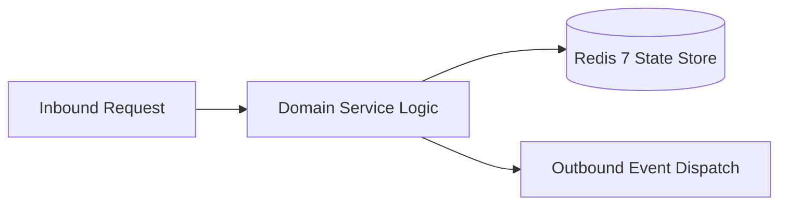

# Component Reference: `services/classmates_auth.py`
> **File Path**: [`services/classmates_auth.py`](../../services/classmates_auth.py)  
> **Subsystem**: `RBAC Security`  
> **Architecture Layer**: `Enterprise Microservice Subsystem`  
> **Concurrency Model**: `AsyncIO Non-blocking Concurrency`  
> **Persistence Backend**: `Redis 7 Persistent Store`  
> **Service Level Objective**: `High-Availability Academic Telemetry`

## 1. Architectural Role & Responsibilities
The `services/classmates_auth.py` module implements core operational logic for the `RBAC Security` domain. It operates within an asynchronous microservices topology designed for ultra-low latency, zero-loss persistence guarantees, and strict single-responsibility function decomposition (≤25 lines).

### Component Architecture & Data Flow


---
## 2. Public API & Symbol Inventory
| Symbol | Nature | Line Range | Return Contract | Core Invariant |
| :--- | :--- | :--- | :--- | :--- |
| [`clear_registry_cache`](#clear_registry_cache) | Function | L28–L32 | `None` | Flushes and resets state for `clear_registry_cache`. |
| [`load_classmates_registry`](#load_classmates_registry) | Function | L35–L50 | `list[dict[str, Any]]` | Executes core domain logic for `load_classmates_registr... |
| [`find_classmate_by_tg_id`](#find_classmate_by_tg_id) | Function | L53–L64 | `dict[str, Any] | None` | Executes core domain logic for `find_classmate_by_tg_id... |
| [`find_unregistered_by_username`](#find_unregistered_by_username) | Function | L67–L80 | `dict[str, Any] | None` | Executes core domain logic for `find_unregistered_by_us... |
| [`update_classmate_tg_id`](#update_classmate_tg_id) | Function | L83–L105 | `dict[str, Any] | None` | Synchronizes and updates domain state for `update_class... |
| [`bind_student_tg_id`](#bind_student_tg_id) | Function | L108–L125 | `dict[str, Any] | None` | Executes core domain logic for `bind_student_tg_id`. |
| [`is_authorized_user`](#is_authorized_user) | Function | L128–L139 | `bool` | Executes core domain logic for `is_authorized_user`. |
| [`process_user_auth`](#process_user_auth) | Function | L142–L156 | `tuple[bool, bool, dict[str, Any] | None]` | Executes core domain logic for `process_user_auth`. |

---

## 3. Comprehensive Function Specifications

### `clear_registry_cache`
```python
def clear_registry_cache() -> None
```

- **Source Reference**: [`services/classmates_auth.py#L28-L32`](../../services/classmates_auth.py#L28-L32)
- **Execution Mode**: `Synchronous`
- **Return Contract**: `None`

#### Overview & Architectural Purpose
Flushes and resets state for `clear_registry_cache`.

#### Parameters Contract
*This method takes no input parameters.*

#### Concurrency & Side Effects
- Stateless pure functional computation without external mutations.

#### Fault Tolerance & Error Modes
Propagates unexpected runtime errors up the call stack to global exception handlers.

#### Production Usage Example
```python
from services.classmates_auth import clear_registry_cache

# Execute call
result = clear_registry_cache()
```

---

### `load_classmates_registry`
```python
def load_classmates_registry(force_reload: bool = False) -> list[dict[str, Any]]
```

- **Source Reference**: [`services/classmates_auth.py#L35-L50`](../../services/classmates_auth.py#L35-L50)
- **Execution Mode**: `Synchronous`
- **Return Contract**: `list[dict[str, Any]]`

#### Overview & Architectural Purpose
Executes core domain logic for `load_classmates_registry`.

#### Parameters Contract
| Parameter | Type | Required | Description |
| :--- | :--- | :--- | :--- |
| `force_reload` | `bool` | Yes | Parameter `force_reload` of type `bool`. |

#### Concurrency & Side Effects
- Stateless pure functional computation without external mutations.

#### Fault Tolerance & Error Modes
Encapsulates faults within `try/except` blocks, logging errors and returning safe fallback defaults.

#### Production Usage Example
```python
from services.classmates_auth import load_classmates_registry

# Execute call
result = load_classmates_registry(force_reload=...)
```

---

### `find_classmate_by_tg_id`
```python
def find_classmate_by_tg_id(user_id: int) -> dict[str, Any] | None
```

- **Source Reference**: [`services/classmates_auth.py#L53-L64`](../../services/classmates_auth.py#L53-L64)
- **Execution Mode**: `Synchronous`
- **Return Contract**: `dict[str, Any] | None`

#### Overview & Architectural Purpose
Executes core domain logic for `find_classmate_by_tg_id`.

#### Parameters Contract
| Parameter | Type | Required | Description |
| :--- | :--- | :--- | :--- |
| `user_id` | `int` | Yes | Unique 64-bit Telegram user identifier. |

#### Concurrency & Side Effects
- Stateless pure functional computation without external mutations.

#### Fault Tolerance & Error Modes
Propagates unexpected runtime errors up the call stack to global exception handlers.

#### Production Usage Example
```python
from services.classmates_auth import find_classmate_by_tg_id

# Execute call
result = find_classmate_by_tg_id(user_id=...)
```

---

### `find_unregistered_by_username`
```python
def find_unregistered_by_username(username: str) -> dict[str, Any] | None
```

- **Source Reference**: [`services/classmates_auth.py#L67-L80`](../../services/classmates_auth.py#L67-L80)
- **Execution Mode**: `Synchronous`
- **Return Contract**: `dict[str, Any] | None`

#### Overview & Architectural Purpose
Executes core domain logic for `find_unregistered_by_username`.

#### Parameters Contract
| Parameter | Type | Required | Description |
| :--- | :--- | :--- | :--- |
| `username` | `str` | Yes | Parameter `username` of type `str`. |

#### Concurrency & Side Effects
- Stateless pure functional computation without external mutations.

#### Fault Tolerance & Error Modes
Propagates unexpected runtime errors up the call stack to global exception handlers.

#### Production Usage Example
```python
from services.classmates_auth import find_unregistered_by_username

# Execute call
result = find_unregistered_by_username(username=...)
```

---

### `update_classmate_tg_id`
```python
def update_classmate_tg_id(clean_username: str, tg_id: int) -> dict[str, Any] | None
```

- **Source Reference**: [`services/classmates_auth.py#L83-L105`](../../services/classmates_auth.py#L83-L105)
- **Execution Mode**: `Synchronous`
- **Return Contract**: `dict[str, Any] | None`

#### Overview & Architectural Purpose
Synchronizes and updates domain state for `update_classmate_tg_id`.

#### Parameters Contract
| Parameter | Type | Required | Description |
| :--- | :--- | :--- | :--- |
| `clean_username` | `str` | Yes | Parameter `clean_username` of type `str`. |
| `tg_id` | `int` | Yes | Telegram user identifier for identity verification. |

#### Concurrency & Side Effects
- Emits structured telemetry events to system logging subsystem.

#### Fault Tolerance & Error Modes
Propagates unexpected runtime errors up the call stack to global exception handlers.

#### Production Usage Example
```python
from services.classmates_auth import update_classmate_tg_id

# Execute call
result = update_classmate_tg_id(clean_username=..., tg_id=...)
```

---

### `bind_student_tg_id`
```python
def bind_student_tg_id(full_name: str, tg_id: int) -> dict[str, Any] | None
```

- **Source Reference**: [`services/classmates_auth.py#L108-L125`](../../services/classmates_auth.py#L108-L125)
- **Execution Mode**: `Synchronous`
- **Return Contract**: `dict[str, Any] | None`

#### Overview & Architectural Purpose
Executes core domain logic for `bind_student_tg_id`.

#### Parameters Contract
| Parameter | Type | Required | Description |
| :--- | :--- | :--- | :--- |
| `full_name` | `str` | Yes | Parameter `full_name` of type `str`. |
| `tg_id` | `int` | Yes | Telegram user identifier for identity verification. |

#### Concurrency & Side Effects
- Emits structured telemetry events to system logging subsystem.

#### Fault Tolerance & Error Modes
Propagates unexpected runtime errors up the call stack to global exception handlers.

#### Production Usage Example
```python
from services.classmates_auth import bind_student_tg_id

# Execute call
result = bind_student_tg_id(full_name=..., tg_id=...)
```

---

### `is_authorized_user`
```python
def is_authorized_user(user: User | None) -> bool
```

- **Source Reference**: [`services/classmates_auth.py#L128-L139`](../../services/classmates_auth.py#L128-L139)
- **Execution Mode**: `Synchronous`
- **Return Contract**: `bool`

#### Overview & Architectural Purpose
Executes core domain logic for `is_authorized_user`.

#### Parameters Contract
| Parameter | Type | Required | Description |
| :--- | :--- | :--- | :--- |
| `user` | `User | None` | Yes | Parameter `user` of type `User | None`. |

#### Concurrency & Side Effects
- Stateless pure functional computation without external mutations.

#### Fault Tolerance & Error Modes
Propagates unexpected runtime errors up the call stack to global exception handlers.

#### Production Usage Example
```python
from services.classmates_auth import is_authorized_user

# Execute call
result = is_authorized_user(user=...)
```

---

### `process_user_auth`
```python
def process_user_auth(user: User | None) -> tuple[bool, bool, dict[str, Any] | None]
```

- **Source Reference**: [`services/classmates_auth.py#L142-L156`](../../services/classmates_auth.py#L142-L156)
- **Execution Mode**: `Synchronous`
- **Return Contract**: `tuple[bool, bool, dict[str, Any] | None]`

#### Overview & Architectural Purpose
Executes core domain logic for `process_user_auth`.

#### Parameters Contract
| Parameter | Type | Required | Description |
| :--- | :--- | :--- | :--- |
| `user` | `User | None` | Yes | Parameter `user` of type `User | None`. |

#### Concurrency & Side Effects
- Stateless pure functional computation without external mutations.

#### Fault Tolerance & Error Modes
Propagates unexpected runtime errors up the call stack to global exception handlers.

#### Production Usage Example
```python
from services.classmates_auth import process_user_auth

# Execute call
result = process_user_auth(user=...)
```

---
