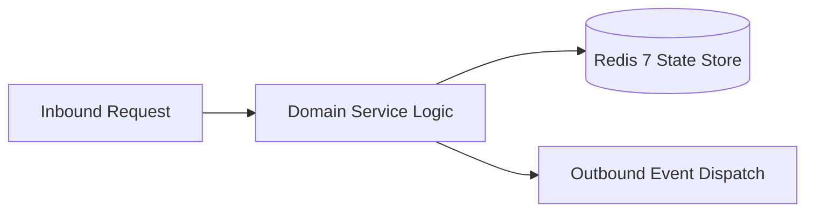

# Component Reference: `services/custom_teachers.py`
> **File Path**: [`services/custom_teachers.py`](../../services/custom_teachers.py)  
> **Subsystem**: `Faculty Registry`  
> **Architecture Layer**: `Enterprise Microservice Subsystem`  
> **Concurrency Model**: `AsyncIO Non-blocking Concurrency`  
> **Persistence Backend**: `Redis 7 Persistent Store`  
> **Service Level Objective**: `High-Availability Academic Telemetry`

## 1. Architectural Role & Responsibilities
The `services/custom_teachers.py` module implements core operational logic for the `Faculty Registry` domain. It operates within an asynchronous microservices topology designed for ultra-low latency, zero-loss persistence guarantees, and strict single-responsibility function decomposition (≤25 lines).

### Component Architecture & Data Flow


---
## 2. Public API & Symbol Inventory
| Symbol | Nature | Line Range | Return Contract | Core Invariant |
| :--- | :--- | :--- | :--- | :--- |
| [`load_custom_teachers`](#load_custom_teachers) | Function | L12–L21 | `dict[str, TeacherData]` | Executes core domain logic for `load_custom_teachers`. |
| [`save_custom_teacher`](#save_custom_teacher) | Function | L24–L35 | `None` | Saves serialized entity data to storage for `save_custo... |
| [`delete_custom_teacher`](#delete_custom_teacher) | Function | L38–L50 | `None` | Evicts and removes record from storage for `delete_cust... |

---

## 3. Comprehensive Function Specifications

### `load_custom_teachers`
```python
def load_custom_teachers() -> dict[str, TeacherData]
```

- **Source Reference**: [`services/custom_teachers.py#L12-L21`](../../services/custom_teachers.py#L12-L21)
- **Execution Mode**: `Synchronous`
- **Return Contract**: `dict[str, TeacherData]`

#### Overview & Architectural Purpose
Executes core domain logic for `load_custom_teachers`.

#### Parameters Contract
*This method takes no input parameters.*

#### Concurrency & Side Effects
- Stateless pure functional computation without external mutations.

#### Fault Tolerance & Error Modes
Propagates unexpected runtime errors up the call stack to global exception handlers.

#### Production Usage Example
```python
from services.custom_teachers import load_custom_teachers

# Execute call
result = load_custom_teachers()
```

---

### `save_custom_teacher`
```python
def save_custom_teacher(last_name: str, full_name: str, link_info: str) -> None
```

- **Source Reference**: [`services/custom_teachers.py#L24-L35`](../../services/custom_teachers.py#L24-L35)
- **Execution Mode**: `Synchronous`
- **Return Contract**: `None`

#### Overview & Architectural Purpose
Saves serialized entity data to storage for `save_custom_teacher`.

#### Parameters Contract
| Parameter | Type | Required | Description |
| :--- | :--- | :--- | :--- |
| `last_name` | `str` | Yes | Parameter `last_name` of type `str`. |
| `full_name` | `str` | Yes | Parameter `full_name` of type `str`. |
| `link_info` | `str` | Yes | Parameter `link_info` of type `str`. |

#### Concurrency & Side Effects
- Stateless pure functional computation without external mutations.

#### Fault Tolerance & Error Modes
Propagates unexpected runtime errors up the call stack to global exception handlers.

#### Production Usage Example
```python
from services.custom_teachers import save_custom_teacher

# Execute call
result = save_custom_teacher(last_name=..., full_name=..., link_info=...)
```

---

### `delete_custom_teacher`
```python
def delete_custom_teacher(last_name: str) -> None
```

- **Source Reference**: [`services/custom_teachers.py#L38-L50`](../../services/custom_teachers.py#L38-L50)
- **Execution Mode**: `Synchronous`
- **Return Contract**: `None`

#### Overview & Architectural Purpose
Evicts and removes record from storage for `delete_custom_teacher`.

#### Parameters Contract
| Parameter | Type | Required | Description |
| :--- | :--- | :--- | :--- |
| `last_name` | `str` | Yes | Parameter `last_name` of type `str`. |

#### Concurrency & Side Effects
- Stateless pure functional computation without external mutations.

#### Fault Tolerance & Error Modes
Propagates unexpected runtime errors up the call stack to global exception handlers.

#### Production Usage Example
```python
from services.custom_teachers import delete_custom_teacher

# Execute call
result = delete_custom_teacher(last_name=...)
```

---
