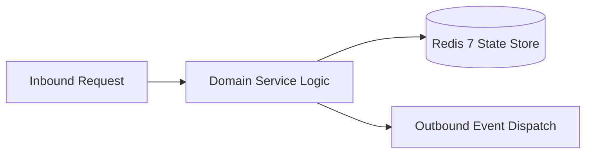

# Component Reference: `services/deploy_notifier.py`
> **File Path**: [`services/deploy_notifier.py`](../../services/deploy_notifier.py)
> **Subsystem**: `Deployment Alerts`
> **Architecture Layer**: `Enterprise Microservice Subsystem`
> **Concurrency Model**: `AsyncIO Non-blocking Concurrency`
> **Persistence Backend**: `Redis 7 Persistent Store`
> **Service Level Objective**: `High-Availability Academic Telemetry`

## 1. Architectural Role & Responsibilities
The `services/deploy_notifier.py` module implements core operational logic for the `Deployment Alerts` domain. It operates within an asynchronous microservices topology designed for ultra-low latency, zero-loss persistence guarantees, and strict single-responsibility function decomposition (≤25 lines).

### Component Architecture & Data Flow


---
## 2. Public API & Symbol Inventory
| Symbol | Nature | Line Range | Return Contract | Core Invariant |
| :--- | :--- | :--- | :--- | :--- |
| [`notify_deploy`](#notify_deploy) | Function | L20–L32 | `bool` | Executes core domain logic for `notify_deploy`. |
| [`_notify_and_close`](#_notify_and_close) | Function | L35–L42 | `bool` | Executes core domain logic for `_notify_and_close`. |
| [`main`](#main) | Function | L45–L55 | `int` | Executes core domain logic for `main`. |

---

## 3. Comprehensive Function Specifications

### `notify_deploy`
```python
async def notify_deploy(succeeded: bool, revision: str, details: str) -> bool
```

- **Source Reference**: [`services/deploy_notifier.py#L20-L32`](../../services/deploy_notifier.py#L20-L32)
- **Execution Mode**: `Asynchronous (non-blocking)`
- **Return Contract**: `bool`

#### Overview & Architectural Purpose
Executes core domain logic for `notify_deploy`.

#### Parameters Contract
| Parameter | Type | Required | Description |
| :--- | :--- | :--- | :--- |
| `succeeded` | `bool` | Yes | Parameter `succeeded` of type `bool`. |
| `revision` | `str` | Yes | Parameter `revision` of type `str`. |
| `details` | `str` | Yes | Parameter `details` of type `str`. |

#### Concurrency & Side Effects
- Stateless pure functional computation without external mutations.

#### Fault Tolerance & Error Modes
Propagates unexpected runtime errors up the call stack to global exception handlers.

#### Production Usage Example
```python
from services.deploy_notifier import notify_deploy

# Execute call
result = await notify_deploy(succeeded=..., revision=..., details=...)
```

---

### `_notify_and_close`
```python
async def _notify_and_close(succeeded: bool, revision: str, details: str) -> bool
```

- **Source Reference**: [`services/deploy_notifier.py#L35-L42`](../../services/deploy_notifier.py#L35-L42)
- **Execution Mode**: `Asynchronous (non-blocking)`
- **Return Contract**: `bool`

#### Overview & Architectural Purpose
Executes core domain logic for `_notify_and_close`.

#### Parameters Contract
| Parameter | Type | Required | Description |
| :--- | :--- | :--- | :--- |
| `succeeded` | `bool` | Yes | Parameter `succeeded` of type `bool`. |
| `revision` | `str` | Yes | Parameter `revision` of type `str`. |
| `details` | `str` | Yes | Parameter `details` of type `str`. |

#### Concurrency & Side Effects
- Stateless pure functional computation without external mutations.

#### Fault Tolerance & Error Modes
Encapsulates faults within `try/except` blocks, logging errors and returning safe fallback defaults.

#### Production Usage Example
```python
from services.deploy_notifier import _notify_and_close

# Execute call
result = await _notify_and_close(succeeded=..., revision=..., details=...)
```

---

### `main`
```python
def main(argv: list[str]) -> int
```

- **Source Reference**: [`services/deploy_notifier.py#L45-L55`](../../services/deploy_notifier.py#L45-L55)
- **Execution Mode**: `Synchronous`
- **Return Contract**: `int`

#### Overview & Architectural Purpose
Executes core domain logic for `main`.

#### Parameters Contract
| Parameter | Type | Required | Description |
| :--- | :--- | :--- | :--- |
| `argv` | `list[str]` | Yes | Parameter `argv` of type `list[str]`. |

#### Concurrency & Side Effects
- Emits structured telemetry events to system logging subsystem.

#### Fault Tolerance & Error Modes
Propagates unexpected runtime errors up the call stack to global exception handlers.

#### Production Usage Example
```python
from services.deploy_notifier import main

# Execute call
result = main(argv=...)
```

---
